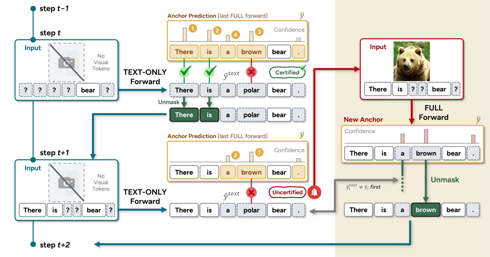
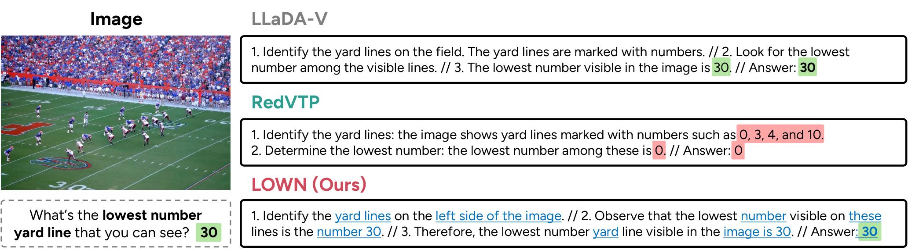

> **원문**: [arXiv](https://arxiv.org/abs/2610.36671) · [HuggingFace](https://huggingface.co/papers/2610.36671) (👍 98) · [GitHub](https://github.com/hyeon9698/LOWN)
{: .prompt-info }

## 들어가며

어제 HuggingFace Daily Papers에서 98 upvote를 받은 KAIST의 논문입니다. Diffusion vision-language model(DVLM)은 autoregressive 모델과 달리 bidirectional attention을 쓰기 때문에 KV 캐시를 그대로 쓸 수 없고, 그 결과 매 디코딩 스텝마다 이미지·프롬프트·현재까지의 응답 전체를 처음부터 다시 처리합니다. 문제는 이 입력에서 이미지 토큰이 차지하는 비중이 LLaDA-V 기준 89~97%라는 점인데, 바꿔 말하면 모델이 스텝마다 쓰는 연산의 대부분이 "조금 전에 이미 봤던 같은 그림"을 또 보는 데 들어간다는 뜻입니다.

이 논문이 던지는 질문은 단순합니다. "정말 매 스텝마다 그림을 봐야 하나?" 저자들은 이걸 직접 측정으로 확인합니다 — 이미지가 있을 때와 없을 때의 예측을 같은 디코딩 경로에서 나란히 비교해보니, 둘의 top-1 예측이 83.4%나 일치했다는 겁니다. 그리고 이 관찰을 그대로 디코딩 규칙으로 바꾼 게 LOWN입니다. 별도 학습도, 튜닝할 임계값도 없이 평균 FLOPs를 0.35배로 줄이면서 점수는 99.6%를 유지한다는 결과가 흥미로워 오늘 리뷰로 골랐습니다.

## 한눈에 보기

- **핵심 기여**: ① LLaDA-V의 디코딩 경로에서 이미지가 있는 FULL forward와 없는 TEXT-ONLY forward의 예측을 스텝마다 비교해, "이미지가 실제로 예측을 바꾸는 비율"이 평균 22.8%(7.9~43.8%)에 불과함을 정량적으로 확인. ② 이 관찰을 바탕으로, 직전 FULL forward의 예측(anchor)을 TEXT-ONLY forward로 검증해 일치하면 재사용하고 불일치하면 FULL forward를 다시 돌리는 학습·임계값 없는 디코딩 기법 LOWN 제안. ③ LLaDA-V·LaViDa·VidLaDA 세 backbone, 열 개 벤치마크에서 검증하고 visual token pruning·KV 캐싱과의 직교적 결합까지 확인.
- **성능**: LLaDA-V 기준 10개 벤치마크 평균 베이스라인 점수의 99.6%를 0.353배 FLOPs로 달성, 동일 FLOPs 예산의 경쟁 기법(RedVTP, ZOO-Prune, KLASS) 대비 10개 중 8개 벤치마크에서 최고 점수. RedVTP 50% retention과 결합 시 0.223배 FLOPs에서 10개 전부 최고 점수.
- **한 줄 요약**: Diffusion VLM이 디코딩 스텝 대부분에서 "이미지 없이도 같은 답이 나온다"는 사실을 직접 측정으로 확인하고, 그 사실을 학습이나 임계값 튜닝 없이 바로 디코딩 규칙으로 바꿔낸 논문입니다.

## 어떤 문제를 풀려고 했나

LLaDA-V 같은 DVLM은 완전히 마스킹된 응답에서 시작해 $T$번의 디노이징 스텝 동안, 매 스텝 이미지 토큰 $v$·프롬프트 $c$·현재 응답 $x_t$ 전체에 대해 forward pass를 돌리고 가장 확신도 높은 $k$개 위치를 언마스킹합니다. 이 forward를 논문은 **FULL forward**라고 부르는데, 매 스텝 전체 시퀀스를 처음부터 다시 계산해야 하는 이유는 bidirectional attention 때문에 autoregressive 모델처럼 이전 스텝의 KV를 그대로 재사용할 수 없어서입니다.

기존 가속 방법들은 이 비용을 세 갈래로 줄여왔습니다. visual token pruning(RedVTP, ZOO-Prune)은 이미지 토큰 수 자체를 줄이고, 캐싱 기법(Fast-dLLM 등)은 중간 상태를 재사용하고, 적응형 스케줄(KLASS 등)은 스텝당 더 많은 토큰을 언마스킹해 스텝 수를 줄입니다. 그런데 이 셋 모두 "이 스텝에 이미지가 필요한가"라는 질문 자체는 던지지 않습니다. pruning은 토큰을 줄여도 남은 토큰은 매 스텝 처리하고, 캐싱도 이미지가 결과에 영향을 주는지와 무관하게 동작합니다. 저자들은 바로 이 지점 — "이미지를 아예 안 보는 스텝이 있을 수 있다"는 가능성 — 을 파고듭니다.

## 핵심 아이디어

### 1. FULL forward 정의와 측정 프로토콜

먼저 비교의 기준이 되는 FULL forward를 정리하면 이렇습니다.

$$
\hat y^{\text{full}}_{t,i} = \arg\max_w\, p_\theta(y^i = w \mid v, c, x_t), \qquad \hat s^{\text{full}}_{t,i} = \max_w\, p_\theta(y^i = w \mid v, c, x_t)
$$

$\hat y^{\text{full}}_{t,i}$는 스텝 $t$, 마스킹된 위치 $i$에서 이미지·프롬프트·현재 응답을 모두 조건으로 넣었을 때의 top-1 예측 토큰이고, $\hat s^{\text{full}}_{t,i}$는 그 확신도(softmax 확률)입니다.

저자들은 이 FULL forward와 나란히, 이미지 토큰만 빼고 position ID는 그대로 유지한 **TEXT-ONLY forward**를 똑같은 디코딩 경로를 따라가며 추가로 돌립니다. 중요한 건 TEXT-ONLY의 출력은 실제 디코딩 결정에 전혀 관여하지 않고 오직 기록만 된다는 점입니다 — 즉 측정 자체가 베이스라인의 디코딩 궤적을 전혀 건드리지 않습니다. 이렇게 측정해보니, 언마스킹된 위치의 83.4%에서 두 forward의 top-1 예측이 같았고, 최종 토큰의 85.0%는 언마스킹되기 전에 이미 top-1 예측으로 떠 있었다고 합니다. 다만 이 비율은 벤치마크마다 크게 갈립니다 — MMBench는 7.9%만 이미지에 의존하는 반면 DocVQA는 43.8%에 달합니다. 그래서 "몇 스텝마다 한 번씩 이미지를 본다"는 식의 고정 스케줄로는 이 편차를 담아내기 어렵다는 게 다음 설계의 출발점입니다.

### 2. Certificate — anchor를 TEXT-ONLY로 검증하기

LOWN의 핵심 메커니즘은 "anchor"와 "certificate"라는 두 개념으로 요약됩니다. FULL forward를 한 번 돌릴 때마다 그 예측 $\bar y$와 확신도 $\bar s$를 저장해두는데 이게 anchor입니다. 이후 스텝에서는 TEXT-ONLY forward만 돌려서 그 예측이 anchor와 일치하는지 봅니다. 일치하면 그 위치는 "인증(certified)"된 것으로 간주해 anchor의 예측을 그대로 씁니다. 불일치가 나오는 순간 그 지점에서 인증 사슬이 끊기고, 확신도 순으로 정렬된 인증된 접두사(prefix) $\mathcal{U}^{\text{text}}$만 채택됩니다.

흥미로운 점은 왜 이 "일치 여부"가 그럴듯한 신호가 되는지입니다. TEXT-ONLY와 anchor(FULL)는 두 가지가 동시에 다릅니다 — 하나는 이미지를 보는지 여부, 다른 하나는 어느 시점의 응답 상태를 조건으로 계산됐는지입니다. 둘이 일치한다는 건 "이 토큰에는 이미지가 굳이 필요 없었다"는 것과 "상태가 바뀐 뒤에도 anchor가 여전히 유효하다"는 것, 이 두 조건을 동시에 간접적으로 확인해주는 셈입니다. 별도의 확신도 임계값 없이 "일치냐 아니냐"라는 이진 신호만으로 이 두 가지를 같이 검증한다는 점이 이 방법의 영리한 지점이라고 생각합니다.

다음은 이 전체 흐름을 보여주는 그림입니다.

_Figure 3. 왼쪽 열은 TEXT-ONLY forward만으로 진행되는 스텝들이고, 오른쪽은 인증이 실패해 FULL forward가 다시 돌아가는 순간입니다._

그림을 따라가 보면, step $t$에서는 anchor("There", "is", "a", "brown", "bear", ".")를 TEXT-ONLY 예측과 비교해 "There"와 "is"는 일치(초록 체크)하지만 "brown" 자리에서 "polar"가 나와 불일치(빨간 X)가 발생합니다. 이 지점에서 인증된 접두사가 끊기므로 "There", "is"까지만 언마스킹되고, 그 다음 step t+1에서는 남은 anchor("a", "brown")를 다시 검증하다가 또 "brown" 대 "polar" 불일치가 나며 종이 울립니다(빨간 종 아이콘). 이때 비로소 오른쪽 빨간 패널의 FULL forward가 실제 이미지를 보고 새 anchor를 계산하는데, 여기서 "brown"이 맞다는 게 확인되고, TEXT-ONLY 예측과 갈렸던 위치("brown")가 우선적으로 언마스킹됩니다. 즉 이미지는 "polar"처럼 텍스트만으로는 틀리게 추측했을 위치를 바로잡는 데만 호출되고, 이미 텍스트만으로 맞힐 수 있는 "There", "is" 같은 토큰에는 아예 쓰이지 않습니다.

### 3. 스텝 단위 결정 규칙

이 certificate가 스텝마다 두 가지를 동시에 결정합니다 — 이미지를 볼지 말지, 그리고 몇 개를 언마스킹할지입니다. 베이스라인이 스텝당 언마스킹하는 토큰 수를 $k$라 할 때, 상태 갱신 규칙은 이렇습니다.

$$
x_i \leftarrow \begin{cases}
\bar y_i, & i \in \mathcal{U}^{\text{text}},\quad |\mathcal{U}^{\text{text}}| \ge k \\
\hat y^{\text{full}}_{t,i}, & i \in \mathcal{U}^{\text{full}},\quad |\mathcal{U}^{\text{text}}| < k
\end{cases}
$$

$\mathcal{U}^{\text{text}}$는 TEXT-ONLY 검증을 통과한 인증된 접두사, $\mathcal{U}^{\text{full}}$은 인증이 모자랄 때 FULL forward가 새로 계산한 $k$개 위치입니다. 인증된 접두사가 $k$개 이상이면 그 스텝은 FULL forward를 아예 건너뛰고 인증된 토큰 전부(보통 $k$개보다 많음)를 한 번에 언마스킹합니다. 반대로 인증된 접두사가 $k$개에 못 미치면 FULL forward를 돌려 anchor를 새로 갱신하고, 이때는 TEXT-ONLY와 의견이 갈렸던 위치부터 우선 언마스킹합니다.

이 규칙의 의미를 풀어보면, 텍스트만으로 충분한 구간에서는 한 스텝에 베이스라인보다 더 많은 토큰을 한꺼번에 밀어붙여서 스텝 수 자체를 줄이고, 이미지가 필요한 구간에서는 베이스라인과 동일하게 $k$개씩 신중하게 진행합니다. 두 경우 모두 한 스텝에 최소 $k$개는 언마스킹되므로, LOWN은 베이스라인의 $T$ 스텝보다 더 걸리는 일이 없고 오히려 TEXT-ONLY 쪽에서 스텝 수 자체가 줄어들 수 있습니다.

### 4. 비용 분석 — 왜 TEXT-ONLY가 훨씬 싼가

이 방법이 실제로 얼마나 이득인지는 아래 비용 모델로 설명됩니다. FULL forward와 TEXT-ONLY forward의 입력 길이를 각각 $N_F = \lvert v\rvert + \lvert c\rvert + \lvert x_t\rvert$, $N_T = \lvert c\rvert + \lvert x_t\rvert$라 하면,

$$
R = \frac{F_{\text{LOWN}}}{F_{\text{base}}} = \frac{n_F}{T} + \frac{n_T}{T}\cdot\frac{\mathcal{C}(N_T)}{\mathcal{C}(N_F)} = f + \sigma\rho
$$

$f = n_F/T$는 전체 스텝 중 FULL forward가 호출된 비율, $\sigma = n_T/T$는 베이스라인 대비 실제로 돈 스텝 수의 비율, $\rho = \mathcal{C}(N_T)/\mathcal{C}(N_F)$는 TEXT-ONLY forward 한 번이 FULL forward 한 번 대비 얼마나 싼지를 나타내는 비율입니다.

이 식에서 눈여겨볼 부분은 $\rho$가 단순히 "토큰 수 비율"보다 훨씬 작게 나온다는 점입니다. 그 이유는 forward 비용 자체가 이렇게 생겼기 때문입니다.

$$
\mathcal{C}_{\text{layer}}(n) = \underbrace{8nd^2 + 4n^2 d}_{\text{attention}} + \underbrace{6ndm}_{\text{FFN}}, \qquad \mathcal{C}(n) = L\cdot\mathcal{C}_{\text{layer}}(n) + 2nd|\mathcal{V}|
$$

$n$은 시퀀스 길이, $d$는 hidden 차원, $m$은 FFN 폭, $L$은 레이어 수, $\lvert\mathcal{V}\rvert$는 vocab 크기입니다. 여기서 $4n^2 d$ 항이 시퀀스 길이의 제곱에 비례하는 attention 비용인데, 이미지 토큰을 빼면 $n$이 9~33배 줄어들고 이 제곱항은 그 제곱만큼, 즉 수십~수백 배 더 줄어듭니다. 그 결과 LLaDA-V 기준 TEXT-ONLY forward는 FULL forward의 3~10%밖에 안 드는 겁니다. 결국 LOWN의 이득은 "FULL forward 호출 빈도 $f$를 낮춘다"는 것과 "애초에 TEXT-ONLY 자체가 거의 공짜에 가깝다"는 두 요인이 곱해져서 나옵니다.

## 실험 결과

다음은 LLaDA-V에서 LOWN의 FLOPs 예산에 맞춘 성능 비교표입니다. 각 셀은 점수이고, 괄호 안은 베이스라인 대비 상대 FLOPs입니다(가장 낮은 FLOPs는 굵게, 최고 점수는 **굵게**, 2위는 _이탤릭_).

| Method | MathVista | ScienceQA | ChartQA | MME | MMBench | DocVQA | CapArena | LLaVA-Bench | GQA | DeCapBench | Avg. |
|---|---|---|---|---|---|---|---|---|---|---|---|
| LLaDA-V (Vanilla) | 59.10 | 76.50 | 78.16 | 1719.49 | 70.88 | 83.91 | −88.67 | 58.20 | 53.31 | 33.18 | 100.0% |
| RedVTP | 51.70 (×0.354) | 70.70 (×0.286) | 74.32 (×0.641) | 1469.78 (×0.256) | 56.70 (×0.280) | **83.39** (×0.520) | _−91.00_ (×0.411) | _56.90_ (×0.505) | _50.97_ (×0.260) | _33.03_ (×0.411) | 93.0% |
| ZOO-Prune | 53.70 (×0.403) | 73.87 (×0.348) | _76.44_ (×0.641) | 1582.41 (×0.299) | 67.27 (×0.317) | 78.73 (×0.483) | −93.17 (×0.417) | 54.30 (×0.490) | 50.16 (×0.238) | 31.02 (×0.411) | _94.2%_ |
| KLASS | **56.70** (×0.346) | _75.01_ (×0.318) | 73.64 (×0.669) | _1641.99_ (×0.316) | _68.81_ (×0.331) | 75.36 (×0.487) | −96.83 (×0.476) | 42.50 (×0.536) | 49.52 (×0.249) | 30.18 (×0.500) | 91.9% |
| **LOWN (Ours)** | _56.00_ (**×0.325**) | **78.83** (**×0.243**) | **78.36** (**×0.576**) | **1655.08** (**×0.231**) | **69.93** (**×0.270**) | _82.31_ (**×0.452**) | **−85.67** (**×0.388**) | **57.40** (**×0.454**) | **53.24** (**×0.205**) | **34.43** (**×0.391**) | **99.6%** |

이 표에서 읽히는 패턴은 "LOWN이 몇 점을 땄다"가 아니라 "경쟁 기법들이 FLOPs를 비슷하게 받았을 때 어디서 흔들리는가"입니다. RedVTP와 ZOO-Prune은 CapArena·LLaVA-Bench·DeCapBench 같은 open-ended captioning에서 점수 하락이 특히 두드러지는데, 이건 pruning이 버린 시각 정보가 짧은 답변에는 큰 타격이 없어도 길게 설명해야 하는 캡션에서는 디테일 누락으로 바로 드러나기 때문으로 보입니다. KLASS는 MathVista에서 LOWN보다 높은 점수(56.70 vs 56.00)를 내지만 MME·DeCapBench 등 나머지 대부분에서는 LOWN에 못 미치는데, 이는 KLASS가 벤치마크별로 confidence·KL 임계값을 따로 튜닝해야 하는 방법임을 감안하면 의미가 큽니다 — LOWN은 그런 튜닝 없이 같은 규칙 하나로 더 고른 성능을 냅니다. 또한 눈에 띄는 건 LOWN이 ScienceQA(78.83)·ChartQA(78.36)·MMBench(69.93)·GQA(53.24)에서 베이스라인(76.50/78.16/70.88/53.31)과 거의 같거나 오히려 높은 점수를 낸다는 점인데, FULL 스텝에서 "텍스트와 이미지 예측이 갈린 위치부터 먼저 언마스킹"하는 순서 자체가 일부 과제에서는 베이스라인의 기본 확신도 순서보다 더 나은 디코딩 궤적을 만든다는 뜻으로 읽힙니다.

composition 실험도 인상적입니다. RedVTP(50% retention)와 결합하면 0.223배 FLOPs에서 10개 벤치마크 전부 최고 점수를 내고, Fast-dLLM(KV 캐싱)과 결합하면 MathVista·LLaVA-Bench·DeCapBench에서 생성 시간을 38.1~50.1% 추가로 줄여 베이스라인 대비 5.6~7.0배 빠른 디코딩을 달성합니다. pruning은 "FULL forward 한 번의 비용"을 줄이고 LOWN은 "FULL forward를 부르는 횟수"를 줄이는 서로 다른 축이라, 둘을 같이 쓰면 비교적 덜 공격적인 pruning 설정으로도 더 공격적인 단독 pruning보다 품질과 속도를 동시에 이길 수 있다는 게 저자들의 설명인데, 실제로 MathVista에서 RedVTP 50%+LOWN(54.9점, ×0.195)이 RedVTP 30% 단독(51.7점, ×0.354)보다 점수도 높고 FLOPs도 낮다는 구체적 사례로 뒷받침됩니다.

ablation에서 하나 더 짚을 부분은 visual routing(FULL forward 호출 여부 결정)과 adaptive acceptance(한 번에 더 많이 언마스킹하는 것)를 분리했을 때, FLOPs 절감의 대부분(27~68%)이 visual routing만으로 나오고 adaptive acceptance는 거기서 추가로 21~43%를 더 줄인다는 결과입니다. 즉 "이미지를 언제 볼지 결정하는 것" 자체가 이 방법의 핵심 엔진이고, 언마스킹 개수를 늘리는 건 보너스에 가깝습니다.

## 아쉬운 점 / 의문점

몇 가지 짚고 넘어갈 지점이 있습니다.

첫째, 저자들도 인정하듯 LOWN은 차트나 문서처럼 이미지 의존도가 구조적으로 높은 과제에서는 이득이 작습니다. 부록의 DocVQA 사례 하나는 15스텝 중 14스텝에서 FULL forward가 필요해 0.90배 FLOPs까지 올라가는데, 벤치마크 전체 평균이 0.45배인 걸 생각하면 입력에 따라 비용 편차가 꽤 크다는 뜻입니다. 이는 LOWN의 근본적 한계이기도 한데, 비용이 디코딩이 끝나기 전까지는 확정되지 않는다는 점입니다 — 고정 예산이 필요한 서빙 환경에서는 이 불확실성이 걸림돌이 될 수 있어 보입니다. 논문은 pruning과의 결합이 이 문제를 "부분적으로" 완화한다고 쓰는데, 그 완화 폭이 구체적으로 얼마나 되는지는 명시되어 있지 않습니다.

둘째, anchor는 나이가 들수록(즉 여러 스텝 전 FULL forward 결과를 계속 재사용할수록) 신뢰도가 떨어집니다. 부록에 따르면 한 스텝 묵은 anchor는 4.1~11.0%가 fresh FULL 예측과 어긋나고, 여덟 스텝 묵으면 DocVQA에서는 25.3%까지 치솟습니다. 다행히 실제 LOWN 실행에서는 92~97%의 토큰이 한 스텝 전 anchor만 쓴다고는 하지만, 이건 "운이 좋아서"가 아니라 anchor가 불일치할 때마다 바로 갱신되도록 설계했기 때문이라 설계상 자연스러운 결과이긴 합니다. 다만 이 메커니즘이 benign한 건 현재 측정한 열 개 벤치마크·세 backbone 범위 안에서 확인된 것이라, 응답이 훨씬 길거나 이미지 의존이 뒤늦게 발생하는 과제에서도 같은 패턴이 유지될지는 좀 더 지켜봐야 할 것 같습니다.

셋째, 비교 경쟁 기법(RedVTP, ZOO-Prune, KLASS)은 이산적인 하이퍼파라미터 그리드에서 "LOWN의 FLOPs 이상인 가장 싼 설정"을 고르는 방식으로 선택됩니다. 저자들이 투명하게 명시한 방법론이고 LOWN에 불리하게 작용할 여지는 없어 보이지만, 그리드가 10% 단위라 경쟁 기법이 실제보다 더 비싼 지점에서 평가됐을 가능성은 남아 있습니다. 개인적으로는 더 촘촘한 그리드에서도 경향이 유지되는지 궁금한 부분입니다.

넷째, 비교 기준이 전부 greedy decoding에 고정되어 있습니다. temperature를 올린 샘플링 환경에서도 "텍스트만으로 top-1이 일치한다"는 전제가 그대로 유지될지는 논문에 언급이 없습니다. 확신도가 낮은 상황에서 top-1 일치만 보는 certificate가 과도하게 자신만만해질 가능성도 배제하기 어려워 보입니다.

## 마치며

이 논문에서 가장 좋았던 부분은 사실 방법론보다 2절의 측정 그 자체입니다. "이미지가 얼마나 자주 필요한가"라는, 대답하기 전에는 누구나 당연히 "거의 항상"이라고 답했을 법한 질문을, FULL과 TEXT-ONLY를 나란히 돌려 직접 재는 식으로 반박한 접근이 신선했습니다. 그리고 그 측정 결과를 과도하게 복잡한 장치 없이 — 학습도, 튜닝할 임계값도 없이 — 거의 그대로 디코딩 규칙으로 옮겼다는 점에서 전형적으로 "관찰이 좋으면 방법은 단순해도 된다"는 걸 보여주는 사례라고 느꼈습니다. 다음은 두 방법을 나란히 비교한 정성적 예시입니다.

_Figure 6. 풋볼 경기장 사진에서 "보이는 가장 낮은 야드 라인 숫자"를 묻는 질문. LOWN의 답변에서 파란 밑줄은 FULL forward로 언마스킹된 토큰, 나머지는 TEXT-ONLY forward로 언마스킹된 토큰입니다._

RedVTP는 이미지 토큰을 솎아내는 과정에서 정답인 "30"이 적힌 야드 라인 영역의 토큰이 잘려나가, 그럴듯하게 추론은 하지만 "0"이라는 틀린 답을 냅니다. 반면 LOWN의 답변을 보면 "yard lines", "left side of the image", "30"처럼 시각적으로 확인이 필요한 핵심 단어들에만 파란 밑줄(FULL forward)이 붙어 있고, 나머지 연결어들은 TEXT-ONLY forward로 채워졌습니다. 이미지를 완전히 보존한 채 "언제 그 이미지를 참조할지"만 골라낸다는 LOWN의 설계 철학이 이 한 장의 예시에 압축되어 있다고 생각합니다. 개인적으로는 이 "이미지를 볼지 말지를 토큰 단위로 라우팅한다"는 아이디어가 diffusion VLM을 넘어 멀티모달 입력을 다루는 다른 아키텍처에도 적용될 수 있을지, 특히 오디오나 비디오처럼 더 비싼 모달리티를 다루는 모델에서 어떤 식으로 변형될지 궁금해집니다.
