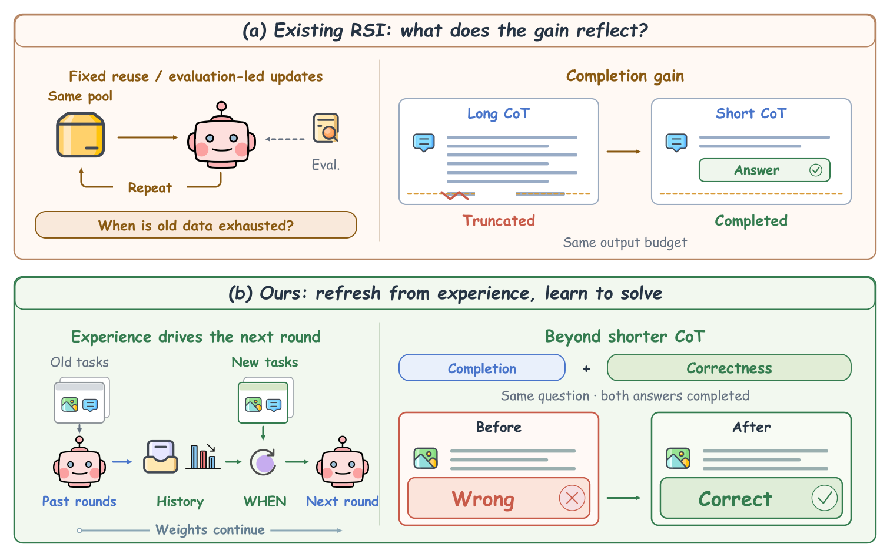
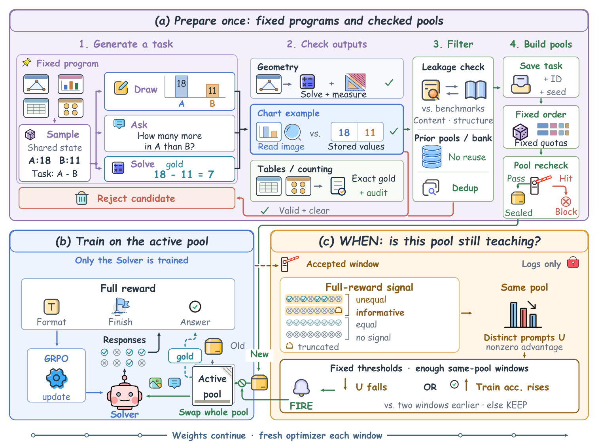
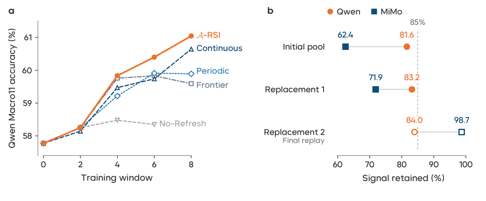
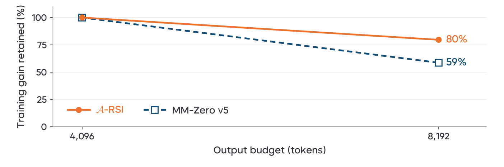

> **원문**: [arXiv](https://arxiv.org/abs/2610.38568) · [HuggingFace](https://huggingface.co/papers/2610.38568) (👍 65)
{: .prompt-info }

## 들어가며

HuggingFace Daily Papers에서 65 upvote를 받은 논문입니다. Recursive self-improvement(RSI), 그러니까 "모델이 자기 자신을 위한 학습 데이터를 만들고 그걸로 또 스스로를 개선하는" 루프는 최근 Absolute Zero, R-Zero, MM-Zero처럼 외부 데이터 없이 돌아가는 방향으로 계속 확장되고 있습니다. 그런데 이 논문이 짚는 지점이 좀 신선합니다. 다들 "다음에 어떤 문제를 만들어야 더 배울 게 많을까"에 집중해왔는데, 정작 "지금 쓰고 있는 문제 풀이 더 이상 배울 게 없어졌다는 걸 어떻게 알아채나"는 거의 다뤄지지 않았다는 겁니다.

더 흥미로웠던 건 라벨 신뢰성 문제를 다루는 방식이었습니다. R-Zero나 MM-Zero류 방법은 보통 모델 자신의 self-consistency나 다수결 투표로 정답을 정하는데, 이러면 모델이 자주 틀리는 유형의 문제에서는 틀린 답이 그대로 다음 학습의 정답 라벨이 되어버립니다. A-RSI는 이 두 문제(언제 바꿀지 / 정답이 맞는지)를 아예 분리해서 풉니다 — 언제 바꿀지는 학습 로그로, 정답이 맞는지는 프로그램이 직접 계산해서. 그리고 자기 reward 설계에 대해 상당히 가차없는 감사(audit)까지 수행하는데, 심지어 비교 대상인 다른 논문(MM-Zero)의 벤치마크 점수를 재현해서 "그 점수 상승분 중 상당수는 추론 능력이 아니라 그냥 답을 더 잘 끝맺는 효과 아니냐"고 되묻는 부분이 특히 눈길을 끌어 오늘 리뷰로 골랐습니다.

## 한눈에 보기

- **핵심 기여**: ① 그룹 내 응답들의 보상 편차(GRPO advantage)가 줄어드는 정도를 학습 로그에서 직접 읽어 풀 교체 시점을 정하는 규칙 제안 — 검증셋이나 테스트 점수를 전혀 참고하지 않음. ② 모델이 스스로 작성한 프로그램이 이미지·질문·정답을 같은 설정(configuration)에서 함께 만들어내는 파이프라인으로, 외부 학습 데이터나 사람이 쓴 정답 라벨 없이 학습 루프를 완전히 돌림. ③ 난이도 기반·경쟁력 기반 등 여러 "다음 문제 선택" 전략과 매칭된 학습량에서 비교하고, 점수 상승이 "응답이 짧아져서 끝까지 완결된 효과"인지 "실제로 답이 고쳐진 효과"인지 분리해서 보고.
- **성능**: Qwen3-VL-8B-Instruct 기준 11개 벤치마크 평균(Macro11)이 공통 시작점 57.77에서 8번의 추가 학습 윈도우, 800개의 새 태스크만으로 61.05로 상승. MiMo-VL-7B-SFT는 59.08에서 60.71로 상승. 같은 조건에서 "매 윈도우마다 무조건 새 풀로 교체"하는 방식은 3,200개를 써야 60.64에 그침.
- **한 줄 요약**: "다음에 뭘 배울지"가 아니라 "언제 배움이 멈췄는지"를 학습 로그만으로 판단하고, 정답은 모델의 투표가 아니라 프로그램이 계산하게 만들어서 외부 데이터 없는 자기개선 루프의 두 가지 신뢰성 구멍(타이밍, 라벨)을 동시에 틀어막으려 한 논문입니다.

## 어떤 문제를 풀려고 했나

Recursive self-improvement 루프를 계속 돌리려면 크게 두 가지를 결정해야 합니다. 하나는 "다음에 어떤 문제를 줄 것인가"이고, 다른 하나는 "지금 풀고 있는 문제 묶음을 언제 새것으로 바꿀 것인가"입니다. 기존 연구 대부분은 전자에 집중했습니다. Absolute Zero는 코드 실행으로 정답을 검증하고, R-Zero는 Challenger 모델이 Solver의 현재 실력에 맞춰 문제를 co-evolve시키고, MM-Zero는 난이도 보상으로 문제를 조정합니다. 전부 "어떤 문제가 다음에 적당한가"를 풀고 있을 뿐, "지금 풀이 이미 소진됐다"는 신호를 어떻게 포착할지는 다루지 않습니다.

더 근본적인 문제는 라벨입니다. self-consistency나 다수결 투표로 정답을 정하면, 모델이 체계적으로 틀리는 문제 유형에서는 그 틀린 답이 고스란히 다음 라운드의 학습 타깃이 됩니다. 저자들은 아래 표로 기존 방법들의 위치를 정리합니다.

| Method | Task source | Supervision | Data updated | Selection rule |
|---|---|---|---|---|
| Absolute Zero | Model-proposed code | Code execution | Continuously | Learnability reward |
| R-Zero | Challenger model | Model labels | Co-evolving | Near solver ability |
| MM-Zero | Multi-role model | Majority vote | Continuously | Difficulty reward |
| Vision-Zero | Image-pair games | Game rewards | Alternating | Self-play ↔ RLVR |
| ThinkLite-VL | 11k public tasks | Dataset labels | One-time | MCTS / pass rate |
| Online Diff. Filtering | Fixed prompt set | Dataset labels | Every batch | Mid-range difficulty |
| SEC / DUMP | Fixed distributions | Dataset labels | Every step | Bandit on advantage |
| **A-RSI (ours)** | Model-written templates | Program-computed | **Log-triggered** | Random, fixed shares |

표를 보면 패턴이 하나 드러납니다. 대부분의 방법이 "매 스텝 혹은 매 배치마다 조금씩" 데이터를 바꾸거나(Continuously, Every step/batch), 아니면 아예 한 번만 선별하고 끝납니다(One-time). A-RSI만 "Log-triggered" — 즉 데이터를 언제 바꿀지를 모델이 아니라 학습 로그가 결정합니다. 그리고 Supervision 칸도 유일하게 "Program-computed"인데, 나머지는 전부 모델 자신의 판단(Model labels, Majority vote, Game rewards)에 기대고 있습니다. 개인적으로는 이 표 하나가 논문의 포지셔닝을 거의 다 설명해준다고 느꼈습니다 — 화려한 선택 전략보다는 "언제, 그리고 무엇을 믿고" 쪽을 단순하게 가져간 설계입니다.

## 핵심 아이디어

다음은 A-RSI가 이 문제를 어떻게 푸는지 동기와 함께 보여주는 그림입니다.

_Figure 1. (a) 기존 RSI는 같은 풀을 반복하거나 평가 점수로만 업데이트를 판단하는데, (b) A-RSI는 학습 로그로 교체 시점을 정하고, 응답이 "짧아져서 맞았는지" "실제로 고쳐져서 맞았는지"를 구분해서 본다._

왼쪽 위(a)가 문제의식입니다. 같은 풀을 계속 재사용하면 학습이 정체될 수 있는데, 그렇다고 평가 점수로만 판단하자니 "긴 CoT가 토큰 제한에 걸려 잘리던 응답"이 그냥 "짧고 완결된 응답"으로 바뀌기만 해도 점수가 오를 수 있다는 함정이 있습니다. 즉 점수가 올랐다고 해서 그게 꼭 "더 잘 추론해서"는 아닐 수 있다는 겁니다. 오른쪽 아래(b)가 A-RSI의 답인데, 과거 경험(학습 로그)이 다음 라운드의 시작 시점을 정하고, 이후 "완결됨 + 정답임"을 따로 떼어서 봅니다. 이 그림에서 가장 눈여겨볼 부분은 우측 하단의 "Beyond shorter CoT" 블록입니다 — 같은 질문, 둘 다 완결된 응답인데 Before는 틀리고 After는 맞다는 걸 보여주는데, 이건 뒤에 나오는 실제 케이스 스터디(섹션 6)에서 다시 확인할 수 있습니다.

### 1. 태스크는 프로그램이 통째로 만든다

A-RSI의 출발점은 "질문과 정답을 같은 소스에서 뽑는다"는 계약입니다.

$$z\sim p_\tau,\qquad (I,q,a)=G_\tau(z)$$

$\tau$는 고정된 태스크 템플릿(기하·차트·표·카운팅 등), $p_\tau$는 그 템플릿의 파라미터 분포, $z$는 거기서 뽑은 파라미터, $G_\tau$는 그 파라미터로 이미지 $I$, 질문 $q$, 정답 $a$를 한꺼번에 만들어내는 프로그램입니다.

여기서 중요한 건 이미지, 질문, 정답이 전부 같은 샘플링된 설정 $z$에서 나온다는 점입니다. 예를 들어 차트 템플릿이 막대 두 개의 값 $v_A=18$, $v_B=11$을 뽑으면, 그 값으로 그래프를 그리고, "A가 B보다 얼마나 큰가"라는 질문을 만들고, 정답은 저장된 값에서 $a=18-11=7$로 직접 계산합니다. 모델은 완성된 이미지와 질문만 받고, 정답은 이미 계산되어 있는 값과 비교해 채점됩니다. 모델이 정답을 "투표"로 정하는 게 아니라 프로그램이 정답을 계산하기 때문에, R-Zero나 MM-Zero처럼 모델 자신의 불확실한 예측이 다음 학습의 라벨이 되는 구조를 피해갑니다. 다만 이 신뢰성은 결국 템플릿 프로그램 자체가 맞게 짜였는지에 달려 있는데, 이 부분은 뒤 분석 섹션에서 저자들이 직접 감사합니다.

### 2. Solver는 세 조각짜리 보상으로 GRPO 학습

$$r(y,a)=r_{\mathrm{ans}}(y,a)+\lambda_{\mathrm{fmt}}\,r_{\mathrm{fmt}}(y)+\lambda_{\mathrm{stop}}\,r_{\mathrm{stop}}(y)$$

$r_{\mathrm{ans}}$는 추출한 답이 $a$와 일치하면 1, 아니면 0입니다. $r_{\mathrm{fmt}}$는 박스(boxed) 형식을 지키면 1, $r_{\mathrm{stop}}$은 정상 종료하면 0, 토큰 제한에 걸려 끊기면 $-1$입니다. $\lambda_{\mathrm{fmt}}$, $\lambda_{\mathrm{stop}}$은 학습 내내 고정된 계수입니다.

저자들은 이 식에서 수학적으로 한 가지를 보장합니다. 정답 보상 1을 받은 응답과 0을 받은 응답의 전체 보상 차이는 $R(r_c)-R(r_w)\geq 1-\lambda_{\mathrm{fmt}}-\lambda_{\mathrm{stop}}>0$이어서, 형식이나 종료 보상이 아무리 유리해도 오답이 정답보다 높은 보상을 받을 수는 없습니다. 다만 이건 어디까지나 "정답 vs 오답" 사이의 순서를 지켜준다는 것이지, "오답들끼리" 형식만 맞춰서 보상을 올리는 건 막지 못합니다 — 실제로 저자들은 통제된 reward-scoring 테스트로 이 허점이 실재한다는 걸 확인하는데, 이 내용은 아래 분석 섹션에서 다시 다룹니다.

### 3. 핵심: 풀이 "소진됐다"를 학습 로그로 판단하기

이 논문에서 가장 핵심적인 부분입니다. 한 윈도우(100번의 GRPO 업데이트)가 끝날 때마다 두 가지 신호를 계산합니다.

$$
U_w=\left|\left\{x_g:\ g\in\mathcal{G}_w,\ \max_{1\leq j\leq m}|A_{g,j}|>\varepsilon\right\}\right|,\qquad
a_w=\frac{1}{m|\mathcal{G}_w|}\sum_{g\in\mathcal{G}_w}\sum_{j=1}^{m}c_{g,j}
$$

$\mathcal{G}_w$는 윈도우 $w$에서 기록된 응답 그룹들(하나의 프롬프트에 대해 뽑은 $m$개 응답이 한 그룹), $A_{g,j}$는 그중 $j$번째 응답의 GRPO advantage, $c_{g,j}$는 그 응답의 정답 보상입니다. $U_w$는 "advantage가 0이 아닌(=그룹 안에서 응답들의 보상이 서로 달라 실제로 그래디언트가 나오는) 프롬프트의 개수"이고, $a_w$는 그 윈도우의 평균 정답률입니다.

GRPO는 한 그룹 안의 모든 응답이 똑같은 보상을 받으면 advantage가 0이 되어 그래디언트 신호를 전혀 주지 못합니다. $U_w$가 점점 줄어든다는 건 "이 풀의 문제 대부분이 이제 모델에게 다 맞거나 다 틀리는, 더 배울 게 없는 문제로 수렴했다"는 뜻입니다. DAPO가 배치 단위로 이런 "신호 없는" 프롬프트를 걸러내는 것과 비슷한 통계를, A-RSI는 풀 전체를 교체할지 말지 판단하는 더 상위 레벨의 신호로 씁니다.

이 두 신호로 실제 교체 여부를 결정하는 식은 이렇습니다.

$$
\delta_w=
\begin{cases}
1,& n_w\geq n_{\min}\ \text{and}\ \bigl(U_w\leq\rho U_{w-\ell}\ \text{or}\ a_w-a_{w-\ell}\geq\eta\bigr),\\
0,&\text{otherwise}.
\end{cases}
$$

$n_w$는 현재 풀에서 누적된 accepted window 수, $n_{\min}$은 판단을 내리기 전 최소 관찰 기간, $\ell$은 몇 윈도우 전과 비교할지, $\rho$는 신호 유지율 임계값(실험에서 0.85), $\eta$는 정답률이 이만큼 올라야 교체를 트리거하는 임계값입니다.

여기서 눈여겨볼 부분은 두 조건이 OR로 묶여 있다는 점입니다 — 신호($U_w$)가 충분히 줄었거나, 정답률($a_w$)이 크게 올랐거나, 둘 중 하나만 만족해도 교체됩니다. 그런데 재미있게도 실제 실행 로그를 까보면(5.1절), 실행된 교체 결정은 전부 $U_w$ 하락 쪽에서만 트리거됐고 정답률 조건은 단독으로 발동한 적이 한 번도 없었다고 합니다. 설계는 두 갈래인데 실전에서는 사실상 한쪽만 작동한 셈이죠. 저자들도 이 식이 "풀을 완전히 마스터했다"는 증명이 아니라 어디까지나 운영상의 휴리스틱이라는 점을 분명히 짚습니다 — 응답이 전부 틀려도, 응답 분포가 한쪽으로 쏠려도 그룹 내 분산이 사라질 수 있기 때문입니다.

### 4. 교체는 전체를 한 번에, 모델 가중치는 그대로

교체가 결정되면($\delta_w=1$) 활성 풀 전체를 미사용 태스크로 바꿉니다. 고정된 가족별 쿼터 $\mathbf{k}=(k_{\mathrm{geo}},k_{\mathrm{chart}},k_{\mathrm{table}},k_{\mathrm{count}})$ 아래 무작위로 뽑는데, 이 순서는 미리 정해져 있어서 모델의 정답이나 난이도 추정과는 전혀 무관합니다. 교체는 풀만 바꿀 뿐 모델을 리셋하지 않습니다 — $\theta_w$는 이전 모든 윈도우의 경험을 그대로 들고 다음 윈도우로 넘어가고, 옵티마이저와 스케줄러만 새로 초기화됩니다. 위 Figure 2가 이 전체 파이프라인을 한눈에 보여줍니다.

_Figure 2. (a) 학습 전에 템플릿·후보 저장소·교체용 풀을 전부 미리 준비해두고, (b) Solver만 GRPO로 학습하며, (c) 컨트롤러는 학습 로그만 읽고 현재 풀을 유지할지 다음 풀을 꺼낼지 결정한다._

(a) 블록을 보면 "태스크 생성 → 출력 검증 → 필터링(유출/중복 검사) → 풀 구축"까지 전부 학습이 시작되기 전에 끝나 있다는 게 중요합니다. 즉 학습 중에는 새로운 문제를 "만들어내는" 작업이 전혀 없고, 미리 준비된 풀 중 어느 것을 꺼내 쓸지만 결정됩니다. (c) 블록의 자물쇠 아이콘("Logs only")이 상징하는 부분이 이 논문의 핵심 주장인데, 컨트롤러가 접근할 수 있는 정보가 학습 로그(advantage, 정답률)뿐이고 검증셋이나 평가 점수는 전혀 보지 않는다는 뜻입니다.

## 실험 결과

Qwen3-VL-8B-Instruct의 11개 벤치마크 전체 결과입니다. $S_0$는 공개된 기본 모델이고, 여기에 기존 풀(500개 태스크)로 100스텝을 먼저 학습시켜 다섯 가지 refresh 전략이 공통으로 출발하는 지점을 만듭니다(본문에서 말하는 57.77이 이 지점입니다). 이후 $S_{ij}$는 $i$번째 풀, $j$번째 연속 학습 윈도우를 뜻합니다.

| Benchmark | $n$ | $S_0$ | $S_{11}$ | $S_{12}$ | $S_{13}$ | $S_{21}$ | $S_{22}$ | $S_{23}$ | $S_{31}$ | $S_{32}$ | $S_{33}$ |
|---|---|---|---|---|---|---|---|---|---|---|---|
| MMSI | 1000 | 27.10 | 27.90 | 26.70 | 28.10 | 28.50 | 28.70 | 30.70 | 28.80 | 29.30 | 31.00 |
| MathVerse | 3940 | 62.03 | 62.01 | 62.39 | 62.46 | 63.40 | 64.06 | 63.38 | 63.25 | 63.48 | 63.81 |
| MathVision | 3040 | 45.92 | 47.27 | 47.20 | 47.66 | 48.98 | 50.07 | 50.62 | 51.45 | 51.45 | 52.53 |
| MMMU-Pro (4) | 1592 | 58.42 | 59.23 | 58.79 | 59.74 | 60.24 | 62.63 | 62.06 | 61.31 | 63.19 | 63.00 |
| VisNumBench | 1913 | 49.03 | 52.74 | 53.84 | 54.47 | 55.36 | 54.68 | 55.62 | 54.05 | 55.99 | 56.19 |
| MMMU-Pro (10) | 1592 | 50.75 | 51.19 | 52.64 | 52.32 | 52.70 | 53.45 | 52.32 | 54.27 | 53.96 | 54.52 |
| MMMU-Pro (vision) | 1730 | 50.06 | 49.36 | 50.46 | 50.58 | 51.62 | 51.21 | 51.04 | 51.39 | 53.76 | 52.72 |
| MMMU | 895 | 60.56 | 62.68 | 62.57 | 63.24 | 65.25 | 65.14 | 64.25 | 65.36 | 64.36 | 65.92 |
| ChartQA | 2500 | 81.24 | 82.48 | 82.20 | 81.88 | 84.40 | 83.32 | 84.52 | 84.28 | 84.96 | 85.00 |
| PhyX | 3000 | 63.50 | 66.93 | 67.07 | 68.30 | 70.00 | 70.97 | 72.03 | 71.73 | 74.17 | 73.33 |
| SCEMQA-MC | 840 | 74.52 | 77.02 | 76.90 | 77.50 | 77.74 | 77.14 | 77.86 | 76.79 | 76.90 | 77.86 |
| **Macro11** | -- | **56.65** | **58.08** | **58.25** | **58.75** | **59.84** | **60.12** | **60.40** | **60.24** | **61.05** | **61.44** |

숫자를 하나씩 보기보다 패턴을 짚어보면, 거의 모든 벤치마크에서 풀이 바뀔 때마다(파란 음영의 Macro11 행 기준 $S_{13}\to S_{21}$, $S_{23}\to S_{31}$ 구간) 점수가 계단식으로 한 번 더 뛰는 게 보입니다. 특히 PhyX(63.50→74.17, +10.67)와 MathVision(45.92→51.45, +5.53)처럼 다단계 추론이 필요한 벤치마크에서 누적 개선폭이 가장 큽니다. 반면 ChartQA(81.24→84.96)나 SCEMQA-MC(74.52→76.90)처럼 이미 점수가 높은 벤치마크는 개선폭이 상대적으로 작습니다 — 태스크 생성기가 기하·차트·표·카운팅 위주라 다단계 추론 벤치마크 쪽에 학습 신호가 더 직접적으로 꽂히는 것으로 보입니다.

다음은 다섯 가지 refresh 전략을 같은 학습량 기준으로 비교한 ablation입니다. A-RSI는 "학습 로그 트리거 + 무작위 선택"이고, 나머지는 트리거 방식이나 선택 방식 중 하나씩을 바꾼 변형입니다.

| Variant | Refresh rule | New-pool selection | $S_{21}$ | $S_{23}$ | $S_{32}$ | New tasks by $S_{32}$ |
|---|---|---|---|---|---|---|
| **A-RSI** | Training-log trigger | Random | 59.84 | 60.40 | 61.05 | 800 |
| No-Refresh | Never | None | 58.48 | 58.35 | -- | 0 |
| Continuous | Every window | Adaptive difficulty | 59.47 | 59.74 | 60.64 | 3,200 |
| Periodic | Every two windows | Frontier | 59.22 | 59.91 | 59.89 | 1,200 |
| Frontier | Training-log trigger | Frontier | 59.76 | 59.83 | 59.59 | 800 |

여기서 가장 인상적인 패턴은 "더 적게 쓰면서 더 잘한다"는 점입니다. A-RSI는 800개의 새 태스크로 61.05를 찍는데, Continuous(매 윈도우 교체)는 4배인 3,200개를 쓰고도 60.64에 그칩니다. 그리고 No-Refresh는 $S_{31}$에서 학습 상태 점검(health gate)에 두 번 실패해 중단되어 $S_{32}$ 결과 자체가 없습니다 — 같은 풀을 계속 재사용하면 그래디언트 신호가 거의 사라져서(100 스텝 중 정상 스텝이 94개뿐, zero-signal 경고 35건) 학습이 아예 멈춰버린다는 뜻입니다. 다만 저자들이 스스로 인정하듯, 선택 전략(Random vs Frontier)과 타이밍(트리거 vs 주기적)이 동시에 바뀐 비교라서 "타이밍 자체가 좋아서"인지 "무작위 선택이 좋아서"인지는 이 표만으로는 분리되지 않습니다. 실제로 선택 방식을 Frontier로 고정하고 타이밍만 비교하면(Frontier vs Periodic) 오히려 트리거 방식이 0.30점 뒤처집니다 — 이 부분은 뒤에서 다시 짚겠습니다.

다음은 학습 곡선과, 같은 규칙이 두 모델에 다르게 적용되는 과정을 보여주는 그림입니다.

_Figure 4. (a) 다섯 전략의 Qwen Macro11 추이. (b) 85% 신호 유지율 기준선 대비, 풀마다 Qwen과 MiMo가 각각 어디에 있는지._

(a) 패널을 보면 window 0(공통 출발점)부터 window 4까지는 전략들이 거의 붙어서 올라가다가, window 4를 지나면서 A-RSI(주황, 실선)가 Continuous(남색 점선)를 서서히 앞서고, No-Refresh(회색)는 window 4 이후 거의 평평해지다 꺾입니다. (b) 패널이 더 흥미로운데, x축이 "초기 윈도우 대비 advantage 신호가 몇 % 남았는지"입니다. 세로 점선이 85% 임계값이고, 이 선보다 왼쪽(적게 남음)이면 교체 트리거가 켜집니다. Replacement 2(최종 리플레이) 줄을 보면 Qwen은 84.0%로 임계값보다 살짝 아래라 교체가 발동하지만, MiMo는 98.7%로 한참 위에 있어서 같은 풀을 계속 씁니다. 같은 규칙, 같은 임계값인데 두 모델의 학습 상태가 다르니 결정도 갈린다는 걸 숫자로 보여주는 장면이라, 이 컨트롤러가 그냥 "N번마다 교체"하는 고정 스케줄과는 다르게 작동한다는 저자들의 주장을 가장 직접적으로 뒷받침하는 그림이라고 생각합니다.

## 비판적으로 읽기 — reward hacking과 "진짜 개선"인지 확인하기

이 논문에서 개인적으로 가장 인상 깊었던 부분은 자기 방법론에 대한 감사(audit)입니다. 먼저 통제된 reward-scoring 스트레스 테스트 결과입니다.

| Controlled check | Tasks passing |
|---|---|
| Correct committed answer ranks above incorrect committed answer | 1,000 / 1,000 |
| Canonical formatting raises reward with correctness and termination fixed | 1,000 / 1,000 |
| Normal commitment raises reward with correctness and termination fixed | 1,000 / 1,000 |

정답이 걸린 순위는 항상 안전하다는 걸 확인했지만, 저자들은 여기서 멈추지 않고 "그럼 오답 안에서 형식만 바꿔도 보상이 올라가는가"까지 테스트합니다. 그리고 실제로 그렇다는 걸 확인합니다 — 형식을 맞추거나 정상 종료하는 것만으로 오답의 보상이 올라갈 수 있다는 걸 스스로 인정하는 겁니다. 또 정답 체커(answer checker) 자체에서도 16,000건의 지정된 검사 중 220건이 실패했는데, 그중 다수가 객관식 문제에서 "정답을 포함하지만 관련 없는 텍스트가 뒤에 붙은 응답"을 정답으로 오인하는 패턴이었습니다. 실제 학습 로그 16,000건 중에서는 이 허점이 딱 1건의 점수만 바꿨다고 하니 영향은 제한적이지만, 파이프라인이 완벽하지 않다는 걸 굳이 수치로 보고하는 태도가 신뢰감을 줍니다.

더 과감한 부분은 아래 그림입니다. 자기 모델이 긴 출력 제한에서 짧은 제한보다 유리한 효과("완결되면 점수가 오른다")가 있다는 걸 인정하고, 그 민감도를 경쟁 모델과 비교합니다.

_Figure 5. 4096토큰 기준 학습 이득을 100%로 정규화했을 때, 토큰 제한을 8192로 두 배 늘려도 A-RSI는 이득의 80%를 유지하지만 MM-Zero v5는 59%만 유지한다._

이 그래프가 말하는 바는 분명합니다. 출력 길이 제한을 널널하게 풀어주면(4096→8192) 두 방법 모두 이득 폭이 줄어드는데, 그 줄어드는 정도가 다릅니다. A-RSI는 원래 이득의 80%가 남는 반면 MM-Zero v5는 59%만 남습니다. 바꿔 말하면 MM-Zero가 보고한 개선분 중 상당 부분이 "답을 더 잘 추론해서"가 아니라 "제한된 토큰 안에 답을 욱여넣는 데 더 능숙해져서"일 가능성이 크다는 뜻입니다. 저자들은 실제로 MM-Zero의 공개 가중치를 가져와 재현 실험까지 돌려서, 그냥 베이스 모델의 토큰 제한만 늘려줘도(학습 없이) 4096토큰 기준 이득의 절반 가까이를 공짜로 얻는다는 걸 보여줍니다. 다른 논문의 주장을 직접 재검증하고 "이 정도는 학습 효과가 아니라 평가 설정 효과"라고 짚어주는 부분이라, 이 저자들이 자기 결과에도 같은 잣대를 들이대는지 신뢰가 갑니다 — 그리고 실제로 A-RSI의 결과도 반드시 8192토큰 기준이 메인이고 4096토큰 결과는 "의심스럽다"고 스스로 명시합니다.

## 아쉬운 점 / 의문점

몇 가지는 저자들이 Limitations에서 직접 인정한 부분이고, 몇 가지는 리뷰어로서 든 의문입니다.

- **타이밍과 선택이 뒤섞여 있다.** 앞서 본 ablation 표에서 A-RSI가 Continuous보다 적은 데이터로 더 높은 점수를 냈지만, 이건 트리거 방식(언제)과 선택 방식(무엇을)이 동시에 바뀐 비교입니다. 선택 방식을 Frontier로 고정하고 타이밍만 비교하면 오히려 트리거 방식이 0.30점 뒤처진다고 하니, "학습 로그 기반 타이밍 자체가 더 낫다"는 주장은 아직 완전히 입증되지 않았습니다. 게다가 실제로 실행된 처음 두 번의 교체가 공교롭게도 "3윈도우마다"라는 고정 스케줄과 정확히 일치했다는 점도 저자들이 스스로 지적합니다 — 고정 스케줄과 비교하는 대조군이 없어서, 지금 결과만으로는 "학습 로그를 보는 게 그냥 3윈도우마다 바꾸는 것보다 나은가"를 확실히 말할 수 없습니다.
- **각 arm이 1번씩만 학습됐다.** 시드를 바꿔가며 반복한 결과가 아니라서, 0.40점·1.15점 같은 작은 차이들에 통계적 유의성이 없습니다.
- **모델 간 전이가 제한적으로만 확인됐다.** MiMo에 쓰인 교체 풀이 애초에 Qwen의 난이도 기준으로 골라진 것들이라, "이 방법이 모델을 가리지 않고 통하는가"는 아직 깔끔하게 답해지지 않았습니다.
- **태스크 생성기가 기하·차트·표·카운팅에 한정.** 함수 그래프, 수치 추정, 공간 추론 같은 유형은 다루지 않아서, 여기서 본 개선이 다른 유형의 추론에도 일반화되는지는 미지수입니다.

개인적으로는 타이밍 vs 선택을 분리하지 못한 점이 가장 아쉬웠습니다. "3윈도우 고정 스케줄 + 무작위 선택"이라는 대조군 하나만 추가했어도 이 논문의 핵심 주장(학습 로그 기반 타이밍이 유효하다)이 훨씬 강해졌을 것 같은데, 저자들도 이를 next step으로 남겨뒀습니다.

## 마치며

이 논문을 고른 이유를 다시 생각해보면, 결국 "자기개선 루프를 오래 돌리려면 무엇이 제일 먼저 망가지는가"라는 질문에 대한 답이 인상적이었기 때문입니다. 답은 화려한 커리큘럼이 아니라 단순히 "데이터가 바닥나면 그래디언트가 사라진다"는, 꽤 기본적인 사실이었고, 저자들은 이걸 고치는 데 가장 값싼 방법(로그 기반 트리거 + 무작위 교체)이 오히려 더 정교한 방법들(난이도 기반 선택, 적응형 난이도 조절)보다 낫다는 걸 보여줍니다. 더 정교한 게 항상 이기지는 않는다는 꽤 겸손한 결론인데, 저자들 스스로도 "이건 우리가 쓴 프로그램 생성기와 모델, 테스트한 선택 규칙에 한정된 결과"라고 못 박아 두는 태도가 좋았습니다.

여담으로, MM-Zero 벤치마크 관행에 대한 재검증 섹션은 이 블로그에서 다뤘던 "짧아진 CoT가 점수를 올린다"는 이슈(LOWN 리뷰, 10/31)와도 맞닿아 있어서 같이 읽으면 재미있을 것 같습니다. 두 논문 모두 "토큰 예산과 완결 여부가 벤치마크 점수에 생각보다 크게 영향을 준다"는 걸 서로 다른 각도에서 짚고 있어서, 앞으로 멀티모달 추론 모델 평가할 때 출력 길이 조건을 꼭 같이 봐야겠다는 생각이 듭니다.
