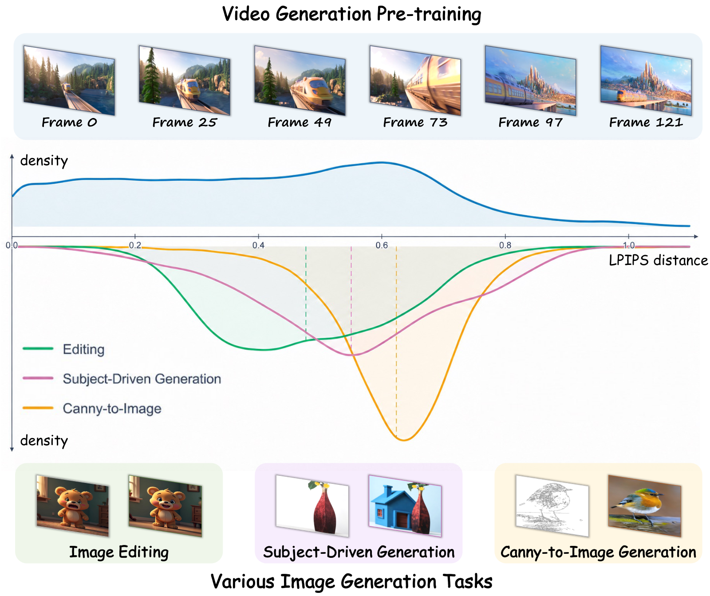
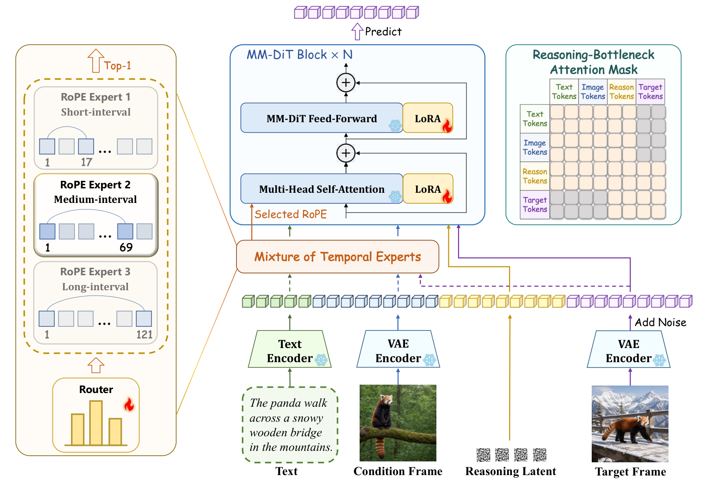
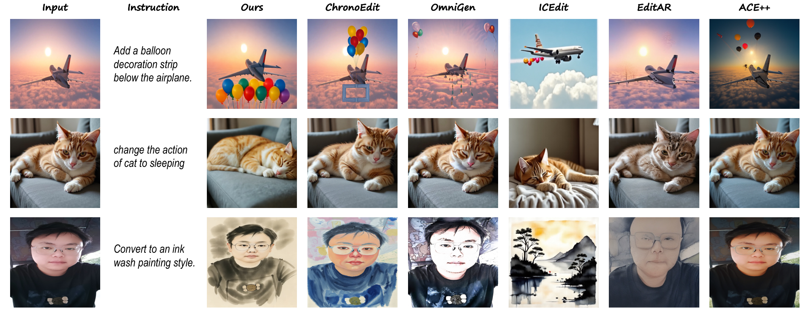
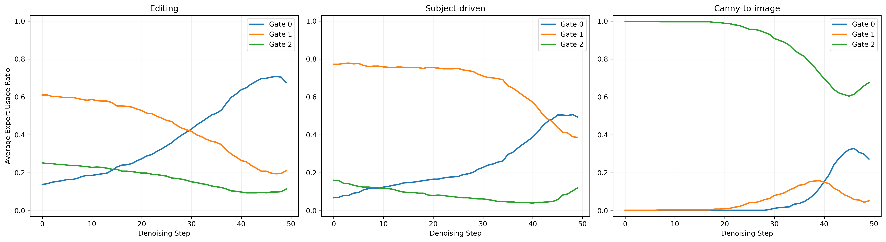

> **원문**: [arXiv](https://arxiv.org/abs/2610.36545) · [HuggingFace](https://huggingface.co/papers/2610.36545) (👍 112) · [GitHub](https://github.com/Lyne1/FrameForge)
{: .prompt-info }

## 들어가며

어제 HuggingFace Daily Papers에서 112 upvote를 받은 논문입니다. 피사체 유지 생성, 캐니맵(edge map) 기반 생성, 지시어 편집(instruction editing)은 서로 완전히 다른 과제처럼 보이지만, 최근 연구들은 이걸 하나의 모델로 풀려고 계속 시도해왔습니다. 그중에서도 흥미로운 흐름은 "비디오 생성모델을 가져다 쓰자"는 쪽인데, 비디오 모델은 어차피 '한 프레임이 다음 프레임으로 어떻게 변하는가'를 이미 배운 상태이기 때문입니다. 조건 이미지를 앞 프레임, 타깃 이미지를 뒷 프레임으로 놓으면 비디오 모델의 사전지식을 그대로 재활용할 수 있다는 아이디어죠.

그런데 이 논문이 짚는 지점이 제법 신선했습니다. 기존 방법들은 조건과 타깃을 "몇 번째 프레임"에 놓을지를 고정해두고 썼는데, 생각해보면 편집은 아주 작은 변화만 필요한 반면 피사체 생성이나 캐니맵 변환은 훨씬 큰 변화를 요구합니다. 그렇다면 비디오의 "몇 프레임 뒤"에 해당하는지도 과제마다, 심지어 같은 과제 안에서도 샘플마다 달라야 하는 게 아닐까요? 이 질문 하나에서 출발해 라우팅(routing)과 잠재 추론(latent reasoning)이라는 두 장치를 엮어낸 설계가 눈에 띄어 오늘 리뷰로 골랐습니다.

## 한눈에 보기

- **핵심 기여**: ① 조건-타깃 관계를 "가상의 시간 간격(virtual temporal interval)"으로 재해석하고, 실제 비디오의 LPIPS 거리 분포와 세 가지 생성 과제의 조건-타깃 거리 분포가 겹친다는 걸 보여 이 관점을 뒷받침. ② Mixture of Temporal Experts(MoTE) — 서로 다른 가상 간격을 가진 RoPE 전문가 여러 개를 두고, 텍스트·조건·노이즈 낀 타깃을 보고 샘플마다 하나를 고르는 라우터. ③ Chain of Temporal Reasoning(CoTR) — 조건과 타깃 사이에 노이즈로 초기화된 "추론 잠재"를 끼워 넣고, 학습 중 일부 구간에서 타깃이 텍스트·조건에 직접 접근하지 못하게 막아 이 잠재를 거치도록 강제.
- **성능**: DreamBench(피사체 유지)·COCO2017(캐니맵)·GEdit-Bench(지시어 편집) 세 과제를 과제별 어댑터 없이 LoRA 하나로 동시에 처리하면서도 비교 대상들을 상회. 특히 GEdit의 Motion Change 카테고리에서 G-O 점수 6.84를 기록해 Gemini 2.5(6.72)를 넘고 GPT-4o(7.81)에는 못 미치지만 근접.
- **한 줄 요약**: "조건과 타깃이 비디오의 몇 프레임만큼 떨어져 있는가"를 고정값이 아니라 입력마다 라우터가 고르게 하고, 그 사이를 어떻게 채울지는 지도 없이 학습되는 잠재 하나에 맡겨서, 서로 다른 조건부 생성 과제를 비디오 모델 하나의 사전지식으로 묶어낸 논문입니다.

## 어떤 문제를 풀려고 했나

실제 입력(텍스트, 참조 이미지, 구조 맵 등)이 요구하는 건 과제마다 완전히 다릅니다. 기존에 이걸 통일된 모델로 푸는 방식은 크게 두 갈래였습니다. 하나는 대규모 멀티태스크 데이터로 네이티브 통합 모델을 처음부터 학습하는 방식(OmniGen, UniReal, BAGEL 등), 다른 하나는 기존 이미지 생성기에 컨트롤 브랜치나 어댑터를 덧붙이는 방식(ControlNet, IP-Adapter, OminiControl 등)입니다. 두 방식 모두 조건을 "보조적인 공간·의미 신호"로 주입할 뿐, 조건과 타깃이 얼마나 다른지, 혹은 하나가 다른 하나로 어떻게 변환되어야 하는지를 명시적으로 모델링하지 않습니다.

최근에는 비디오 생성모델의 사전지식을 가져다 쓰는 세 번째 흐름(ChronoEdit, RealGeneral, DRA-Ctrl 등)이 등장했는데, 이들은 조건과 타깃을 비디오의 고정된 프레임 위치에 배치합니다. 저자들은 바로 이 "고정된 시간 간격"이 문제라고 짚습니다. 다음 그림이 그 근거입니다.

_자연 비디오에서 프레임 간 LPIPS 거리 분포(위)와, 편집·피사체 생성·캐니맵 변환 세 과제의 조건-타깃 LPIPS 거리 분포(아래). 점선은 각 과제의 중앙값입니다._

위쪽 파란 영역은 자연 비디오에서 프레임 간격이 다르면 시각적 변화량(LPIPS 거리)도 다르다는 걸 보여줍니다. 아래쪽 세 곡선을 보면, 편집(초록)은 LPIPS 거리가 작은 쪽에 몰려 있고, 캐니맵 변환(주황)은 거리가 큰 쪽에 몰려 있으며, 피사체 생성(분홍)은 그 중간입니다. 중요한 건 이 세 분포의 변동 범위가 자연 비디오의 분포 범위와 상당히 겹친다는 점인데, 이건 "각 생성 과제가 비디오 모델이 이미 배운 시간적 변환 사전지식의 특정 구간에 대응할 수 있다"는 가설을 뒷받침합니다. 그리고 각 과제 안에서도 곡선의 폭이 꽤 넓다는 점도 눈여겨볼 만한데, 과제 라벨 하나만으로는 그 샘플에 필요한 변환 크기를 정할 수 없다는 뜻입니다. 그래서 저자들은 조건-타깃 관계를 과제마다 고정하지 않고, 입력마다 적응적인 "가상의 시간 간격"으로 모델링하자고 제안합니다.

## 핵심 아이디어

이 관점은 자연스럽게 두 가지 질문으로 나뉩니다. 타깃이 조건으로부터 **얼마나 멀리** 있는가, 그리고 조건이 타깃으로 **어떻게** 변환되는가. FrameForge는 이 둘을 각각 MoTE와 CoTR로 나눠 풉니다. 전체 구조는 다음과 같습니다.

_MM-DiT 백본이 텍스트·조건·추론·타깃 토큰을 함께 처리하고, MoTE가 매 디노이징 스텝마다 RoPE 설정을 고르며, 중간 학습 단계에서는 Reasoning-Bottleneck Attention Mask가 타깃-텍스트/조건 간 직접 어텐션을 확률적으로 차단합니다._

그림 아래쪽을 보면 입력이 네 종류 토큰으로 나뉘어 있습니다. 텍스트(초록), 조건 프레임(파랑), 추론 잠재(노랑), 그리고 노이즈가 섞인 타깃 프레임(보라)입니다. 이 넷이 함께 MM-DiT에 들어가는데, 왼쪽의 Mixture of Temporal Experts가 이들의 시간적 위치 관계(RoPE)를 정하고, 오른쪽의 Reasoning-Bottleneck Attention Mask가 어텐션 연결 패턴을 조정합니다. 백본과 VAE는 전부 freeze된 채로, LoRA 하나와 라우터만 학습됩니다.

### 1. "얼마나 멀리" — Mixture of Temporal Experts (MoTE)

비디오 백본은 3D-RoPE로 시각 토큰의 시간·공간 좌표를 인코딩합니다. 조건과 타깃에 항상 같은 시간 간격을 주면, 과제·샘플·디노이징 스텝에 따라 실제로 필요한 변환 크기가 다른데도 전부 동일한 위치 관계를 강제하게 됩니다. MoTE는 서로 다른 가상 간격을 가진 RoPE 전문가 $E$개를 만들어두고, 매 샘플마다 어느 것을 쓸지 가볍게 선택합니다.

$$\Delta_e = s_e - 1, \qquad F_e = r_t(s_e - 1) + 1$$

$s_e$는 전문가 $e$가 쓰는 가상 잠재 시간축의 위치 개수이고, $\Delta_e$는 그로부터 나오는 가상 시간 간격입니다. $r_t$는 VAE의 시간 압축 배율(이 논문에서는 4)이고, $F_e$는 이 잠재 간격에 대응하는 실제 비디오 프레임 수입니다. 본문 설정에서는 비디오 프레임 간격 $\{17, 69, 121\}$을 쓰는데, 숫자로만 보면 추상적이지만 의미는 간단합니다 — 짧은 전문가는 "바로 다음 장면 정도의 변화", 긴 전문가는 "한참 뒤 장면 정도의 변화"에 대응하는 위치 관계를 만들어준다는 뜻입니다.

라우터는 텍스트·조건·노이즈 낀 타깃을 보고 어느 전문가를 쓸지 정합니다.

$$\mathbf{p} = \operatorname{Softmax}\left(\frac{\mathbf{a}}{\tau_{\mathrm{router}}}\right), \qquad e^{*} = \mathop{\arg\max}_{e\in\{1,\ldots,E\}} p_e$$

$\mathbf{a}$는 라우터가 뽑아낸 샘플 단위 로짓이고, $\tau_{\mathrm{router}}$는 분포를 얼마나 날카롭게 만들지 정하는 온도입니다. $\mathbf{p}$가 각 전문가를 고를 확률, $e^*$가 그중 가장 높은 확률을 가진 전문가입니다. 여기서 선택이 Top-1, 즉 "하나만 고른다"는 점이 중요한데, 혼합이 아니라 매 샘플마다 명확히 하나의 시간적 위치 관계를 쓰겠다는 설계입니다.

문제는 argmax처럼 이산적인 선택은 그래디언트가 흐르지 않는다는 점입니다. 이걸 straight-through estimator로 우회합니다.

$$\mathbf{g} = \operatorname{sg}\left(\mathbf{g}^{\mathrm{hard}}-\mathbf{p}\right) + \mathbf{p}$$

$\mathbf{g}^{\mathrm{hard}}$는 선택된 전문가에 대한 원-핫 벡터, $\operatorname{sg}(\cdot)$는 역전파 시 그래디언트를 막는 stop-gradient입니다. 순전파에서는 $\mathbf{g}$가 사실상 $\mathbf{g}^{\mathrm{hard}}$와 같은 값을 갖지만(하드 선택이 그대로 전달), 역전파에서는 $\mathbf{p}$ 쪽으로만 그래디언트가 흐릅니다. 즉 추론 때는 정말로 전문가 하나만 쓰면서도, 학습 때는 소프트한 확률 분포를 통해 라우터를 최적화할 수 있다는 뜻입니다. 여기에 배치 단위로 전문가 사용을 고르게 분산시키는 로드 밸런싱 손실까지 더해 라우팅이 한쪽으로 쏠리는 걸 막습니다.

### 2. "어떻게 변하는가" — Chain of Temporal Reasoning (CoTR)

MoTE가 "얼마나 멀리"는 정해주지만 "어떻게 변하는지"까지 결정해주지는 않습니다. CoTR은 조건과 타깃 사이에 표준 가우시안에서 뽑은 추론 잠재 하나를 끼워 넣습니다. 이 잠재는 직접 지도(supervision)를 받지 않고, MM-DiT 블록을 거치며 텍스트·조건·타깃과 어텐션으로 상호작용하면서 점점 맥락화됩니다. 말하자면 "조건에서 타깃으로 가는 길목"을 암묵적으로 담당하는 중간 표현인 셈입니다.

다만 잠재를 끼워 넣기만 하면 타깃 토큰이 굳이 이 잠재를 거치지 않고 텍스트·조건에 바로 접근하는 지름길을 택할 수 있습니다. 이걸 막기 위해 중간 학습 단계에서 확률 $p_{\mathrm{mask}}$로 아래 마스크를 적용합니다.

$$
\mathbf{M}^{\mathrm{cotr}}_{ij}=
\begin{cases}
-\infty, & i\in\mathcal{T}\cup\mathcal{C},\; j\in\mathcal{X}, \\
-\infty, & i\in\mathcal{X},\; j\in\mathcal{T}\cup\mathcal{C}, \\
0, & \text{그 외}
\end{cases}
$$

$\mathcal{T}, \mathcal{C}, \mathcal{R}, \mathcal{X}$는 각각 텍스트, 조건, 추론, 타깃 토큰 집합이고, $i, j$는 어텐션의 질의·키 인덱스입니다. 이 마스크는 텍스트/조건 토큰과 타깃 토큰 사이의 직접적인 어텐션만 $-\infty$로 막아버립니다. 추론 잠재를 거치는 경로는 그대로 열려 있으니, 타깃은 이제 텍스트나 조건을 직접 보지 못하고 오직 추론 잠재를 통해서만 정보를 받게 됩니다. 비유하자면 "결론만 보고 베끼지 말고 중간 과정을 거쳐서 답을 내라"고 강제하는 셈입니다. 앞서 본 아키텍처 그림 오른쪽의 표가 바로 이 마스크 패턴인데, Text/Image 행과 Target 열이 교차하는 칸(회색)이 막혀 있는 걸 확인할 수 있습니다.

학습은 3단계로 진행됩니다. 먼저 LoRA는 고정한 채 라우터만 학습하고, 다음 단계에서 추론 잠재와 확률적 마스크를 도입해 라우터와 LoRA를 함께 학습하며, 마지막 단계는 두 모듈을 유지한 채 전체 어텐션(마스크 없이)으로 추가 학습합니다. 마지막 단계의 설정이 추론 시점과 동일해, 학습-추론 불일치를 줄이는 구조입니다.

## 실험 결과

세 과제 모두 HunyuanVideo1.5-T2V-720P를 백본으로, rank 32의 LoRA(182M 파라미터)만 학습했습니다. 두 장의 A800 GPU로 약 6일이 걸렸다고 합니다. 과제별 전용 모델이 아니라 공유 LoRA 하나로 세 과제를 전부 처리한다는 점을 염두에 두고 아래 표들을 보면 좋습니다.

**피사체 유지 생성 (DreamBench)**

| Method | Base Model | SC↑ | PQ↑ | O↑ |
|---|---|---|---|---|
| BLIPDiffusion | SD 1.5 | 0.574 | 0.696 | 0.613 |
| SSR-Encoder | SD 1.5 | 0.524 | 0.774 | 0.608 |
| IP-Adapter | SDXL | 0.516 | _0.824_ | 0.629 |
| ACE++ | FLUX.1-dev | 0.660 | 0.779 | 0.688 |
| EasyControl | FLUX.1-dev | 0.596 | **0.839** | 0.679 |
| OmniGen | Native | 0.611 | 0.762 | 0.652 |
| OminiControl | FLUX.1-dev | 0.680 | 0.816 | 0.719 |
| EchoGen | Infinity-2B | 0.729 | 0.744 | 0.719 |
| RealGeneral | CogVideoX-1.5 | 0.633 | 0.767 | 0.669 |
| DRA-Ctrl | HunyuanVideo-I2V | 0.609 | 0.800 | 0.656 |
| ChronoEdit | Wan2.1-I2V-14B | **0.757** | 0.764 | _0.729_ |
| **Ours** | HunyuanVideo1.5 | _0.739_ | 0.783 | **0.739** |

**캐니맵 → 이미지 생성 (COCO2017)**

| Method | Base Model | FID↓ | SSIM↑ | CLIP-T↑ |
|---|---|---|---|---|
| ControlNet | SD1.5 | **20.42** | 0.299 | 0.323 |
| OmniGen | Native | _22.51_ | 0.352 | **0.329** |
| EasyControl | FLUX.1-dev | 22.82 | _0.417_ | 0.319 |
| RealGeneral | CogVideoX-1.5 | 24.63 | 0.414 | _0.324_ |
| DRA-Ctrl | HunyuanVideo-I2V | 23.27 | 0.408 | 0.314 |
| **Ours** | HunyuanVideo1.5 | 23.47 | **0.447** | 0.323 |

두 표에서 패턴을 짚어보면, FrameForge는 SC나 FID 같은 "1등 지표" 몇 개에서는 밀리지만, 그 밀리는 지표에서 1등을 차지한 방법은 다른 지표에서 크게 무너집니다. ChronoEdit은 SC 1위지만 O 점수에서는 FrameForge에 뒤지고, ControlNet은 FID 1위지만 SSIM(구조적 충실도)이 가장 낮습니다. 즉 FrameForge는 어느 한 지표에 올인하지 않고 여러 지표에서 고르게 강한 쪽인데, 논문도 이걸 "피사체 보존과 사실성 사이의 더 나은 균형"이라고 표현합니다. 개인적으로는 이런 "특정 과제에 올인하지 않는 범용성"이 하나의 공유 LoRA로 세 과제를 동시에 처리한다는 설계와 잘 맞아떨어진다고 느꼈습니다.

**지시어 기반 이미지 편집 (GEdit-Bench)**

| | | Motion Change G-SC↑ | Motion Change G-PQ↑ | Motion Change G-O↑ | Overall G-SC↑ | Overall G-PQ↑ | Overall G-O↑ |
|---|---|---|---|---|---|---|---|
| **Closed-source** | | | | | | | |
| Gemini 2.5 | Native | 6.87 | 7.79 | 6.72 | 8.25 | 8.29 | 7.89 |
| GPT-4o | Native | 7.81 | 8.53 | 7.81 | 8.74 | 7.67 | 8.01 |
| Seedream 4.0 | Native | 5.58 | 8.53 | 5.53 | 8.41 | 8.04 | 7.81 |
| **Open-source** | | | | | | | |
| ACE++ | FLUX.1-dev | 1.80 | 6.85 | 2.29 | 2.27 | 6.44 | 2.60 |
| EditAR | LlamaGen | 2.65 | 6.05 | 2.91 | 4.26 | 5.70 | 3.89 |
| ICEdit | FLUX.1-dev | 0.93 | **7.98** | 1.13 | 4.94 | _7.39_ | 4.87 |
| OmniGen | Native | 3.35 | 6.68 | 3.12 | _5.88_ | 5.87 | 5.01 |
| UniWorld-V1 | Native | 1.58 | _7.55_ | 1.76 | 4.93 | **7.43** | 4.85 |
| HiDream-I1 (E1) | Native | 1.58 | 7.23 | 1.66 | 5.66 | 6.06 | 5.01 |
| ChronoEdit | Wan2.1-I2V-14B | _5.90_ | 7.33 | _5.76_ | 5.35 | 6.88 | _5.08_ |
| **Ours** | HunyuanVideo1.5 | **6.90** | 7.18 | **6.84** | **6.56** | 6.52 | **6.12** |

이 표가 가장 인상적입니다. Motion Change(동작 변화) 카테고리에서 FrameForge의 G-O 점수(6.84)가 비디오 사전지식 없이 이미지 백본만 가져다 쓴 오픈소스 방법들(ACE++ 2.29, OmniGen 3.12 등)을 압도적으로 앞서는데, 저자들은 이걸 "비디오 모델이 배운 동적(dynamic) 시각 사전지식의 중요성"이라고 해석합니다. 생각해보면 "고양이를 눕혀서 재우기" 같은 동작 변화는 정적인 이미지 쌍만으로 학습한 모델보다, 애초에 움직임을 본 적 있는 모델이 더 잘 이해할 법도 합니다. 더 놀라운 건 이 Motion Change 점수가 비공개 모델인 Gemini 2.5(6.72)와 Seedream 4.0(5.53)을 넘어서고, GPT-4o(7.81)에는 못 미치지만 근접한 수준까지 올라왔다는 점입니다. 다음은 이 결과를 눈으로 확인할 수 있는 비교 그림입니다.

_물체 추가, 동작 변화, 스타일 변환 세 가지 편집 유형에서 FrameForge와 다른 방법들을 비교한 예시._

첫 번째 줄(풍선 장식을 비행기 아래에 추가)을 보면, ChronoEdit은 풍선을 비행기 위쪽에 어색하게 붙였고 ICEdit은 아예 장면을 재구성해버렸는데, FrameForge만 "비행기 아래"라는 공간 관계를 지키면서 자연스럽게 풍선을 추가했습니다. 두 번째 줄(고양이를 자는 자세로)에서는 FrameForge가 고양이를 실제로 눕혀서 재웠지만, 나머지 방법들은 고양이가 여전히 앉아 있거나 눈만 살짝 감은 수준에 그칩니다. 세 번째 줄(수묵화 스타일 변환)에서는 FrameForge와 ChronoEdit은 인물의 정체성을 유지하면서 스타일만 바꿨는데, ICEdit은 아예 다른 그림(풍경화)을 그려버렸습니다. 이 세 예시 모두 "원본에서 무엇을 유지하고 무엇을 바꿀지"를 구분하는 능력을 보여주는데, 이게 바로 CoTR이 해결하려던 "조건에서 타깃으로의 변환"을 명시적으로 모델링한 효과로 보입니다.

### MoTE는 실제로 과제마다 다른 선택을 하는가

MoTE가 설계 의도대로 작동하는지 확인하기 위해, 저자들은 500개 샘플에 대해 50 디노이징 스텝 동안 각 전문가(Gate)가 선택되는 비율을 시각화했습니다.

_편집, 피사체 생성, 캐니맵 변환 세 과제에서 디노이징 스텝별 전문가 사용 비율. Gate 0/1/2는 각각 짧은/중간/긴 간격 전문가._

세 그래프를 나란히 보면 뚜렷한 차이가 보입니다. 오른쪽 캐니맵 변환은 초반 스텝 거의 전부를 Gate 2(긴 간격, 초록)가 차지하는데, 이는 조건-타깃 거리가 가장 큰 과제라는 점과 정확히 맞아떨어집니다. 왼쪽 편집은 초반에 Gate 1(중간 간격, 주황)이 우세하다가 스텝이 진행될수록 Gate 0(짧은 간격, 파랑)으로 빠르게 옮겨가고, 가운데 피사체 생성도 비슷하게 짧은 간격 쪽으로 이동하지만 그 전환이 더 완만합니다. 저자들은 이걸 "타깃 잠재가 아직 노이즈로 뒤덮인 초반에는 중간 간격을 쓰다가, 타깃 내용이 드러나기 시작하면 짧은 간격으로 옮겨간다"고 해석하는데, 편집이 원본 내용을 더 많이 보존해야 하는 과제라서 이 전환이 더 일찍, 더 강하게 일어난다는 설명이 과제 특성과 자연스럽게 들어맞습니다. 이 그림에서 가장 눈여겨볼 부분은 세 그래프가 '과제마다 고정된 하나의 전문가'가 아니라 '스텝에 따라 움직이는 궤적'을 보여준다는 점인데, 이건 라우터가 과제 라벨뿐 아니라 디노이징 진행 상황까지 반영해서 결정을 내리고 있다는 증거입니다.

### Ablation: MoTE와 CoTR은 정말 둘 다 필요한가

| Variant | LoRA | MoTE | CoTR | Subject↑ | Canny↓ | Editing↑ |
|---|---|---|---|---|---|---|
| Task-specific baseline | Task-specific | ✗ | ✗ | 0.676 | 25.22 | 5.99 |
| Unified baseline | Shared | ✗ | ✗ | 0.722 | 25.78 | 4.94 |
| + MoTE | Shared | ✓ | ✗ | 0.719 | 25.62 | 5.77 |
| + CoTR | Shared | ✗ | ✓ | 0.726 | 25.94 | 5.56 |
| **Full Model** | Shared | ✓ | ✓ | **0.739** | **23.47** | **6.12** |

이 표에서 가장 흥미로운 줄은 두 번째와 다섯 번째입니다. 과제별 전용 LoRA(0.676/25.22/5.99)를 공유 LoRA로 바꾸기만 하면 피사체 생성은 오히려 좋아지는데(0.722) 편집은 크게 나빠집니다(4.94). 즉 과제를 하나로 묶는 것 자체가 편집 과제에는 간섭(interference)으로 작용한다는 뜻입니다. MoTE나 CoTR을 따로 추가하면 편집 점수가 각각 5.77, 5.56으로 회복되지만, 둘 다 과제별 전용 모델의 5.99에는 못 미칩니다. 그런데 둘을 합치면 6.12로 전용 모델마저 넘어서면서 동시에 피사체 생성과 캐니맵 점수도 최고치를 찍습니다. 저자들은 이걸 "두 모듈이 서로 다른 요구사항(시간적 사전 선택과 중간 변환 모델링)을 보완적으로 해결하기 때문"이라고 설명하는데, 숫자만 봐도 한쪽만으로는 공유 모델의 과제 간섭 문제를 완전히 풀지 못한다는 게 꽤 명확하게 드러납니다.

이 외에도 전문가 개수(1/3/5/7개 중 3개가 최적), 가상 간격 범위(짧게/중간/길게 중 긴 쪽이 편집에 유리), 추론 잠재 개수(1개가 최적이고 2~3개는 오히려 성능 저하)에 대한 ablation이 이어지는데, 공통적으로 "늘린다고 항상 좋아지지는 않는다"는 결론입니다. 특히 추론 잠재를 2~3개로 늘리면 명시적 지도 없이 학습되는 잠재 공간이 지나치게 넓어져 타깃 학습 신호가 분산된다는 설명인데, 직관적으로 납득이 가는 부분입니다. 또한 HunyuanVideo1.0으로 백본을 바꿔도 동일한 경향(피사체 0.699→0.736, 캐니맵 FID 24.52→23.07, 편집 4.38→5.00 개선)이 재현되어, 이 설계가 특정 백본에 종속된 트릭이 아니라는 점도 보여줍니다.

## 아쉬운 점 / 의문점

- **FID 해석이 조금 조심스럽습니다.** 캐니맵 과제에서 FrameForge의 FID(23.47)는 ControlNet(20.42)보다 나쁜데, 저자들은 "FID는 Inception 특징 공간의 분포 차이를 재는 것이라 백본 고유의 외관 통계에 영향을 받을 수 있다"고 해명합니다. 틀린 말은 아니지만, 이런 해명은 자기 모델에 불리한 지표가 나올 때마다 쓸 수 있는 논리이기도 해서, SSIM·CLIP-T·정성적 결과를 종합해서 본다는 저자들의 태도 자체는 합리적이지만 FID 하나만 떼어놓고 보면 여전히 약점으로 남습니다.
- **라우터의 "선택"이 얼마나 안정적인지는 불명확합니다.** Top-1 straight-through 라우팅은 학습 초반 라우터의 무작위 초기화에 따라 수렴하는 전문가 배분이 달라질 수 있는데, 이 논문은 단일 학습 결과만 보고하고 라우팅 안정성(여러 시드로 반복했을 때도 비슷한 패턴이 나오는지)은 다루지 않습니다.
- **170K×3=510K 샘플, 12,000 iteration이라는 학습 규모가 상대적으로 작은 세팅**에서 나온 결과라, 더 큰 스케일에서 MoTE/CoTR의 이득이 유지되는지, 혹은 전문가 수를 늘려도 괜찮아지는지는 논문에 명시되어 있지 않습니다.
- **추론 잠재가 실제로 무엇을 인코딩하는지에 대한 해석(interpretability) 분석이 없습니다.** CoTR이 성능을 올린다는 건 ablation으로 확인되지만, 이 잠재가 "구조 변화", "스타일 변화" 같은 어떤 의미 있는 중간 표현을 담고 있는지, 아니면 그냥 추가 파라미터 용량으로 작동하는지는 확인할 길이 없습니다. 개인적으로는 이 잠재를 시각화하거나 디코딩해보는 실험이 있었다면 CoTR의 메커니즘을 훨씬 설득력 있게 보여줬을 것 같아서 아쉬웠습니다.

## 마치며

이 논문을 끝까지 읽고 나서 가장 남은 인상은, "통합 모델을 만든다"는 목표를 "과제마다 다른 어댑터를 만들지 않는다"는 쪽으로만 풀지 않고 "애초에 비디오 모델이 이미 가진 축(시간)에 과제들을 매핑한다"는 쪽으로 풀었다는 점입니다. 멀티태스크 학습에서 흔히 생기는 과제 간섭 문제를, 새 파라미터를 추가하는 대신 기존 모델이 이미 가진 시간 축의 "어느 지점을 볼지"를 입력마다 다르게 고르는 방식으로 우회한 셈인데, 이게 꽤 깔끔한 해법처럼 느껴졌습니다.

여담으로, GEdit-Bench Motion Change에서 오픈소스 모델이 비공개 모델(Gemini 2.5)을 넘어선 결과는 "비디오 사전학습이 정적 이미지 편집에도 전이된다"는 최근 연구 흐름(ChronoEdit, Video4Edit 등)과 궤를 같이 합니다. 다만 이 흐름의 공통 전제가 "큰 비디오 파운데이션 모델에 접근할 수 있어야 한다"는 것이라, 개인 프로젝트 수준에서 바로 재현해보기는 쉽지 않을 것 같습니다. 그래도 MoTE의 "입력-적응형 가상 시간 간격"이라는 아이디어 자체는 비디오 모델이 아니어도, 이미지 diffusion 모델의 위치 인코딩을 다루는 다른 조건부 생성 작업에 옮겨볼 만한 발상이라고 생각합니다.
