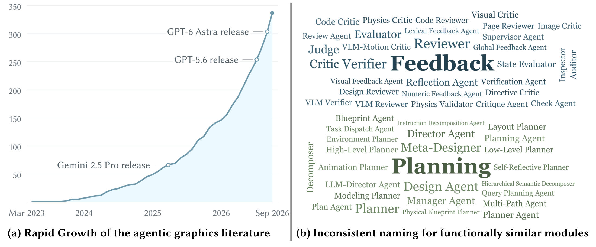
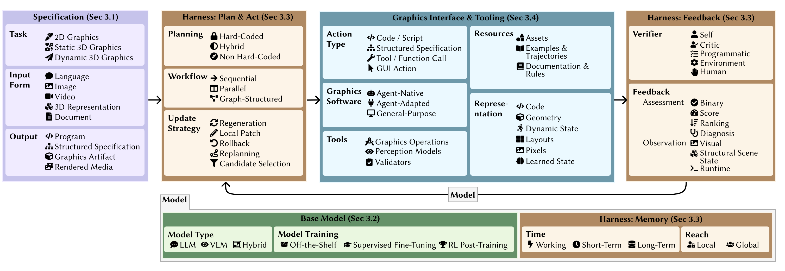
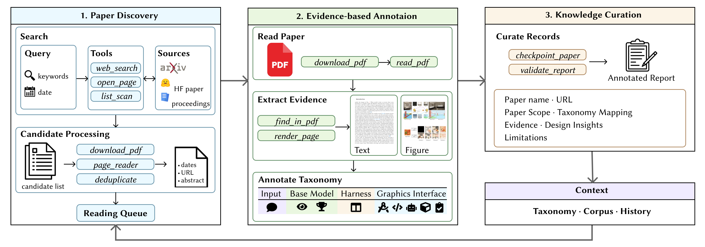
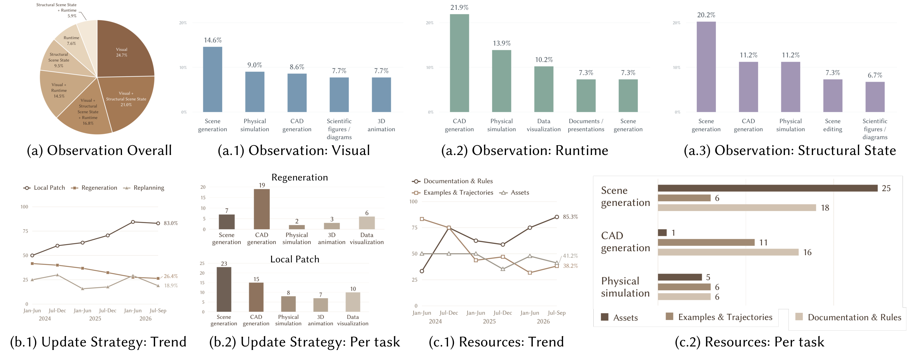

> **원문**: [arXiv](https://arxiv.org/abs/2611.01860) · [HuggingFace](https://huggingface.co/papers/2611.01860) (👍 108)
{: .prompt-info }

## 들어가며

어제 HuggingFace Daily Papers에서 108 upvote를 받은 논문입니다. 평소 리뷰하던 "모델 하나를 제안하고 벤치마크로 검증하는" 논문이 아니라, Eurographics의 STAR(State-of-the-Art Report) 포맷으로 쓰인 서베이입니다. 보통 서베이는 핵심 아이디어 하나를 파고들기보다 분야 전체를 조망하는 글이라 리뷰 블로그 포맷과는 궁합이 안 맞는 경우가 많은데, 이 논문을 고른 이유는 두 가지입니다.

첫째, "LLM 에이전트가 그래픽스 코드를 짜고 렌더링 결과를 보면서 스스로 고친다"는 흐름 — Blender 씬 편집, CAD 모델링, 캐릭터 애니메이션, 파티클 이펙트까지 — 이 지난 2~3년 사이 정말 폭발적으로 늘었다는 걸 숫자로 보여줍니다. 둘째, 이 많은 논문을 "사람이" 일일이 분류하는 대신, 저자들이 직접 만든 또 다른 에이전트에게 논문을 읽고 분류하는 일을 맡겼습니다. 서베이를 쓰는 노동 자체를 에이전트화한 셈인데, 이 블로그가 매일 하는 일(논문 하나 골라서 읽고 정리하기)과 묘하게 닮아 있어서 흥미롭게 읽었습니다.

## 한눈에 보기

- **핵심 기여**: ① "agentic graphics system"을 세 가지 조건(LLM이 행동을 결정한다 / 그래픽스 환경에서 실제로 조작을 실행한다 / 실행 결과 피드백이 다음 행동에 영향을 준다)으로 명확히 정의하고, 명세·기반 모델·하니스·그래픽스 인터페이스 네 축으로 된 공통 taxonomy를 제시. ② 이 taxonomy로 2024~2026년 9월까지 300여 편의 논문을 자동으로 검색·분류·주석하는 "에이전트형 리터러처 서베이 시스템"을 구축. ③ 이 시스템의 분석 결과로 "로컬 패치 방식 업데이트가 50%→83%로 늘었다"처럼 분야 전체의 설계 트렌드를 정량적으로 제시.
- **성능**: 벤치마크 수치로 성능을 겨루는 논문이 아니라서 해당 없음. 대신 "자체 구축 코퍼스 300여 편을 얼마나 신뢰성 있게 taxonomy로 분류했는가"가 이 논문의 검증 대상에 가깝고, 이 부분은 사람이 사후 검수했다고만 밝히고 있습니다.
- **한 줄 요약**: 용어도 제각각이고 양도 너무 많아 더는 사람이 손으로 정리하기 힘들어진 "agentic graphics" 분야를, 통일된 taxonomy와 그 taxonomy로 논문을 직접 읽고 분류하는 에이전트를 함께 만들어 지도를 그려낸 서베이입니다.

## 어떤 문제를 풀려고 했나

저자들이 짚는 문제는 단순합니다. 그래픽스는 원래 코드로 만들어지는 분야입니다 — 셰이더 프로그램, 절차적 모델링 룰, 물리 솔버가 전부 코드죠. 그런데 LLM이 코드 생성·추론·도구 사용에 능숙해지면서, 이제 사람이 셰이더 파라미터를 일일이 조정하는 대신 "이 재질을 좀 더 거칠게 만들어줘" 한 마디로 에이전트가 Blender 프로그램을 고치는 일이 가능해졌습니다. 문제는 이런 시스템을 다루는 논문이 2023년 초부터 2026년 9월까지 기하급수적으로 늘었다는 겁니다.

다음 그림이 이 상황을 압축해서 보여줍니다.

_Figure 1. (a) 2023년 3월부터 2026년 9월까지 수집한 코퍼스 논문 수의 누적 그래프. (b) "피드백"과 "플래닝" 역할을 하는 모듈에 논문마다 다르게 붙인 이름들을 워드클라우드로 정리._

왼쪽 그래프는 가로축이 시간, 세로축이 누적 논문 수인데, GPT-6 Astra·GPT-5.6·Gemini 2.5 Pro 같은 주요 모델 릴리스 시점을 같이 표시해서 "더 좋은 모델이 나올 때마다 이 분야 논문 생산 속도가 한 번씩 꺾인다"는 인상을 줍니다. 2026년 9월 기준 300편을 넘겼는데, 그래프 모양이 거의 수직에 가깝습니다. 오른쪽 워드클라우드가 더 흥미로운데, 똑같이 "결과물을 평가해서 다시 고치라고 알려주는 모듈"을 두고 어떤 논문은 Critic, 어떤 논문은 Verifier, 어떤 논문은 Judge, Reviewer, Inspector, Auditor라고 부릅니다. "계획을 세우는 모듈"도 Planner, Director Agent, Meta-Designer, Decomposer 등으로 제각각입니다. 기능은 같은데 이름이 다르니 두 논문을 비교하려면 매번 용어부터 다시 번역해야 하는 셈이죠. 이게 바로 이 서베이가 "하나의 공통 어휘"를 만들어야 한다고 주장하는 근거입니다.

참고로 2절(Background and Scope)에서 agentic graphics system의 scope를 꽤 엄격하게 긋는데, 이 기준이 개인적으로는 꽤 유용했습니다. 네트워크를 처음부터 학습시켜 그래픽스 프로그램을 직접 추론하는 방식(예: Shape2Prog)이나, LLM이 한 번에 레이아웃·메시를 생성하고 끝나는 단발성 생성(예: LayoutGPT, LLaMA-Mesh)은 전부 이 서베이의 범위 밖입니다. "LLM이 행동을 정하고, 실제 환경에서 실행하고, 그 결과 피드백이 다음 행동에 영향을 줘야 한다"는 세 조건을 다 만족해야 비로소 agentic이라고 부르겠다는 겁니다. 당연해 보이지만, 요즘 "에이전트"라는 말이 거의 마케팅 용어처럼 남용되는 걸 생각하면 이렇게 선을 명확히 긋고 시작하는 태도 자체가 눈에 띄었습니다.

## 핵심 아이디어

### 네 축으로 나눈 taxonomy

이 서베이의 뼈대는 Figure 2의 taxonomy입니다.

_Figure 2. Agentic Graphics Systems의 설계 공간. 왼쪽부터 명세(Specification) → 하니스의 플래닝/실행(Plan & Act) → 그래픽스 인터페이스 및 도구(Graphics Interface & Tooling) → 하니스의 피드백(Feedback) 순으로 흐르고, 아래쪽에 기반 모델(Base Model)과 하니스의 메모리(Memory)가 공통으로 깔립니다._

이 그림 하나가 사실상 서베이 전체의 목차입니다. 왼쪽 보라색 블록(Specification)은 "어떤 과제를, 어떤 입력으로, 어떤 출력을 기대하는가"를 정의합니다 — 2D 그래픽/정적 3D/동적 3D라는 과제 분류, 언어·이미지·영상·3D 표현·문서라는 입력 형태, 프로그램·구조화된 명세·그래픽스 아티팩트·렌더링된 미디어라는 출력 형태가 여기 속합니다. 가운데 주황색(Harness: Plan & Act)은 "계획을 얼마나 미리 정해놓는가"(하드코딩 vs. 비하드코딩), "단계를 어떻게 연결하는가"(순차/병렬/그래프 구조), "피드백이 왔을 때 전체를 다시 만들지, 일부만 고칠지, 되돌릴지"를 다룹니다. 파란색(Graphics Interface & Tooling)은 에이전트가 실제로 뭘 가지고 작업하는지 — 코드/스크립트로 명령하는지 GUI를 직접 조작하는지, Blender 같은 범용 소프트웨어를 쓰는지 에이전트 전용으로 설계된 환경을 쓰는지 — 를 구분합니다. 갈색(Harness: Feedback)은 누가 결과를 평가하는지(자기 자신, 별도 critic, 프로그램적 검증, 환경 실행, 사람)와 그 평가가 이진 판정인지 점수인지 랭킹인지를 나눕니다. 아래쪽 초록색(Base Model)과 또 다른 갈색(Harness: Memory)은 이 모든 걸 떠받치는 공통 축으로, 모델 종류(LLM/VLM/하이브리드)와 학습 방식, 그리고 정보를 얼마나 오래(워킹/단기/장기) 어느 범위로(로컬/글로벌) 기억하는지를 규정합니다.

왜 이게 의미가 있냐면, 논문마다 "Critic"이라고 부르든 "Verifier"라고 부르든 이 taxonomy 안에서는 똑같이 "하니스의 feedback 축에서 verifier 역할을 하는 모듈"로 환원되기 때문입니다. 앞서 Figure 1(b)의 워드클라우드 문제를 이 축 하나로 해소하는 셈이죠. 개인적으로 인상 깊었던 부분은 "Update Strategy"를 regeneration/local patch/rollback/replanning/candidate selection 다섯 가지로 쪼갠 지점인데, 이게 뒤에서 나오는 핵심 발견(로컬 패치가 늘고 있다는) 결과와 바로 연결되는 분석 단위가 됩니다.

### 서베이를 쓰는 에이전트, 그 자체가 또 하나의 agentic graphics... 는 아니지만

이 논문의 두 번째 기여는 "이 taxonomy로 300편을 누가 분류하느냐"는 문제에 대한 답입니다. 사람이 300편을 다 읽고 라벨을 붙이는 대신, 저자들은 논문을 검색하고 읽고 taxonomy 라벨을 붙이는 에이전트 파이프라인을 직접 만들었습니다.

_Figure 3. 리터러처 서베이 에이전트의 동작 과정. (1) 검색어로 논문을 찾아 중복 제거 후 읽기 대기열에 넣고, (2) PDF를 다운로드해 텍스트와 그림에서 근거를 뽑아 taxonomy 라벨을 붙이고, (3) 라벨·근거·한계를 포함한 주석 보고서로 저장해 다음 실행에서 재사용합니다._

구조는 1) 논문 발견 → 2) 증거 기반 주석 → 3) 지식 큐레이션 세 단계입니다. 1단계에서는 웹 검색과 arXiv/HuggingFace/학회 proceedings를 뒤져 후보 논문 목록을 만들고 중복을 제거합니다. 2단계가 핵심인데, PaperQA2 방식을 따라 "먼저 근거를 모으고 나서 분류한다"는 원칙을 지킵니다 — 즉 taxonomy 라벨을 찍기 전에 반드시 논문 본문과 그림에서 해당 라벨을 뒷받침하는 문장이나 이미지를 찾아 근거로 남깁니다. 이렇게 하면 "이 논문은 critic을 쓴다"는 라벨이 어디서 나온 판단인지 나중에 사람이 검증할 수 있습니다. 3단계는 이 주석을 영구 저장소에 쌓아서, 다음 실행 때 이미 본 논문은 건너뛰고 새 논문만 처리하거나, 증거가 부족했던 논문을 다시 읽도록 합니다.

이 시스템이 실제로 두 논문(SubDGuide와 PLAYGROUND)을 분석한 예시가 Table 1로 제시되는데, 전체를 옮기면 이렇습니다.

| 항목 | SubDGuide | PLAYGROUND |
|---|---|---|
| **범위** | Core, 메시→SubD 재구성 | Core, 2D 레이아웃 생성 |
| **입력** | 모델링, 3D 표현, 그래픽스 아티팩트 | 2D 그래픽스 저작, 언어, 이미지, 그래픽스 아티팩트 |
| **기반 모델** | VLM, Off-the-Shelf | VLM, SFT(retriever·planner·generator), Off-the-Shelf(verifier) |
| **하니스** | Hybrid, Sequential(피드백 루프), Local Patch, Rollback, Candidate Selection, Self-verification, Programmatic, Binary, Score, Diagnosis, Visual, Structural Scene State, Short-Term Memory, Local Memory | Hybrid, Sequential(피드백 루프), Regeneration, Candidate Selection, Replanning, Critic, Ranking, Binary, Diagnosis, Visual, Structural Scene State, Short-Term Memory, Global Memory, Local Memory |
| **그래픽스 인터페이스** | Structured Specification, Tool/Function Call, Agent-Adapted, Graphics Operations, Perception Models, Validators, Geometry, Pixels | Structured Specification, Agent-Adapted, Authoring, Observation, Examples & Trajectories, Documentation & Rules, Scene Structure and Layouts, Pixels |
| **설계 인사이트** | 의미적 결정과 기하학적 실행을 분리해, 제안된 수정이 현재 결과를 대체하기 전에 검증받을 수 있게 함 | 매 플래닝 단계를 현재 렌더 결과에 조건화해, 그룹핑과 배치를 진화하는 캔버스에 맞춰 적응시킴 |
| **한계 분석** | 수정이 초기 케이지와 지원되는 토폴로지 연산에 의존 — 빠진 부분이나 임의의 엣지 흐름은 대체로 복구 불가 | 이미 승인된 그룹은 고정된 채로 남아, 초기 레이아웃 오류로부터의 회복이 제한됨 |

표 아래 줄에 적힌 설명이 꽤 날카로운데, 두 시스템의 "업데이트 전략"이 다른 이유가 "한계"로 바로 이어진다고 짚습니다. SubDGuide는 local patch + rollback을 쓰기 때문에 일부 수정이 틀렸을 때 되돌릴 수는 있지만 애초에 초기 케이지(cage) 구조 자체가 잘못되면 손을 못 댑니다. PLAYGROUND는 매 단계 렌더를 보고 플래닝하지만 이미 확정한 그룹은 다시 안 건드리기 때문에 초반 레이아웃 실수가 끝까지 간다는 거죠. 같은 taxonomy 축(update strategy)으로 두 논문을 나란히 놓으니 "왜 이 시스템은 특정 종류의 오류를 못 고치는가"가 설계 선택 하나로 설명이 됩니다. 이게 이 taxonomy의 실제 쓸모를 보여주는 대목이라고 생각합니다.

## 분석 결과 — 300편을 모아보니 보이는 패턴

taxonomy로 300여 편을 라벨링한 결과, 저자들은 네 가지 패턴을 짚습니다. 그중 가장 흥미로운 건 시간에 따른 트렌드 분석입니다.

_Figure 4. (a) 관찰(observation) 유형별 분포, (b) 업데이트 전략의 시간에 따른 변화(b.1)와 과제별 분포(b.2), (c) 지원 자원의 시간에 따른 변화(c.1)와 과제별 분포(c.2)._

가장 눈에 띄는 숫자는 (b.1)입니다. 가로축이 2024년 상반기부터 2026년 하반기까지 반년 단위 구간이고, 세로축이 각 업데이트 전략이 차지하는 비율인데, local patch(검은 선)가 50.0%에서 83.0%까지 꾸준히 올라갑니다. 반대로 regeneration(결과를 통째로 다시 만드는 방식)은 계속 내려갑니다. 저자들의 해석은 "씬(scene) 표현은 객체 하나하나를 독립적으로 수정할 수 있지만, CAD 연산은 모델링 단계 사이에 의존성이 있어서 부분 수정이 더 어렵다"는 것인데, 실제로 (b.2)를 보면 CAD generation은 regeneration 비율이 압도적으로 높고(19건) scene generation은 local patch가 압도적으로 높습니다(23건). 초기에는 "일단 다시 만들고 보자"는 식의 거친 접근이 많았다면, 점점 "필요한 부분만 정밀하게 고치는" 방향으로 분야 전체가 성숙해지고 있다는 뜻으로 읽힙니다.

(c.1)도 비슷한 이야기를 하는데, "문서와 규칙(Documentation & Rules)"을 참고 자료로 쓰는 비율이 2026년 하반기에 85.3%까지 올라갑니다. 저자들은 이걸 "그래픽스 도구와 API가 점점 전문화되면서, 명시적인 문서가 있어야 에이전트가 복잡한 연산을 안정적으로 수행할 수 있기 때문"이라고 설명합니다. (a) 파이차트를 보면 시각적 관찰(Visual)이 전체 observation의 24.7%로 가장 크고, Visual+Structural Scene State 조합까지 합치면 상당 부분을 차지합니다. VLM이 흔해지면서 "렌더링된 이미지를 보고 판단하는" 피드백이 기본값이 되어가고 있다는 신호로 보입니다.

## 아쉬운 점 / 의문점

비판적으로 보면 걸리는 지점이 몇 개 있습니다.

첫째, 이 분석 전체가 "GPT-6 Astra, medium reasoning effort"로 돌린 자동 분류 시스템의 출력에 기반합니다. 사람이 사후 검수(manual verification)를 했다고는 쓰여 있지만, 검수가 "코퍼스에 포함될 논문인지 거르는 수준"이었는지 "taxonomy 라벨 하나하나가 맞는지 재검증하는 수준"이었는지는 논문에 명시되어 있지 않습니다. 3절(지식 큐레이션) 설명을 보면 "이 검사들은 빠지거나 일관성 없는 항목을 잡아내지만, 분류 자체의 정확성을 검증하지는 않는다"고 저자들 스스로도 인정하고 있어서, "분야 전체의 83%가 local patch를 쓴다"는 숫자를 얼마나 액면 그대로 믿어야 할지는 조심스럽습니다. 같은 모델로 같은 taxonomy를 적용했으니 적어도 "상대적인 추세"는 신뢰할 수 있겠지만, 절대적인 비율이 사람이 직접 분류했을 때와 어느 정도 차이가 날지는 알 수 없습니다.

둘째, "에이전트형 리터러처 서베이 시스템을 공개할 계획"이라고만 적혀 있고(we plan to release the system publicly), 실제 코드나 수집한 300편 코퍼스 자체에 대한 저장소 링크는 이 논문 본문에서 찾지 못했습니다. 즉 이 서베이가 제시하는 taxonomy는 재현 가능하지만, 그 taxonomy를 적용해 300편을 분류해낸 파이프라인 자체는 아직 검증 가능한 형태로 열려 있지 않습니다.

셋째, 다소 여담이지만 Figure 1(a)에 등장하는 "GPT-6 Astra"라는 모델명이 눈에 띄었습니다. 이 서베이가 다루는 시간 범위(2026년 9월)와 모델 생태계가 지금 이 블로그를 쓰는 시점과 거의 맞닿아 있다 보니, 분야가 얼마나 빠르게 움직이는지를 실감하게 되는 지점이었습니다. 동시에, 이렇게 빠른 템포 자체가 "서베이를 쓰는 일도 에이전트에게 맡겨야 한다"는 저자들의 문제의식을 가장 직접적으로 뒷받침하는 증거이기도 합니다.

넷째, taxonomy의 네 축(명세/기반 모델/하니스/인터페이스)이 상호 배타적이지 않고 각 시스템이 여러 옵션을 동시에 가질 수 있다 보니(Table 1만 봐도 하니스 항목에 라벨이 14개씩 붙어 있습니다), 분류가 세밀한 대신 "두 시스템이 얼마나 비슷한가"를 한눈에 비교하기는 오히려 어려워 보입니다. 라벨 집합 사이의 거리를 재는 정량적 지표 없이는, 결국 사람이 라벨 목록을 읽고 다시 해석해야 하는 수고가 taxonomy 이전과 크게 다르지 않을 수도 있겠다는 생각이 들었습니다.

## 마치며

개인적으로는 이 서베이를 "agentic graphics 분야에 입문하는 지도"로서보다, "LLM 에이전트로 무언가를 자동화하는 시스템을 설계할 때 어떤 축을 고려해야 하는가"에 대한 체크리스트로 더 유용하게 읽었습니다. 그래픽스라는 특정 분야를 떼어놓고 봐도, 명세-기반 모델-하니스(플래닝/피드백/메모리)-도구 인터페이스라는 네 축은 코딩 에이전트나 리서치 에이전트를 설계할 때도 거의 그대로 재활용할 수 있는 구조입니다. 특히 "verifier의 종류"와 "feedback signal의 종류"를 분리해서 본 접근은, 지금 제가 하는 작업(에이전트가 글을 쓰고 스스로 검토하는 파이프라인)에도 그대로 가져다 쓸 수 있는 프레임이라 메모해뒀습니다.

여담으로, 서베이를 쓰는 노동을 에이전트에게 위임한다는 발상 자체가 재귀적이라 재미있었습니다. 다음 관전 포인트는 이 리터러처 서베이 시스템이 실제로 공개되었을 때, 다른 분야(가령 이 블로그가 매일 하는 "논문 읽고 분류하기")에도 그대로 이식할 수 있을 만큼 일반적인 설계인지 확인해보는 것입니다.
