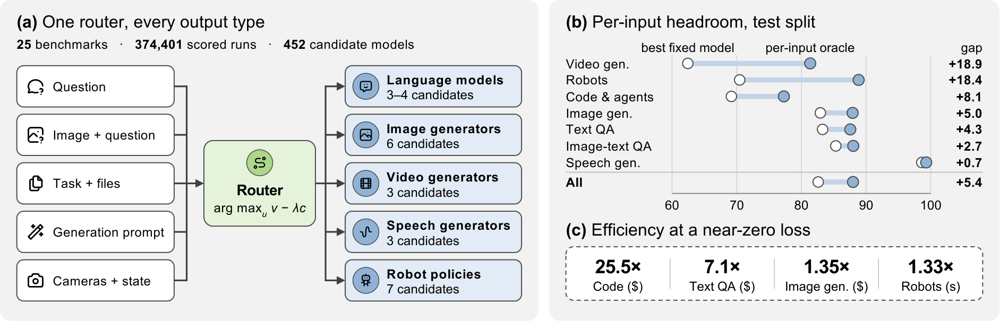
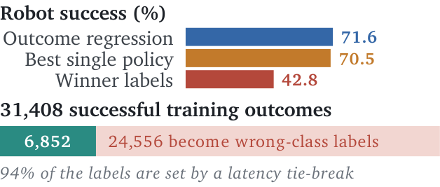
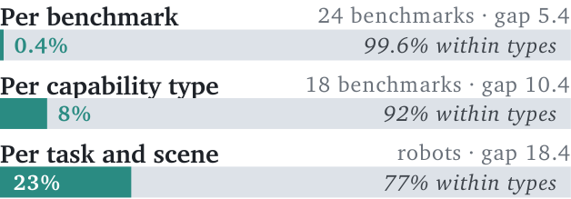
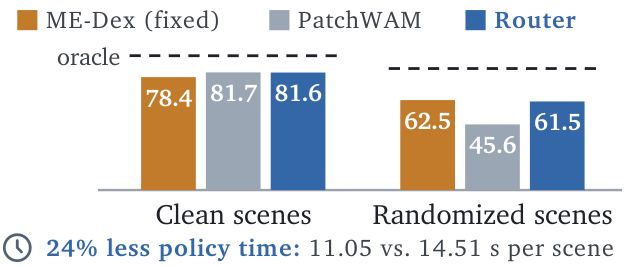
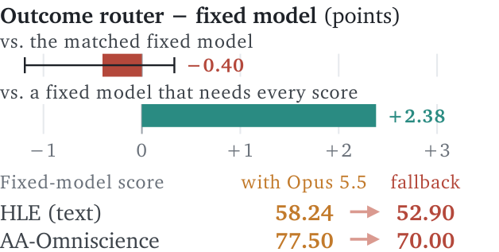

> **원문**: [arXiv](https://arxiv.org/abs/2611.05275) · [HuggingFace](https://huggingface.co/papers/2611.05275) (👍 84) · [GitHub](https://github.com/InfRec-Cardinal/route-anything)
{: .prompt-info }

## 들어가며

어제 HuggingFace Daily Papers에서 84 upvote를 받은 논문입니다. 저자 소속을 보면 National University of Singapore HPC-AI Lab(Colossal-AI로 유명한 Yang You 교수 연구실), InfRec/Cardinal AI Lab, UC Berkeley, HKUST가 섞여 있는데, 이 조합 자체가 이 논문의 성격을 잘 보여줍니다 — 이론과 대규모 실측을 같이 하겠다는 겁니다.

라우팅(routing) 연구, 그러니까 "질문마다 어떤 모델을 쓸지 고르는" 연구는 지금까지 거의 전부 텍스트 LLM에 한정되어 있었습니다. FrugalGPT 같은 캐스케이드, RouteLLM 같은 학습 라우터, 최근의 unified routing theory까지 전부 "언어모델 중에 뭘 고를까"였죠. 이 논문은 그 범위를 언어모델, 이미지·비디오·음성 생성기, 코드/업무 에이전트, 로봇 정책까지 넓혀서 "후보(candidate)"라는 하나의 틀로 묶고, 25개 벤치마크에서 452개 후보 조합을 돌려 374,401건의 실행 기록을 쌓았습니다. 개인적으로 흥미로웠던 지점은, 이게 단순히 "라우터를 더 잘 만들었다"는 논문이 아니라 "라우팅이 언제 이득이고 언제 아닌지"를 수학적으로 못박으려는 시도라는 점입니다.

## 한눈에 보기

- **핵심 기여**: ① 가격(λ), 기준 정책(reference), 품질 하한(floor)을 포함한 라우터 가치의 통일된 이론 — 특히 "라우터가 무엇을 관찰하느냐가 성능의 상한을 결정한다"는 information ladder. ② 25개 벤치마크·452개 후보·374,401건 실행으로 구성된 omni-modal trajectory matrix. ③ 학습된 라우터가 고정 최고 후보 대비 평균 +0.3점, 비디오 생성에서는 +2.1점까지 개선. ④ 가격을 고려하면 기준 모델 대비 평균 8.82배(코드 작업에서는 25.5배) 효율 향상.
- **성능**: 입력별 최적 선택(oracle)은 고정 best 후보보다 5.4점 높지만, 학습된 라우터는 이 격차의 6%만 회수합니다. 반면 "품질은 거의 그대로 두고 비용만 줄이는" 방향에서는 효과가 훨씬 극적입니다.
- **한 줄 요약**: "항상 제일 센 모델을 쓴다"와 "매 입력마다 최적을 고른다" 사이의 현실적인 간극이 얼마나 크고 어디에 있는지, 그리고 그 간극을 돈으로 환산하면 어떤 선택이 남는지를 실측으로 보여준 논문입니다.

## 어떤 문제를 풀려고 했나

지금까지 라우팅 이론은 거의 텍스트 한정이었습니다. 저자들은 질문, 이미지+질문, 작업+파일, 생성 프롬프트, 카메라 프레임+로봇 상태를 전부 "입력(input)"으로, 언어모델·이미지/비디오/음성 생성기·로봇 정책·"싼 모델로 시도하고 검증 후 에스컬레이션" 같은 실행 계획까지 전부 "후보(candidate)"로 통칭합니다. 그리고 세 가지 질문을 던집니다.

1. 라우팅이 줄 수 있는 잠재적 이득(headroom)은 얼마나 큰가?
2. 실제로 학습된 라우터가 그 이득을 얼마나 잡아내는가?
3. 가격을 고려했을 때, 언제 더 싼 경로로 바꿔도 충분한가?

이 세 질문에 답하려면 "같은 입력에 여러 후보를 전부 돌려본" 데이터가 필요한데, 이게 바로 이 논문의 핵심 인프라인 trajectory matrix입니다. 공정하게 비교하려고 모든 후보를 똑같은 입력에 돌린 것 자체가 상당한 비용이 들었을 것으로 보이는데, 이 부분이 논문의 가장 설득력 있는 부분이기도 합니다.

## 핵심 아이디어

다음은 논문 전체 구조를 요약한 Figure 1입니다.

_(a) 질문, 이미지+질문, 작업+파일, 생성 프롬프트, 카메라+로봇 상태 같은 다양한 입력을 하나의 라우터가 받아서 언어모델·이미지/비디오/음성 생성기·로봇 정책 후보군으로 보냅니다. (b) 테스트셋에서 입력별 최적 선택(파란 점)이 고정 최고 모델(흰 점)보다 평균 5.4점 앞서는데, 비디오 생성·로봇은 격차가 18점대로 특히 크고 음성 생성은 0.7점으로 거의 없습니다. (c) 품질 손실을 0.5점 이내로 묶었을 때 기준 모델 대비 얻는 효율 배수로, 코드에서 25.5배까지 올라갑니다._

(a) 패널의 수식 $\arg\max_u\, v - \lambda c$가 이 논문 전체를 관통하는 라우팅 규칙이고, (b)·(c)는 뒤에서 하나씩 뜯어볼 두 가지 질문 — "라우팅의 잠재 이득이 얼마나 큰가"와 "가격을 고려하면 얼마나 싸지는가" — 을 미리 요약해서 보여줍니다.

### 라우터의 가치를 어떻게 정의하는가

저자들은 입력 $x$마다 후보 집합 $\mathcal U(x)$가 있고, 후보 $u$를 실행하면 가치 $V_u \in [0,1]$(벤치마크 점수)와 비용 $D_u$(달러나 초)가 나온다고 둡니다. 라우터는 상태 $s=\sigma(x)$만 보고 후보를 고르는데, 이 $\sigma$가 벤치마크 이름일 수도, 과제 유형일 수도, 입력 전체일 수도 있습니다. 가격 $\lambda$가 주어지면 라우터의 목표는

$$Q=\mathbb{E}[V_g-Y_B],\quad \mathcal S=\mathbb{E}[C_B-D_g],\quad \eta=\frac{\mathbb{E}[V_g]}{\mathbb{E}[D_g]},\quad \eta_B=\frac{\mathbb{E}[Y_B]}{\mathbb{E}[C_B]},\quad Q\ge-\epsilon$$

로 정리됩니다. 여기서 $Y_B, C_B$는 "항상 제일 센 모델을 쓴다" 같은 기준 정책(reference)의 가치와 비용이고, $Q$는 기준 대비 품질 변화, $\mathcal S$는 기준 대비 절약액, $\eta$는 (내 라우터의) 품질/비용 효율, $\eta_B$는 기준 정책의 효율입니다. 마지막 $Q \ge -\epsilon$이 품질 하한(floor) 제약이고요.

이 수식 자체는 평범한 비율 정의처럼 보이지만, 의미 해석에서 중요한 포인트는 "효율이 좋아지는 것"과 "품질이 바닥 밑으로 안 떨어지는 것"이 **서로 다른 조건**이라는 겁니다. 논문은 바로 다음 문장에서 반례를 듭니다 — 기준 정책의 1/10 비용으로 15%만 정답을 맞히는 모델은 $\eta$로는 기준의 1.5배지만 $Q=-0.85$로 사실상 쓸모가 없습니다. 효율 숫자 하나만 보고 "싸고 좋다"고 판단하면 안 된다는 걸 수식 단계에서부터 못박는 셈입니다.

### 최적 라우터는 "가치 빼기 가격×비용"을 최대화하는 후보만 쓴다

이론의 핵심 결과(Theorem 1)는, 가격 $\lambda$가 주어졌을 때 최적 라우터는 각 상태 $s$에서

$$g^\star(s) = \arg\max_u\ \bigl[v(s,u)-\lambda\, c(s,u)\bigr]$$

를 만족하는 후보만 쓴다는 겁니다. $v(s,u)$는 상태 $s$에서 후보 $u$의 기대 가치, $c(s,u)$는 기대 비용입니다. 직관적으로는 "가격표가 있으면 가성비 1등만 쓰면 된다"는 당연한 얘기인데, 재미있는 부분은 효율의 최댓값 $\eta^\star$를 구하는 방법입니다. 저자들은 $\Phi(\lambda)=\sum_s \pi(s)\max_u[v(s,u)-\lambda c(s,u)]$라는 함수를 정의하고, $\eta^\star$가 바로 $\Phi(\lambda)=0$의 해라는 걸 보입니다(Dinkelbach의 분수계획법 트릭). 이게 왜 중요하냐면, 뒤에서 "기준 모델을 부르는 게 손해 보기 시작하는 가격선"(admission price)을 계산할 때 그대로 재사용되기 때문입니다 — 코드 실험에서 기준 모델 Opus 4.6의 admission price는 달러당 100점인데, 전체 최적 효율 $\eta^\star$는 1022라서, 품질 손실을 0으로 맞추려는 라우터는 **아예 Opus를 한 번도 부르지 않습니다**. 이론 하나가 "왜 비싼 모델을 거의 안 쓰는 게 최적인지"를 숫자로 설명해주는 셈입니다.

### 정보의 사다리 — 거칠게 보는 라우터는 딱 거칠게만 이득을 본다

가장 마음에 들었던 개념은 information ladder입니다. 라우터가 입력을 얼마나 세밀하게 보느냐에 따라 도달 가능한 성능에 순서가 생긴다는 명제입니다.

$$V^\star(\sigma_1)\ \le\ V^\star(\sigma_2)\ \le\ V^\star(x)\ \le\ \mathbb{E}\bigl[\max_u W_u\bigr]$$

$\sigma_1$이 $\sigma_2$보다 거친 관찰(예: $\sigma_1$=벤치마크 이름, $\sigma_2$=세부 과제 유형)이면, 거친 관찰만 보는 라우터의 최선($V^\star(\sigma_1)$)은 더 세밀한 관찰을 보는 라우터의 최선($V^\star(\sigma_2)$)을 절대 넘지 못하고, 그 끝에는 입력 전체를 보는 라우터($V^\star(x)$), 더 끝에는 노이즈까지 포함한 완전한 오라클($\mathbb{E}[\max_u W_u]$)이 있습니다.

이 사다리가 중요한 이유는 뒤에 나오는 실험 결과를 전부 해석하는 틀이 되기 때문입니다. 예를 들어 107~157개 세부 유형(leaf)으로 나누는 규칙 기반 라우터를 18개 벤치마크에 돌려보면, 유형별 최선을 사후에 골라도 전체 격차(5.4점)의 겨우 8%만 회수됩니다. 사다리 이론대로라면 당연한 결과인데 — 벤치마크 이름보다 더 세밀한 "유형"이라는 정보가 거의 도움이 안 된다는 뜻은, 격차 대부분이 **같은 유형 안에서, 입력 하나하나마다** 벌어진다는 뜻입니다. 로봇 조작에서는 반대로 장면 조건(깨끗한 장면 vs 무작위 장면)만 알아도 격차의 23%가 회수되는데, 이건 "장면 조건"이라는 중간 단계 정보가 로봇에서는 꽤 많은 걸 설명한다는 의미입니다. 같은 사다리 이론으로 두 분야의 전혀 다른 양상을 설명할 수 있다는 게 이 틀의 강점입니다.

### 승자를 맞히지 말고 결과를 배워라

라우터를 학습시킬 때 흔히 쓰는 두 가지 타깃이 있습니다. 각 후보의 실제 결과(outcome)를 회귀로 맞히거나, "이번엔 누가 제일 잘했는지"(winner)를 분류로 맞히는 것. 논문은 winner 라벨이 **값의 범위 절반 가까이를 잃을 수 있다**고 수학적으로 보입니다. 극단적인 예시를 들면, 후보 A가 항상 $a<1$을 내고 후보 B가 확률 $b\in(\tfrac12, a)$로 1을, 나머지는 0을 낸다고 합시다. B가 이기는 비율($p_B=b$)이 A가 이기는 비율보다 높아서 winner 분류기는 B를 고르지만, 실제 기댓값은 $\mathbb{E}[V_B]=b<a$라서 A가 더 좋습니다. "자주 이기는 것"과 "평균적으로 좋은 것"이 다르다는, 생각해보면 당연하지만 실무에서 자주 놓치는 함정입니다.

이게 추상적인 얘기만은 아니라는 걸 로봇 실험이 보여줍니다. 다음은 같은 입력·백본으로 outcome 회귀와 winner 분류를 비교한 그림입니다.

_outcome 회귀는 71.6%, winner 분류는 42.8%. 31,408개의 학습 성공 사례 중 24,556개가 winner 라벨 기준으로는 "틀린 클래스"가 됩니다._

왜 이런 큰 차이가 날까요? 로봇 정책 여러 개가 대부분의 훈련 장면에서 다 성공하다 보니, 승자를 가르는 기준이 거의 "누가 더 빠른가"(tie-break)로 수렴해버립니다. 실제로 라벨의 94%가 속도 동점 처리로 결정됐다고 합니다. 그 결과 winner 분류기는 "빠르지만 자주 실패하는" 정책을 고르도록 학습되고, 성공했던 사례 3만 1천여 건 중 2만 4천여 건이 "오답"으로 취급됩니다. 이론에서 예측한 함정이 실제 숫자로 그대로 나타난 사례라 인상 깊었습니다.

## 실험 결과

### Finding 1 — 잠재적 이득은 크지만, 대부분 과제 유형 '안쪽'에 있다

다음은 24개 벤치마크를 7개 그룹으로 묶어, 고정 최고 후보(Fixed)와 입력별 최적 선택(Oracle) 사이의 격차를 정리한 표입니다.

| Group | Benchmarks | Candidates | Inputs | Fixed | Best fixed in hindsight | Oracle | Gap |
|---|---:|---:|---:|---:|---:|---:|---:|
| Text QA | 7 | 3–4 | 9,482 | 83.27 | 83.27 | 87.56 | 4.28 |
| Image-text QA | 3 | 3 | 5,708 | 85.32 | 85.32 | 88.02 | 2.70 |
| Image generation | 5 | 4–6 | 1,515 | 82.93 | 82.99 | 87.92 | 4.99 |
| Video generation | 1 | 3 | 158 | 62.43 | 62.43 | 81.36 | 18.93 |
| Speech generation | 2 | 3 | 608 | 98.62 | 98.63 | 99.30 | 0.68 |
| Code and workplace agents | 5 | 4 | 343 | 69.17 | 69.78 | 77.29 | 8.11 |
| Robot manipulation | 1 | 7 | 2,000 | 70.45 | 70.45 | 88.85 | 18.40 |
| **All** | 24 | — | 19,814 | 82.60 | 82.62 | 87.98 | **5.38** |

패턴을 짚어보면, 음성 생성처럼 어떤 모델을 써도 다 거의 완벽한 영역(격차 0.68점)과, 비디오 생성·로봇 조작처럼 후보 간 우열이 입력마다 크게 갈리는 영역(격차 18점대)이 극명하게 갈립니다. 그리고 "Best fixed in hindsight"(테스트셋에서 사후에 고른 최선의 고정 후보) 열이 Fixed 열과 거의 같다는 게 중요한데, 이건 과적합 없이도 "애초에 라우팅할 여지가 거의 없는" 영역과 "여지가 큰" 영역이 뚜렷이 갈린다는 뜻입니다.

다음 그림은 그 격차 5.4점(혹은 10.4점, 18.4점) 중 얼마나가 "과제 유형"이라는 중간 정보로 회수되는지를 보여줍니다.

_벤치마크 단위로는 격차의 0.4%, 과제 유형 단위로는 8%, 로봇의 과제·장면 단위로는 23%만 회수됩니다._

앞서 설명한 information ladder 그대로입니다. 텍스트·이미지 쪽은 "과제 유형"이라는 정보가 거의 쓸모없고(92~99.6%가 유형 안쪽에 남음), 로봇만 유독 장면 조건 정보가 꽤 쓸모 있습니다(23% 회수). 저자들은 이걸 "로봇은 카메라로 보이는 조건이 어떤 정책이 이길지를 상당 부분 결정하지만, 텍스트·이미지는 같은 유형 안에서도 입력마다 승자가 계속 바뀐다"고 해석하는데, 납득이 갑니다.

### Finding 2·3·4 — 학습된 라우터의 실제 성적

16개 벤치마크에 하나의 capability-tree 라우터(Qwen3.5-4B를 과제 유형 분류기로 파인튜닝)를 돌린 결과입니다.

| Group (benchmarks) | Inputs | Fixed | Router | Oracle | Router − Fixed | Share |
|---|---:|---:|---:|---:|---:|---:|
| Text QA (3) | 588 | 65.14 | 64.97 | 71.43 | −0.17 | −3% |
| Code and workplace agents (5) | 519 | 69.24 | 70.01 | 74.78 | +0.77 | 14% |
| Image generation (5) | 1,559 | 82.96 | 83.21 | 87.92 | +0.25 | 5% |
| Video generation (1) | 161 | 62.17 | 64.28 | 80.22 | +2.12 | 12% |
| Speech generation (2) | 617 | 98.63 | 98.63 | 99.30 | 0.00 | 0% |
| **All 16 benchmarks** | 3,444 | 79.68 | 79.98 | 84.80 | **+0.30** | 6% |
| Robot manipulation (outcome router) | 2,000 | 70.45 | 71.55 | 88.85 | +1.10 | 6% |

전체 평균 +0.30점은 솔직히 크지 않은 숫자입니다. 저자들도 이 부분을 숨기지 않고, 라우터가 10개 벤치마크에서는 고정 후보와 0.01점 이내로 똑같이 행동한다고 밝힙니다. 심지어 leaf 분류기 정확도가 86~89%나 되는데도 입력의 83~86%는 여전히 고정 후보로 보내지는데, 이건 나쁜 라우터라서가 아니라 "한 벤치마크 안에서는 거의 한 후보가 거의 모든 유형에서 이기기 때문"이라고 설명합니다. 반대로 득을 보는 지점은 뚜렷합니다 — Terminal-Bench(+8.3점, 다만 36개 입력뿐이라 표본이 작습니다), VBench-2.0(+2.1점), OneIG(+1.1점). 가장 크게 손해 본 곳은 AA-LCR(−2.4점)입니다. 개인적으로 재미있었던 디테일은, 아무 학습도 안 한 Qwen3.5-4B에게 그냥 "네가 골라봐"라고 시키면 고정 후보보다 1.15점 더 나쁘다는 겁니다. 즉 분류기를 제대로 학습시키지 않은 라우터는 차라리 안 쓰느니만 못하다는 뜻이죠.

로봇에서는 사정이 조금 다릅니다. 카메라 3장과 로봇 상태만 보고 7개 정책 각각의 성공 확률을 예측하는 outcome 라우터가 "깨끗한 장면"에서는 PatchWAM을, "무작위 장면"에서는 ME-Dex를 주로 선택합니다.

_깨끗한 장면에서는 PatchWAM(81.7%)에 가깝게, 무작위 장면에서는 ME-Dex(62.5%)에 가깝게 따라가면서, 전체 추론 시간은 24% 줄입니다._

전체 성공률은 71.55%로 고정 최고 정책(70.45%)보다 1.1점 높은데, 이 정도 격차는 신뢰구간이 [−0.40, +2.55]라 통계적으로 아주 단단하진 않습니다. 하지만 흥미로운 건 성공률이 아니라 효율입니다 — 장면당 평균 추론 시간이 14.51초에서 11.05초로 24% 줄어서, 정책-초당 성공률로는 최고 단일 정책의 1.33배입니다. "어느 쪽이 이기는지 맞히는" 것보다 "이 장면에서는 굳이 느린 정책을 쓸 필요가 없다는 걸 아는" 쪽이 더 확실한 이득이라는 인상을 줍니다.

### Finding 5·6 — 비교 방식과 가격이 결론을 뒤집는다

라우팅과 별개로, 제가 가장 실무적으로 유용하다고 느낀 부분은 "공정한 비교" 문제입니다. Opus 5.5는 HLE의 1,122개 훈련 입력 중 11개에서 점수가 없었는데, "모든 입력에 점수가 있어야만 후보로 인정"하는 흔한 기준을 쓰면 이 벤치마크에서 Opus 5.5 대신 차선 모델로 대체되어 고정 후보 점수가 58.24에서 52.90으로 떨어집니다. AA-Omniscience에서도 77.50 → 70.00으로 비슷한 일이 벌어지고요. 그 결과 전체 평균 고정 후보 점수가 68.30에서 65.52로 떨어지고, 원래는 라우터가 고정 후보보다 0.40점 손해였던 결과가 2.38점 이득으로 **부호가 뒤집힙니다**.

_매칭된 고정 후보 대비로는 라우터가 −0.40점 손해지만, "모든 점수가 있어야 인정"하는 기준으로 바꾸면 +2.38점 이득으로 부호가 바뀝니다. 아래쪽은 그 원인인 HLE·AA-Omniscience에서 Opus 5.5가 결측 때문에 탈락하며 점수가 떨어지는 모습입니다._

위쪽 막대 두 개를 비교하면 "라우터가 좋다/나쁘다"는 결론이 비교 기준선 하나로 뒤집히는 게 한눈에 보이고, 아래쪽 숫자는 그 기준선이 왜 바뀌는지를 구체적으로 보여줍니다 — Opus 5.5가 HLE 1,122개 중 11개에서만 점수가 없어도, "결측 있으면 탈락" 규칙 아래서는 차선 모델로 통째로 대체되어 58.24점이 52.90점이 됩니다. 라우터가 갑자기 좋아진 게 아니라, 비교 기준선이 바뀐 것뿐입니다. 벤치마크 비교에서 결측치 처리 하나가 이렇게 결론을 뒤집을 수 있다는 걸 숫자로 보여준 부분이라, 라우팅 연구가 아니더라도 모델 비교 실험을 하는 사람이라면 한 번쯤 곱씹어볼 만합니다.

가격을 고려했을 때의 결과는 다음 표에 정리되어 있습니다.

| Testbed (resource) | Reference | Route | ΔV [95% CI] | η/η_B |
|---|---|---|---:|---:|
| Code, CodeRouterBench ($) | Always Opus 4.6 | Fitted, ε=0 | −0.44 [−1.75, +0.97] | 25.5× |
| | | Certified, ε=0 | ≥0 in 200/200 | 19.4× |
| Text QA, RouterBench ($) | Always GPT-4 | Fitted, ε=0 | −0.40 [−0.84, +0.08] | 7.1× |
| | | Certified, ε=0 | ≥0 in 200/200 | 6.7× |
| Image generation ($) | Fixed generator | Fitted, ε=0.5 | −0.47 [−0.87, −0.06] | 1.35× |
| | | Fitted, ε=2 | −1.56 [−2.39, −0.73] | 2.03× |
| Robot manipulation (s) | Fixed policy | Outcome router | +1.10 [−0.40, +2.55] | 1.33× |

코드 작업에서 25.5배라는 숫자가 눈에 띄는데, 품질 손실은 겨우 0.44점입니다. 이게 가능한 이유가 바로 앞서 설명한 admission price입니다 — Opus 4.6을 부르는 게 손해 보기 시작하는 가격선(달러당 100점)이 전체 최적 효율(1022)보다 한참 낮아서, 품질 손실 0을 목표로 하는 라우터는 애초에 Opus를 거의 부르지 않습니다. 다만 저자들은 정직하게 한계도 보고하는데, 훈련 데이터의 절반으로 피팅한 "fitted floor"는 새로운 테스트 분할에서 200번 중 12.5%만 품질 하한을 지킵니다. 그래서 통계적으로 보수적인 "certified floor"(나머지 절반으로 가설검정)를 쓰면 200번 중 200번 다 하한을 지키면서도 19.4배라는, 여전히 큰 효율을 얻습니다. "최적화는 과적합되기 쉬우니 반드시 별도 데이터로 검증하라"는 원칙을 라우팅에도 그대로 적용한 셈입니다.

## 아쉬운 점 / 의문점

몇 가지 걸리는 부분이 있습니다. 첫째, 학습된 라우터의 전체 효과(+0.3점)가 생각보다 작아서, "87~89% 정확도의 분류기를 따로 학습시킬 가치가 있는가"라는 질문에는 논문 스스로도 완전히 긍정적이지 않습니다. 규칙 기반 트리(분류기 학습 없이 107개 leaf를 직접 정의)가 거의 비슷한 성능(+0.09점)을 낸다는 걸 보면, 적어도 지금 설정에서는 "학습"의 기여가 제한적입니다.

둘째, GitHub 저장소를 확인해보니 라우터 코드와 분석 스크립트는 공개되어 있지만, 이 논문의 핵심 자산인 omni-modal trajectory matrix 자체는 README에 "proprietary, 공개하지 않는다"고 명시되어 있습니다. 452개 후보 × 25개 벤치마크를 다시 돌리려면 상당한 API 비용이 들 텐데, 이 데이터 없이는 논문의 핵심 주장(헤드룸 5.4점, 효율 8.82배)을 커뮤니티가 직접 재현하기는 어려워 보입니다.

셋째, 학습 라우터는 전부 Qwen3.5-4B 백본 하나로 고정되어 있습니다. 백본을 바꾸면 +0.3점이라는 결과가 얼마나 민감하게 변하는지는 논문에 없어서, 이 숫자가 "라우팅이라는 과제 자체의 한계"인지 "이 특정 백본의 한계"인지는 명확히 구분하기 어렵습니다.

넷째, 로봇 실험은 RoboTwin 시뮬레이션 하나에 의존합니다. 저자들도 Limitations에서 이론이 "라우터 자신의 과거 선택에 의존하는 상태"(예: SciCode처럼 이전 단계 코드가 다음 단계 입력에 포함되는 경우)는 다루지 않는다고, 그리고 장기 호흡의 에이전트 작업에 대한 step-level 라우팅은 더 깊은 탐구가 필요하다고 스스로 인정합니다. 실제 production에 가까운 멀티스텝 에이전트 시나리오에서 이 이론이 얼마나 그대로 통할지는 이 논문만으로는 판단하기 어렵습니다.

## 마치며

라우팅 연구가 거의 텍스트 LLM에만 머물러 있던 와중에, 이미지·비디오·음성·로봇까지 끌어안고 452개 후보 조합을 전부 같은 입력에 돌려서 37만 건이 넘는 실행 기록을 쌓은 스케일 자체가 인상적이었습니다. 개인적으로는 "학습 라우터가 얼마나 똑똑한가"보다 "언제 비싼 모델을 아예 부르지 않아도 되는가"를 수식으로 못박은 admission price와 certified floor 쪽이 더 실무적으로 와닿았습니다. 지금 많은 멀티 에이전트 시스템이 "일단 제일 센 모델을 기본값으로 깔고 가끔 싼 모델로 바꿔치기"하는 식으로 돌아가는데, 이 논문의 틀을 쓰면 "언제 바꿔 타도 안전한지"를 데이터로 증명하고 갈 수 있다는 게 핵심 제안인 것 같습니다. 다음에 관심 있게 볼 지점은, 이 admission-price 공식이 실제 멀티스텝 코딩 에이전트나 오케스트레이션 시스템처럼 상태가 라우터 자신의 과거 선택에 의존하는 상황에서도 그대로 성립하는지입니다.
