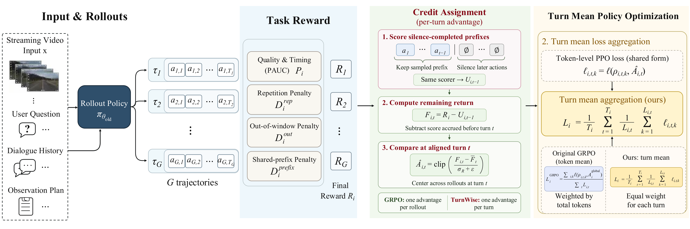
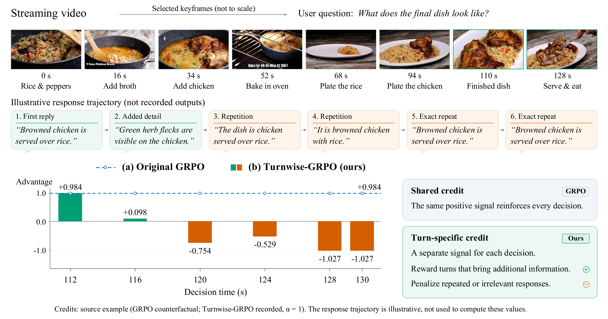
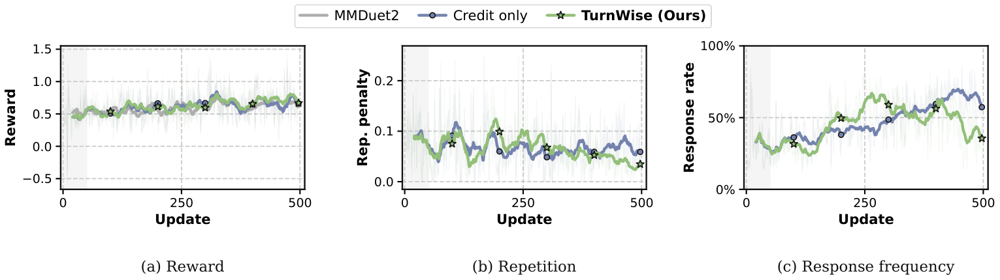
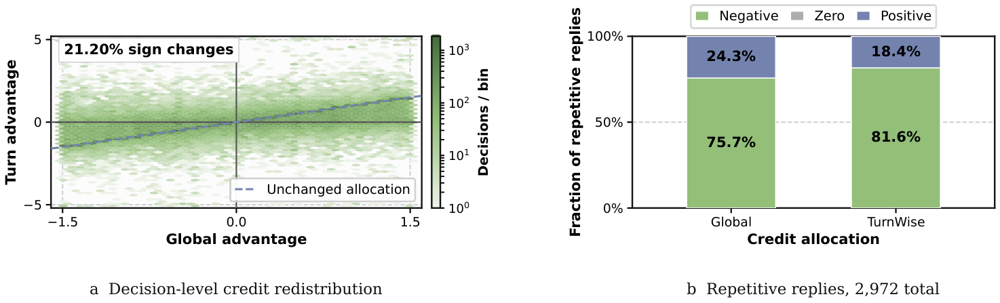

> **원문**: [arXiv](https://arxiv.org/abs/2611.06728) · [HuggingFace](https://huggingface.co/papers/2611.06728) (👍 80) · [GitHub](https://github.com/XD111ds/turn-wise-rl)
{: .prompt-info }

## 들어가며

오늘 HuggingFace Daily Papers에서 80 upvote를 받은 논문입니다. 저자 소속이 Fudan University, Shanghai AI Lab, JD.com인데, JD.com 소속 저자가 가장 많고 project leader도 JD.com 소속인 걸 보면 산업 쪽에서 스트리밍 영상 어시스턴트를 실제로 돌리면서 부딪힌 문제를 RL 쪽에서 정리한 논문으로 보입니다.

스트리밍 비디오 이해라는 태스크 자체가 재밌습니다. 보통의 비디오 QA는 영상을 다 보고 나서 답하면 되지만, 스트리밍 설정에서는 영상이 계속 들어오는 와중에 "지금 답할까, 더 기다릴까"를 반복적으로 결정해야 합니다. 이 결정을 GRPO로 학습시키려는 시도(MMDuet2, ThinkStream, StreamPro)가 최근 몇 편 나왔는데, 이 논문은 "다들 보상을 더 정교하게 설계하는 데만 집중했지, 정작 그 보상을 어떻게 턴 단위로 나눠줄지는 아무도 안 건드렸다"는 지점을 파고듭니다. 제목 그대로 "턴이 중요하다"는 주장이고, 읽어보니 꽤 설득력 있는 지적입니다.

## 한눈에 보기

- **핵심 기여**: ① 스트리밍 비디오 RL에서 궤적 전체에 같은 어드밴티지를 broadcasting하는 GRPO의 구조적 문제(granularity mismatch)를 짚어낸다. ② 비평가(critic) 모델이나 추가 롤아웃 없이, 침묵-완성(silence-completed) 프리픽스 점수만으로 턴별 remaining-return 어드밴티지를 계산하는 TurnWise를 제안한다. ③ 응답/대기 결정에 토큰 길이와 무관하게 동일한 가중치를 주는 turn-mean 손실 집계를 더한다.
- **성능**: Qwen2.5-VL-3B·Qwen3-VL-4B 두 백본 모두에서 ProactiveVQA·OVO-Timing·StreamingBench 세 벤치마크 전부 최고 집계 점수. 3B에서는 ProactiveVQA +3.96, OVO-Timing +3.87, StreamingBench +0.69, 4B에서는 각각 +6.26, +1.92, +2.38점 개선.
- **한 줄 요약**: 좋은 궤적 안에도 나쁜 턴이 있고, 나쁜 궤적 안에도 좋은 턴이 있다는 당연한 관찰을, "이 턴 이후로 얼마나 더 잘했나"만 떼어내 어드밴티지로 쓰는 방식으로 풀어낸 논문입니다.

## 어떤 문제를 풀려고 했나

스트리밍 인스턴스는 비디오 $x$, 유저 질문, 초기 대화 이력 $h_0$, 그리고 언제 결정을 내릴지 정하는 observation plan으로 구성됩니다. 각 결정 시점 $t$에서 정책 $\pi_\theta$는 텍스트 응답을 하거나 명시적인 대기 행동 `NO REPLY`($\varnothing$)를 출력합니다. GRPO는 하나의 인스턴스에서 $G$개 궤적 $\tau_i = (a_{i,1}, \ldots, a_{i,T_i})$를 샘플링하고, 궤적 전체를 평가해서 하나의 보상 $R_i$를 매긴 뒤, 그 보상을 그룹 내 평균·표준편차로 정규화한 하나의 어드밴티지를 궤적에 속한 모든 토큰에 그대로 뿌립니다.

문제는 여기서 생깁니다. 한 궤적 안에서 초반에 좋은 응답을 했고 트래젝토리 보상이 그룹 평균보다 높다고 해봅시다. 그런데 그 뒤로 같은 내용을 반복하는 불필요한 응답을 몇 번 더 냈다면? GRPO 입장에서는 이 궤적 전체가 "좋은 궤적"이므로, 뒤에 나온 반복 응답에도 똑같이 양의 어드밴티지가 걸립니다. 보상 함수 자체는 반복을 패널티로 잡고 있는데도, 궤적 단위로 뭉뚱그려진 어드밴티지가 그 패널티 신호를 희석시켜 버리는 거죠. 반대 방향도 성립합니다 — 초반에 삽질한 궤적은 전체 보상이 그룹 평균보다 낮아서, 뒤늦게 낸 유용한 후속 응답조차 음의 어드밴티지를 받습니다. 저자들은 이걸 "어떤 턴의 학습 신호가 그 턴 이전에 쌓인 보상에까지 영향을 받는다"는 granularity mismatch로 정리합니다.

## 핵심 아이디어

다음은 TurnWise의 4단계 파이프라인을 보여주는 전체 구조도입니다.

_Figure 2. Input & Rollouts에서 $G$개 궤적을 샘플링하고, Task Reward에서 품질·반복·창 밖 응답·과도한 공유 프리픽스를 조합해 궤적 보상 $R_i$를 만든 뒤, Credit Assignment에서 침묵-완성 프리픽스 점수로 턴별 어드밴티지 $\hat A_{i,t}$를 계산하고, 마지막 Turn Mean Policy Optimization에서 턴마다 동일한 가중치로 손실을 집계합니다._

왼쪽부터 보면, 궤적 보상 자체는 MMDuet2가 쓰던 PAUC 기반 보상을 그대로 가져옵니다.

$$R_i = \mathcal{R}(\tau_i) = 3P_i - 2D_i^{\mathrm{rep}} - 0.5D_i^{\mathrm{out}} - 2D_i^{\mathrm{prefix}}$$

$P_i$는 답변 품질과 정해진 reply window 안에서의 적시성을 함께 측정한 점수고, $D_i^{\mathrm{rep}}$는 이미 앞선 응답이 다룬 내용을 또 반복한 비율, $D_i^{\mathrm{out}}$은 reply window를 벗어난 턴에서 응답한 비율, $D_i^{\mathrm{prefix}}$는 공유 프리픽스가 비정상적으로 긴 경우에 대한 패널티입니다.

이 논문이 새로 건드리는 부분은 보상 함수가 아니라, 이 보상을 턴마다 어떻게 나눠주느냐입니다. 기존 GRPO는 이렇게 합니다.

$$A_i^{\mathrm{global}} = \frac{R_i - \bar R}{\sigma_R + \epsilon}, \qquad \bar R = \frac{1}{G}\sum_{j=1}^{G} R_j$$

$\bar R$은 그룹 내 평균 보상, $\sigma_R$은 표준편차입니다. 이 $A_i^{\mathrm{global}}$ 하나를 궤적의 모든 턴, 모든 토큰에 그대로 씁니다. 즉 턴이 10개든 2개든, 그 궤적 안에서는 전부 같은 숫자로 학습됩니다.

TurnWise는 여기에 "침묵-완성 프리픽스 점수(silence-completed prefix scoring)"라는 트릭을 씁니다. 스트리밍 설정에는 명시적인 대기 행동 $\varnothing$이 있다는 점을 이용해서, 궤적의 앞부분 $t$개 결정은 그대로 두고 그 뒤 나머지를 전부 침묵으로 바꿔치기한 가상의 궤적을 만들고, 이걸 같은 보상 함수로 채점합니다.

$$U_{i,t} = \mathcal{R}\bigl(a_{i,1}, \ldots, a_{i,t}, \underbrace{\varnothing, \ldots, \varnothing}_{T_i - t}\bigr), \qquad 0 \le t \le T_i$$

여기서 $U_{i,t}$는 "턴 $t$까지만 실제로 응답하고 그 뒤로는 아무 말도 안 했다면 받았을 점수"입니다. $U_{i,0}$은 전부 침묵인 기준선이고, $U_{i,T_i}=R_i$는 원래 궤적 보상 그대로입니다. 이 양 끝 사이를 채우면, 턴 $t$ 이전에 쌓인 "이미 확보한 보상" $C_{i,t-1}=U_{i,t-1}-U_{i,0}$과, 턴 $t$부터 끝까지 "앞으로 더 번 보상" $F_{i,t}=R_i - U_{i,t-1}$로 정확히 분해됩니다. 핵심은 이 분해가 근사가 아니라 텔레스코핑으로 유도되는 등식이라는 점이고, 논문은 부록에서 $D_i^{\mathrm{rep}}$ 같은 비율 기반(non-additive) 패널티에도 이 분해가 정확히 성립함을 보입니다.

이제 턴별 어드밴티지는 전체 보상 $R_i$ 대신 이 remaining return $F_{i,t}$를 그룹 내에서 상대 비교해서 만듭니다.

$$\hat A_{i,t} = \left[A_i^{\mathrm{global}} - \frac{C_{i,t-1}-\bar C_{t-1}}{\sigma_R+\epsilon}\right]_{-a_{\max}}^{a_{\max}}$$

$\bar C_{t-1}$은 그룹 내 다른 롤아웃들의 "턴 $t$ 이전 누적 보상" 평균이고, $[\cdot]_{-a_{\max}}^{a_{\max}}$는 값을 $\pm a_{\max}$로 클리핑하는 연산자입니다($a_{\max}=5$). 이 식을 말로 풀면 "원래 GRPO 어드밴티지에서, 이 턴 이전에 이미 확보해둔(그룹 평균 대비 초과분) 보상을 빼준다"는 뜻입니다. 그 결과로, 전체 보상이 평균보다 높은 궤적이라도 특정 턴 이후로 영양가가 없었다면 그 턴은 음의 어드밴티지를 받을 수 있고, 반대로 전체 보상이 낮은 궤적도 뒤늦게 터진 좋은 응답은 양의 어드밴티지를 받을 수 있게 됩니다. 논문은 이 교정 강도를 바로 1로 주지 않고 $\alpha \in [0,1]$로 스케일해서, 학습 초반 10% 구간에서 0부터 1까지 선형으로 끌어올립니다 — 처음엔 기존 GRPO처럼 학습하다가 점점 턴 단위 신용 할당으로 전환하는 워밍업입니다.

여기서 제가 흥미로웠던 부분은, 이 교정이 완전히 critic-free라는 점입니다. 보통 턴 단위 어드밴티지를 만들려면 state-value를 추정하는 별도 네트워크가 필요한데, TurnWise는 "침묵으로 채운 가상의 연속"을 같은 보상 함수로 채점하는 것만으로 그 역할을 대신합니다. 추가 롤아웃도 필요 없고, 이미 계산해둔 응답 품질·반복 체크를 캐싱된 scan으로 재활용하기만 하면 됩니다.

두 번째 축인 turn-mean 손실 집계는 비교적 단순합니다. 기존 token-mean GRPO 손실은 턴이 생성한 토큰 수에 비례해서 가중치가 매겨지므로, 긴 응답 하나가 짧은 대기 행동 여러 개보다 손실에서 훨씬 큰 비중을 차지합니다.

$$L_i(\theta) = \frac{1}{T_i}\sum_{t=1}^{T_i}\frac{1}{L_{i,t}}\sum_{k=1}^{L_{i,t}}\ell_{i,t,k}(\theta)$$

$L_{i,t}$는 턴 $t$에서 생성된 토큰 수, $\ell_{i,t,k}$는 PPO 식 클리핑 surrogate 손실입니다. 턴 안에서 먼저 토큰 손실을 평균 내고, 그다음에 턴끼리 다시 평균을 내는 2단계 구조라서, 10토큰짜리 대기 행동과 100토큰짜리 응답이 똑같이 $1/T_i$의 비중을 갖게 됩니다. 저자들은 이 둘을 "credit assignment는 각 턴이 어느 방향으로 학습될지를 정하고, turn-mean aggregation은 그 턴이 손실에서 얼마나 큰 목소리를 낼지를 정한다"로 역할 분담을 설명하는데, 뒤에 나오는 ablation을 보면 실제로 이 둘이 서로 다른 축에서 기여한다는 게 꽤 명확하게 드러납니다.

다음은 이 교정이 실제 응답에 어떻게 작용하는지를 보여주는 예시입니다.

_Figure 1. 128초짜리 요리 영상에서 "최종 요리가 어떻게 생겼나"를 묻는 질문에 모델이 6번 응답하는 가상 시나리오. 처음 두 응답(갈색 치킨이 밥 위에 올라감, 허브 가루가 보임)은 새 정보를 담고 있지만, 3~6번째 응답은 점점 더 노골적으로 같은 문장을 반복합니다._

왼쪽 아래 막대그래프가 핵심입니다. 파란 점선(원래 GRPO)은 궤적 전체 보상이 양수였다는 이유만으로 여섯 턴 모두에 +0.984라는 같은 어드밴티지를 줍니다. 반면 TurnWise(초록/주황 막대)는 처음 두 턴만 양수(+0.984, +0.098)이고 3번째 턴부터는 전부 음수로 뒤집힙니다. 이게 바로 "이 턴 이후로 남은 보상"만 떼어내 비교한 결과입니다. 아키텍처 다이어그램보다 이 그림이 TurnWise가 뭘 하려는 건지 훨씬 직관적으로 보여준다고 생각합니다.

## 실험 결과

학습 파이프라인은 먼저 Qwen2.5-VL-3B와 Qwen3-VL-4B를 EgoExo4D, EgoExoLearn, Live-WhisperX, Tarsier2, LLaVA-Video에서 뽑은 100,874개 예제로 SFT한 뒤, MMDuet2 방식을 따라 3,983개 스트리밍 인스턴스(20초 세그먼트, 최대 90프레임, 2초 간격 샘플링)로 GRPO 학습을 합니다. 배치 8, 인스턴스당 롤아웃 $G=4$, 학습률 $10^{-6}$, KL/엔트로피 정규화 없음. 보상 판정은 `gpt-oss-20b`가 맡습니다.

다음은 세 벤치마크(ProactiveVQA, OVO-Timing, StreamingBench)에서 SFT 및 세 RL 베이스라인(MMDuet2, ThinkStream, StreamPro)과 비교한 메인 결과 표입니다.

| Method | Ego | TV | VAD | Web | PAUC Overall | CRR | SSR | REC | F1 Avg. | RealTime Acc. | Proactive Acc. | Avg. |
|---|---|---|---|---|---|---|---|---|---|---|---|---|
| **Qwen2.5-VL-3B** | | | | | | | | | | | | |
| Baseline | 9.32 | 27.85 | 8.98 | 42.45 | 22.15 | 0.00 | 0.53 | 3.46 | 1.33 | 69.42 | 22.40 | 45.91 |
| + SFT | 26.05 | 27.60 | 26.30 | 35.00 | 28.74 | 0.00 | 0.95 | 0.76 | 0.57 | 74.68 | _22.80_ | _48.74_ |
| + MMDuet2 | _44.10_ | _39.70_ | _28.70_ | 45.90 | _39.60_ | _13.86_ | **17.56** | 21.76 | _17.72_ | 74.88 | 20.40 | 47.64 |
| + ThinkStream | 32.90 | 34.48 | 15.72 | _55.43_ | 34.63 | 4.09 | 4.54 | 15.60 | 8.08 | 72.52 | 16.40 | 44.46 |
| + StreamPro | 39.73 | 37.96 | 22.15 | 52.29 | 38.03 | 7.98 | 6.49 | _29.02_ | 14.50 | _75.16_ | 20.40 | 47.78 |
| **+ TurnWise** | **44.69** | **43.01** | **29.18** | **57.36** | **43.56** | **18.02** | _14.61_ | **32.15** | **21.59** | **75.85** | **23.00** | **49.43** |
| Δ | | | | | +3.96 | | | | +3.87 | | | +0.69 |
| **Qwen3-VL-4B** | | | | | | | | | | | | |
| Baseline | 24.00 | 31.80 | 15.09 | 48.42 | 29.83 | 4.21 | 4.56 | _16.66_ | 8.48 | 73.57 | 32.80 | 53.19 |
| + SFT | 29.10 | 27.07 | _28.46_ | 36.33 | 30.24 | 2.78 | 0.95 | 1.06 | 1.60 | 77.56 | _35.60_ | _56.58_ |
| + MMDuet2 | 24.30 | 28.57 | 24.95 | 42.91 | 30.18 | **11.88** | 4.25 | 11.57 | _9.23_ | 77.28 | 30.40 | 53.84 |
| + ThinkStream | _41.29_ | **38.49** | 19.47 | 45.48 | _36.18_ | 5.67 | _6.09_ | 15.09 | 8.95 | 77.04 | 34.80 | 55.92 |
| + StreamPro | 36.39 | 36.43 | 14.82 | _51.02_ | 34.67 | 4.34 | 4.63 | 16.52 | 8.50 | _78.24_ | 32.80 | 55.52 |
| **+ TurnWise** | **42.63** | _37.73_ | **31.95** | **57.45** | **42.44** | _8.68_ | **7.35** | **17.43** | **11.15** | **79.52** | **38.40** | **58.96** |
| Δ | | | | | +6.26 | | | | +1.92 | | | +2.38 |

(볼드는 1위, _이탤릭_은 2위입니다.)

패턴을 보면, TurnWise는 세 벤치마크 전부의 집계 점수(Avg.)에서 두 백본 모두 1위를 차지합니다. 다만 세부 지표로 들어가면 완전한 압승은 아닙니다. 특히 OVO-Timing의 CRR·SSR 서브메트릭에서는 MMDuet2가 더 높은 경우가 꽤 있습니다(3B의 SSR은 MMDuet2가 17.56으로 1위, 4B의 CRR은 MMDuet2가 11.88로 1위). 즉 TurnWise가 모든 세부 항목을 다 이기는 게 아니라, 반복·창 밖 응답을 줄이는 방향으로 균형을 잡으면서 평균을 끌어올리는 쪽에 가깝습니다. 특정 서브태스크에서 날카롭게 특화된 기존 방법을 "전반적으로" 상회하는 그림이라고 보는 게 더 정확할 것 같습니다.

두 번째로 흥미로운 표는 credit assignment와 turn-mean aggregation 중 어느 쪽이 무엇을 기여하는지 분리한 ablation입니다.

| Method | Credit Assign. | Turn Mean | PAUC ↑ | Rep. ↓ | F1 ↑ | Avg. ↑ |
|---|---|---|---|---|---|---|
| Base | --- | --- | 22.15 | 65.40 | 1.33 | 45.91 |
| SFT | --- | --- | 28.74 | **3.79** | 0.57 | 48.74 |
| MMDuet2 | --- | --- | 39.60 | 6.08 | 17.72 | 47.64 |
| + Turn Mean | --- | ✓ | 41.87 | 9.78 | 8.17 | 47.58 |
| + Credit | ✓ | --- | _43.12_ | 15.53 | _18.63_ | _48.94_ |
| **TurnWise** | ✓ | ✓ | **43.56** | _5.98_ | **21.59** | **49.43** |

여기서 드러나는 패턴이 제일 재밌습니다. Credit assignment 단독(+ Credit)은 PAUC와 F1을 크게 끌어올리지만 반복률(Rep.)은 오히려 15.53으로 MMDuet2(6.08)보다 나빠집니다. 즉 턴별로 "뭘 밀고 뭘 누를지" 방향은 잘 잡았는데, 토큰 수 가중치 때문에 짧은 대기 행동의 신호가 긴 응답에 묻혀서 실제로 반복을 억제하는 데까지는 못 간 겁니다. 반대로 Turn Mean 단독은 F1이 8.17로 뚝 떨어지는데, 방향이 틀린 신호(기존 GRPO의 궤적 단위 어드밴티지)를 턴마다 동일한 비중으로 더 강하게 밀어붙인 셈이라 오히려 역효과가 날 수 있다는 뜻으로 읽힙니다. 둘을 합쳤을 때만 반복률이 5.98로 뚝 떨어지면서 F1·Avg.도 동시에 최고가 됩니다. 저자들 표현대로 "credit assignment가 방향을, turn-mean이 그 방향의 목소리 크기를 정한다"는 설명이 숫자로 정확히 재현되는 ablation입니다.

학습 과정에서 실제로 무슨 일이 일어나는지는 아래 학습 동역학 그래프로 보여줍니다.

_Figure 3. 500회 업데이트 동안 (a) 보상, (b) 응답당 반복 패널티 크기, (c) 비침묵 응답 비율을 MMDuet2·Credit-only·TurnWise 세 가지로 비교. 회색 음영은 $\alpha$ 워밍업 구간입니다._

(a) 보상은 세 방법 다 비슷한 범위에서 오르지만, (b)를 보면 Credit-only(보라)는 반복 패널티가 업데이트가 진행돼도 잘 안 떨어지는 반면 TurnWise(초록)는 꾸준히 내려가서 마지막엔 0.036까지 떨어집니다. (c)는 더 극적인데, Credit-only는 응답 빈도가 오히려 업데이트 후반까지 계속 올라가서 60% 넘게 가는 반면 TurnWise는 중반 이후로 꺾여서 37%까지 내려갑니다. 즉 턴마다 동일한 가중치를 주는 turn-mean 없이는, 모델이 "일단 자주 응답하면 보상 평균은 유지되니까" 식으로 과잉 응답하는 쪽으로 수렴할 수 있다는 걸 학습 곡선이 직접 보여주는 셈입니다.

마지막으로, 실제 학습 트래젝토리에서 신용이 얼마나 재분배되는지를 보는 분석이 있습니다.

_Figure 4. 11,116개 완전 궤적, 84,184개 결정 턴을 분석. (a) 가로축이 원래 GRPO 어드밴티지, 세로축이 TurnWise 턴 어드밴티지로, 점선(변화 없음)에서 벗어난 정도가 재분배의 크기입니다. (b) Judge가 "반복"으로 라벨링한 2,972개 응답 중 음의 어드밴티지를 받는 비율._

(a)는 84,184개 결정 중 21.20%가 부호 자체를 바꾸고, 53.15%의 궤적이 양·음 어드밴티지를 동시에 포함하게 됐다는 걸 보여줍니다. 한 궤적 안에서도 턴마다 서로 다른 학습 방향을 받는다는 뜻이죠. (b)는 더 구체적인데, 722개의 "반복인데 전체 궤적 어드밴티지는 양수"였던 응답 중 59.83%(432개)가 TurnWise에서는 음의 어드밴티지로 뒤집힙니다. 논문이 처음에 제기한 문제 — 좋은 궤적에 숨어 있는 반복 응답이 부당하게 양의 신호를 받는 상황 — 가 실제 학습 데이터에서 얼마나 자주 벌어지고 있었는지를 숫자로 보여주는 그림이라 개인적으로 가장 설득력 있게 느꼈습니다.

## 아쉬운 점 / 의문점

몇 가지 걸리는 지점이 있습니다.

첫째, $\alpha$ 민감도 실험(본문 Table 3, 여기서는 생략)을 보면 credit assignment 단독일 때는 $\alpha=1$보다 $\alpha=0.25$에서 PAUC가 더 높게 나옵니다(44.50 vs 43.12). 완전한 TurnWise(credit + turn-mean)에서는 $\alpha=1$이 네 지표 모두 최고라고 보고되지만, 이건 "완전 교정이 항상 최선"이라기보다 "완전 교정은 turn-mean과 짝지어졌을 때만 최선"이라는, 좀 더 복잡한 상호작용처럼 보입니다. 이 상호작용이 왜 생기는지에 대한 설명은 논문에 명시되어 있지 않습니다.

둘째, 침묵-완성 프리픽스 스코어링은 "그룹 내 정렬된(aligned) 궤적이 같은 observation plan을 따르고 공통 horizon을 갖는다"는 전제에 의존합니다. 논문 본문에도 "different instances may have different horizons"라고 적혀 있는데, 같은 그룹 안에서 궤적마다 결정 시점 수가 달라지는 경우(예: 모델이 대화를 일찍 끝내버리는 경우)는 어떻게 정렬하는지 구체적으로 설명되어 있지 않습니다. 실제 배포 환경에서는 유저가 질문을 중간에 추가하거나 영상 길이가 가변적일 텐데, 이런 비정형 상황에서도 이 방법이 그대로 작동할지는 의문입니다.

셋째, 보상 판정과 평가 모두 LLM judge(`gpt-oss-20b`로 보상, `GPT-5.6-luna`로 평가)에 의존하는데, 이 judge들의 편향이나 노이즈가 PAUC·반복률 같은 지표에 어떻게 전파되는지에 대한 분석(예: judge-human agreement)은 없습니다. 개인적으로는, 반복 여부를 LLM judge가 판단한다는 게 이 논문 전체 신용 할당 메커니즘의 입력값인 만큼, judge 신뢰도에 대한 검증이 조금 아쉬웠습니다.

넷째, 테스트된 백본이 3B·4B급으로 상대적으로 작습니다. 이 턴 단위 신용 재분배가 더 큰 모델(가령 7B 이상)에서도 비슷한 폭으로 유효한지, 아니면 모델이 커질수록 궤적 단위 신호만으로도 반복을 스스로 억제하는 능력이 생겨서 효과가 줄어드는지는 논문에서 다루지 않습니다.

## 마치며

이 논문의 핵심은 사실 아이디어 자체는 단순합니다 — "return-to-go"라는 강화학습의 오래된 원칙을, 명시적인 대기 행동이 있는 스트리밍 설정에서 critic 없이 구현하는 영리한 방법을 찾은 겁니다. Decision Transformer나 고전적인 Monte Carlo return 계산에서 익숙한 개념을 스트리밍 비디오 RL이라는 비교적 새로운 태스크에 깔끔하게 이식했다는 점이 좋았습니다. 여담이지만, Figure 1의 요리 예시가 논문 치고는 꽤 공들여 만든 설명 그림이라 이해하는 데 큰 도움이 됐습니다 — 수식보다 이 그림 하나가 더 많은 걸 설명해 준다고 느꼈습니다.

다음에 더 보고 싶은 건, 이 턴 단위 신용 할당이 비디오를 넘어 멀티턴 에이전트 전반(예: 도구 호출을 할지 말지를 반복적으로 결정하는 agentic RL)에도 그대로 옮겨갈 수 있을지입니다. "응답 vs 대기"를 "도구 호출 vs 더 생각하기"로 바꾸기만 하면 같은 프레임워크가 꽤 자연스럽게 적용될 것 같은데, 논문에서는 스트리밍 비디오에만 국한해서 검증하고 있어서 그 일반화 가능성이 궁금해졌습니다.
