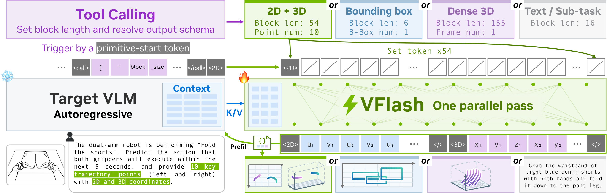
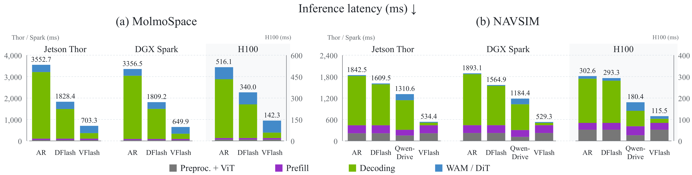

> **원문**: [arXiv](https://arxiv.org/abs/2611.08449) · [HuggingFace](https://huggingface.co/papers/2611.08449) (👍 89) · [Project Page](https://research.nvidia.com/labs/lpr/vflash/)
{: .prompt-info }

## 들어가며

오늘 HuggingFace Daily Papers에서 89 upvote를 받은 NVIDIA 논문입니다. 저자 목록을 보면 NVIDIA 소속 연구자들 사이사이에 Johns Hopkins, HK PolyU, Purdue, HKU의 인턴 출신 1저자들이 끼어 있는, 전형적인 NVIDIA Research 인턴십 산출물 형태입니다. 분야는 "물리 AI(Physical AI)" — 로봇 조작과 자율주행처럼 VLM이 눈으로 본 걸 바탕으로 공간적인 계획(어디를 집을지, 어디로 움직일지)을 세워야 하는 영역입니다.

이 논문을 고른 이유는 단순합니다. 보통 디코딩을 빠르게 만드는 기법들은 "속도와 품질의 트레이드오프"를 전제로 깔고 들어갑니다. Speculative decoding도 결국 target 모델의 분포를 그대로 보존하는 선에서만 빠르게 만들 수 있다는 게 정설이었죠. 그런데 이 논문은 "토큰 단위로 맞는지 검증하는 과정 자체를 버렸더니, 속도만 빨라진 게 아니라 정확도까지 올라갔다"는, 꽤 반직관적인 주장을 던집니다. 왜 그런 일이 가능한지가 이 리뷰의 핵심입니다.

## 한눈에 보기

- **핵심 기여**: ① 바운딩 박스·2D/3D 궤적·조밀한 3D 포인트 모션 같은 "시각적 프리미티브(visual primitive)"는 타입·차원·길이가 정해지는 순간 좌표 레이아웃 전체가 미리 알려진다는 점에 착안해, 프리미티브 하나를 토큰 단위 순차 생성이 아니라 한 번의 forward pass로 통째로 예측하는 Flash Primitive Decoding(FPD)을 제안. ② 기존 speculative decoding처럼 target의 그리디 선택과 토큰 단위로 일치하는지 검증하는 대신, 스키마상 유효한 예측이면 그대로 받아들이는 direct acceptance로 전환. ③ 이 과감한 설계가 오히려 3D 로봇 궤적 예측 정확도를 AR(autoregressive) target보다 끌어올린다는 걸 여러 벤치마크에서 일관되게 보임.
- **성능**: 3D 로봇 궤적에서 ADE 18~61% 감소, 3D 포인트 모션 포캐스팅에서 약 25배 빠른 싱글 롤아웃 생성, MolmoSpaces 조작 벤치마크 평균 성공률 62.6% → 70.2%, Jetson Thor/DGX Spark에서 다운스트림 파이프라인 지연시간 약 80% 절감.
- **한 줄 요약**: "구조가 정해진 출력은 target과 토큰 단위로 똑같을 필요 없이, 스키마만 맞으면 통째로 믿고 써도 된다"는 관찰 하나로 속도와 정확도를 동시에 얻어낸 논문입니다.

## 어떤 문제를 풀려고 했나

로봇이나 자율주행차를 조종하는 VLM은 "다음에 뭘 해야 하는지"를 말로만 표현하지 않습니다. 박스로 물체 위치를 짚거나, 궤적으로 앞으로의 움직임을 미리 그려두는 식으로 "시각적 계획(visual plan)"을 함께 생성합니다. 문제는 이런 계획이 상세해질수록 — 웨이포인트가 늘어나거나, 2D에 더해 3D 좌표까지 같이 예측하거나 — 좌표 토큰 수가 늘어나고, 기존 AR VLM은 이걸 한 토큰씩 순차적으로 디코딩한다는 점입니다. 매 순간 새로운 관측이 들어오는 물리 에이전트 입장에서는, 디코딩이 느려질수록 계획을 더 자주 갱신할 수 없게 되는 직접적인 손해로 이어집니다.

병렬 디코딩이 해법으로 떠오르지만 기존 방법들은 각자 한계가 있습니다. Diffusion LLM은 속도-품질 트레이드오프가 뚜렷하고, 저자들이 베이스로 삼은 DFlash(block diffusion 기반 speculative decoding)는 draft를 빠르게 만들어도 target과의 토큰 단위 검증 단계에서 발목을 잡힙니다. 좌표 하나가 target의 선택과 정확히 일치하지 않으면 — 공간적으로는 거의 차이가 없는데도 — 검증에 실패해버리는 겁니다. LocateAnything이라는 선행 연구가 박스에 한해 병렬 디코딩을 시도했지만 고정 크기 2D 프리미티브에 머물렀습니다. VFlash는 이 틈을 "가변 길이 궤적까지 포함하는 일반적 프레임워크"로 메우려 합니다.

## 핵심 아이디어

VFlash를 이해하려면 먼저 기존 speculative decoding이 왜 느린지부터 짚어야 합니다. Draft 모델 $q_\phi$가 $\gamma$개 토큰을 제안하면 target $p_\theta$가 이를 검증하는데, 이때 쓰이는 게 "그리디 일치" 기준입니다.

$$\tau_{\mathrm{ver}}=1+\max\Big\{k\le\gamma:\; a_j=\argmax_{v}\,p_\theta\!\left(v\mid x,a_{<j}\right) \ \text{for all}\ j\le k\Big\}$$

여기서 $\tau_{\mathrm{ver}}$는 한 사이클당 실제로 받아들여지는 토큰 수, $a_j$는 draft가 제안한 $j$번째 토큰, $\argmax_v p_\theta(v\mid x, a_{<j})$는 target이 그 위치에서 그리디로 골랐을 토큰입니다. 즉 draft가 제안한 토큰들 중 target의 그리디 선택과 처음부터 연속으로 일치하는 구간까지만 인정받습니다.

눈여겨볼 부분은 이 기준이 "맞았는지"가 아니라 "target과 토큰이 같은지"를 본다는 점입니다. 좌표처럼 연속적인 값을 양자화해서 토큰으로 쓰는 경우, draft가 공간적으로는 거의 정확한데 양자화 빈(bin) 하나만 어긋나도 그 지점에서 검증이 끊깁니다. 저자들은 이걸 두고 "draft block을 아무리 길게 늘려도 $\tau_{\mathrm{ver}}$는 그보다 훨씬 낮은 지점에서 포화된다"고 지적합니다. 실제로 본문 실험에서 DFlash는 궤적 블록 안에서 평균 2.2토큰밖에 못 받아들입니다.

VFlash의 첫 번째 전환은 "애초에 뭘 같이 예측할지"를 primitive 단위로 정의하는 겁니다. 박스, 궤적, 포인트 모션 같은 프리미티브는 타입과 길이(waypoint 개수 $P$ 등)가 정해지면 좌표 레이아웃 전체가 고정됩니다. 그래서 길이 $B(s)$짜리 블록 전체를, 순차적 조건부가 아니라 조건부 독립으로 한 번에 예측합니다.

$$q_\phi\!\left(a_{1:B(s)-1}\mid H_\theta(x),a_0\right) =\prod_{j=1}^{B(s)-1} q_{\phi,j}\!\left(a_j\mid H_\theta(x),a_0,\mathrm{MASK}^{B(s)-1}\right)$$

$H_\theta(x)$는 frozen target VLM에서 뽑은 context feature, $a_0$는 프리미티브 시작 토큰, 나머지 $B(s)-1$개 위치는 전부 마스킹된 채로 동시에 예측됩니다. 기존 AR target이 $B(s)-1$번의 순차 패스를 거쳐야 하는 걸, 가벼운 non-causal drafter가 한 번의 양방향 forward pass로 끝내는 구조입니다.

여기서 의미 해석이 중요합니다. 이 구조 자체는 DFlash의 block diffusion과 비슷해 보이지만, 핵심 차이는 "학습 라벨이 어디서 오는가"입니다. VFlash의 drafter는 target의 다음 토큰을 흉내 내도록 학습되는 게 아니라, 사람이 주석단 실제 좌표(annotated coordinate)를 직접 정답으로 학습합니다. 즉 애초부터 "target을 복제하는 모델"이 아니라 "정답 좌표를 맞히는 모델"로 훈련되는 겁니다. 이게 뒤에 나올 "target보다 더 정확해지는" 현상의 씨앗입니다.

두 번째 전환은 추론 시점의 수용 기준입니다. VFlash는 식 2를 버리고 이렇게 바꿉니다.

$$\tau_{\mathrm{dir}}= \begin{cases} B(s), & A_s(\hat{a})=1,\\[2pt] 1+r, & \text{otherwise}, \end{cases}$$

$\hat a$는 drafter가 만든 예측, $A_s$는 "스키마 검증기(구분자가 제 위치에 있는지, 좌표 토큰이 합법적인 어휘집합인지) + 박스에 한해서는 공간적 신뢰도 가드"로 구성된 수용 테스트입니다. 조건을 통과하면 블록 전체 $B(s)$개 토큰을 한 번에 다 받아들이고, 실패하면 앞쪽 $r$개만 남기고(궤적은 $r=0$) 나머지를 제약된 target AR로 다시 생성합니다.

의미 해석: 식 2는 "target과 토큰이 같아야 인정"이었다면, 식 7은 "구조적으로 유효하면 무조건 인정"입니다. 토큰 단위 일치를 요구하지 않기 때문에, 좌표가 target의 선택과 양자화 빈 하나 정도 어긋나더라도 전혀 문제가 되지 않습니다. 대신 신뢰를 어디서 얻느냐면, drafter 자체가 정답 좌표로 직접 학습됐다는 사실에서 얻습니다. 검증을 포기하는 대신 애초에 검증이 필요 없을 만큼 잘 학습시킨 셈이죠.

이 수용 기준을 식 1($L=(T_{\mathrm{draft}}+T_{\mathrm{verify}})/\tau$)에 대입하면 프리미티브 하나당 지연시간이 이렇게 정리됩니다.

$$L_{\mathrm{dir}} =\frac{t_{\mathrm{par}}+t_{\mathrm{target}}}{B(s)}$$

$t_{\mathrm{par}}$는 drafter의 병렬 forward pass 시간, $t_{\mathrm{target}}$은 target이 캐시 갱신과 다음 컨텍스트 feature 추출을 위해 한 번 더 도는 시간입니다. AR 방식에서는 좌표 하나마다 target forward pass가 필요했는데, VFlash는 프리미티브가 아무리 길어져도(웨이포인트가 10개든 20개든) 분자의 두 항이 "완만하게" 커질 뿐 순차 스텝 수 자체는 늘지 않습니다. 즉 더 상세한 계획을 요구해도 디코딩 스텝이 늘지 않는다는 게 이 논문이 "길고 가변적인 궤적"까지 다룰 수 있는 이유입니다.

아래는 FPD의 전체 파이프라인을 보여주는 그림입니다.

_Figure 2. FPD 설계: tool call이 block 크기와 출력 스키마를 정하고, primitive-start 토큰이 트리거가 되어 해당 레이아웃(2D+3D 궤적은 54토큰, 박스는 6토큰, Dense 3D는 155토큰, 텍스트는 16토큰)으로 VFlash가 한 번의 병렬 패스를 수행한다._

왼쪽 위의 "Tool Calling" 박스가 눈여겨볼 지점입니다. target VLM이 먼저 평범한 텍스트로 `{"name": "atomic_decoding", "arguments": {"block_size": 54}}` 같은 tool call을 생성하고, 거기서 block 길이가 정해집니다. 그 다음 `<2D>` 같은 시작 토큰이 나오면 그걸 트리거로 VFlash가 54개 토큰 전부를(회색 사선 박스들) 한 번의 패스로 채웁니다. 아래쪽에는 "Fold the shorts" 같은 자연어 지시에서 양팔 로봇의 10개 궤적 포인트가 2D/3D 좌표로 동시에 뽑혀 나오는 예시가 나와 있는데, 이게 실제 추론 흐름을 직관적으로 보여줍니다. 개인적으로는 이 구조가 "스키마를 먼저 텍스트로 선언하고, 본체는 구조화된 디코더에 맡긴다"는 점에서 최근 LLM들의 JSON 모드/함수 호출 패턴과 묘하게 닮았다고 느꼈습니다.

아래 표는 논문이 정의한 세 가지 프리미티브 레이아웃입니다.

| Primitive | Layout |
|---|---|
| B-box | `<box>` $u_1\,v_1\,u_2\,v_2$ `</>` |
| 2D+3D traj. | `<2D>` $(u\,v)\times P$ `</>` `<3D>` $(x\,y\,z)\times P$ `</>` |
| Dense motion | `<Dense>` $t_1 t_2$ $[k\,(s\,d_1{\cdots}d_5)\times 3]\times P$ `</>` |

박스는 좌표 4개짜리 짧은 블록이지만, 궤적은 포인트 수 $P$에 비례해서 길이가 늘어나는 가변 블록입니다. 이 표에서 짚을 패턴은, 프리미티브마다 레이아웃이 다 다른데도 "시작 토큰 → 좌표 슬롯들 → 종료 토큰"이라는 공통 틀을 공유한다는 점입니다. 덕분에 drafter 하나가 여러 종류의 프리미티브를 동시에 다룰 수 있습니다.

## 실험 결과

**3D 로봇 궤적 예측.** 가장 인상적인 결과는 여기입니다. InternA1·AgiBot·MolmoBot 세 데이터셋, 3가지 학습 변형(3D-only / 2D+3D / 2D+3D+wrist-camera)에 대해 AR과 VFlash를 비교했습니다.

| Training Variant | Decoder | InternA1 ADE | FDE | SR@5 | SR@10 | AgiBot ADE | FDE | SR@5 | SR@10 | MolmoBot ADE | FDE | SR@5 | SR@10 |
|---|---|---|---|---|---|---|---|---|---|---|---|---|---|
| 3D-only | AR | 0.101 | 0.155 | 0.412 | 0.658 | 0.083 | 0.125 | 0.503 | 0.799 | 0.066 | 0.104 | 0.526 | 0.804 |
| 3D-only | **VFlash** | **0.065** | **0.098** | **0.638** | **0.820** | **0.042** | **0.067** | **0.731** | **0.914** | **0.054** | **0.083** | **0.653** | **0.870** |
| 2D+3D | AR | 0.153 | 0.233 | 0.273 | 0.473 | 0.105 | 0.151 | 0.398 | 0.698 | 0.076 | 0.116 | 0.467 | 0.767 |
| 2D+3D | **VFlash** | **0.062** | **0.091** | **0.640** | **0.827** | **0.041** | **0.064** | **0.739** | **0.919** | **0.055** | **0.085** | **0.640** | **0.862** |
| 2D+3D+wrist | AR | 0.130 | 0.196 | 0.360 | 0.554 | 0.084 | 0.129 | 0.456 | 0.749 | 0.066 | 0.102 | 0.547 | 0.813 |
| 2D+3D+wrist | **VFlash** | **0.060** | **0.091** | **0.651** | **0.835** | **0.036** | **0.057** | **0.794** | **0.937** | **0.052** | **0.080** | **0.671** | **0.877** |

(ADE/FDE는 미터 단위, 낮을수록 좋음. SR@5/SR@10은 각각 5cm/10cm 이내로 맞춘 웨이포인트 비율, 높을수록 좋음.)

패턴이 아주 뚜렷합니다. 모든 데이터셋·모든 학습 변형에서 VFlash가 AR을 이깁니다. 특히 "2D+3D" 행을 보면, AR은 2D를 같이 예측하게 했을 때 3D-only보다 오히려 ADE가 15~51% 나빠지는데(2D 토큰을 먼저 순차 생성하느라 3D 예측에 쓸 컨텍스트가 흐트러지는 것으로 보입니다), VFlash는 2D와 3D를 한 블록 안에서 동시에 예측하기 때문에 이런 손해가 없습니다. 저자들이 "조건부 독립 예측이 오히려 긴 시퀀스의 복합 오차 누적을 막아준다"고 설명하는 부분인데, 설득력 있는 해석이라고 생각합니다.

**MolmoSpaces 조작 다운스트림.** VFlash가 만든 시각적 계획이 실제 행동 생성에 도움이 되는지 본 실험입니다.

| Method | Avg. | Pick | P&P | Open | Close |
|---|---|---|---|---|---|
| π0-FAST DROID | 20.7 | 22.0 | 11.0 | 11.1 | 38.6 |
| π0 DROID | 23.2 | 16.2 | 12.5 | 11.0 | 53.1 |
| π0.5 DROID | 34.5 | 36.4 | 13.6 | 22.7 | 65.1 |
| PRTS-Droid | 42.4 | 53.8 | 27.7 | 12.0 | 76.3 |
| Cosmos3-Nano-Policy | 53.0 | 65.5 | 35.2 | 32.0 | 79.1 |
| WALL-OSS-0.5 | 53.8 | 73.8 | 46.0 | 16.8 | 78.5 |
| PrimeR0 | 60.3 | 77.5 | 54.6 | 27.8 | **81.3** |
| Baseline | 62.6 | 81.1 | 55.7 | 49.3 | 64.2 |
| **VFlash** | **70.2** | **83.6** | **67.3** | **52.8** | 77.0 |

Baseline은 world action model(WAM)에 원래 달려 있던 텍스트 인코더를 쓴 것이고, VFlash는 그 자리에 VFlash가 만든 2D+3D 궤적 계획을 넣은 것뿐, 다른 구조는 동일합니다. 흥미로운 건 과업별 개선폭입니다. Pick은 2.5점밖에 안 올랐는데 Pick & Place와 Close는 각각 11.6점, 12.8점이나 올랐습니다. 저자들은 "여러 단계가 얽힌 과업일수록 명시적인 궤적 계획의 이득이 크다"고 해석하는데, Pick처럼 단순한 단일 동작보다 Pick & Place처럼 "집고 → 옮기고 → 놓는" 복합 동작에서 궤적이 중간 단계를 구체화해주는 역할을 한다고 보면 납득이 갑니다. 다만 Close에서는 PrimeR0(81.3)이 VFlash(77.0)보다 여전히 높다는 점은 짚고 넘어갈 만합니다 — VFlash가 모든 과업에서 1등은 아닙니다.

**속도.** 아래는 다운스트림 과업별 지연시간을 플랫폼별로 쪼갠 그림입니다.

_Figure 4. VFlash의 플랫폼별·과업별 지연시간. 초록색이 디코딩 구간입니다._

MolmoSpaces 기준 Jetson Thor에서 AR은 전체 3552.7ms 중 디코딩이 대부분을 차지하는데, VFlash는 전체를 703.3ms로 줄입니다. 막대그래프에서 읽어야 할 부분은 "어느 구간이 줄었는가"입니다. 초록색(디코딩) 구간만 극적으로 짧아지고, 회색(전처리+ViT)과 보라색(prefill), 파란색(액션 모델) 구간은 AR·DFlash·VFlash 사이에 거의 차이가 없습니다. 즉 VFlash가 손댄 건 순수하게 좌표 디코딩 구간이고, 나머지 파이프라인은 그대로라는 뜻입니다. NAVSIM 쪽(그림 오른쪽)에서는 VFlash가 Qwen-Drive-1.0이라는 별도의 1.04B 전용 플로우매칭 플래너보다도 빠른데, VFlash는 4B VLM 자체를 느리게 쓰는 대신 디코딩 방식만 바꿨다는 걸 생각하면 꽤 인상적인 결과입니다.

## 아쉬운 점 / 의문점

몇 가지 걸리는 부분이 있습니다.

먼저, 논문 상단의 "원문" 링크에 적힌 GitHub 저장소(`NVlabs/Eagle`의 `Embodied` 폴더)를 직접 확인해봤는데, 현재는 이 논문이 인용하는 선행 연구인 LocateAnything의 코드만 올라와 있고 VFlash 관련 코드나 가중치는 보이지 않았습니다. 추후 업데이트될 가능성이 커 보이지만, 지금 시점에서는 재현이 불가능하다는 점을 밝혀둡니다. 그래서 이번 리뷰에서는 GitHub 링크를 빼고 Project Page만 걸었습니다.

두 번째로, 박스 생성 결과(본문 표 2, 이 리뷰에는 포함하지 않았습니다)를 보면 VFlash를 검증 없이 그대로 쓰면(direct) Dense200에서 F1이 AR 대비 20점 가까이 떨어집니다. AR fallback(불확실한 박스만 다시 target AR로 생성)을 붙여야 F1을 회복하는데, 이건 "direct acceptance가 항상 안전하지는 않다"는 뜻이기도 합니다. 궤적에서는 직접 수용이 잘 통하는데 박스에서는 왜 더 불안정한지 — 좌표 개수가 적어서 한 번의 실수가 전체 IoU에 더 치명적으로 작용하기 때문일 거라 추측은 되지만, 논문이 이 차이를 명시적으로 분석하진 않습니다.

세 번째, Dense 3D motion 예측(Table 4, PointMotionBench)에서는 VFlash가 HOT3D와 WorldTrack 양쪽에서 AR보다 ADE가 밀립니다(WorldTrack FDE는 오히려 15% 악화). DAVIS에서만 큰 폭으로 이깁니다. 저자들도 이걸 숨기지 않고 "AR보다는 못하지만 flow-matching 변형보다는 낫다"고 적어뒀는데, "3D 로봇 궤적에서는 VFlash가 항상 이긴다"는 인상과는 결이 다른 결과라 눈여겨볼 지점입니다. 즉 "검증 없는 직접 수용이 항상 정확도를 높여준다"는 건 아니고, 프리미티브 종류와 좌표 표현 방식(특수 토큰 vs. 텍스트 토큰화된 digit grid)에 따라 갈리는 것 같습니다.

마지막으로 ablation에서 궁금한 점 하나. MolmoSpaces 표에서 "AR generation"(VFlash 대신 AR로 생성한 2D+3D 계획을 WAM에 먹인 경우)이 Baseline(62.6)보다도 낮은 61.0을 기록합니다. VFlash 궤적(70.2)과 AR 궤적(61.0) 사이에 9점이나 차이가 나는 건, 단순히 "VFlash가 더 정확한 궤적을 만들어서"라고 설명하기엔 너무 큰 격차로 느껴집니다. 혹시 AR로 생성한 궤적의 context feature 자체가 VFlash의 병렬 생성 방식과 다른 분포를 가져서 WAM이 덜 익숙해하는 건 아닐지 — 이 부분은 논문에 명시되어 있지 않아 정확히는 모르겠습니다.

## 마치며

이 논문에서 제일 재밌는 지점은 기술적 디테일보다 "검증을 버린다"는 선택 자체입니다. Speculative decoding 커뮤니티는 지금껏 "target 분포를 보존하는 선에서 빠르게"를 금과옥조처럼 지켜왔는데, VFlash는 "애초에 우리가 원하는 게 토큰 일치가 아니라 공간적 정확도라면, target을 복제할 이유가 없다"고 말합니다. 당연한 말 같지만 이걸 실제로 증명해서, lightweight drafter가 자기가 흉내 내야 할 4B target보다 더 정확한 좌표를 뽑아내는 걸 보여줬다는 게 이 논문의 진짜 기여라고 생각합니다.

다음 관전 포인트는 저자들이 결론에서 언급한 "공유된 관측에서 여러 개의 상호보완적인 프리미티브를 동시에 생성하는" 확장입니다. 지금은 한 번에 한 primitive-start 토큰만 트리거되는 구조인데, 예를 들어 박스와 궤적을 동시에 병렬로 뽑아낼 수 있다면 — 코드가 공개되면 꼭 한번 실제로 돌려보고 싶은 부분입니다.
