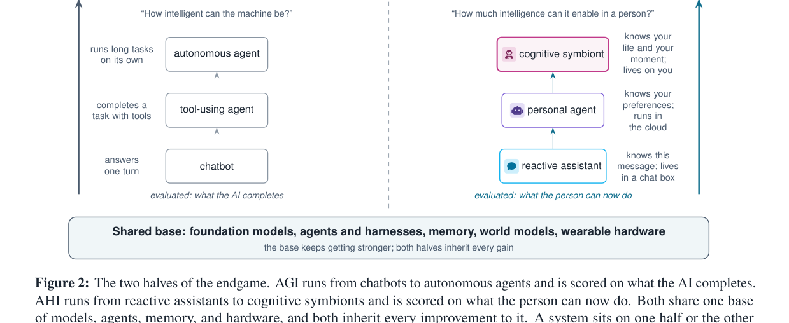
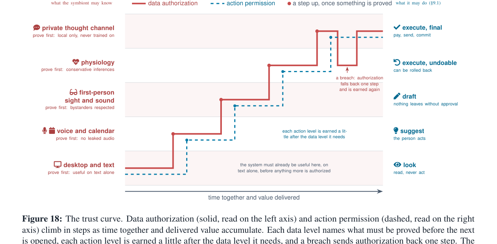
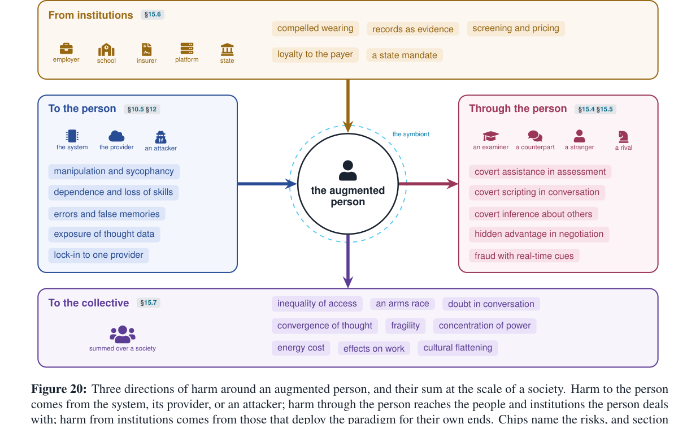

> **원문**: [arXiv](https://arxiv.org/abs/2611.05376) · [HuggingFace](https://huggingface.co/papers/2611.05376) (👍 84) · [프로젝트 페이지](https://cognitive-symbiont.github.io)
{: .prompt-info }

## 들어가며

오늘 HuggingFace Daily Papers에서 84 upvote를 받은 논문인데, 저자가 Hao Fei(University of Oxford) 1인입니다. 실험도, 코드도, 벤치마크 숫자도 없는 23쪽짜리 포지션 페이퍼가 혼자 쓴 글로는 꽤 이례적인 분량이라 눈길이 갔습니다. 그림이 20개, 표가 18개, 공식 정의(Definition)가 5개, 수식이 8개 — 거의 한 편의 작은 책에 가깝습니다.

논문이 여는 방식이 인상적입니다. 연구자가 아이디어를 떠올렸는데 메모하기 전에 잊어버립니다. 회의 중 동료가 3년 전 자신이 발표한 수치를 묻는데 기억이 안 납니다. 중요한 결정을 앞두고 지난번엔 어떻게 판단했는지 기억나지 않습니다. 저자는 이 다섯 가지 장면이 전부 "지능의 실패"가 아니라고 말합니다. 그 답을 이미 가지고 있는 AI가 어딘가에 존재하는데, 다만 그 순간 그 자리에 없었을 뿐이라는 겁니다. 이 논문은 바로 그 "그 자리에 없음"을 메우는 시스템, 저자가 **cognitive symbiont(인지 공생체)**라고 부르는 패러다임을 제안합니다.

## 한눈에 보기

- **핵심 기여**: ① AGI(기계가 얼마나 똑똑한가)와 대비되는 AHI(AI-augmented human intelligence, 기계가 한 사람을 얼마나 똑똑하게 만드는가)를 AI 엔드게임의 "두 번째 절반"으로 명명. ② 이를 실현하는 시스템 형태로 평생·내장·실시간·사적·저마찰·능동(lifelong, embedded, real-time, private, low-friction, proactive)이라는 6개 속성을 가진 cognitive symbiont를 정의. ③ "cognitive gap"(사람이 가진 전체 맥락과, 실제로 그 순간 떠올릴 수 있는 작업 맥락 사이의 차이)이라는 단일 불변량으로 패러다임 전체를 꿰는 형식화 제공. ④ sense → keep → understand → live alongside → act/think → grow로 이어지는 symbiosis loop로 연구 공간을 조직하고, 23개 공개 문제와 6단계 역량 로드맵으로 마무리.
- **성능**: 실험/벤치마크 없음. 대신 평가 축으로 augmentation(증강), synergy(시너지), retention(잔존 능력), personalization differential(개인화 기여도) 4개 지표와 10개 평가 차원을 제시.
- **한 줄 요약**: "다음 세대 AI의 진짜 병목은 모델 크기가 아니라, 그 모델이 '당신'이라는 특정한 한 사람과 얼마나 깊이, 얼마나 적은 마찰로 결합하느냐다."

## 어떤 문제를 풀려고 했나

지난 10년간 AI 발전은 단 하나의 축으로 측정되어 왔다고 저자는 말합니다. "기계가 혼자서 얼마나 해낼 수 있는가." 코딩, 문서 요약, 컴퓨터 조작까지 이 축에서는 분명 엄청난 진보가 있었습니다. 그런데 저자가 던지는 질문은 다릅니다. 모델 자체의 능력(capability)은 계속 오르는데, 그 모델과 **특정 개인 사이의 결합(coupling)**은 거의 제자리걸음이라는 겁니다. 매 대화마다 배경 설명을 처음부터 다시 해야 하고, 도움은 너무 늦게 오거나 너무 시끄럽게 오고, 사람들은 정작 중요한 일은 시스템에 맡기지 않습니다 — 이 세 가지가 "결합이 부족하다"는 증상이라고 짚습니다.

흥미로운 건 이 틀을 세우는 방식입니다. 논문은 AI와 사람의 관계를 4단계로 나눕니다(reactive assistant → autonomous agent → personal agent → cognitive symbiont, 아래 표 참고). 그리고 "물리 AI(Physical AI)의 시대가 열리면 두 종류의 지능적 개체가 생긴다"는 주장을 핵심 축으로 세웁니다. 하나는 스스로 몸과 목표를 가진 embodied robot(체화 로봇)이고, 다른 하나는 사람의 몸에 올라타 그 사람의 감각과 목표를 그대로 쓰는 AI-augmented individual(AI 증강 개인)입니다. 이 논문은 전자(로봇 쪽)에 쏟아지는 관심에 비해 후자가 상대적으로 덜 다뤄졌다고 보고, 후자에 전부를 건 글입니다.

다음은 AGI와 AHI를 나란히 놓고 비교한 그림입니다.

_AGI는 chatbot → tool-using agent → autonomous agent로 올라가며 "AI가 무엇을 완수했는가"로 평가받고, AHI는 reactive assistant → personal agent → cognitive symbiont로 올라가며 "사람이 이제 무엇을 할 수 있게 됐는가"로 평가받습니다. 둘은 같은 기반(foundation model, agent, memory, world model, wearable) 위에 서 있습니다._

왼쪽 축과 오른쪽 축이 같은 기반 위에서 평행하게 자란다는 게 포인트입니다. ChatGPT 같은 제품도 답변의 정확도로 채점하면 AGI 축의 chatbot이고, 그 답변 이후 사용자가 무엇을 더 잘하게 됐는지로 채점하면 AHI 축의 reactive assistant라는 식으로, 같은 시스템이 "무엇으로 평가받는가"에 따라 다른 반쪽에 속한다는 설명이 꽤 설득력 있습니다. 다만 이 그림 자체가 측정값이 아니라 "개념적 스케치"라고 캡션에 명시돼 있다는 점은 미리 밝혀둘 필요가 있겠습니다. 그래프처럼 보이지만 실은 비유에 가깝습니다.

## 핵심 아이디어

### "Cognitive gap" — 논문 전체를 꿰는 단 하나의 변수

이 논문의 뼈대는 다섯 개의 정의(Definition)로 세워집니다. 가장 중요한 건 **self-context**(한 사람이 가진 모든 맥락 $C^h_t$ — 경험, 지식, 약속, 관계, 몸 상태, 현재 하는 일 전부)와 **working context**(그중 실제로 떠올려 쓸 수 있는 작은 부분집합 $c_t \subset C^h_t$, 작업 기억·주의·시간·감정에 의해 제한됨)의 구분입니다. 이 둘의 격차가 바로 cognitive gap입니다.

$$G_t \;=\; U\!\left(x_t;\, C^h_t\right) \;-\; U\!\left(x_t;\, c_t\right)$$

여기서 $x_t$는 어떤 구체적인 상황이고, $U(\cdot)$는 그 상황에서 사람이 달성한 결과(outcome)입니다. $C^h_t$는 그 사람이 가진 전체 맥락으로 얻을 수 있었던 결과, $c_t$는 그 순간 실제로 떠올린 작은 맥락으로 얻은 결과입니다.

의미를 풀면 이렇습니다. 이 $G_t$는 "지능이 부족해서" 생기는 격차가 아니라, 매일 누구나 치르는 비용 — 잊어버린 것, 눈치채지 못한 것, 끝까지 생각해보지 못한 것, 말로 표현하지 못한 것 — 을 수치화한 것입니다. 저자는 symbiont의 임무를 "$G_t$를 줄이는 것"으로 정의합니다. 독심술이 필요한 게 아니라, $C^h_t$ 중 지금 필요한 조각을 적절한 순간에 $c_t$로 되돌려주거나, 혹은 사람이 시간이 있었다면 직접 했을 추론·잡무를 대신 해주면 된다는 겁니다. 그리고 여기에 짝을 이루는 두 번째 정의가 augmented individual $h \oplus s$(사람과 symbiont의 결합)이고, 그 증강 효과는 $\Delta_{\mathrm{aug}}(x_t) = U(x_t;\, h \oplus s) - U(x_t;\, h)$로 씁니다. AGI는 $U(\cdot; s)$를 올리는 일이고 AHI는 $U(\cdot; h \oplus s)$를 올리는 일이라는 한 문장으로 두 패러다임의 경계가 정리됩니다.

개인적으로는 이 형식화가 증명할 수 있는 정리를 끌어내려는 게 아니라 — 저자 스스로도 "수식에서 어떤 정리도 끌어내지 않는다"고 못박습니다 — 뒤따르는 모든 논의(누가 득을 보는가, 무엇을 측정해야 하는가, 무엇이 틀렸다고 증명될 조건인가)를 하나의 공통 언어로 되돌릴 수 있게 하는 "회계 장부" 역할을 한다는 점이 영리하다고 느꼈습니다.

### 6개 속성과 "Jarvis 테스트"

논문은 symbiont가 반드시 가져야 할 속성 6가지를 제시하고, 영화 아이언맨의 Jarvis를 기준점 삼아 테스트합니다. 아래는 원문 표를 그대로 옮긴 것입니다.

| 속성 | 의미 | 없으면 무너지는 것 | Jarvis | 2026년 개인 에이전트 |
|---|---|---|---|---|
| Lifelong (평생) | 수년에 걸쳐 하나의 관계와 기억을 유지 | 매 세션이 0에서 시작, 격차가 좁혀지지 않음 | ✅ | 부분적 |
| Embedded (내장) | 채팅창이 아니라 실제 활동 속에 present | 도움이 사후에만 가능 | ✅ | ❌ |
| Real-time (실시간) | 활동이 진행 중일 때 아직 쓸모 있는 시점에 개입 | 제때 못 온 올바른 말은 말이 아닌 것과 같음 | ✅ | ❌ |
| Private (사적) | 사람과 symbiont 사이의 교환은 사적으로 남고, 상황이 허락하면 은밀히 전달 | 속내를 털어놓을 수 없고, 신호마다 주변 사람을 방해 | ✅ | 부분적 |
| Low-friction (저마찰) | 멈춰서 설명하거나 폰을 꺼내게 하지 않음 | 사용 비용이 이득을 잠식 | ✅ | ❌ |
| Proactive (능동) | 묻지 않아도 말할지 판단 | 무엇을 놓치고 있는지 모르면 물어볼 수도 없음 | ✅ | 부분적 |

논문의 "Beyond Jarvis" 박스가 재밌는 지점을 짚습니다. Jarvis는 이 6개 속성을 이미 다 통과하지만(저자 표현으로는 영화적 설정으로 주어진 것), 그럼에도 이 논문이 노리는 symbiont는 Jarvis를 다섯 걸음 더 넘어서야 한다는 겁니다. Jarvis는 토니 스타크가 직접 지은 연구실과 수트를 통해 보지만, 일반인의 symbiont는 안경·펜던트·이어버드 같은 저렴한 외부 기기 몇 개로 봐야 합니다. Jarvis는 주로 일정과 시스템, 전장 상황을 알 뿐 주인의 목표·감정·맹점을 깊이 모델링하지 않는데, symbiont의 무게중심은 바로 그 "마음" 층이어야 한다는 식입니다. 할리우드 레퍼런스를 끌어오면서도 "그걸 그대로 베끼는 게 아니라 거기서 여섯 걸음 더 간 것"이라고 선을 긋는 전개가 영리합니다.

이 6개 속성을 만족하는 시스템이 하는 일을 한 바퀴 도는 구조로 그린 게 "symbiosis loop"입니다 — sense & interact(감각과 발화) → keep(기록) → understand(이해) → live alongside(실시간 동행) → act for & think with(대행과 공동 사고) → grow(학습), 그 아래 personal runtime이 깔리고 전체를 trust가 감쌉니다. 논문 2부 전체(8개 섹션)가 이 루프를 한 바퀴 도는 구성인데, 아쉽게도 이 루프 다이어그램 자체는 원문이 TikZ로 직접 그린 그림이라 이번 PDF 캡처 과정에서는 이미지로 확보하지 못했습니다. 다만 구조는 위 서술로 충분히 따라갈 수 있습니다.

### 두 개의 대화를 동시에 — Cognitive full-duplex와 "침묵도 출력"

이론만 있는 게 아니라 구체적인 장면도 하나 보여줍니다. 회의 중 동료가 "지난 분기에 보고했던 그 수치가 뭐였죠?"라고 묻는 순간을 저자는 "cognitive full-duplex"라고 부릅니다. 사람은 동료와 대화를 이어가는 동시에, symbiont는 조용히 기록을 뒤져 수치를 확인하고 안경에 한 줄짜리 큐(cue)를 띄워줍니다. 사람은 대화를 멈추지 않고 그 수치를 자기 말처럼 답합니다.

_왼쪽 인물의 안경 위에 구체 모양 아이콘(symbiont)과 반투명 문서 더미(검색된 기록)가 떠 있고, 오른쪽 동료는 막대그래프 말풍선으로 "그 수치가 뭐였죠"를 묻는 상황을 표현했습니다._

이 그림에서 눈여겨볼 부분은 symbiont가 "답을 대신 말해주는" 게 아니라는 점입니다. 사람이 직접 "420만, 9% 증가"라고 답합니다. symbiont는 그 답을 떠올리는 과정만 거들었을 뿐입니다. 원문은 이를 두 개의 루프로 쪼개 설명합니다. fast loop(이름 하나, 숫자 하나처럼 1초 내에 떠야 하는 즉각 반응, 기기 안의 작은 모델만 쓸 수 있음)와 slow loop(검색·추론·요약처럼 느려도 되지만 미리 준비해둬야 하는 배경 작업)입니다. "실시간성"을 뭉뚱그려 "전부 저지연이어야 한다"고 요구하면 안 된다는 지적이 실무적으로 와닿았습니다.

이 "언제 개입할 것인가"를 하나의 결정 문제로 형식화한 게 intervention policy입니다.

$$a^*_t = \arg\max_{a \in \mathcal{A}_t} \mathbb{E}[\Delta U(a) \mid b_t] \;-\; \lambda_t \cdot \mathrm{Interrupt}(a, \mathrm{attention}_t) \;-\; \rho \cdot \mathrm{Risk}(a), \quad \text{s.t.}\ \ \mathrm{conf}(b_t) \ge \theta(a)$$

$\mathcal{A}_t$는 그 순간 취할 수 있는 행동 집합인데, 여기엔 반드시 "침묵($\varnothing$, 개입 비용 0)"이 포함됩니다. $\mathbb{E}[\Delta U(a) \mid b_t]$는 현재 믿음 상태 $b_t$에서 행동 $a$가 가져올 기대 이득, $\mathrm{Interrupt}(\cdot)$는 그 순간의 주의 상태를 고려한 방해 비용, $\mathrm{Risk}(\cdot)$는 잘못된 개입의 위험이고, $\theta(a)$는 행동이 개입적일수록 더 높아지는 확신 임계값입니다.

이 수식에서 읽어야 할 메시지는 단순합니다. "도움이 시끄러울수록(개입적일수록) symbiont는 더 확신이 있어야 한다"는 것, 그리고 불확실할 때 기본값은 언제나 침묵이라는 것입니다. $\lambda$, $\rho$, $\theta$ 같은 가중치는 논문에서 구체적인 숫자로 주어지지 않고 "앞으로 풀어야 할 연구 변수"로 남겨둡니다. 솔직히 이 부분은 수식이라기보다 "이렇게 설계해야 한다"는 설계 원칙을 수식의 옷을 입힌 것에 가깝습니다 — 그 자체로 나쁘다는 뜻은 아니고, 포지션 페이퍼라는 장르의 한계이자 정직함이라고 봅니다.

### 신뢰는 한 번에 열리지 않는다 — Trust curve

symbiont가 사람의 하루 전체를 보고, 생각을 추론하고, 대신 돈을 쓰고 말을 하게 하려면 전례 없는 수준의 권한을 요구하게 됩니다. 저자는 이걸 "전부 다 주면 그때 도와줄게"라는 선결 조건으로 설계하면 안 된다고 못박고, 대신 시간이 지나며 단계적으로 열리는 곡선으로 그립니다.

_왼쪽 축(실선)은 데스크톱/텍스트 → 음성·캘린더 → 1인칭 시청각 → 생체신호 → 사적 사고 채널 순으로 열리는 데이터 권한, 오른쪽 축(점선)은 보기만 함 → 제안 → 초안 작성 → 되돌릴 수 있는 실행 → 최종 실행 순으로 열리는 행동 권한입니다. 계단마다 "먼저 증명해야 할 것"이 붙어 있고, 신뢰가 깨지면 한 칸 되돌아갑니다._

이 그래프에서 중요한 건 두 축이 나란히, 그러나 행동 권한이 데이터 권한보다 한 발 늦게 올라간다는 점입니다. 즉 symbiont가 당신의 음성과 캘린더를 볼 수 있게 됐다고 해서 곧바로 당신 대신 이메일을 보낼 권한을 갖는 게 아니라는 것이죠. 그리고 "신뢰가 깨지면 한 단계 후퇴한다"는 화살표가 그려져 있는데, 캡션에 아주 솔직한 단서가 달려 있습니다 — 이미 유출된 정보는 되돌릴 수 없으니, 후퇴는 "추가 노출을 막는 것"일 뿐이라는 겁니다. 이 솔직함이 오히려 신뢰가 갔습니다. 보안을 다 해결했다고 과장하지 않고 한계를 명시한 태도랄까요.

여기서 생기는 데이터의 새로운 종류도 짚고 넘어갈 만합니다. 저자는 사람이 사적 채널에 속삭이는 생각, symbiont가 추론한 심리 상태, 나아가 신경 인터페이스가 읽어낼 의도 신호까지를 "thought data(사고 데이터)"라 부르고, 이게 다른 어떤 개인정보보다 더 강하게 보호되어야 한다고 주장합니다 — 기본적으로 로컬 저장, 기본적으로 학습에 미사용, 언제든 삭제 가능, 누구와도 교환 금지. "cognitive sovereignty(인지 주권)"라는 용어도 제시하는데, 신경윤리학 쪽 논의를 거의 그대로 가져온 것이라고 스스로 밝힙니다.

## 누구를 위한 것이고, 무엇이 위험한가

이 논문에서 가장 설득력 있다고 느낀 대목은 "모두에게 좋다"는 주장을 리스트로 때우지 않고, 리스크를 패러다임의 일부로 끌어안았다는 점입니다. 저자는 augmentation(증강)이 기존 AI 리스크와 질적으로 다른 이유 네 가지를 듭니다. **귀속(attribution)** — symbiont의 도움이 시험 답안이나 협상 발언처럼 "그 사람 자신의 퍼포먼스"로 나타난다는 점. **비가시성(invisibility)** — 사적으로 전달되는 도움은 시험 감독관이나 상대방에게 숨겨진다는 점. **파급력(reach)** — 기록이 다른 사람의 삶도 함께 담는다는 점. **위치재(position)** — 경쟁 상황에서 한 사람의 증강이 곧 남의 손해가 되고, 모두가 도입 압박을 받게 된다는 점(설문 응답자의 60%가 인지 임플란트가 보편화되면 이런 압박을 예상했다는 수치를 인용합니다).

_사람에게 가는 피해(시스템·제공자·공격자발), 사람을 통해 밖으로 나가는 피해(시험 감독관·협상 상대·낯선 사람 대상), 기관으로부터 내려오는 피해(고용주·학교·보험사·국가), 그리고 이 셋이 사회 규모로 합쳐진 집단적 피해까지 네 방향을 한 번에 정리한 지도입니다._

실제로 2025년에 Cluely라는 제품이 "시험·면접 부정행위용"으로 팔렸고, 중국은 대입 수능(가오카오) 기간에 챗봇 기능을 꺼버렸다는 사례를 인용하는데, 이게 먼 미래 얘기가 아니라 이미 벌어지고 있는 일이라는 걸 체감하게 합니다. 저자가 내놓는 해법은 "symbiont는 사람이 들어선 자리의 규칙을 따르고, 따랐다는 걸 증명할 수 있어야 한다"는 원칙인데 — 시험 중엔 침묵하는 걸 암호학적으로 증명하는 "verifiable abstention" 같은 개념을 공개 문제로 던져두는 선에서 그칩니다. 방향은 맞다고 보지만, 구체적인 메커니즘은 전혀 제시되지 않습니다.

## 아쉬운 점과 의문

읽으면서 계속 든 생각은 이겁니다 — 이 논문은 "증명"이 아니라 "지도"를 그리는 글입니다. 저자 스스로 결론에서 "새로운 알고리즘을 제안하지 않는다, 기여는 프레이밍과 연구 공간의 조직화에 있다"고 분명히 밝힙니다. 그 점을 감안해도 몇 가지는 짚고 싶습니다.

첫째, "실험 없음"이 가장 큰 공백입니다. 평가 섹션에서 synergy를 "사람과 AI의 결합이 둘 중 나은 쪽보다 나은가"로 정의해놓고, 정작 2024년의 한 메타분석(Vaccaro et al.)을 인용해 "사람-AI 조합이 둘 중 더 나은 쪽보다 오히려 못한 경우가 많다"는 선행 증거를 직접 소개합니다. 이건 이 논문의 핵심 가정 — 더 깊은 결합이 곧 더 나은 결과로 이어진다는 전제 — 에 스스로 의문부호를 다는 셈인데, 저자는 이를 "그래서 synergy는 augmentation과 별도로 반드시 측정해야 한다"는 방법론적 교훈으로 수렴시킵니다. 논리적으로는 맞지만, 이게 과연 "symbiont가 작동할 것"이라는 낙관의 근거가 되는지는 의문입니다. 오히려 "결합이 늘 좋은 건 아니다"라는 더 조심스러운 결론도 얼마든지 가능해 보입니다.

둘째, Jarvis라는 레퍼런스에 지나치게 기댄다는 인상도 있습니다. 저자는 "증거로 쓰지 않는다"고 각주에 못박아두지만, 논문 전체에서 Jarvis가 반복해서 등장하며 사실상 디자인 목표처럼 기능합니다. 허구의 캐릭터가 "달성해야 할 6개 속성을 이미 다 가지고 있다"는 설정 자체가, 독자에게 "이게 실현 가능하다"는 착시를 줄 위험이 있다고 느꼈습니다.

셋째, 23개의 공개 문제(open problems) 중 별표로 표시된 4개 — 삶 전체를 쿼리 가능한 기록으로 만드는 기술, 센서에서 귀까지의 종단 지연 예산, 상시 가동 연산 비용, 웨어러블 하드웨어 반복 개발 — 는 사실상 "아직 아무것도 풀리지 않은 하드 프로블럼"들입니다. 로드맵 그림에서는 이것들이 "1단계 데스크톱 코파일럿"부터 요구되는 전제조건으로 나오는데, 그렇다면 1단계조차 지금 기준으로는 꽤 멀리 있는 셈입니다. 여담으로, 이 로드맵이 "제품 일정이 아니다"라고 캡션에 명시한 것도 스스로 그 점을 알고 있다는 방증 같습니다.

넷째, 신경 인터페이스(뇌-기계 인터페이스)를 센서 목록에 당연한 듯 포함시키는 부분은 다소 성급해 보입니다. 표에서는 "horizon: research / distant"로 분류해 거리를 두긴 하지만, "사고 데이터"라는 개념 자체가 이미 그 전제 위에 서 있어서, 지금 쓸 수 있는 웨어러블(안경·이어버드·반지)의 이야기와 먼 미래의 BCI 이야기가 같은 틀 안에서 섞여 있다는 인상을 지우기 어려웠습니다.

## 마치며

그럼에도 이 논문이 가치 있다고 느낀 지점은, "다음 10년의 AI 연구를 무엇으로 평가할 것인가"라는 질문을 정면으로 던졌다는 데 있습니다. 벤치마크 점수를 올리는 데 익숙해진 연구 문화에서, "그래서 그 사람이 더 강해졌는가"를 측정 대상으로 삼자는 제안은 — 설령 지금 당장 측정 방법이 없더라도 — 방향 자체는 꽤 울림이 있습니다. 결론의 마지막 문장도 인상적이었습니다. "이 패러다임이 성공했다는 신호는, 한 사람이 자신이 되고 싶었던 모습에 더 가까워진 것이고, 그걸 두고 아무도 AI가 사람에 더 가까워졌다고 착각하지 않는 것이다." 개인 프로젝트로 메모·에이전트 류를 만지는 입장에서는, cognitive gap이라는 틀 자체보다 침묵을 기본값으로 둔 intervention policy나 단계적으로 권한을 여는 trust curve 쪽이 훨씬 바로 가져다 쓸 수 있는 설계 원칙으로 느껴졌습니다. 다음에 또 관전할 지점은, 이 논문이 23개 공개 문제로 던져놓은 것들 중 실제로 누가, 어떤 벤치마크로 먼저 치고 나오는가입니다.
