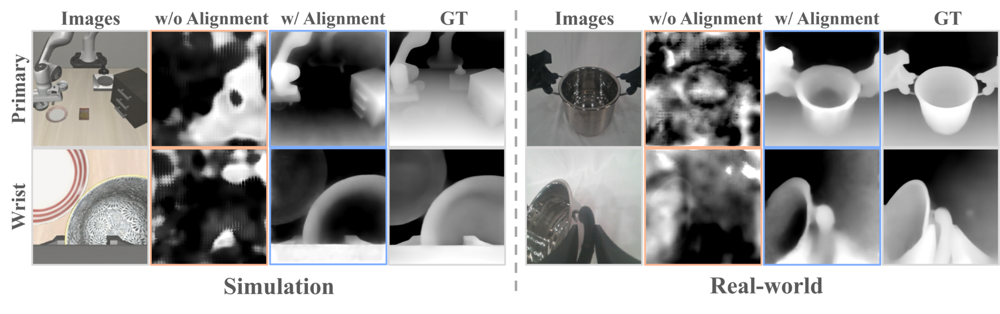
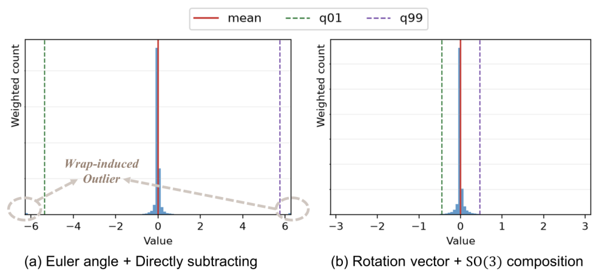
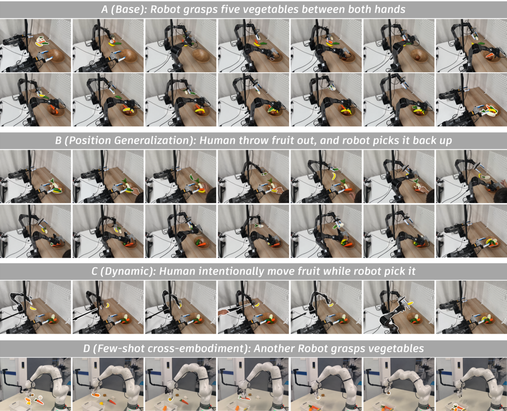
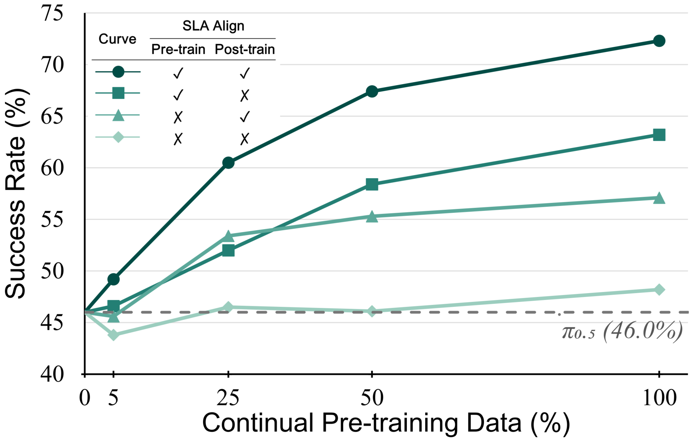

> **원문**: [arXiv](https://arxiv.org/abs/2611.08373) · [HuggingFace](https://huggingface.co/papers/2611.08373) (👍 92) · [GitHub](https://github.com/OpenHelix-Team/Spatial-Forcing/tree/master/SLA) · [프로젝트 페이지](https://sla-team.github.io/omnisf_projectpage/)
{: .prompt-info }

## 들어가며

오늘 HuggingFace Daily Papers에서 92 upvote를 받은 로봇 조작(manipulation) 논문입니다. 저자 소속이 홍콩과기대(광저우), BAAI, 칭화대로 이어지는데, 흥미로운 건 이 팀이 이미 발표한 "Spatial Forcing"이라는 방법을 한 단계 더 확장한 후속작이라는 점입니다. Spatial Forcing은 사전학습된 VLA를 다운스트림 태스크에 맞춰 후속학습(post-training)할 때만 공간 정렬을 걸어줬는데, 이 논문은 그 아이디어를 아예 continual pre-training 단계로 끌어올립니다. "후속 처리로 붙이는 3D 능력"에서 "기초 모델 자체가 갖는 3D 능력"으로 격상시키겠다는 거죠.

실제로 LaTeX 소스를 열어보면 저자들이 중국어로 써둔 초안 메모(`%wenxuan: 최근에...`)가 그대로 주석으로 남아 있습니다. 급하게 영어로 다듬어 arXiv에 올린 티가 나는데, 로보틱스 쪽 논문 발행 속도가 그만큼 빡빡하다는 방증이기도 합니다.

## 한눈에 보기

- **핵심 기여**: ① 사전학습된 $\pi_{0.5}$ 정책을 초기화 지점으로 삼아, 중간 시각 임베딩을 고정된 3D 인식 모델(OmniVGGT)과 정렬시키는 방식으로 continual pre-training을 수행하는 SLA 제안. ② 이질적인 6개 공개 로봇 데이터셋(170만 에피소드, 14,330시간)을 좌표계·회전 표현까지 통일해 하나의 사전학습 코퍼스로 구성. ③ 도메인마다 최적 정렬 레이어가 다르다는 문제를 토큰·채널별 게이트로 자동 선택하는 adaptive layer selection 도입. ④ 추론 시에는 3D teacher, 정렬 프로젝터, 게이트를 전부 버리고 원래 VLA 구조 그대로 동작.
- **성능**: LIBERO-Plus 87.4%, RoboTwin 2.0 Clean2Random 72.3%(평균 79.2%), RoboCasa-Panda 68.4%(태스크당 50개 시연만 사용), RoboDojo-Real 33.9% 성공률(π0.5 대비 +21.1%p). 8개 실환경 배포 조건 평균 83.8%, π0.5 대비 +24.0%p.
- **한 줄 요약**: "3D 공간 이해를 후속학습 때 끼워 넣지 말고, 애초에 기초 모델이 사전학습 단계에서부터 체화하게 만들자."

## 어떤 문제를 풀려고 했나

VLA 모델은 보통 2D 이미지-텍스트로 사전학습된 VLM(Vision-Language Model) 위에 action expert를 얹어 만듭니다. 문제는 이 사전학습 과정에 3D 구조 정보가 명시적으로 들어간 적이 없다는 겁니다. 로봇이 물체를 집으려면 "저 컵이 나로부터 얼마나 멀리, 어느 각도에 있는가" 같은 공간 추론이 필수인데, 그 능력을 기대할 근거가 애초에 학습 과정에 없는 셈입니다.

기존에 이 문제를 푸는 방법은 크게 두 갈래였다고 저자들은 정리합니다. 하나는 후속학습 단계에서 깊이 카메라나 포인트클라우드 같은 3D 센서 입력을 그대로 모델에 먹이는 방식(PointVLA, GeoVLA, BridgeVLA 등)인데, 센서 데이터 품질이 들쭉날쭉하고 로봇마다 센서 종류·위치·캘리브레이션이 다 달라서 일반화가 어렵습니다. 다른 하나는 아예 처음부터(from scratch) 3D 구조를 반영한 VLA를 새로 설계하는 방식(SpatialVLA, PoseVLA 등)인데, 이쪽은 사전학습 데이터 규모가 작아서 기존 2D VLA가 축적한 방대한 로봇 지식을 이어받지 못합니다.

저자들이 직전에 냈던 Spatial Forcing은 이 중간 지점을 찾았습니다 — 센서 입력도, 구조 변경도 없이, VLA의 시각 임베딩을 외부 3D 모델의 표현과 "닮도록" 암묵적으로 정렬만 시키는 겁니다. 그런데 이걸 후속학습에서만 썼다는 게 한계였습니다. 특정 다운스트림 태스크에 맞출 때만 반짝 켜지는 부가 기능이라, 범용적인 3D 공간 이해를 담은 "기초 모델"로는 축적되지 않습니다. SLA는 바로 이 지점 — "Spatial Forcing을 continual pre-training으로 확장하면 어떻게 될까"라는 질문에서 출발합니다.

## 핵심 아이디어

### 가설 검증: VLA는 정말 3D 정보를 모르는가

본격적인 방법을 설명하기 전에, 저자들은 먼저 "VLA의 시각 임베딩에 3D 정보가 얼마나 들어있는가"를 직접 측정합니다. VLA(openvla-oft)를 통째로 얼린 뒤, DPT 헤드 하나만 따로 학습시켜 시각 임베딩에서 깊이(depth) 맵을 복원해보는 linear probing 실험입니다.

다음은 그 결과를 보여주는 그림입니다.

_Figure 2. 정렬 없이 2D 이미지만으로 학습된 시각 임베딩(w/o Alignment)과, SLA 방식으로 정렬된 임베딩(w/ Alignment)에서 각각 깊이 맵을 복원한 결과 비교._

왼쪽부터 원본 이미지, 정렬 없이 복원한 깊이 맵, 정렬 후 복원한 깊이 맵, 정답(GT) 깊이 맵 순서입니다. "w/o Alignment" 열을 보면 시뮬레이션이든 실환경이든 로봇 팔과 물체의 윤곽이 거의 뭉개져서 노이즈에 가깝습니다. 반면 "w/ Alignment" 열은 냄비의 둥근 입구, 손목 카메라에 잡힌 그릇의 곡면까지 GT와 거의 비슷한 형태로 복원됩니다. 이 실험이 논문 전체의 출발점인데, "2D 사전학습만으로는 시각 임베딩에 쓸만한 3D 구조가 거의 담기지 않는다"는 걸 꽤 직관적으로 보여줍니다. 거꾸로 말하면 정렬 신호 하나만 추가해도 같은 백본에서 깊이 정보가 상당히 살아난다는 뜻이기도 하고요.

### 정렬 메커니즘: 얼린 3D 모델을 교사로 쓰기

SLA의 핵심은 VLA의 중간 시각 토큰을, 고정된(frozen) 외부 3D 인식 모델이 뽑아낸 표현과 코사인 유사도로 맞추는 것입니다. 여러 VLA 레이어에서 뽑은 시각 토큰을 하나로 합치는 과정이 이렇게 정의됩니다.

$$\mathbf z = \sum_{\ell=1}^{L}{}^{(\ell)}\mathbf g\odot \mathrm{MLP}\!\left[\mathrm{LN}\!\left({}^{(\ell)}\boldsymbol{x}^{\mathcal V}\right)\right]$$

$L$은 VLA의 어텐션 레이어 수, ${}^{(\ell)}\boldsymbol{x}^{\mathcal V}$는 $\ell$번째 레이어를 지난 시각 토큰, ${}^{(\ell)}\mathbf g$는 레이어마다 다르게 적용되는 토큰·채널별 게이트입니다.

의미를 풀면, 레이어 하나만 골라 정렬하는 대신 모든 레이어의 시각 토큰을 정규화·투영한 뒤 게이트로 가중합해서 하나의 정렬 대상 $\mathbf z$를 만든다는 겁니다. "몇 번째 레이어가 공간 정보를 제일 잘 담고 있는가"를 사람이 미리 정하지 않고 모델이 알아서 섞도록 맡기는 셈이죠. 이 게이트는 다음처럼 계산됩니다.

$$ {}^{(\ell)}\mathbf g_i =\sigma\!\left(W_g\,{}^{(\ell)}\boldsymbol{x}_i^{\mathcal V}+\mathbf b_g\right) $$

$W_g, \mathbf b_g$는 학습 가능한 게이트 파라미터고 $\sigma$는 시그모이드입니다. 특정 레이어의 토큰 값 자체를 보고 "이 토큰은 공간 정렬에 얼마나 기여해야 하는가"를 0~1 사이 값으로 결정하는 구조입니다. 이렇게 모은 $\mathbf z$를 3D 교사 모델의 출력 $\mathbf y$와 비교하는 정렬 손실은 이렇습니다.

$$\mathcal L_{\mathrm{align}} =\frac{1}{N}\sum_{i=1}^{N}\left[1-\mathcal S(\mathbf z_i,\mathbf y_i)\right]$$

$\mathcal S$는 코사인 유사도, $N$은 전체 뷰에 걸친 시각 토큰 개수입니다. 두 벡터의 방향이 비슷할수록 손실이 0에 가까워지는 단순한 형태입니다. 그리고 이 정렬 손실은 기존 행동 예측 손실에 가중치 $\alpha$로 더해집니다.

$$\mathcal L=\mathcal L_{\mathrm{action}}+\alpha\mathcal L_{\mathrm{align}}$$

여기서 눈여겨볼 부분은, 이 손실이 행동 예측을 "대체"하는 게 아니라 "보조"한다는 점입니다. 액션 생성 헤드도, VLA 백본 구조도 손대지 않고, 그저 중간 표현이 공간적으로 더 그럴듯한 모양을 갖도록 유도만 합니다. 덕분에 추론 시에는 3D 교사 모델, 프로젝터, 게이트를 전부 떼어내도 되고, 사전학습된 $\pi_{0.5}$ 가중치를 그대로 이어받아 continual pre-training을 시작할 수 있습니다. 교사 역할은 VGGT를 기반으로 한 OmniVGGT가 맡는데, 일부 데이터셋에만 있는 카메라 캘리브레이션·깊이 정보를 placeholder 토큰으로 처리해 "일부만 있어도, 아예 없어도" 돌아가게 설계된 모델이라 이질적인 데이터 소스를 다루기에 적합했다고 설명합니다.

### State Dropout — "시각이 아니라 로봇 상태값에 치팅하기"

흥미로운 보조 장치가 하나 더 있습니다. 로봇의 proprioceptive state(현재 관절·엔드이펙터 위치)는 매우 정확한 정보라서, 모델이 거기에만 의존해 "이 state 값일 땐 이렇게 움직이면 된다"는 식으로 시연 경로를 외워버리는 지름길을 택할 위험이 있습니다. 이걸 막기 위해 학습 중 일정 확률로 state 토큰 전체를 통째로 마스킹해버립니다. 추론 시에는 정상적으로 state를 넣어줍니다.

나중에 실험 결과에서 보겠지만, 이 드롭아웃 확률은 0%도 100%도 아닌 25%에서 최적이라는 점이 재밌는 패턴입니다.

### 회전 표현의 함정 — 각도가 한 바퀴 돌 때 생기는 수치 폭발

데이터 처리 쪽에서 실용적으로 인상 깊었던 부분입니다. 이 논문은 로봇의 서로 다른 관절 구조를 통일하기 위해 엔드이펙터(EEF) pose를 공통 액션 표현으로 쓰는데, 회전을 어떤 형식으로 나타내느냐가 생각보다 큰 영향을 줍니다. 상대 회전은 이렇게 계산됩니다.

$$\Delta R_t=R_tR_0^\top,\qquad \Delta\mathbf r_t=\operatorname{Log}(\Delta R_t)^\vee$$

$(\mathbf p_0,R_0)$는 현재 pose, $R_t$는 청크 내 $t$번째 목표 pose의 회전행렬이고, $\operatorname{Log}(\cdot)^\vee$는 상대 회전행렬을 다시 rotation vector로 바꾸는 연산입니다.

왜 이 연산이 필요한지는 다음 그림이 잘 보여줍니다.

_Figure 3. (a) 오일러 각을 그대로 빼서 상대 회전을 구한 경우, (b) 회전행렬을 SO(3) 합성한 뒤 rotation vector로 바꾼 경우의 액션 값 분포._

(a)를 보면 ±2π 근처에 뚝 떨어진 이상치(outlier)들이 보입니다. 오일러 각을 그냥 빼버리면, 실제로는 아주 작은 회전인데 각도 표현이 한 바퀴(2π)를 넘나드는 경계에서 숫자상으로는 거의 2π만큼 "점프"한 것처럼 계산되는 겁니다. 이 이상치들이 정규화에 쓰는 1~99백분위수(q01/q99) 구간을 바깥까지 넓혀버리면서, 정작 대부분을 차지하는 정상적인 회전값들은 정규화 후 거의 0 근처로 짓눌립니다. (b)의 rotation vector + SO(3) 합성 방식은 이 문제를 깔끔하게 피해갑니다. 사소해 보이지만 액션 정규화 파이프라인을 실제로 운용해본 사람만 알아챌 수 있는 함정이라, 데이터 처리 섹션 중 가장 실용적인 대목이었습니다.

### 데이터: 170만 에피소드를 하나의 좌표계로 묶기

마지막으로 데이터 쪽 작업량도 상당합니다. InternData-A1, AgiBotWorld-Beta, RoboCasa365, RoboCOIN, DROID, MolmoAct 여섯 개 데이터셋을 모아 총 170만 에피소드, 1,504개 태스크, 14,330시간 분량을 구성했는데, 단순히 합친 게 아니라 ①좌표계 원점(양팔은 두 베이스의 중점, 외팔은 베이스 위치)과 축 방향(+x 전방, +y 좌측, +z 위)을 통일하고, ②스크립트로 생성돼 동작 패턴이 단조로운 InternData-A1 같은 시뮬레이션 데이터는 태스크별로 3~15%만 남기는 다운샘플링을 거치고, ③기동 데이터가 아닌 이동(base motion), 다지 로봇 핸드, 비정상 속도 궤적, 정지 프레임을 필터링하는 과정을 거쳤습니다. 후속학습 평가셋과 겹치는 데이터는 사전학습 코퍼스에서 아예 제외해 데이터 유출도 막았다고 합니다. 화려한 아이디어는 아니지만, continual pre-training이 실제로 작동하려면 이 전처리 단계가 성패를 가른다는 걸 보여주는 대목입니다.

## 실험 결과

LIBERO-Plus는 카메라·로봇·언어·조명·배경·관측 노이즈·물체 배치까지 7개 축으로 perturbation을 주는 벤치마크입니다.

| Method | Camera | Robot | Language | Light | Background | Noise | Layout | Average |
|---|---|---|---|---|---|---|---|---|
| $\pi_0$ | 13.8 | 6.0 | 58.8 | 85.0 | 81.4 | 79.0 | 68.9 | 53.6 |
| $\pi_{0.5}$ | 78.4 | 73.6 | 80.8 | 96.2 | 94.1 | 89.0 | 84.5 | 84.4 |
| Qwen-RobotManip (robot-only) | 72.8 | _78.2_ | _88.7_ | 97.5 | _97.6_ | **95.4** | 85.4 | _87.1_ |
| Spatial Forcing | 70.2 | **79.3** | 85.6 | 96.8 | 96.2 | 86.0 | _88.3_ | 85.1 |
| **SLA (Ours)** | **82.2** | 73.8 | 83.5 | **98.8** | **98.0** | **95.4** | 86.2 | **87.4** |

SLA가 7개 perturbation 축 전부에서 π0.5보다 좋아지는데, 특히 observation noise(89.0→95.4%)와 background(94.1→98.0%) 축에서 폭이 큽니다. 재밌는 건 Robot과 Language 축에서는 SLA가 1등이 아니라는 점입니다. 공간 정렬이 "장면을 더 또렷하게 보는" 쪽(카메라 시점 변화, 노이즈, 배경)에는 확실히 도움이 되지만, 로봇 본체 변화나 언어 이해 같은 축에는 상대적으로 덜 기여한다는 걸 짐작하게 합니다.

RoboTwin 2.0은 50개 양팔 조작 태스크를, 깨끗한 시연으로만 학습(Clean2Clean)하거나 도메인 랜덤화가 섞인 환경에서 평가(Clean2Random)합니다.

| Method | Clean2Clean | Clean2Random | Average |
|---|---|---|---|
| $\pi_{0.5}$ | 70.7 | 46.0 | 58.3 |
| ME-Dex-1.0 | **89.6** | _68.1_ | _78.9_ |
| Spatial Forcing | 74.7 | 62.6 | 68.7 |
| **SLA (Ours)** | _86.0_ | **72.3** | **79.2** |

여기가 이 논문에서 가장 설득력 있는 결과라고 느꼈습니다. Clean2Clean(훈련 조건과 비슷한 환경)에서는 ME-Dex-1.0에 2위로 밀리지만, 일반화 난이도가 훨씬 높은 Clean2Random에서는 전 구간 1위(72.3%)를 찍습니다. 깨끗한 조건에만 맞춰 과적합한 게 아니라, 정말 보지 못한 환경에서 더 잘 버틴다는 뜻이라서요.

8개 실환경 배포 조건(A–H)은 양팔 협응, 위치/동적 일반화, 소수샷 로봇 간 전이, 지시 따르기를 각각 테스트합니다.

| Method | A: 양손 전달 | B: 던진 과일 회수 | C: 움직이는 과일 | D: 다른 로봇 전이 |
|---|---|---|---|---|
| $\pi_{0.5}$ | 74 | 52 | 42 | 48 |
| Spatial Forcing | _84_ | _66_ | _58_ | _62_ |
| **SLA (Ours)** | **94** | **82** | **76** | **78** |

| Method | E: 물병 잡기 | F: 높이 변화 | G: 흔들리는 테이블 | H: 미학습 물체 | Average |
|---|---|---|---|---|---|
| $\pi_{0.5}$ | 90 | _68_ | 44 | _60_ | 59.8 |
| Spatial Forcing | _94_ | 64 | _60_ | 56 | _68.0_ |
| **SLA (Ours)** | **98** | **84** | **78** | **80** | **83.8** |

다음은 이 중 A–D 과정을 실제로 촬영한 장면입니다.

_Figure 5. 양팔 협응(A), 사람이 던진 과일 회수(B), 움직이는 과일 포착(C), 10개 시연만으로 다른 로봇(Franka)에 전이(D) 과제 장면._

이 표에서 가장 눈에 띄는 패턴은 F 조건입니다. 테이블 높이만 바꿨을 뿐인데 Spatial Forcing(후속학습 때만 정렬)은 오히려 π0.5(68%)보다 낮은 64%로 떨어집니다. 반면 SLA는 84%로 올라갑니다. 즉 후속학습 단계의 정렬만으로는 "학습 조건과 조금만 달라져도 불안정해지는" 상황이 생기는데, 사전학습 단계부터 공간 이해를 쌓아두면 그 변화에도 흔들리지 않는다는 걸 F 조건이 특히 선명하게 보여줍니다.

Data Scaling 실험도 핵심 주장을 뒷받침합니다. RoboTwin Clean2Random 기준으로, 사전학습·후속학습 두 단계 모두 정렬을 켠 경우 데이터 5%→100%로 늘릴 때 성공률이 49.2%→72.3%(+23.1%p)로 꾸준히 오르지만, 둘 다 끈 경우엔 43.8%→48.2%로 거의 제자리걸음입니다.

_Figure 4. SLA 정렬을 사전학습·후속학습 단계에서 독립적으로 켜고 끈 4가지 조합의 데이터 스케일링 곡선._

네 곡선 중 가장 위에 있는 "사전학습 O, 후속학습 O" 곡선이 데이터가 늘어날수록 다른 세 곡선과 간격이 벌어집니다. "데이터만 더 넣으면 알아서 좋아진다"가 아니라 "공간 정렬이라는 학습 신호가 있어야 그 데이터가 실제 성능으로 전환된다"는 걸 보여주는 그래프라, 단순 스케일링 법칙 확인보다 더 흥미로운 결론이라고 생각합니다.

마지막으로 State Dropout 확률에 대한 ablation도 짚을 만합니다. 0%(드롭아웃 없음) 38.1% → 25% 79.2%(최고) → 50% 53.9% → 75% 61.9% → 100% 56.7%로, 확률을 올릴수록 좋아지는 단조 증가가 전혀 아닙니다. state를 아예 없애버리면(100%) 오히려 유용한 proprioceptive 정보까지 잃어서 성능이 떨어지고, 적당히만(25%) 가려야 "시각에 의존하되 state도 참고하는" 균형점을 찾는다는 뜻으로 읽힙니다.

## 아쉬운 점 / 의문점

몇 가지 걸리는 지점이 있습니다. 먼저 RoboDojo-Real/Sim 결과에는 SLA의 핵심 기여(공간 정렬)와는 별개로 메모리 메커니즘(9장의 과거 메인 카메라 프레임을 추가 입력으로 주는 방식)이 함께 적용돼 있습니다. 이 벤치마크에서의 우위가 공간 정렬 덕인지 메모리 덕인지를 가르는 ablation이 논문에 없어서, RoboDojo 쪽 숫자(특히 Memory 차원에서 26.2/25.8%로 크게 뛴 부분)를 SLA 자체의 공로로만 읽기는 조심스럽습니다. 논문도 이 메모리 메커니즘을 본문이 아니라 부록에 따로 떼어둔 걸 보면 저자들도 이 둘을 구분해서 보고 있다는 느낌은 듭니다.

또 RoboTwin, RoboCasa-Panda 비교 대상 숫자 상당수가 공식 리더보드나 타 논문에서 그대로 가져온 값입니다. 평가 시드, trial 수, 하드웨어 조건이 자신들의 재현 실험과 완전히 똑같다는 보장은 없어서, 절대적인 등수보다는 "같은 조건에서 직접 비교한" π0.5·Spatial Forcing과의 격차 쪽을 더 신뢰하는 게 안전해 보입니다.

실환경 평가는 조건당 50개 인스턴스로 성공률을 매기는데, 이 정도 샘플 수면 신뢰구간이 꽤 넓을 수 있습니다. 논문에 분산이나 반복 실험 결과가 없어서, 예를 들어 F 조건의 84% vs 64% 같은 20%p 차이가 통계적으로 얼마나 견고한지는 정확히 판단하기 어렵습니다. 개인적으로는 이 정도 실환경 로봇 실험을 대규모 반복하기 어렵다는 현실도 이해하지만, 적어도 동일 조건을 2회 이상 반복한 결과였다면 더 믿음이 갔을 것 같습니다.

## 마치며

이 논문이 재밌는 건 새로운 구조를 발명했다기보다, "같은 메커니즘을 언제 적용하느냐"라는 질문 하나로 성능을 크게 바꿀 수 있다는 걸 데이터로 보여준다는 점입니다. Spatial Forcing과 SLA는 정렬 손실 자체는 거의 동일한데, 그걸 후속학습에만 쓰느냐 사전학습부터 쓰느냐의 차이가 RoboTwin Clean2Random에서만 10.5%p, 실환경 F 조건에서는 아예 우위가 뒤집힐 정도로 큽니다. "3D 센서를 새로 달지 않고 기존 2D VLA의 지식을 그대로 재사용하면서 공간 이해를 심는다"는 방향성 자체는 실용적이라, 다음 관전 포인트는 이 정렬 신호를 continual pre-training 단계 이후 더 다양한 teacher(깊이 외에 접촉력, 의미적 affordance 같은)로 확장했을 때도 같은 패턴이 유지되는지일 것 같습니다.
