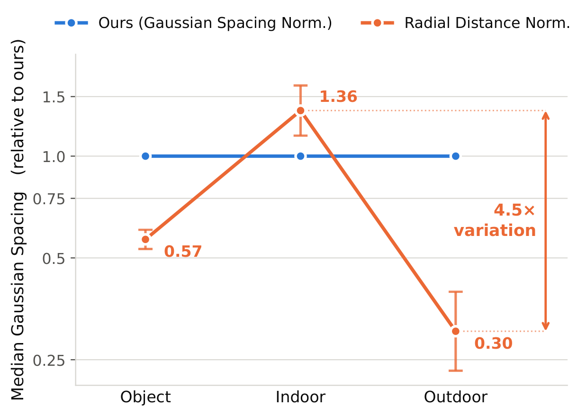
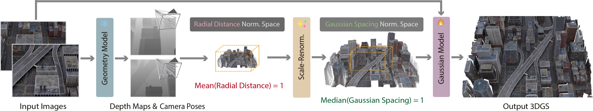
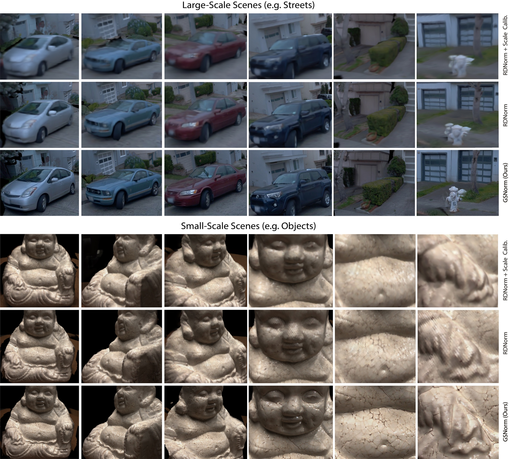

> **원문**: [arXiv](https://arxiv.org/abs/2611.08264) · [HuggingFace](https://huggingface.co/papers/2611.08264) (👍 60) · [GitHub](https://github.com/zju3dv/SplatAnything) · [프로젝트 페이지](https://zju3dv.github.io/SplatAnything/)
{: .prompt-info }

## 들어가며

오늘은 오랜만에 LLM이나 에이전트가 아니라 3D 컴퓨터 비전/그래픽스 논문을 골라봤습니다. HuggingFace Daily Papers에서 60 upvote를 받은 feed-forward 3D Gaussian Splatting(3DGS) 논문인데, 저자 소속이 저장대(Zhejiang University), 텐센트 훈위안(Tencent Hunyuan), Causa Robotics로 걸쳐 있는 10인 공저입니다.

재밌는 건 GitHub 저장소를 열어보면 제목 바로 아래에 "SplatAnything (InfiniSplat v3)"라는 부제가 붙어있다는 점입니다. 논문 본문의 관련 연구 절에는 "InfiniSplat"이라는 모노큘러 복원 방법이 비교 baseline으로, "익명의 InfiniSplat v2"가 참고문헌으로 각각 따로 인용되어 있는데, 저장소 이름으로 미루어보면 이 팀이 자기 이전 모델(InfiniSplat → v2)을 한 단계씩 발전시켜 온 세 번째 버전이 이 논문이라는 뜻으로 보입니다. 심사 중에는 익명화 때문에 자기 선행 연구를 남의 연구인 것처럼 인용해야 하는 사정이야 흔하지만, 뒤에서 보겠지만 본문 Table 3에서 이 팀은 자기들의 이전 모델(InfiniSplat)을 상대로도 또렷한 우위를 보고합니다. 자기 자신을 상대로도 정직하게 비교했다는 점이 눈에 들어왔습니다.

## 한눈에 보기

- **핵심 기여**: ① feed-forward 3DGS 모델들이 공통으로 쓰는 Radial Distance Normalization(RDNorm)이 장면의 전역적인 거리 통계만 맞출 뿐, 실제로 Gaussian 크기를 결정해야 하는 "이웃 Gaussian 사이의 간격(Gaussian spacing)"은 그대로 둔다는 문제를 지적. ② 이 간격의 중앙값을 기준으로 삼아 정규화하는 Gaussian Spacing Normalization(GSNorm) 제안. ③ 기존 벤치마크가 보간(interpolation) 시점 위주였던 것과 달리, 입력 뷰 희소성과 외삽(extrapolation) 시점을 통제한 7개 데이터셋 교차 벤치마크를 새로 구축.
- **성능**: 7개 데이터셋(ScanNet, NRGBD, DL3DV, Tanks & Temples, Mip-NeRF 360, ETH3D, DTU) 평균 기준으로 포즈 없는 설정과 포즈 있는 설정 모두에서 거의 전 구간 1위. 모노큘러(단일 이미지) 설정에서도 자사 이전 모델 InfiniSplat 대비 뚜렷하게 앞섬.
- **한 줄 요약**: "Gaussian 크기의 학습 타깃을 안정시키려면, 카메라로부터 얼마나 먼가가 아니라 점들이 서로 얼마나 촘촘한가를 기준으로 좌표계를 맞춰야 한다."

## 어떤 문제를 풀려고 했나

Feed-forward 3DGS는 장면마다 따로 최적화를 돌리는 기존 3DGS와 달리, 이미지 몇 장을 넣으면 한 번의 순전파로 3D Gaussian 표현을 바로 뽑아내는 방식입니다. 최근 이 분야의 흐름은 VGGT 같은 geometry foundation model로 먼저 깊이·카메라 포즈를 예측한 뒤, 그 기하 정보 위에서 픽셀별로 Gaussian의 크기·회전·불투명도·색을 예측하는 두 단계 구조로 수렴하고 있습니다.

문제는 이 기하 예측 모델들이 공통으로 쓰는 정규화 방식에 있다고 저자들은 말합니다. 장면의 스케일이 제각각이면 좌표값이 수치적으로 불안정해지니, 보통 "기준 카메라로부터 복원된 3D 점들까지의 평균 거리"로 장면 전체를 나눠서 스케일을 1 근처로 맞춥니다(Radial Distance Normalization, RDNorm). 그런데 이 평균 거리를 똑같이 맞췄다고 해서, 이웃한 두 Gaussian 중심 사이의 실제 간격까지 똑같아지는 건 아니라는 게 이 논문의 핵심 관찰입니다. 작은 물체를 가까이서 찍은 장면과 건물이 늘어선 거리를 찍은 장면은 평균 거리를 똑같이 1로 맞춰도, 픽셀 하나하나가 커버해야 하는 실제 공간적 간격은 전혀 다릅니다.

이게 왜 문제가 되냐면, Gaussian이 표면을 빈틈없이 덮으려면 그 크기가 주변 Gaussian과의 간격에 맞아야 하기 때문입니다. 간격이 넓은데 작게 예측하면 구멍(hole)이 뚫리고, 간격이 좁은데 크게 예측하면 서로 겹쳐서 뭉개집니다(over-smoothing). 그런데 RDNorm 공간에서는 비슷하게 생긴 로컬 영역이라도 장면에 따라 요구되는 Gaussian 크기가 다를 수 있다는 것이니, 모델 입장에서는 "이 패치를 보면 이 정도 크기로 찍어라"는 지도학습 신호 자체가 장면마다 흔들리는 셈입니다.

## 핵심 아이디어

### Gaussian spacing이라는 새 척도

저자들은 먼저 "Gaussian spacing"이라는 개념을 수식으로 정의합니다. 각 뷰의 픽셀 $\mathbf{u}$에서 깊이 $D_i(\mathbf{u})$와 초점거리 $(f_{x,i}, f_{y,i})$가 주어지면, 핀홀 카메라 모델로 역투영한 3D 점들 사이의 간격은 1차 근사로 이렇게 정리됩니다.

$$d_i(\mathbf{u}) \approx \frac{D_i(\mathbf{u})}{\sqrt{f_{x,i}f_{y,i}}}$$

$D_i(\mathbf{u})$는 뷰 $i$의 픽셀 $\mathbf{u}$에서의 깊이값, $f_{x,i}, f_{y,i}$는 그 뷰 카메라의 가로·세로 초점거리입니다.

이웃 픽셀 사이의 3D 간격이 결국 "그 지점의 깊이를 초점거리로 나눈 값"으로 근사된다는 뜻입니다. 직관적으로도 그럴듯한데, 카메라에서 멀수록(깊이가 클수록) 같은 한 픽셀이 덮는 실제 공간은 넓어지고, 초점거리가 길수록(화각이 좁을수록, 더 "확대"해서 찍을수록) 같은 픽셀이 덮는 공간은 좁아지니까요. 이 값이 바로 각 픽셀에서 Gaussian이 가져야 할 "적정 크기"의 기준점이 됩니다.

### 기존 RDNorm이 놓치는 지점

RDNorm은 기준 카메라에서 복원된 모든 3D 점 $\mathbf{P}_i(\mathbf{u})$까지의 거리를 평균 내 정규화 인자 $s_r$을 정합니다.

$$s_r = \frac{1}{N_p}\sum_{i=1}^{N}\sum_{\mathbf{u}\in\Omega_i}\left\|\mathbf{P}_i(\mathbf{u})\right\|_2$$

$\Omega_i$는 뷰 $i$에서 유효한 픽셀 집합, $N_p$는 전체 유효 픽셀 수입니다.

이 식 자체는 평범한 평균 계산입니다. 문제는 이렇게 구한 $s_r$로 깊이를 나눠 정규화한 뒤의 Gaussian spacing을 다시 써보면 드러납니다.

$$d_i^{r}(\mathbf{u}) \approx \frac{D_i(\mathbf{u})}{\sqrt{f_{x,i}f_{y,i}}\,s_r}$$

겉보기엔 그냥 분모에 $s_r$ 하나 더 붙은 것뿐이지만, 의미는 꽤 큽니다. $s_r$은 "평균 거리"를 1로 맞추는 값이지, $d_i(\mathbf{u})$ 자체를 특정 값으로 맞추도록 설계된 값이 아닙니다. 그래서 RDNorm을 거친 뒤에도 $d_i^r(\mathbf{u})$는 장면마다, 카메라 구성마다 제각각으로 남습니다. "평균 거리를 하나로 맞췄다"는 것과 "Gaussian 간격을 하나로 맞췄다"는 것은 전혀 다른 이야기라는 게 이 수식이 보여주는 바입니다.

실제로 이 차이가 어느 정도인지를 보여주는 그래프가 있습니다.

_object/indoor/outdoor 세 장면 유형에서, RDNorm을 거친 뒤의 median Gaussian spacing을 GSNorm(파란 선, 항상 1)과 비교한 그래프. RDNorm은 유형 사이에 최대 4.5배 차이가 난다._

가로축은 object·indoor·outdoor 세 장면 유형이고, 세로축은 GSNorm 결과(파란 선, 항상 1로 고정) 대비 상대적인 median Gaussian spacing입니다. RDNorm(주황 선)을 보면 object는 0.57, indoor는 1.36, outdoor는 0.30으로 들쭉날쭉합니다. 즉 RDNorm을 썼다고 자기 입으로 "정규화했다"고 말할 수는 있지만, 정작 Gaussian 예측기가 기준으로 삼아야 할 양은 장면 유형에 따라 최대 4.5배까지 벌어진 채로 남아있다는 걸 숫자로 보여주는 그래프입니다.

### GSNorm: 중앙값으로 간격 자체를 맞추기

그래서 저자들의 해법은 단순합니다. 거리의 평균이 아니라, Gaussian spacing의 중앙값이 1이 되도록 정규화 인자를 정하자는 것입니다.

$$s_g = \operatorname*{median}_{i,\mathbf{u}\in\Omega_i}\left(\frac{D_i(\mathbf{u})}{\sqrt{f_{x,i}f_{y,i}}}\right)$$

전체 뷰, 전체 유효 픽셀에 걸쳐 $D_i(\mathbf{u})/\sqrt{f_{x,i}f_{y,i}}$ 값들을 모은 뒤 그 중앙값을 $s_g$로 삼습니다.

이 식이 좋은 이유는 두 가지입니다. 하나는 중앙값이 양의 스케일링에 대해 등변(equivariant)이라는 성질 덕분에, "median Gaussian spacing을 1로 맞춰라"는 목표를 뒤집으면 바로 이 닫힌 형태의 해가 나온다는 점입니다. 다른 하나는 평균이 아니라 중앙값을 쓴다는 점 자체인데, 깊이 맵에는 배경이나 먼 곳의 극단적인 값이 섞이기 마련이라 이런 값들이 평균을 크게 왜곡할 수 있는 반면 중앙값은 이런 이상치에 상대적으로 둔감합니다. 이렇게 구한 $s_g$로 깊이·3D 점·카메라 평행이동을 다시 스케일링하면, 장면 유형과 무관하게 "대표적인 Gaussian 간격은 1"이라는 일관된 기준점 위에서 Gaussian 크기를 예측하게 됩니다. 로컬한 간격의 상대적인 변화(물체 가장자리는 조밀하고 먼 배경은 성기고 하는 식의 변화)는 그대로 보존하면서, 장면 전체를 관통하는 대표 스케일만 통일하는 셈입니다.

### 아키텍처: 얼린 기하 모델 위에 가벼운 헤드

전체 파이프라인은 다음과 같이 구성됩니다.

_입력 이미지에서 얼린 geometry foundation model로 깊이·카메라 포즈를 뽑고, RDNorm 공간을 GSNorm 공간으로 재정규화한 뒤 Gaussian 모델로 넘기는 전체 흐름._

왼쪽부터 보면, 입력 이미지가 얼린(파란 눈송이 아이콘) geometry foundation model(WorldMirror 2.0)을 통과해 깊이 맵과 카메라 포즈를 얻습니다. 이 결과는 원래 "평균 Radial Distance = 1"인 RDNorm 공간에 있는데, Scale-Renorm 단계(주황 블록)에서 이걸 "median Gaussian Spacing = 1"인 GSNorm 공간으로 다시 스케일링합니다. 이렇게 재정규화된 3D 점이 Gaussian 중심이 되고, 이어서 불꽃 아이콘으로 표시된(= 학습 대상인) Gaussian 모델이 각 픽셀의 불투명도·회전·크기·구면조화(SH) 색 계수를 예측합니다.

여기서 눈에 띄는 설계는 Gaussian을 예측하는 백본을 처음부터 새로 학습시키지 않고, WorldMirror 2.0의 기하 백본에서 가중치를 그대로 가져와 fine-tuning한다는 점입니다. 거기에 가볍게 새로 학습하는 GSHead 하나만 얹어 Gaussian 속성을 뽑아냅니다. 기하 이해 능력은 사전학습된 백본에서 최대한 재사용하고, GSNorm이라는 좌표계 교정과 작은 헤드 학습만으로 Gaussian 예측 문제를 푸는 구조입니다. 학습은 MSE와 LPIPS를 1:1로 섞은 렌더링 손실만으로 진행되는데, 흥미로운 점은 GSNorm이 손실 함수 안에 들어가는 게 아니라 그 전 단계인 좌표계 정의 자체를 바꾸는 전처리라는 점입니다. 학습 목적함수를 건드리지 않고 "무엇을 1로 맞출 것인가"라는 질문만 바꿔서 결과를 끌어올린 셈이라, 개인적으로는 이 논문에서 가장 깔끔한 지점이라고 느꼈습니다.

## 실험 결과

가장 먼저 확인할 건 이 정규화 방식 자체의 효과입니다. 같은 아키텍처·학습 설정에서 정규화 공간만 바꿔본 ablation 결과입니다.

| Norm. Space | Views=1 DISTS↓ | Views=1 LPIPS↓ | Views=4 DISTS↓ | Views=4 LPIPS↓ | Views=8 DISTS↓ | Views=8 LPIPS↓ | Views=16 DISTS↓ | Views=16 LPIPS↓ | Views=32 DISTS↓ | Views=32 LPIPS↓ | Views=64 DISTS↓ | Views=64 LPIPS↓ |
|---|---|---|---|---|---|---|---|---|---|---|---|---|
| Radial Distance Norm. | 0.308 | 0.394 | 0.223 | 0.278 | 0.223 | 0.272 | 0.218 | 0.268 | 0.225 | 0.277 | 0.224 | 0.250 |
| Radial Distance Norm. + Scale Calibration | 0.323 | 0.400 | 0.249 | 0.309 | 0.252 | 0.308 | 0.245 | 0.300 | 0.253 | 0.305 | 0.234 | 0.265 |
| **Gaussian Spacing Norm. (Ours)** | **0.294** | **0.367** | **0.198** | **0.245** | **0.196** | **0.237** | **0.190** | **0.232** | **0.197** | **0.241** | **0.217** | **0.229** |

여기서 "Scale Calibration"은 Gaussian 예측 자체는 그대로 RDNorm 공간에서 하되, 예측된 Gaussian 크기만 사후적으로 장면의 median spacing에 맞춰 일괄 재조정한 버전입니다. 그런데 표를 보면 이 사후 보정판이 오히려 순수 RDNorm보다도 전 구간에서 더 나쁩니다. 저자들은 이걸 두고 "사후 크기 보정으로는 애초에 학습 단계에서 생긴 지도학습 타깃의 모호함을 되돌릴 수 없다"고 해석하는데, 숫자가 그 해석을 뒷받침합니다. Gaussian 예측 *이전에* 좌표계를 바꾸는 GSNorm만이 모든 입력 뷰 개수(1~64)에서 일관되게 가장 좋습니다. 특히 흥미로운 건 격차가 입력 뷰가 적을 때(1~8뷰) 더 크게 벌어진다는 점인데, 입력이 적을수록 애매한 지점을 추정으로 메워야 할 일이 많아지니 정규화 기준이 안정적이냐 아니냐가 더 민감하게 작동하는 것으로 보입니다.

실제로 어떤 식으로 망가지는지는 정성적 비교에서 더 선명하게 드러납니다.

_위: 거리(대규모 장면)에서의 RDNorm+Scale Calib., RDNorm, GSNorm 비교. 아래: 불상(소규모 object)에서의 같은 비교._

위쪽 거리 장면 행들을 보면 RDNorm 계열(위 두 줄)은 차량이나 소화전 같은 디테일이 흐릿하게 뭉개져 있는데, 맨 아래 GSNorm 줄에서는 소화전의 빨간 띠, 덤불의 잎사귀 결까지 또렷합니다. 캡션에서 말한 "대규모 장면에서의 over-smoothing"이 바로 이겁니다. 아래쪽 불상 장면에서는 반대로 RDNorm 쪽(위 두 줄)에서 표면에 가로줄 같은 줄무늬·구멍 아티팩트가 보이는 반면, GSNorm(맨 아래)은 균열 무늬 같은 미세한 표면 디테일까지 비교적 깨끗하게 살아있습니다. 하나의 정규화 기준이 장면 규모에 따라 정반대 실패 양상(뭉개짐 vs 구멍)을 낳는다는 걸 한 그림 안에서 같이 보여주는 구성이 설득력 있었습니다.

이제 baseline들과의 전체 비교입니다. 7개 데이터셋에서 4~64 입력 뷰를 평균한 결과이고, 포즈를 안 주는 설정(w/o Pose)과 포즈를 주는 설정(w/ Pose)으로 나뉩니다.

| Input | Method | ScanNet DISTS↓ | ScanNet LPIPS↓ | NRGBD DISTS↓ | NRGBD LPIPS↓ | DL3DV DISTS↓ | DL3DV LPIPS↓ | T&T DISTS↓ | T&T LPIPS↓ | MipNeRF360 DISTS↓ | MipNeRF360 LPIPS↓ | ETH3D DISTS↓ | ETH3D LPIPS↓ | DTU DISTS↓ | DTU LPIPS↓ |
|---|---|---|---|---|---|---|---|---|---|---|---|---|---|---|---|
| w/o Pose | AnySplat | 0.278 | 0.414 | 0.236 | 0.352 | 0.371 | 0.327 | 0.593 | 0.737 | 0.538 | 0.787 | 0.278 | 0.154 | 0.520 | 0.810 |
| w/o Pose | YoNoSplat | 0.265 | _0.236_ | 0.285 | 0.240 | 0.375 | _0.219_ | 0.424 | _0.338_ | 0.405 | 0.586 | 0.321 | _0.033_ | 0.484 | 0.729 |
| w/o Pose | DA3-GS | 0.286 | 0.305 | _0.233_ | _0.217_ | _0.337_ | 0.228 | _0.414_ | 0.380 | _0.371_ | _0.565_ | _0.228_ | 0.087 | _0.365_ | _0.582_ |
| w/o Pose | Mirror2-GS | _0.193_ | _0.222_ | _0.235_ | 0.237 | _0.246_ | _0.188_ | _0.306_ | _0.351_ | _0.283_ | _0.528_ | _0.205_ | 0.070 | _0.347_ | _0.617_ |
| w/o Pose | QuerySplat | _0.236_ | 0.242 | 0.261 | _0.216_ | 0.343 | 0.291 | 0.425 | 0.393 | 0.412 | 0.652 | 0.290 | **0.031** | 0.424 | 0.676 |
| w/o Pose | **Ours** | **0.184** | **0.207** | **0.195** | **0.183** | **0.221** | **0.156** | **0.252** | **0.299** | **0.233** | **0.463** | **0.147** | _0.049_ | **0.229** | **0.483** |
| w/ Pose | DepthSplat | 0.288 | 0.278 | 0.323 | 0.272 | 0.329 | 0.191 | 0.397 | 0.353 | 0.561 | 0.656 | 0.445 | 0.068 | 0.370 | 0.598 |
| w/ Pose | TokenGS | 0.369 | 0.272 | 0.333 | 0.277 | 0.375 | 0.211 | 0.515 | 0.346 | 0.502 | 0.716 | 0.400 | _0.042_ | 0.593 | 0.828 |
| w/ Pose | tttLRM | 0.292 | 0.300 | 0.320 | 0.292 | 0.323 | 0.196 | _0.390_ | _0.342_ | 0.350 | 0.531 | 0.225 | 0.063 | 0.382 | 0.599 |
| w/ Pose | ReSplat | _0.272_ | _0.240_ | 0.284 | 0.232 | _0.304_ | _0.159_ | 0.396 | **0.275** | _0.349_ | _0.525_ | _0.219_ | **0.027** | 0.441 | 0.664 |
| w/ Pose | DA3-GS (Pose Cond.) | 0.274 | 0.291 | _0.238_ | _0.227_ | 0.311 | 0.219 | 0.425 | 0.368 | 0.362 | 0.556 | 0.223 | 0.089 | _0.368_ | _0.596_ |
| w/ Pose | Mirror2-GS (Pose Cond.) | _0.195_ | _0.223_ | _0.231_ | _0.226_ | _0.239_ | _0.180_ | _0.304_ | 0.346 | _0.272_ | _0.506_ | _0.201_ | 0.062 | _0.315_ | _0.532_ |
| w/ Pose | **Ours (Pose Cond.)** | **0.185** | **0.206** | **0.186** | **0.162** | **0.215** | **0.148** | **0.251** | _0.290_ | **0.219** | **0.440** | **0.133** | _0.037_ | **0.184** | **0.364** |

(DISTS·LPIPS 모두 낮을수록 좋은 지표이고, 둘 다 사람이 느끼는 구조·질감 유사도를 반영하는 perceptual metric입니다. **굵게**는 1위, _이탤릭_은 2~3위.)

패턴을 짚어보면, SplatAnything은 두 설정 모두에서 거의 모든 데이터셋·지표를 휩씁니다. 그런데 딱 한 군데, ETH3D의 LPIPS만큼은 QuerySplat(0.031)이나 ReSplat(0.027)에 1위를 내줍니다. 반면 같은 ETH3D의 DISTS는 SplatAnything이 1위(0.147/0.133)입니다. ETH3D는 질감이 단순한 공업용 피사체·캘리브레이션 장면이 많은 데이터셋인데, 이런 곳에서는 "구조가 맞는가"(DISTS가 더 잘 반영)보다 "픽셀 단위 텍스처 디테일이 맞는가"(LPIPS가 더 민감)가 갈리는 지점에서 약간 밀리는 걸로 보입니다. 완벽한 전승은 아니지만, 이 정도 일관성으로 7개 데이터셋을 쓸어담는 사례는 흔치 않습니다.

마지막으로 효율성 이야기도 짧게 덧붙이면, 부록에 따르면 SplatAnything은 가장 빠른 방법(Mirror2-GS, DepthSplat)보다는 느리지만, 더 무거운 DA3-GS·QuerySplat·TokenGS보다는 훨씬 빠릅니다. 입력 64뷰 기준으로 Mirror2-GS가 6초 선인 데 비해 SplatAnything은 11초 선이라, 품질과 속도 사이에서 중간값을 택한 모양새입니다. Data scaling 실험에서도 학습 데이터를 줄이면 성능이 꾸준히 떨어지는 것으로 보고되는데(구체적인 곡선은 appendix), 이건 GSNorm 자체의 효과라기보다는 일반적인 데이터 스케일링 법칙에 가까워 보입니다.

## 아쉬운 점 / 의문점

가장 먼저 걸리는 건 Gaussian spacing 근사식 자체의 전제입니다. $d_i(\mathbf{u}) \approx D_i(\mathbf{u})/\sqrt{f_{x,i}f_{y,i}}$라는 식은 "이웃 픽셀끼리 깊이가 거의 같다(locally constant depth)"는 가정 위에 세워져 있습니다. 그런데 정작 정확한 복원이 가장 중요한 영역은 물체 경계처럼 깊이가 급격히 꺾이는 지점입니다. 이런 depth discontinuity 근처에서 이 근사가 얼마나 깨지는지, 그리고 그게 median 계산 자체에 노이즈를 얼마나 보태는지는 논문에 따로 분석이 없습니다. median이라 이상치에 어느 정도 강건하다고는 해도, 경계 픽셀 비중이 큰 장면(가늘고 복잡한 구조물이 많은 실내 등)에서는 영향이 있을 법한데 이 부분은 논문에 명시되어 있지 않습니다.

또 하나는 비교 대상 baseline들의 재현 방식입니다. 이 논문이 쓴 7개 데이터셋 교차 벤치마크는 이 논문에서 새로 만든 것이라, AnySplat·DepthSplat·ReSplat 등 비교 대상 전부를 저자들이 직접 이 벤치마크 위에서 돌렸다는 뜻이 됩니다. 그 자체는 공정한 비교를 위해 바람직한 선택이지만, 각 baseline을 공식 체크포인트·공식 코드로 그대로 돌렸는지, 하이퍼파라미터 튜닝은 어느 수준까지 했는지에 대한 설명이 본문에 없어서, 비교의 공정성을 판단할 근거가 부족합니다. 특히 ReSplat처럼 PSNR에서는 1위를 자주 차지하는데 DISTS·LPIPS에서는 밀리는(논문이 "과도하게 매끈한 예측" 때문이라고 설명하는) 경우, 그 설명이 맞다면 ReSplat 자체의 특성일 수도 있지만 재현 설정의 차이일 가능성도 완전히 배제하긴 어렵습니다.

마지막으로, 결론부에서 저자들도 스스로 인정하듯 이 방법은 얼린 geometry foundation model(WorldMirror 2.0)의 깊이 추정에 전적으로 의존합니다. GSNorm이 아무리 정교해도 입력 깊이 자체가 틀리면 median도 같이 틀어집니다. 개인적으로는 이 의존성이 이 논문의 진짜 한계라고 보는데, "표면이 보이지 않는 영역은 복원하지 못한다"는 결론부의 한계 서술도 결국 같은 뿌리입니다. GSNorm이 해결한 건 "기하가 맞게 주어졌을 때 Gaussian 크기를 얼마로 할지"의 모호함이지, 기하 추정 자체의 오차는 여전히 고스란히 넘겨받는 구조입니다.

## 마치며

이 논문을 보면서 흥미로웠던 건, 해결책 자체는 "평균 대신 중앙값을 쓰고, 그 기준을 거리가 아니라 간격으로 바꾼다"는 매우 단순한 아이디어인데 그 효과가 작지 않다는 점입니다. 모델 구조나 손실 함수를 건드리지 않고 좌표계 정의 하나만 바꿔서 7개 데이터셋 전반에 걸친 일관된 개선을 만들어냈다는 게 이 연구의 설득력이라고 생각합니다. 한편으로는 "정규화 기준을 뭘로 잡을 것인가"라는, 3DGS뿐 아니라 스케일이 들쭉날쭉한 데이터를 다루는 여러 문제에서 반복적으로 등장하는 질문이기도 해서, 비슷한 사고방식이 다른 도메인에도 적용될 여지가 있어 보입니다. 다음에 궁금한 지점은 이 팀이 다음 버전(혹시 있다면 "InfiniSplat v4"?)에서는 어떤 통계량을 또 바꿔볼지, 그리고 얼린 기하 모델에 대한 의존성을 어떻게 줄여나갈지입니다.
