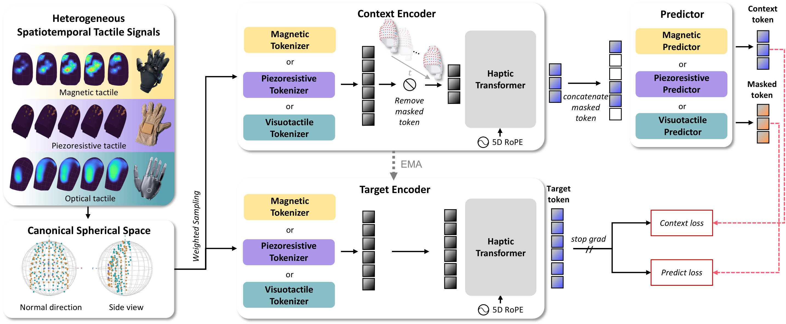
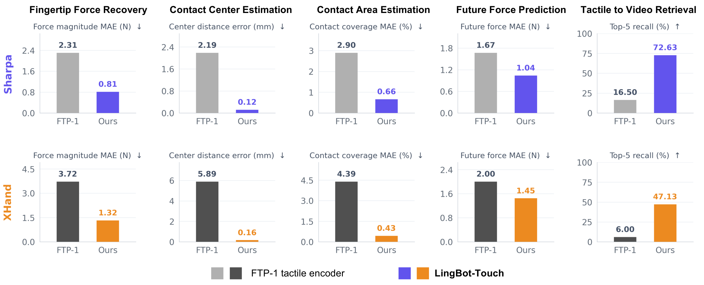
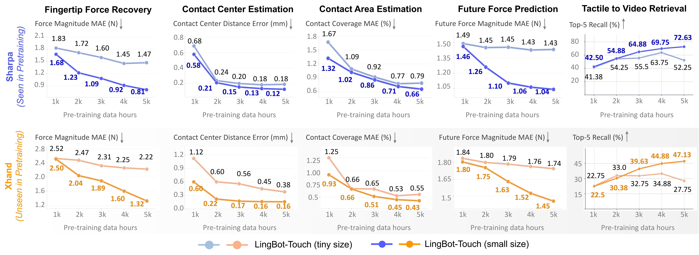
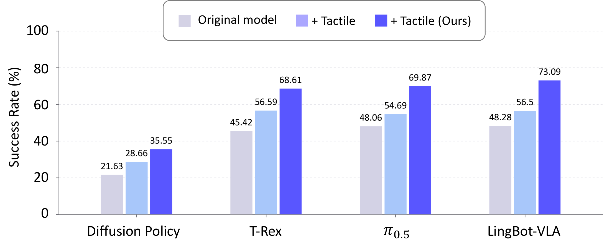

> **원문**: [arXiv](https://arxiv.org/abs/2611.12806) · [HuggingFace](https://huggingface.co/papers/2611.12806) (👍 92) · [GitHub](https://github.com/Robbyant/lingbot-touch)
{: .prompt-info }

## 들어가며

오늘 리뷰할 논문은 HuggingFace Daily Papers에서 92 upvote를 받은 로봇 촉각(tactile) 센싱 논문입니다. 비전-언어-액션(VLA) 모델이나 LLM 에이전트 쪽 논문만 보다가 오랜만에 하드웨어 냄새가 짙은 논문을 골랐습니다.

이 논문이 눈길을 끈 지점은 문제 설정 자체입니다. 촉각 센서는 이미 피에조저항식, 자기식, 시각식(카메라로 변형을 찍는 방식) 등 여러 종류가 상용화되어 있는데, 서로 다른 센서로 찍은 데이터는 호환이 안 됩니다. 센서마다 taxel(촉각의 "픽셀"에 해당하는 감지 단위) 개수, 배치, 샘플링 레이트, 측정 원리가 전부 다르기 때문에, 한 센서에서 학습한 모델을 다른 센서에 그대로 쓸 수가 없습니다. 그래서 지금까지 촉각 표현 학습 연구는 센서 하나를 정해놓고 그 안에서만 데이터를 모으고 모델을 훈련하는 식으로 흩어져 있었다고 합니다. 저자들은 이 문제를 "접촉(contact)이라는 물리적 사건 자체는 센서가 무엇이든 동일하다"는 발상에서 풀어보려고 합니다. 손가락이 모서리를 누르는 사건은 자기 센서로 보든 카메라로 보든 똑같은 사건이니, 센서별 물리 특성만 걷어내면 공유 가능한 표현을 만들 수 있다는 것입니다.

## 한눈에 보기

- **핵심 기여**: ① 피에조저항·자기·시각 촉각 센서의 taxel을 손가락 끝 위의 공통 3D 좌표계(canonical fingertip space)로 투영해서 센서 종류와 무관한 입력 형식을 만듦. ② 이 좌표를 5차원 주소(시간·손가락·위치)로 인코딩해 RoPE에 태우고, 마스킹된 위치의 잠재 표현을 예측하는 JEPA 방식(Tactile-JEPA)으로 비지도 사전학습. ③ 사람이 낀 촉각 장갑과 로봇 원격조작을 합쳐 5,000시간 규모의 촉각 코퍼스를 구축. ④ 사전학습이 끝난 인코더를 얼린 채로 모방학습·VLA·강화학습 정책에 토큰만 꽂아 넣어도 실제 로봇 26개 과제와 시뮬레이션 12개 과제에서 성능이 크게 오름을 확인.
- **성능**: 사전학습 때 한 번도 보지 않은 자기식 센서(XHand1)에서도 추가 학습 없이 FTP-1(기존 최고 수준의 이종 센서 촉각 모델)을 다섯 개 probing 과제 전부에서 앞섬. 실제 로봇 26개 과제 평균 성공률이 정책별로 13.9~24.8%p 상승.
- **한 줄 요약**: "센서 물리를 걷어내고 '접촉'이라는 사건 자체를 표현하도록 학습시키면, 한 번도 본 적 없는 센서에서도 추가 학습 없이 통한다."

## 어떤 문제를 풀려고 했나

로봇이 정교한 손동작(dexterous manipulation)을 하려면 촉각이 꼭 필요합니다. 사람도 손끝 감각이 마비되면 성냥을 긋거나 단추를 채우는 것 같은 간단한 일도 눈으로 보면서조차 잘 못한다고 합니다. 그런데 지금의 로봇 조작 연구는 거의 전부 시각에만 의존하고 있고, 시각만으로는 "지금 얼마나 세게 누르고 있는지", "손아귀에서 물체가 미끄러지고 있는지", "가려진 손가락 밑에서 무슨 일이 일어나는지"를 알 수 없습니다.

그럼 왜 촉각을 안 쓰느냐 하면, 센서가 없어서가 아니라 촉각이라는 양식(modality) 자체가 시각이나 언어처럼 "스케일업"하기 위한 세 가지 조건을 못 갖췄기 때문이라고 저자들은 짚습니다.

1. **공통 입력 형식이 없다** — 센서마다 채널, 배치, 해상도, 샘플링 레이트가 제각각이라 한 센서의 신호가 다른 센서를 학습한 모델에게는 아무 의미가 없습니다.
2. **대규모로 정제된 코퍼스가 없다** — 한 센서의 데이터를 다른 센서 데이터와 합칠 수 없으니, 촉각 데이터를 모으려면 매 시간마다 센서가 달린 손이 물리적으로 세상과 접촉해야 합니다.
3. **확립된 학습 레시피가 없다** — 촉각이 로봇 학습에 도움이 된다는 증거는 있지만 전부 센서별·과제별로 따로따로 보고되어 있어서, 공유 가능한 표현으로 묶여 비교된 적이 없습니다.

개인적으로 이 세 가지 문제를 "하나의 근본 원인"으로 환원한 부분이 이 논문에서 가장 설득력 있는 지점이라고 생각합니다. 센서 물리와 접촉이라는 사건을 분리할 수만 있다면, 셋 다 동시에 풀린다는 주장이거든요. 다만 이게 말처럼 쉬운 문제는 아닌데, 뒤에서 보겠지만 저자들도 "공간 정밀도는 희생된다"는 트레이드오프를 인정하고 있습니다.

## 핵심 아이디어

LingBot-Touch는 세 가지 설계 결정으로 이 문제를 풉니다: (1) 좌표계 통일, (2) JEPA 기반 자기지도 목적함수, (3) 레이아웃에 무관해지도록 만드는 augmentation. 하나씩 살펴보겠습니다.

### 1. Canonical fingertip space — "센서 인덱스가 아니라 손가락 위의 위치"

가장 먼저 해결해야 하는 건 입력 형식입니다. 서로 다른 센서의 taxel을 비교하려면, "몇 번째 taxel인가"가 아니라 "손가락의 어디를 측정했는가"로 바꿔 말해야 합니다. 저자들은 각 센서의 기하학적 형상(geometry asset)에서 출발해 손가락 끝을 표준 방향으로 정렬한 뒤, 공통 반지름을 가진 기준 구(unit-radius reference geometry) 위의 좌표로 스케일·평행이동시킵니다.

$$\mathbf p_i=\alpha\,\tilde{\mathbf p}_i+\mathbf b$$

여기서 $\tilde{\mathbf p}_i$는 방향 정렬이 끝난 taxel $i$의 위치이고, $\alpha>0$과 $\mathbf b\in\mathbb{R}^3$은 센서-손가락 쌍마다 한 번만 오프라인으로 정해지는 스케일·이동 상수입니다.

이 수식 자체는 사실 평범한 아핀 변환(affine transform)입니다. 중요한 건 그 다음인데, 여기에 들어가는 $\alpha$와 $\mathbf b$를 센서마다 (PaXini는 최소 외접구의 중심과 반지름, Sharpa Wave는 깊이 보정을 더한 높이 정렬, Tachin은 등방적(isotropic) 최대 적합 등) 각자 다른 방식으로 구해놓고, 결과적으로 모든 센서가 "같은 반지름의 기준 손가락 끝" 위의 좌표를 쓰게 만든다는 점입니다. 센서가 늘어날 때마다 이 보정 파라미터 한 세트만 새로 구하면 된다는 뜻이라, 확장성 면에서 실용적인 선택으로 보입니다.

이렇게 만든 3D 위치에 시간과 손가락 식별자를 더해 각 토큰은 5차원 주소를 받습니다.

$$\mathbf a_i=(t_i,f_i,\mathbf p_i)\in\mathbb{R}^5,\qquad \mathbf A=(\mathbf a_i)_{i=1}^{L}$$

$t_i$는 시간 윈도우 인덱스, $f_i$는 손가락 식별자, $\mathbf p_i$는 위에서 구한 캐노니컬 좌표이고, $L$은 유효 토큰의 개수입니다.

이 주소는 모델 입력에 직접 들어가는 게 아니라 **RoPE(회전 위치 임베딩)를 통해서만** 어텐션의 쿼리·키에 영향을 줍니다. 즉 5개 축이 각각 head 차원의 일부를 담당해서 돌아가는 구조입니다. 이렇게 하면 토큰 개수가 고정될 필요도 없고 센서별 위치 테이블을 따로 둘 필요도 없어서, 하나의 백본이 센서마다 다른 레이아웃을 그대로 처리할 수 있고, 학습 때 본 적 없는 센서로도 일반화할 길이 열립니다. 여담이지만 RoPE를 공간 좌표(그것도 3D 연속 좌표)에 쓰는 아이디어는 비전 쪽에서도 최근 자주 보이는 패턴인데, 여기서는 "센서가 달라도 호환되는 위치 인코딩"이라는 꽤 구체적인 필요에 의해 채택된 것이라 납득이 갑니다.

### 2. Tactile-JEPA — "복원하지 말고 잠재공간에서 예측하라"

두 번째 문제는 라벨이 없다는 것입니다. 5,000시간짜리 코퍼스에는 과제 카테고리 정도만 붙어있고, 클립 안에서 힘이 얼마나 가해졌는지, 접촉이 어디서 시작하고 끝났는지는 전혀 표시되어 있지 않습니다. 저자들은 V-JEPA 계열의 joint-embedding predictive architecture를 가져와서, 신호 자체를 복원하는 대신 **마스킹된 taxel의 잠재 표현을 예측**하도록 학습시킵니다.

왜 복원이 아니라 예측이냐면, 촉각 신호는 대부분의 시간·대부분의 taxel이 거의 0(접촉 없음)인 극도로 희소한 신호이기 때문입니다. 복원 목적함수를 쓰면 모델이 "배경(접촉 없음)을 잘 재현하는 법"을 배우는 데 보상을 받게 되고, 배경은 많아질수록 오히려 학습에 방해가 됩니다 (이 가설은 §4의 VAE/MAE 비교 실험에서 직접 검증됩니다).

context encoder는 보이는 토큰만 받고, target encoder는 전체 클립을 받습니다. predictor는 context encoder의 출력과 마스킹 위치의 학습 가능한 mask token을 합쳐서, 보이는 위치와 마스킹된 위치 양쪽 모두에서 target encoder의 출력을 맞히도록 훈련됩니다.

$$
\begin{aligned}
\hat{\mathbf z} &= P_\phi^{(g)}\left(E_\theta^{(g)}(\mathbf X_{\mathcal C};\mathbf A_{\mathcal C}), \Delta_{\mathcal M};\mathbf A\right),\\
\bar{\mathbf z} &= \bar E_{\bar\theta}^{(g)}(\mathbf X;\mathbf A)
\end{aligned}
$$

$g$는 센서 종류(자기/피에조저항/시각)에 따라 어느 tokenizer·predictor 분기를 쓸지 고르는 인덱스이고, $\mathcal C$와 $\mathcal M$은 각각 보이는 토큰과 마스킹된 토큰의 집합, $\Delta_{\mathcal M}$은 마스킹 위치에 들어가는 학습 가능한 mask token, $\bar E_{\bar\theta}^{(g)}$는 target encoder입니다.

이 식에서 읽어야 할 포인트는 predictor가 "같은 Haptic Transformer를 공유하되, 센서별로 입출력 투영(projection)만 다르게 갖는다"는 구조입니다. 센서 고유의 물리적 차이는 네트워크 경계부의 얕은 projection에만 머물고, 정작 표현을 뽑아내는 Transformer 본체는 모든 센서가 공유합니다. Ablation 결과(뒤의 표 참고)를 보면 이 "공유하되 경계는 분리" 전략이 "전부 공유" 전략보다 확실히 낫다고 하니, 완전한 통합보다는 적절한 수준의 센서별 여지를 남겨두는 쪽이 맞았던 것 같습니다.

목적함수는 다음과 같습니다.

$$
\mathcal L = \frac{1}{|\mathcal M|D}\sum_{i\in\mathcal M}\left\|\hat{\mathbf z}_i-\operatorname{sg}(\bar{\mathbf z}_i)\right\|_1 + \frac{\lambda}{|\mathcal C|D}\sum_{i\in\mathcal C}\left\|\hat{\mathbf z}_i-\operatorname{sg}(\bar{\mathbf z}_i)\right\|_1
$$

$D$는 (4개 층에서 뽑은 특징을 이어붙인) 최종 특징 차원, $\operatorname{sg}$는 stop-gradient, $\lambda=0.5$입니다.

앞 항(마스킹 위치의 예측 손실)은 "보이지 않는 접촉 정보를 주변 맥락에서 추론하라"는 압박이고, 뒤 항(보이는 위치의 맥락 손실)은 "이미 관측한 접촉 정보를 보존하라"는 압박입니다. 둘을 같이 쓰는 이유가 바로 이 상호보완 관계에 있는데, 재밌게도 뒤에 나오는 ablation 표를 보면 맥락 손실을 빼도 성능 차이가 거의 없습니다(다섯 지표 중 세 개는 살짝 좋아지고 두 개는 살짝 나빠짐). 저자들이 이 손실을 넣어둔 근거(표현 보존)가 실제 수치로는 뚜렷하게 확인되지 않은 셈인데, 이 부분은 논문에 명확한 설명이 없어서 왜 남겨뒀는지는 정확히 모르겠습니다.

target encoder는 그래디언트를 받지 않고 online encoder의 EMA(지수이동평균)로만 갱신됩니다. 그런데 희소한 촉각 신호에서는 마스킹 비율을 처음부터 80%로 주면 학습이 터져버린다고 합니다. 접촉이 보통 손가락의 극소수 taxel에서만 일어나기 때문에, 균등 마스킹을 80%로 걸면 접촉이 일어난 $k$개의 taxel이 전부 가려질 확률이 대략 $0.8^k$나 되고, $k$가 작으면 이 확률이 상당히 커집니다. 그러면 context에는 접촉의 흔적이 전혀 없는데 target에는 있는 클립이 다수 발생하고, 손실이 "입력만으로는 원천적으로 맞힐 수 없는 target"에 끌려다니면서 그래디언트가 폭발한다고 설명합니다. 그래서 마스킹 비율을 처음 300 스텝 동안 40%에서 80%로 선형으로 서서히 올리는 **warm-up**을 둡니다. 전체 20만 스텝 중 300스텝이면 비중은 작지만, 이 구간이 없으면 애초에 학습이 안정적으로 시작되지 않는다는 거라 사소해 보여도 꽤 핵심적인 엔지니어링 디테일입니다.

### 3. Layout-agnostic augmentation — "좌표 템플릿을 외우지 못하게"

캐노니컬 좌표계를 도입했다고 해서 모델이 저절로 레이아웃에 무관해지는 건 아닙니다. 사전학습에는 딱 세 개의 레이아웃(센서당 하나)만 등장하고, RoPE는 그 정확한 좌표를 그대로 넘겨주기 때문에, 모델이 "이 좌표 집합이면 자기 센서, 저 좌표 집합이면 자기 센서" 식으로 **세 점 집합을 통째로 암기**해버릴 위험이 있습니다. XHand1처럼 사전학습에 없던 네 번째 레이아웃이 들어오면 이 암기 전략은 바로 깨집니다.

그래서 저자들은 레이아웃을 일종의 교란 변수(nuisance variable)로 취급해서 두 가지 방식으로 흔듭니다. 하나는 같은 상호작용을 여러 해상도(자기 센서는 손가락당 24~96개 taxel, 시각 센서는 32~200개의 가상 taxel)로 리샘플링해서 보여주는 것이고, 다른 하나는 taxel 위치 자체를 살짝 흔드는 것입니다.

$$\mathbf p'_i=\mathbf p_i+\boldsymbol\delta_i,\qquad \|\boldsymbol\delta_i\|_2\le 0.5\,d_i$$

$\mathbf p_i$는 캐노니컬 좌표, $d_i$는 taxel $i$에서 같은 손가락 위의 가장 가까운 다른 taxel까지의 거리입니다.

오프셋의 크기를 고정값이 아니라 **주변 taxel 밀도에 비례**하도록 잡은 점이 눈에 띕니다. taxel이 촘촘한 영역에서는 조금만 흔들어도 충분하고, 성긴 영역에서는 더 크게 흔들어야 "이웃 안에서 그럴듯하게 다른 레이아웃"이 되기 때문입니다. 같은 taxel의 오프셋은 한 클립 안의 모든 시간 윈도우와 context/target 두 분기에서 공유되어서, 두 branch가 같은 (살짝 바뀐) 기하를 보게 됩니다. 응답 신호 자체와 그 시간적 대응관계는 건드리지 않고 위치 인코딩만 바뀐다는 점에서, 이미지 쪽의 color jitter처럼 "내용은 그대로, 조건만 바꾸는" 증강과 같은 역할을 하는 셈입니다.

### 아키텍처 전체 그림

다음은 위 세 요소가 어떻게 맞물리는지 보여주는 다이어그램입니다.

_Figure 3. 자기·피에조저항·시각 촉각 신호가 캐노니컬 구면 좌표로 매핑되고, 센서별 tokenizer를 거쳐 공유 Haptic Transformer(5D RoPE 포함)로 들어간다. context encoder는 보이는 토큰만 처리하고, target encoder(EMA로 갱신)는 전체 클립을 처리해 context loss와 predict loss의 타깃이 된다._

왼쪽의 "Heterogeneous Spatiotemporal Tactile Signals"에서 "Canonical Spherical Space"로 내려가는 화살표가 §1에서 설명한 좌표 통일 과정이고, 가운데의 context/target 두 인코더 구조가 §2의 JEPA 목적함수입니다. 그림에서 특히 눈여겨볼 부분은 윗줄(context)과 아랫줄(target)이 **같은 색의 tokenizer 블록**을 쓴다는 표시인데, 이건 두 encoder가 (EMA 관계를 빼면) 동일한 구조를 공유한다는 뜻입니다. 오른쪽의 Predictor 쪽에 "Context token"과 "Masked token"이 따로 표시된 것도 손실 함수의 두 항(맥락 손실·예측 손실)이 각각 어디서 나오는지를 시각적으로 보여줍니다.

## 실험 결과

### 사전학습 때 못 본 센서에서도 통하는가

가장 먼저 확인하는 건 "frozen encoder가 접촉 물리를 얼마나 잘 읽어내는가"입니다. 비교 대상은 FTP-1으로, 이종 센서마다 어댑터를 따로 붙여서 쓰는 기존 최고 수준의 촉각 인코더입니다.

_Figure 5. Sharpa Wave(사전학습에서 본 센서, 위)와 XHand1(한 번도 안 본 자기식 센서, 아래)에서 다섯 가지 probing 과제 비교. 회색이 센서별 전용 어댑터를 단 FTP-1, 파랑/주황이 LingBot-Touch._

가로축은 다섯 개 probing 과제(힘 복원, 접촉 중심 추정, 접촉 면적 추정, 미래 힘 예측, 촉각→영상 검색)이고 세로축은 각 과제의 오차 혹은 recall입니다. 위쪽(Sharpa Wave, 사전학습에서 본 센서) 그래프를 보면 LingBot-Touch가 모든 지표에서 FTP-1을 크게 앞서는데, 특히 검색 과제에서 16.5%에서 72.6%로 뛰는 게 눈에 띕니다. 그런데 정말 흥미로운 건 아래쪽(XHand1, 한 번도 본 적 없는 자기식 센서) 그래프입니다. LingBot-Touch는 이 센서에 대해 **단 한 개의 파라미터도 추가로 학습하지 않았는데도**, 센서 전용 어댑터까지 붙인 FTP-1보다 다섯 과제 전부에서 낫습니다. 접촉 중심 추정 오차는 0.16mm로, FTP-1이 '본 센서(Sharpa Wave)'에서 기록한 오차(2.19mm)보다도 한 자릿수 이상 작습니다. 이건 그냥 "새 센서에 그럭저럭 일반화된다" 수준이 아니라, 아예 센서 정체성과 무관한 표현을 학습했다는 꽤 강한 증거로 읽힙니다.

### 데이터를 늘리면 정말 좋아지는가 — 스케일링과 센서 간 전이

다음으로 사전학습 시간을 1천~5천 시간으로 늘려가며 Tiny/Small 두 모델을 각각 학습시켜 봅니다.

_Figure 6. Sharpa Wave(위)와 XHand1(아래)에서 Tiny/Small 두 크기의 모델을 1K~5K시간 사전학습했을 때의 probing 성능 변화._

Small 모델은 양쪽 손 모두에서 시간이 늘 때마다 거의 모든 지표가 단조롭게 좋아지는데, Tiny 모델은 4천 시간 근처에서 꺾이고 5천 시간에서는 오히려 검색 recall이 떨어집니다. 저자들의 해석은 "이 지점부터는 데이터가 아니라 모델 용량이 병목"이라는 겁니다. 당연한 말처럼 들릴 수도 있지만, 실제로 두 모델 크기를 나란히 놓고 "용량 부족으로 인한 포화"를 직접 보여준 그래프라서 설득력이 있습니다.

더 흥미로운 지점은 본문에 텍스트로만 보고된 결과인데, 단일 센서 데이터만으로 학습한 모델과 세 센서를 섞어 학습한 모델을 비교했을 때, **같은 시간 예산이면 단일 소스가 자기 센서에서는 더 낫지만(공간 정밀도 쪽에서 특히 크게), 한 센서의 데이터량을 고정해두고 다른 센서 데이터를 추가하면 거의 모든 과제에서 더 좋아진다**는 겁니다. 그리고 가장 인상 깊은 부분은, 애초에 사전학습 코퍼스에 전혀 들어있지 않은 XHand1조차 다른 센서 데이터가 늘수록 성능이 개선된다는 점입니다. 저자들은 이를 "스케일할수록 좋아지는 건 특정 트랜스듀서의 표현이 아니라 접촉 자체의 표현"이라는 근거로 제시하는데, 데이터가 한 방울도 없는 센서에서 이런 효과가 나타난다는 게 이 논문의 핵심 주장을 가장 직접적으로 뒷받침하는 실험이라고 생각합니다.

### 복원이 아니라 예측이어야 하는 이유

Tactile-JEPA의 설계를 정당화하기 위해, 같은 데이터·같은 하이퍼파라미터로 VAE(복원)와 MAE(마스킹 복원)를 똑같이 학습시켜 비교합니다. 1천 시간 지점에서 LingBot-Touch의 접촉 중심 오차(0.90mm)가 VAE(3.03mm)·MAE(3.07mm)의 3분의 1 이하이고, 검색 recall은 32.1% 대 4.4%/5.6%로 차이가 더 벌어집니다. 그리고 데이터를 4천 시간으로 늘렸을 때 VAE는 오히려 네 개 과제 중 네 개에서 더 나빠집니다(접촉 중심 오차 3.03→4.08mm). "거의 0인 배경을 복원하도록 보상받으면, 배경이 많아질수록 오히려 손해"라는 저자들의 직관이 숫자로 정확히 확인되는 대목입니다.

### 로봇이 실제로 이 표현을 쓸 수 있는가

마지막으로, probing에서 잘 나온 표현이 실제로 로봇 정책 성능을 끌어올리는지를 네 가지 정책 패밀리(Diffusion Policy, $\pi_{0.5}$, LingBot-VLA, T-Rex)와 26개 실제 과제로 검증합니다.

_Figure 10. 원본 정책, 원본 신호를 그대로 더한 정책, LingBot-Touch의 frozen 토큰을 더한 정책의 26개 과제 평균 성공률 비교._

네 정책 모두에서 원본 신호를 그냥 더하는 것보다 LingBot-Touch 토큰을 더하는 쪽이 훨씬 큰 폭으로 좋아집니다(Diffusion Policy +13.9%p, $\pi_{0.5}$ +21.8%p, LingBot-VLA +24.8%p, T-Rex +23.2%p). 더 인상적인 건 원본 촉각 신호를 그냥 넣었을 때 104개 정책-과제 조합 중 22개에서 **오히려 성능이 떨어졌다**는 사실입니다. LingBot-VLA는 마작 정렬 과제에서 28.8%→5.0%로, 계란 옮기기 과제에서 65.0%→28.8%로 떨어졌다고 하니 꽤 심각한 퇴보입니다. 저자들은 "200개 시연만으로는 정책이 희소하고 고차원인 센서를 처음부터 읽는 법을 배우지 못하고, 오히려 이미 잘 읽던 신호(시각 등)로부터 주의를 빼앗긴다"고 설명하는데, 개인적으로 이 결과가 이 논문에서 가장 실용적인 메시지라고 생각합니다. "촉각 센서를 달면 당연히 도움이 된다"가 아니라 "제대로 된 표현 없이 날 것 신호를 넣으면 오히려 해가 될 수 있다"는 건 촉각을 쓰려는 사람이라면 누구나 한 번은 걸려 넘어질 법한 함정이기 때문입니다.

시뮬레이션 강화학습 12개 과제에서도 비슷한 패턴이 반복됩니다. LingBot-Touch 특징을 쓴 정책이 12개 과제 전부에서 최고 성공률을 기록했고(평균 69.0% 대 과제 전용 CNN 45.6%, 원본 신호 38.5%), 더 흥미로운 건 시드 간 표준편차입니다. 다른 방법들은 pen spinning에서 표준편차가 55에 달해서 "어떤 시드는 풀고 어떤 시드는 영영 못 푼다"는 뜻인데, LingBot-Touch는 전 과제에서 표준편차가 9.2를 넘지 않습니다. 미리 학습된 좋은 표현이 탐색(exploration) 부담 자체를 줄여준다는 해석인데, 강화학습 쪽에서 성공률 평균만큼이나 분산도 봐야 한다는 걸 새삼 보여주는 결과였습니다.

### 핵심 설계 선택에 대한 Ablation

아래는 Sharpa Wave에서 1천 시간 데이터로 100 epoch만 학습한 Tiny 인코더를 기준으로, 한 번에 한 설계 요소씩 바꿔가며 측정한 ablation 표입니다. (절댓값은 본문의 전체 모델보다 낮게 나오니, 같은 블록 안에서의 상대 비교만 의미가 있습니다.)

| Ablation | Setting | Force recovery MAE (N) ↓ | Center error (mm) ↓ | Contact coverage MAE (pp) ↓ | Future force MAE (N) ↓ | Retrieval Recall@5 (%) ↑ |
|---|---|---|---|---|---|---|
| Spatial masking (%) | 20 | 2.074 | 1.168 | 2.173 | 1.522 | 23.875 |
| | 40 | 2.189 | 0.945 | 2.328 | 1.526 | 25.375 |
| | 60 | 2.574 | 1.762 | 3.671 | 1.567 | 24.500 |
| | **80** | **1.688** | **0.223** | **0.873** | **1.452** | **35.375** |
| | 90 | 2.284 | 2.324 | 3.429 | 1.624 | 14.375 |
| Temporal masking (% of clip) | [50,50] | 2.576 | 0.909 | 2.207 | 1.552 | 20.000 |
| | [75,75] | 2.284 | 2.324 | 3.429 | 1.624 | 14.375 |
| | [75,100] | 2.155 | *0.728* | 2.017 | 1.556 | 22.750 |
| | **[100,100]** | **1.886** | 0.904 | **1.305** | **1.551** | **26.500** |
| Data augmentation | **Value + position** | **1.590** | **0.239** | **0.931** | 1.478 | **37.125** |
| | Value only | 2.284 | 2.324 | 3.429 | 1.624 | 14.375 |
| | Position only | 1.702 | 0.305 | 0.988 | **1.453** | 30.625 |
| | None | 1.808 | 0.639 | 1.428 | 1.508 | 25.625 |
| Clip length (frames) | 4 | 2.284 | 2.324 | 3.429 | 1.624 | 14.375 |
| | 8 | 2.383 | 2.407 | 4.519 | 1.655 | 9.500 |
| | 16 | 1.806 | 0.689 | 1.332 | 1.529 | 29.250 |
| | **32** | **1.538** | **0.207** | **0.765** | **1.480** | **33.250** |
| Tubelet size (frames/token) | 1 | 2.284 | 2.324 | 3.429 | 1.624 | 14.375 |
| | 2 | 1.653 | 0.212 | *0.889* | *1.400* | 33.375 |
| | **4** | **1.496** | **0.182** | 1.027 | 1.446 | **35.125** |
| | 8 | 2.931 | 2.193 | 4.218 | 1.648 | 13.375 |
| EMA momentum | $0.998\to1.0$ | 7.221 | 3.401 | 8.221 | 1.728 | 1.375 |
| | **$0.999\to1.0$** | **1.529** | **0.271** | **1.361** | **1.463** | **34.625** |
| | 0.99925 (constant) | 2.284 | 2.324 | 3.429 | 1.624 | 14.375 |
| Tokenizer/predictor interfaces | Shared / shared | 2.284 | 2.324 | 3.429 | 1.624 | 14.375 |
| | **Grouped / group-routed** | **1.682** | **0.702** | **1.147** | **1.562** | **21.750** |
| Training objective | **Target + context** | **2.284** | **2.324** | 3.429 | 1.624 | **14.375** |
| | Target only | 2.303 | 2.380 | **3.137** | **1.610** | 14.000 |

표를 쭉 훑어보면 패턴이 하나 보입니다. 거의 모든 블록에서 "중간값"보다 "극단값"이 나은 경우가 많다는 점입니다. 공간 마스킹은 80%가 최적이고 90%에서 오히려 무너지고, 클립 길이는 길수록(32프레임) 좋고 짧을수록(4~8프레임) 나쁘고, EMA momentum은 적당히 빠르게 움직이는 스케줄(0.999→1.0)이 너무 느린 스케줄(0.998→1.0, 사실상 거의 고정)보다 압도적으로 좋습니다(힘 오차 7.2N vs 1.5N). 저자들이 직접 쓴 해석처럼, 희소한 신호에서는 "얼마나 어렵게 만들 것인가(마스킹 비율)"와 "타깃이 얼마나 빨리 움직이는가(EMA)"의 균형을 깨면 학습이 쉽게 붕괴한다는 게 숫자로 뚜렷하게 보입니다. 한 가지 아쉬운 점은, training objective 블록에서 "Target + context"가 Target only보다 사실상 거의 차이가 없다는 걸 저자들도 인정하면서도, 본문 전체(다른 모든 실험)에서는 계속 두 손실을 같이 쓴다는 겁니다. 이 ablation만 보면 context loss를 빼도 될 것 같은데 왜 유지했는지는 설명이 없어서, 안정성 측면의 이유가 있는 건지 아니면 그냥 처음 설계를 바꾸지 않은 건지는 논문만 보고는 알 수 없었습니다.

## 아쉬운 점 / 의문점

저자들이 스스로 인정한 한계는 세 가지입니다. 실험에 쓴 로봇 손 종류가 아직 적다는 점, 용량성(capacitive) 센서는 품질 기준을 통과한 데이터가 없어서 아예 빠졌다는 점, 그리고 캐노니컬 기하가 손가락 끝에만 집중되어 있어서 손바닥이나 손가락 측면의 접촉은 다루지 못한다는 점입니다. 세 번째는 특히 중요한 한계로 보이는데, 실제 파지(grasping) 동작에서는 손바닥과 손가락 옆면의 접촉도 자주 일어나기 때문에, 이 논문의 범위가 "손끝 촉각"으로 한정되어 있다는 점은 독자가 분명히 인지하고 읽어야 할 것 같습니다.

제가 읽으면서 추가로 걸린 부분들은 다음과 같습니다.

- **공간 정밀도 트레이드오프의 크기가 과제 의존적으로 보입니다.** §4에서 고정 예산 비교(단일 소스 vs 멀티소스) 결과, 공간 과제(접촉 중심)에서는 멀티소스가 0.34mm에서 0.68mm로 거의 두 배 나빠집니다. 실제 로봇 성능에 이 정도 공간 정밀도 손실이 어느 정도 영향을 미치는지는 probing 수치로만 보여줄 뿐, 로봇 과제에서 직접 통제된 비교(같은 예산으로 단일소스 vs 멀티소스 둘 다 정책에 꽂아서 비교)는 없습니다. 이 부분이 있었다면 트레이드오프의 실질적 크기를 더 잘 가늠할 수 있었을 것 같습니다.
- **FTP-1과의 공정성.** FTP-1은 100 epoch만 어댑터를 학습했다고 명시되어 있는데, 두 방법의 학습 예산(사전학습 데이터량, 스텝 수)이 완전히 같은 조건인지는 본문에 명확히 나오지 않습니다. 비교 자체의 방향성(모델이 다운스트림 어댑테이션 없이도 더 낫다)은 설득력 있지만, "얼마나 더 나은가"의 절대적 크기는 학습 예산 차이에 따라 다소 민감할 수 있습니다.
- **체크포인트 공개 범위.** GitHub 저장소(`Robbyant/lingbot-touch`)에는 추론 코드와 샘플 데이터가 실제로 공개되어 있지만, Tiny/Small 체크포인트 자체는 별도 승인이 필요한 Hugging Face/ModelScope 컬렉션에 있다고 합니다. 코드는 투명하지만 가중치 접근은 완전히 열려 있지 않다는 점은 재현을 시도하려는 사람이라면 미리 알아둘 필요가 있습니다.

## 마치며

이 논문에서 가장 기억에 남는 문장은 "No tactile sensor today has 5,000 hours of its own, and these experiments show it does not need them"이었습니다. 멀티모달 학습에서 흔히 "각 모달리티마다 충분한 데이터가 있어야 한다"고 가정하기 쉬운데, 이 논문은 "센서를 가로질러 전이되는 부분(힘, 시간적 역동성)"과 "센서 고유의 공간 정밀도처럼 전이되지 않는 부분"을 실험으로 분리해서 보여준 게 인상적이었습니다. 개인적으로는, 이 틀이 촉각뿐 아니라 "센서는 다른데 측정 대상인 물리적 사건은 같은" 다른 영역(예를 들어 서로 다른 IMU나 마이크 배열)에도 적용해볼 수 있는 일반적인 레시피처럼 보여서, VLA나 로봇 학습을 직접 하지 않더라도 "이종 센서를 어떻게 하나의 표현으로 묶을까"를 고민하는 사람에게는 참고할 만한 사례라고 생각합니다. 다음에 이 라인의 후속 연구를 본다면, 손바닥까지 커버리지를 넓힌 버전이나 용량성 센서가 추가된 버전이 가장 궁금할 것 같습니다.
