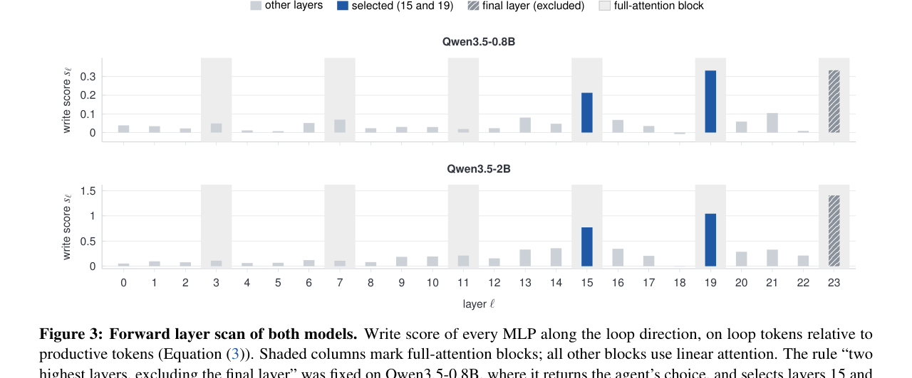
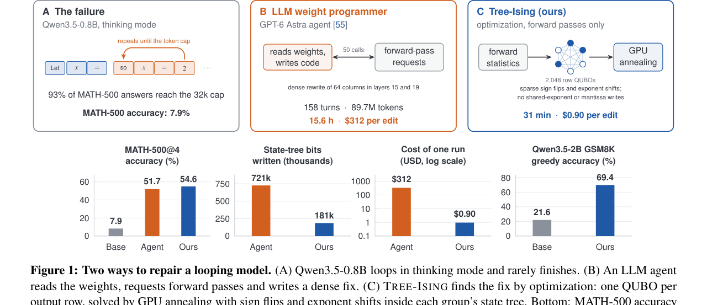
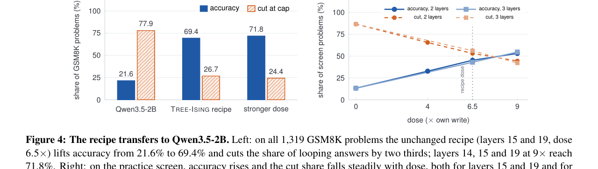

> **원문**: [arXiv](https://arxiv.org/abs/2611.14210) · [HuggingFace](https://huggingface.co/papers/2611.14210) (👍 73)
{: .prompt-info }

## 들어가며

오늘 고른 논문은 HuggingFace Daily Papers에서 73 upvote를 받은 "Tree-Ising: Repairing Language Models with Bit-Level Ising Edits"입니다. 제목만 보면 "LLM을 양자컴퓨터로 고친다" 류의 홍보성 논문처럼 보일 수 있는데, 실제로 읽어보면 훨씬 차분하고 흥미로운 비교 연구입니다.

출발점은 얼마 전 MIT에서 나온 연구(Takehi et al.)입니다. 이 연구는 GPT-6 Astra라는 프론티어 LLM 에이전트에게 Qwen3.5-0.8B의 가중치를 직접 읽고 고치게 시켰습니다. Qwen3.5-0.8B는 thinking mode에서 "so $x$ = 2 so $x$ = 2 so..." 같은 무한 루프에 빠져 MATH-500 문제의 93%를 토큰 한도(32,768)까지 채우고도 끝내지 못하는 고질병이 있는데, 에이전트가 158턴·8,970만 토큰·forward pass 50회를 들여 두 레이어의 64개 컬럼을 다시 써서 이 문제를 상당 부분 고쳤습니다. 그라디언트 한 번 없이, 순수하게 가중치를 "프로그래밍"해서 말이죠.

이 논문의 저자들(QDeep, ITMO 대학)은 여기서 질문을 던집니다. "에이전트가 자연어로 158턴에 걸쳐 내린 판단들을, 수학적으로 명시적인 최적화 문제로 바꿀 수 있지 않을까?" 그리고 실제로 그렇게 했더니, 에이전트보다 **더 정확하면서 가중치는 덜 건드리고, 비용은 350분의 1**이 나왔다는 것이 이 논문의 핵심 주장입니다. 개인적으로 이 "에이전트 대 최적화" 구도 자체가 요즘 AI 연구 흐름을 잘 보여주는 사례라고 생각해서 골랐습니다.

## 한눈에 보기

- **핵심 기여**: ① BF16 가중치의 저장 구조(state tree)를 그대로 활용해 "부호 바꾸기·2의 거듭제곱 곱하기"만 허용하는 이산적 편집 공간을 정의. ② forward pass 통계만으로 "루프를 약화하고 결론을 짓도록 유도하는" 목적함수를 세우고, 이를 출력 행(row) 단위의 독립적인 QUBO(Ising 모델)로 정확히 분해. ③ GPU 시뮬레이티드 어닐링 또는 시뮬레이티드 바이퍼케이션으로 수천 개의 행 문제를 한 번에 풀어 패치를 생성. ④ IBM 양자 하드웨어에서 8-변수 서브문제를 QAOA로 실제 실행.
- **성능**: Qwen3.5-0.8B에서 에이전트 편집(51.7%) 대비 MATH-500 54.6%로 앞서면서, forward pass는 50회→4회, 비용은 $312→$0.90, 변경 비트는 72만→18만(상태트리 기준)으로 줄임. 참조 편집 없이 Qwen3.5-2B에 그대로 적용해도 GSM8K 정확도를 21.6%→69.4%로 끌어올림.
- **한 줄 요약**: "에이전트가 158턴 들여 찾아낸 답을, 통계 네 번 뽑고 GPU 어닐링 한 번 돌려서 더 적은 비트로 재현했다."

## 어떤 문제를 풀려고 했나

배경이 되는 MIT 연구는 "weight-space programming"이라는 패러다임을 제시합니다. LLM 에이전트에게 체크포인트와 연습 문제, forward pass 예산(50회)을 주고 "가중치를 직접 읽고 고쳐보라"고 시킨 겁니다. 에이전트는 잔차 스트림에서 루프와 관련된 방향을 찾아내고, 이를 layer 15와 19의 MLP output projection(`down_proj`)까지 추적한 뒤, 각 레이어의 64개 컬럼을 구조적으로 다시 써서 MATH-500 정확도를 7.9%에서 48.1%로 끌어올렸습니다.

문제는 이 과정의 비용입니다. 158턴, 8,970만 토큰, 15.6시간, $312. 그리고 이 논문 저자들이 짚는 더 근본적인 문제는, **이 모든 판단이 자연어로 내려진다는 점**입니다. 에이전트가 "이 정도면 될 것 같다"고 멈춘 지점이 정말 최적인지 보장할 방법이 없다는 겁니다.

그래서 저자들은 질문을 바꿉니다. "에이전트가 수집한 증거(루프 발생 시점의 forward pass들 vs. 정상 종료 시점의 forward pass들)를 수학적 목적함수로 정식화하면, 이 수치 최적화 문제를 직접 풀 수 있지 않을까?" 그리고 이 최적화 문제를 **BF16이라는 가중치 저장 포맷 자체가 갖는 이산 구조**(state tree)를 그대로 활용해서 풀면, 깔끔하게 Ising 모델(즉 양자 컴퓨터에도 올릴 수 있는 형태)로 떨어진다는 것을 보입니다.

여담이지만, 이 논문은 비교 대상이 되는 MIT 에이전트 연구 저자들이 로그를 전부 공개했기 때문에 가능한 "사후 분석(retrospective) 연구"입니다. 저자들도 스스로 이 점을 여러 번 짚고 있는데, 이게 이 논문을 읽을 때 중요한 전제라서 뒤에서 다시 다루겠습니다.

## 핵심 아이디어

### BF16을 "이산 결정의 트리"로 보기

Tree-Ising의 가장 독특한 지점은 가중치를 수정하는 방식 자체입니다. 일반적인 모델 편집(ROME, MEMIT 등)은 연속적인 값을 업데이트합니다. 하지만 이 논문은 애초에 **BF16이라는 저장 포맷이 이미 이산적**이라는 점에 주목합니다.

BF16 숫자는 부호 1비트, 지수(exponent) 8비트, 가수(mantissa) 7비트로 구성됩니다. 논문은 state tree라는 선행 연구(Ali et al.)의 표현법을 가져와서, 한 행 안의 64개 가중치가 **공유 지수(shared exponent) $E$** 하나를 공유하고, 각 가중치는 $D = E - e \in \{0,\dots,14\}$라는 4비트 "상태"와 부호·가수로만 구성된다고 봅니다.

> $$\Fset=\bigl\{-1,\;2,\;\tfrac12,\;4,\;-2,\;-4,\;-\tfrac12,\;\tfrac14\bigr\}$$
>
> 허용된 이동(move) 집합 $\Fset$은 여덟 개의 배율입니다. 각 원소는 2의 거듭제곱(또는 그 음수)입니다.
>
> 이 집합의 의미는 간단합니다. 가중치에 2를 곱하거나 절반으로 줄이는 건 BF16에서 **지수 비트 하나만 바꾸는 것과 완전히 동일**합니다. 예를 들어 $0.125$($D=3$)를 2배 하면 $0.25$($D=2$)가 되는데, 저장된 비트로 보면 `0011`이 `0010`으로, 딱 1비트만 바뀝니다. 공유 지수 $E$와 가수는 전혀 건드리지 않습니다. 즉 "가중치를 수정한다"는 연속적인 행위가, "그룹의 공유 지수를 깨지 않는 선에서 4비트 상태를 몇 칸 옮길 것인가"라는 **이진 선택**으로 바뀝니다.

이 대목이 이 논문의 가장 영리한 부분이라고 생각합니다. 보통 "이산 최적화"는 어렵고 비효율적이라는 인상이 있는데, 여기서는 거꾸로 "원래 포맷이 이산적이니 그걸 그대로 최적화 변수로 쓰자"는 발상입니다. 그 결과 **공유 지수와 가수는 단 1비트도 건드리지 않는다는 것이 설계상 보장**됩니다 (실험으로 확인하는 게 아니라,애초에 그렇게 짜여 있다는 게 중요한 포인트입니다). 반면 에이전트의 편집은 거의 모든 가수를 다시 쓰고 지수도 1,261개나 건드렸다고 합니다.

### 목적함수: "루프는 죽이고, 정상 동작은 지키고, 적게 건드려라"

> $$\mathcal{E}(\Delta)=\gamma\,\dose(\Delta)+\coll(\Delta)+\lambda\,\|\Delta\|_0$$
>
> $\dose(\Delta)=u^{\top}\Delta\,\mu_{\R}$는 편집이 "루프 방향" $u$를 따라 루프 토큰들에 미치는 효과이고, $\coll(\Delta)=\sum_r \Delta_{r:} C_{\Pset} \Delta_{r:}^\top$은 보호해야 할 정상 토큰들에 생기는 부수 피해(collateral)입니다. $\|\Delta\|_0$는 바뀐 가중치 개수입니다.
>
> 세 항이 하는 역할을 정리하면: $\gamma\,\dose$는 "루프 방향으로의 출력을 충분히 깎아내라"는 압력, $\coll$은 "그러다 다른 멀쩡한 토큰들 출력까지 망치지 마라"는 제약, $\lambda\|\Delta\|_0$는 "가능하면 적은 가중치만 건드려라"는 희소성 페널티입니다. 흥미로운 건 $\coll$ 항의 형태인데, 이건 프루닝·양자화에서 흔히 쓰는 "레이어 출력 재구성 오차"와 똑같은 형태라고 합니다(GPTQ류 방법과 수학적으로 동일 계열). 모델 수리 문제를 양자화스러운 최적화 문제로 번역한 셈입니다.

방향 $u$는 어떻게 정할까요? 논문은 "루프가 벌어지는 순간의 잔차 스트림 평균"과 "정상 종료 직전의 평균"을 빼서 $u_{\mathrm{loop}}$, 그리고 "결론을 내는 토큰들"과 "계속 생각 중인 토큰들"을 빼서 $u_{\mathrm{end}}$를 구한 다음, $u \propto u_{\mathrm{loop}} - 0.5\,u_{\mathrm{end}}$로 합칩니다. 즉 "루프 방향을 죽이면서 동시에 결론 방향을 강화하라"는 두 신호를 한 벡터에 욱여넣는 겁니다.

### 왜 레이어 15와 19인가 — 에이전트 없이 찾기

다음은 두 모델에서 각 레이어 MLP의 "쓰기 점수(write score)"를 비교한 그래프입니다.

_Figure 3. Qwen3.5-0.8B(위)와 Qwen3.5-2B(아래)에서 각 레이어가 루프 방향으로 얼마나 강하게 쓰는지. 회색 음영은 full-attention 블록(3, 7, 11, 15, 19, 23번째 레이어), 파란 막대는 선정된 레이어, 빗금은 제외된 마지막 레이어_

가로축이 레이어 번호, 세로축이 "이 레이어의 MLP가 루프 토큰에서 정상 토큰 대비 얼마나 더 강하게 $u$ 방향으로 쓰는가"를 나타내는 점수입니다. 두 모델 모두 23번(마지막) 레이어가 가장 높지만 이건 "모델이 직접 출력을 만드는 레이어"라서 당연히 높은 것이고 수리 대상에서 제외합니다. 그다음으로 15번과 19번이 다른 레이어보다 최소 두 배 이상 튀어나와 있는데, 이게 **에이전트가 50번의 forward pass와 158턴을 들여 찾아낸 바로 그 두 레이어와 정확히 일치**합니다. 저자들은 이 결과를 forward pass 단 한 번(!)으로 얻었다고 합니다.

다만 저자들 스스로도 솔직하게 짚는 한계가 있는데, 두 모델 모두 15·19·23번 레이어가 공교롭게 "full-attention 블록"입니다(나머지는 linear attention). 그러니까 이 일치가 "스캔 방법이 정말 최적의 레이어를 찾아낸다"는 증거라기보다 "애초에 루프를 일으킬 수 있는 건 멀리 있는 토큰을 그대로 복사할 수 있는 full-attention 레이어뿐이라서, 둘 다 같은 구조를 가진 모델이니 같은 답이 나온 것일 수도 있다"는 설명도 가능하다는 겁니다. 이 부분은 개인적으로 매우 솔직한 태도라고 느꼈습니다 — 좋은 결과를 과대 해석하지 않으려는 노력이 보입니다.

### 행(row) 단위로 쪼개면 정확히 Ising 모델이 된다

여기가 이 논문에서 제일 기술적인 부분인데, 핵심만 짚으면 이렇습니다. 레이어의 출력 행렬 $W$에서 각 출력 행 $r$마다 후보 컬럼 $K=512$개를 고르고, 각 후보 가중치마다 "가장 에너지를 낮추는 배율 하나"를 미리 골라둡니다. 그러면 남는 결정은 "이 후보를 적용할지 말지(0 또는 1)"뿐이라서, 목적함수가 정확히

$$\mathcal{E}_r(x)=\sum_{a=1}^{K}h_a x_a+\sum_{a\neq b}J_{ab}x_a x_b$$

라는 QUBO(이진 이차 최적화) 형태로 떨어집니다. $h_a$는 이 후보 하나를 켰을 때 얻는 "루프 약화 효과 + 자기 부수피해 + 희소성 비용"을 합친 값이고, $J_{ab}$는 두 후보를 동시에 켰을 때 생기는 추가 부수피해(상호작용)입니다. 스핀 변수 $s=2x-1$로 바꾸면 이게 그대로 Ising 모델이 되고요.

중요한 건 **이 분해가 근사가 아니라 정확(exact)하다는 점**입니다. 희소성 예산(전체 몇 개까지 바꿀지)만 레이어 전체에 걸쳐 바깥에서 조율하고, 일단 통계와 후보가 고정되면 2,048개(레이어당 1,024개 × 2개 레이어)의 행 문제가 완전히 독립적으로 풀립니다. 이 독립성 덕분에 GPU에서 전부 배치로 한 번에 풀 수 있고, 또 이게 진짜 Ising 모델이라서 양자 어닐러나 QAOA에도 그대로 올라갈 수 있습니다.

## 실험 결과

### 에이전트 대 Tree-Ising, 정면 비교

다음은 전체 결과를 한눈에 보여주는 그림입니다.

_Figure 1. (A) 루프에 빠진 Qwen3.5-0.8B, (B) 에이전트가 가중치를 읽고 코드를 써서 고치는 방식, (C) Tree-Ising이 forward 통계 → QUBO → GPU 어닐링으로 고치는 방식. 아래 막대그래프: MATH-500 정확도, 상태트리 비트 변경량, 1회 실행 비용(로그 스케일), Qwen3.5-2B 전이 결과_

패널 A는 실패 양상 자체를 보여줍니다. "so $x$ = 2 so $x$ = 2..."처럼 같은 구절을 토큰 한도까지 반복하는 모습이 아주 직관적으로 그려져 있습니다. 오른쪽 아래 막대그래프 네 개 중 세 번째(비용, 로그 스케일)가 가장 인상적인데, 에이전트는 $312, Tree-Ising은 $0.90으로 **세로축이 로그 스케일인데도 두 막대가 거의 양 끝에 붙어 있습니다**. 네 번째 그래프는 Qwen3.5-0.8B용 레시피를 그대로 Qwen3.5-2B에 적용했을 때(참조 편집 없이) 21.6%에서 69.4%로 뛴 결과입니다.

수치를 표로 정리하면 다음과 같습니다.

| | Agent edit | Tree-Ising (ours) | Tree-Ising 우위 |
|---|---:|---:|---|
| **품질** | | | |
| MATH-500 정확도 (%) | 51.7 | **54.6** | +2.9점, p≈0.003 |
| 5개 벤치마크 중 앞선 개수 | – | **5** | 보정 후 2개 유의 |
| MATH-500 cut at cap (%) | 31.6 | **23.9** | 1.3배 적음 |
| **비용** | | | |
| Forward-pass 요청 수 | 50 | **4** | 12.5배 적음 |
| Forward-pass GPU 시간 | 12.2h | **21.8분** | 34배 적음 |
| LLM 토큰 | 8,970만 | **0** | 불필요 |
| Wall clock | 15.6h | **31분** | 30배 빠름 |
| 비용 | $312 | **$0.90** | 약 350배 저렴 |
| **편집 규모** | | | |
| 변경된 가중치 | 130,188 | **112,630** | 13% 적음 |
| BF16 비트 플립 | 621,388 | **278,767** | 2.2배 적음 |
| 상태트리 비트 플립 | 720,586 | **181,062** | 4.0배 적음 |
| 공유 지수 쓰기 | 1,261 | **0** | 설계상 없음 |
| 가수 쓰기 | 129,668 | **0** | 설계상 없음 |

이 표에서 읽어야 할 패턴은 숫자 하나하나가 아니라 **세 축(품질·비용·편집규모)이 전부 같은 방향으로 움직인다**는 점입니다. 보통은 "더 정확하게 고치려면 더 많이 건드려야 한다"는 트레이드오프가 있을 법한데, 여기서는 정확도도 올리고 건드리는 비트 수도 줄였습니다. 이건 "최적화가 에이전트의 자연어 판단보다 애초에 더 효율적인 지점을 찾아낸다"는 주장의 핵심 근거입니다.

다만 바로 뒤에서 저자들이 밝히는 맥락이 중요합니다. 이 비교는 **"에이전트의 전체 탐색 과정" 대 "이미 레이어가 뭔지 알고 있는 상태에서 고정된 레시피 한 번 적용"**을 비교한 것입니다. Tree-Ising도 레이어 15·19 선택은 (포워드 스캔으로 재현은 했지만) 에이전트의 로그를 분석해서 사후적으로 설계된 레시피이고, dose(얼마나 세게 밀어붙일지)도 "에이전트 편집의 1.6배"로 보정한 값입니다. 즉 완전히 "제로베이스 탐색 vs 제로베이스 탐색"의 비교는 아니라는 걸 저자들 스스로 여러 번(논문에서 최소 세 번) 강조합니다. 이 솔직함은 좋지만, 동시에 "그럼 Tree-Ising이 레이어와 dose를 처음부터 자기 힘으로 찾아야 했다면 비용이 얼마나 더 들었을까"는 궁금해지는 지점입니다.

### 연속 편집과 비교하면 왜 이산 편집이 유리한지 보인다

이 논문에서 가장 통찰력 있다고 느낀 ablation은 "희소성 제약과 이산 이동 제약을 다 빼면 어떻게 되는가"입니다. 같은 목적함수를 풀되 제약을 풀면 닫힌 형식(closed-form)의 랭크-1 해가 나오는데, 이건 구조적으로 ROME과 거의 같은 형태입니다. 이 연속 해는 정확도는 Tree-Ising과 비슷하게 나오지만 (스크리닝 세트 기준 57.8% vs 57.0%), **두 행렬의 가중치 96%를 바꿉니다** — Tree-Ising의 112,630개에 비해 700만 개, 즉 62배입니다.

> ❌ "연속 편집도 정확도는 비슷하게 나온다"
> ⭕ "정확도가 비슷하다는 건 '이 목적함수 자체가 좋다'는 뜻이지, 이산 최적화가 특별한 트릭을 쓴 게 아니라는 뜻입니다. 반대로 진짜 차이는 **같은 정확도를 내면서 저장 포맷을 거의 건드리지 않을 수 있는가**에서 나옵니다. 연속 해를 실제로 가중치에 박아 넣으려면 압축되거나 중복 제거된 체크포인트 전체를 다시 인코딩해야 하는데, Tree-Ising의 패치는 비트 하나, 4비트 상태 하나 단위로만 손을 댑니다."

이 ablation 덕분에 "성능 향상이 어디서 오는가"가 명확해집니다. 목적함수(루프 방향 억제 + 결론 방향 강화 + 부수피해 보호) 자체가 좋은 처방이고, 이산화·희소화는 "같은 처방을 저장 포맷 친화적으로 압축해서 적용하는 방법"이라는 겁니다.

### Qwen3.5-2B로의 전이 — 에이전트도 참조 편집도 없이

다음은 레시피를 그대로 더 큰 모델에 옮긴 결과입니다.

_Figure 4. 왼쪽: GSM8K 1,319문제 전체에서 레이어 15·19, dose 6.5배 레시피가 정확도를 21.6%→69.4%로, 토큰 한도 도달 비율을 77.9%→26.7%로 바꿈. 오른쪽: 스크리닝 세트에서 dose를 올릴수록 정확도는 오르고 cut 비율은 떨어지는 경향_

왼쪽 그래프에서 눈여겨볼 점은 "정확도 막대"와 "cut at cap 막대"가 거의 대칭적으로 움직인다는 것입니다. 기본 모델은 정확도 21.6%에 cut 비율 77.9%로, 즉 **답을 아예 못 끝내서 틀리는 경우가 압도적으로 많습니다**. 이게 중요한데, 논문은 "모델이 다 끝내기만 하면 97.9% 확률로 정답을 맞힌다"는 걸 보였습니다 — 즉 문제를 풀 능력 자체는 있는데 멈추는 법을 모르는 것이고, 이게 바로 이 논문이 "능력 문제가 아니라 weight 수준의 결함"이라고 프레이밍하는 근거입니다.

이 전이 실험에서 중요한 점은 레이어 선택도(포워드 스캔으로), dose 보정도(base 모델 자체의 스케일 규칙으로) **에이전트 편집이나 참조 체크포인트 없이** 이뤄졌다는 겁니다. 26분 만에 A100 GPU 한 대로 전체 레시피가 돌아갔다고 하고요. 다만 "레이어 14·15·19, dose 9배"로 더 세게 밀었을 때 71.8%까지 올랐지만, 표준 레시피(69.4%) 대비 통계적으로 유의하지 않다는 점은 과장하지 않고 정직하게 밝히고 있습니다.

### 양자 하드웨어 실험 — 증명이 아니라 "가능성 확인"

논문 마지막에는 IBM Heron 프로세서에서 8변수짜리 서브문제 하나를 QAOA로 돌린 실험이 나옵니다. 깊이 2 QAOA 회로가 1,024샷 중 110샷에서 정확한 최적해를 맞췄는데, 균등 무작위 대조군은 4샷에 그쳤다고 합니다. 저자들이 스스로 명확히 밝히듯 이건 "양자 우위를 보인 게 아니라, 이런 문제를 양자 하드웨어에 올리고 샘플링할 수 있다는 것만 보여준 것"입니다. 사실 이 부분이 논문에서 가장 "곁다리"스러운 섹션이라, 없어도 논문의 핵심 주장은 전혀 흔들리지 않습니다. 개인적으로는 "우리도 양자컴퓨터 실험을 했다"는 걸 보여주고 싶었던 것 같은데, 본문의 신중한 톤에 비해 다소 홍보적으로 느껴지는 유일한 지점이었습니다.

## 아쉬운 점 / 의문점

- **사후 설계(retrospective)라는 태생적 한계**: 앞서 여러 번 언급했듯, 이 레시피 자체가 에이전트의 공개 로그를 분석해서 나온 겁니다. Qwen3.5-0.8B 결과는 엄밀히 말해 "제로베이스 탐색 대결"이 아닙니다. Qwen3.5-2B 전이가 이 한계를 일부 보완하긴 하지만, 그마저도 "레이어 14·15·19 중 최종 레이어 제외"라는 규칙이 0.8B 모델 관찰 이후에 확정된 규칙이라, 완전히 독립적인 검증이라고 보기는 어렵습니다.
- **단일 실패 모드, 단일 모델 계열**: 두 모델 모두 같은 하이브리드 linear/full-attention 아키텍처를 공유하는 Qwen 계열이고, 평가도 수학 벤치마크에만 집중되어 있습니다. instruction-following이나 일반 언어 능력에 대한 부수 효과는 측정되지 않았습니다 (에이전트 쪽은 IFEval 21.0%→62.3%라는 수치가 있다고 하는데, Tree-Ising 쪽은 이 벤치마크를 테스트하지 않았습니다).
- **p-value가 "명목상(nominal)"이라는 저자들의 표현**: 본페로니 보정 이후에는 12개 비교 중 MATH-500@4와 GSM8K, 딱 2개만 살아남습니다. 논문 제목이나 초록의 어조는 "전 벤치마크에서 앞섰다"는 쪽으로 강하게 밀어붙이는데, 통계적으로 확실한 것은 그보다 범위가 좁습니다. 이 부분은 논문 본문에서는 솔직하게 명시하고 있지만, 초록만 읽으면 과장된 인상을 받을 수 있습니다.
- **솔버 간 비교가 엄밀하지 않음**: "각 솔버를 시드 하나로 한 번씩만 돌렸고, 엄밀하게 통제된 조건에서 실행 시간을 측정하지 않았다"고 저자들 스스로 명시합니다. 시뮬레이티드 어닐링과 시뮬레이티드 바이퍼케이션의 속도 비교 주장은 신중하게 받아들여야 할 것 같습니다.
- **코드 공개 여부**: 논문에는 GitHub 저장소 링크가 있지만, 본문에 "will be made publicly available shortly"라고 적혀 있어 이 글을 쓰는 시점에는 코드가 아직 공개되지 않은 것으로 보입니다. 재현을 해보고 싶은 분이라면 당분간은 논문의 수식과 Appendix의 하이퍼파라미터 표에 의존해야 할 것 같습니다.

## 마치며

이 논문을 고른 이유는, 요즘 "LLM 에이전트에게 뭐든 시킨다"는 흐름에 대한 흥미로운 반례이기 때문입니다. 에이전트가 자연어로 158턴을 들여 찾아낸 답이, 사실은 몇 줄의 수식으로 적을 수 있는 최적화 문제였다는 것이죠. 물론 이 최적화 문제를 "처음부터" 세우려면 에이전트가 한 탐색(어느 방향이 문제인지, 어느 레이어가 문제인지)이 먼저 필요했다는 점에서, 둘이 완전히 대체 관계는 아니라고 생각합니다. 오히려 "에이전트가 탐색으로 가설을 찾고, 그 가설을 수학적 목적함수로 공식화할 수 있으면 최적화가 마무리 짓는다"는 분업 구조에 가까워 보입니다.

개인적으로는 BF16 state tree라는 아이디어가 가장 재미있었습니다. "가중치는 연속값"이라는 가정을 당연하게 받아들이지 않고, 저장 포맷이 원래 이산적이라는 사실을 적극적으로 활용해서 최적화 문제를 깔끔하게 만든 접근이 인상적이었습니다. 이게 모델 압축이나 양자화 쪽 다른 문제에도 응용될 수 있을지 궁금해지는 지점입니다. 다음에 이 그룹이나 다른 그룹에서 "순수 탐색(레이어 선택부터) 버전"의 Tree-Ising을 내놓는다면, 그게 진짜 "에이전트 완전 대체" 주장을 검증하는 실험이 될 것 같아 계속 지켜볼 생각입니다.
