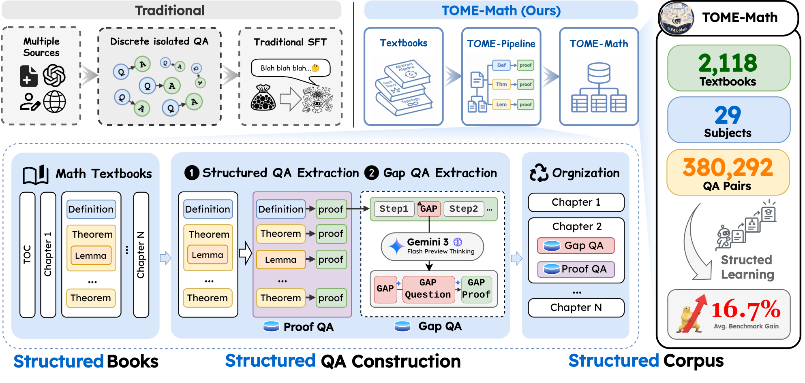
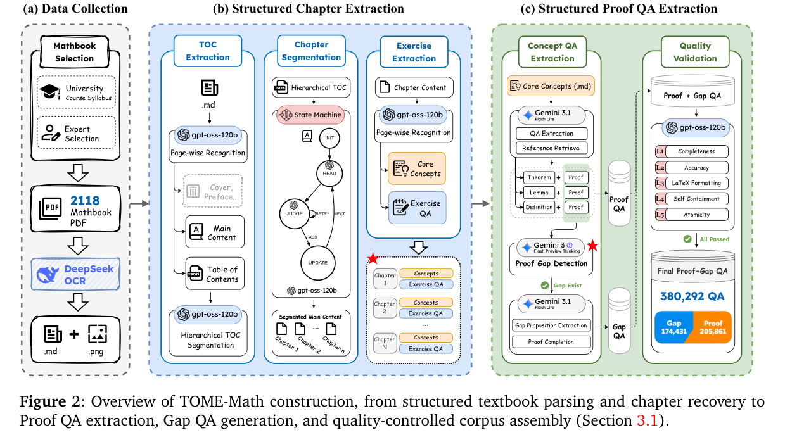
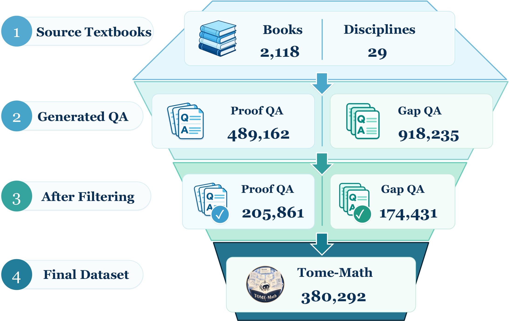
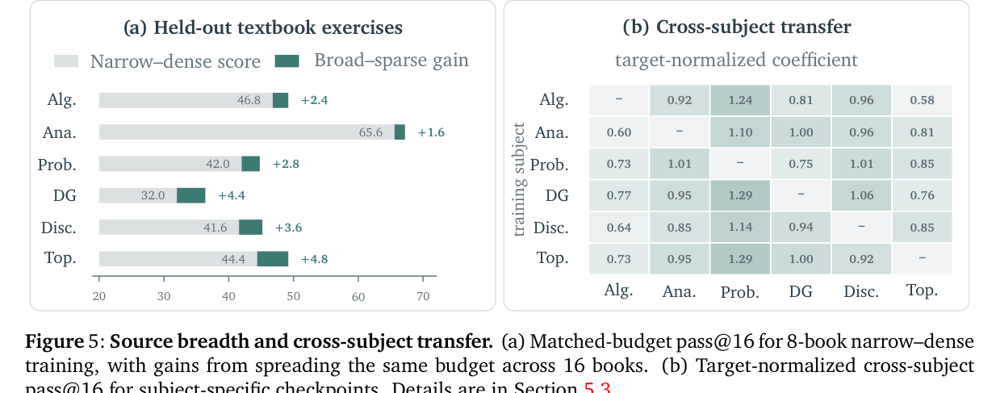

> **원문**: [arXiv](https://arxiv.org/abs/2610.40394) · [HuggingFace](https://huggingface.co/papers/2610.40394) (👍 39)
{: .prompt-info }

## 들어가며

오늘 고른 논문은 HuggingFace Daily Papers에서 39 upvote를 받은 "Scaling Mathematical Proof Supervision from Structured Textbooks"입니다. 저자 소속이나 기관명이 전혀 나오지 않고 참고문헌 스타일이 `iclr2027_conference`로 돼 있는 걸 보면, ICLR 2027에 심사용으로 제출된 익명 논문으로 보입니다.

이 논문을 고른 이유는 질문 자체가 단순하면서도 묵직했기 때문입니다. "수학 LLM 학습 데이터는 왜 전부 문제-정답 쌍 형태일까?" 생각해보면 MATH, GSM8K, MetaMathQA, OpenMathInstruct 같은 유명 데이터셋들이 전부 그렇습니다. 경시대회 문제든 웹에서 긁은 연습문제든 결국 "문제 → 풀이"라는 똑같은 모양으로 평평하게 펴집니다. 그런데 정작 이 지식의 원천인 교과서는 전혀 평평하지 않습니다. 장이 순서대로 쌓이고, 정리는 앞 정리를 인용하고, 증명은 빈틈이 있으면 연습문제로 메워지죠. 저자들은 "이 구조를 복원해서 학습 데이터에 그대로 남겨두면 어떻게 될까"를 2,118권의 교과서로 실제로 해봅니다.

## 한눈에 보기

- **핵심 기여**: ① 2,118권의 대학 수학 교과서를 OCR·장 구조 복원·증명 추출 파이프라인에 통과시켜 38만 개의 구조 보존 QA(TOME-Math)를 생성. ② 정리의 증명에서 암묵적으로 생략된 추론 단계를 LLM이 찾아내 별도의 "Gap QA"로 보강. ③ 추론 시점 검색, 커리큘럼 순서, 출처 다양성 세 축에서 이 구조가 실제로 성능에 기여하는지 통제 실험으로 검증.
- **성능**: Qwen3-30B-A3B-Base를 TOME-Math로 파인튜닝하면 6개 벤치마크 평균이 29.17%에서 45.83%로 상승(+16.7%p). 크기가 4.8배 더 큰 공개 데이터셋(OpenMath1, 182만 건)보다도 6개 벤치마크 전부에서 앞섭니다.
- **한 줄 요약**: "데이터를 더 많이 모으는 것보다, 교과서가 원래 갖고 있던 순서와 연결을 지우지 않는 것이 더 중요했다."

## 어떤 문제를 풀려고 했나

저자들의 출발점은 "수학 지도학습의 가치는 예제 개수만으로 결정되지 않는다"는 관찰입니다. 이 자체는 새로운 주장이 아닙니다. 질문 다양성, 풀이 형식, 교사 모델 품질이 성능에 영향을 준다는 건 MetaMath나 OpenMathInstruct 계열 연구에서도 이미 지적된 바 있습니다. 이 논문이 더 파고드는 지점은 "그렇다면 애초에 구조를 가진 원천을 왜 평평하게 만드는가"입니다.

교과서는 저자들의 표현을 빌리면 "우연히 모인 문제 더미가 아니라 의도적으로 설계된 지식의 진행"입니다. 정의가 개념을 소개하고, 정리와 보조정리가 그 위에 쌓이고, 증명이 타당성을 입증하고, 연습문제가 이해를 확인합니다. 이 모든 요소는 선후관계·개념적 의존성·교육적 순서를 반영하는 장 구조 안에 배치돼 있습니다. MathPile이나 CollegeMath 같은 선행 연구도 교과서를 활용했지만, 주로 텍스트 뭉치나 단답형 문제 추출에 그쳤지 이 구조 자체를 보존하지는 못했다고 저자들은 지적합니다.

그래서 TOME-Math는 세 층위의 구조를 명시적으로 보존하겠다고 선언합니다. **계층 구조**(장·정리의 원래 조직과 순서), **의존 구조**(정리 증명과 그 증명의 빈틈에서 파생된 중간 증명 의무 사이의 연결), **커리큘럼 구조**(교과서 순서와 증명 세분도에 따라 학습 예제를 배열할 수 있는 능력)입니다. 세 가지 모두 "문제-풀이 쌍" 형태로는 애초에 표현할 수 없는 정보라는 게 핵심입니다.

## 핵심 아이디어

### 구조를 보존하는 파이프라인

다음은 TOME-Math 전체 구성을 요약한 개요도입니다.

_Figure 1. 왼쪽(Traditional): 여러 출처가 고립된 QA로 뭉개져 전통적 SFT에 들어간다. 오른쪽(TOME-Math): 교과서가 TOME-Pipeline을 거쳐 정의·정리·보조정리가 증명과 함께, 그리고 장 구조를 유지한 채로 최종 코퍼스에 들어간다_

왼쪽 "Traditional" 박스를 보면 재미있는 디테일이 있습니다. 여러 출처(문서, 사람, 웹)에서 나온 질문과 답이 화살표로 뒤섞이면서 "discrete isolated QA"라는 동그라미 뭉치가 되고, 그게 자루에 담겨 SFT로 들어갑니다. 반면 오른쪽은 교과서의 장(Chapter) 구조가 Definition → Theorem → Lemma 순서 그대로 유지된 채 Proof QA/Gap QA로 나뉘어 들어갑니다. 그림 아래쪽 "Structured QA Construction" 단계에서 Gemini 3 Flash Preview Thinking이 각 증명을 검사해 빈틈(GAP)을 찾고, 이를 "GAP Question → GAP Proof"로 다시 만들어내는 과정이 시각적으로 잘 드러납니다.

구체적인 파이프라인은 아래 그림에서 더 자세히 볼 수 있습니다.

_Figure 2. (a) 교과서 선정과 DeepSeek-OCR 변환, (b) 목차 추출·상태머신 기반 장 분할·연습문제 분리, (c) 정리/보조정리/정의와 증명 추출, Gemini 3로 증명 빈틈 탐지 후 Gap QA 생성, gpt-oss-120b 심사를 거친 최종 코퍼스 조립_

이 그림에서 눈여겨볼 부분은 (b) 단계의 "State Machine"입니다. 각 페이지가 현재 장에 속하는지, 다음 장으로 넘어갔는지, 아니면 장 내부에 경계가 있는지를 판단하고 애매하면 재시도(RETRY)하는 구조입니다. OCR로 변환된 교과서는 페이지 경계와 장 경계가 깔끔하게 맞아떨어지지 않는 경우가 많을 텐데, 이걸 휴리스틱이 아니라 상태머신으로 명시적으로 처리한 점이 구조 보존이라는 목표에 진지하다는 인상을 줍니다. (c) 단계에서는 추출된 Proof QA를 다시 Gemini 3 Flash Preview Thinking에 넣어 "증명 빈틈이 있는가"를 판단하고, 있으면 그 빈틈을 독립적인 명제와 증명으로 재작성해 Gap QA로 만듭니다. 이 Gap QA 918,235개 후보 중 19.00%인 174,431개만 최종 코퍼스에 남는데, 나머지는 품질 검증(완전성·정확성·LaTeX 서식·자기완결성·원자성 다섯 축)에서 걸러집니다.

전체 생성→필터링 과정의 규모는 다음 깔때기 그림으로 한눈에 볼 수 있습니다.

_Figure 3(왼쪽). 2,118권·29개 과목에서 출발해 Proof QA 489,162개와 Gap QA 918,235개 후보를 생성한 뒤, 각각 205,861개와 174,431개로 필터링되어 최종 380,292개 QA가 남는 과정_

여기서 주목할 숫자는 Proof QA의 생존율(205,861/489,162 ≈ 42%)과 Gap QA의 생존율(19%)이 꽤 다르다는 점입니다. Gap QA는 LLM이 "증명에 빈틈이 있다"고 판단한 뒤 그 빈틈을 다시 LLM이 채워 넣는, 한 단계 더 생성적인 과정이기 때문에 품질 검증에서 더 많이 걸러지는 게 자연스러워 보입니다. 바꿔 말하면 Gap QA는 원문 그대로를 옮기는 Proof QA보다 환각 위험이 구조적으로 더 크고, 그만큼 필터를 세게 돌렸다는 뜻으로 읽힙니다.

### 검증은 얼마나 믿을 수 있나 — 비관적 검증기

TOME-Math의 평가에서 흥미로운 부분은 자동 채점의 엄격함입니다. TOME-LongForm(held-out 교과서에서 뽑은 300개 증명 문제)에 대해, 모델이 낸 풀이 하나당 `gpt-5.6-luna`가 8번 독립적으로 리뷰합니다. 이 리뷰들을 합치는 방식이 이렇습니다.

$$y_{ij}=\prod_{r=1}^{8}\mathbf{1}[e_{ijr}=-1]$$

여기서 $e_{ijr}$은 문제 $i$에 대한 응답 $j$를 리뷰 $r$이 평가했을 때 처음 발견한 오류의 위치이고, $e_{ijr}=-1$은 "오류를 못 찾았다"는 뜻입니다. $\mathbf{1}[\cdot]$은 조건이 참이면 1, 아니면 0을 주는 지시함수이고요.

이 식이 말하는 건 간단합니다. 8번의 리뷰 중 단 한 번이라도 오류를 지적하면 $y_{ij}$는 0이 되어 그 풀이는 틀린 것으로 처리됩니다. 다수결이 아니라 "한 표라도 반대하면 기각"하는 비관적 집계입니다. 왜 이렇게 엄격하게 설계했을까 생각해보면, LLM 채점은 관대한 쪽으로 틀리기 쉬운데(그럴듯해 보이면 맞다고 넘어가는 경향), 비관적 집계는 그 반대 방향으로 편향을 걸어서 "너무 후한 채점"의 위험을 줄이려는 의도로 보입니다. 실제로 저자들은 600개 응답을 수학 박사급 인적자원 두 명에게 블라인드로 다시 채점시켜 이 자동 검증기의 허위 승인률·허위 기각률까지 따로 측정했다고 밝힙니다. 솔직히 이 정도 규모의 사람 검증을 데이터 논문 부록에서 보는 건 흔치 않은데, 그만큼 "우리 숫자가 LLM 자기 채점의 거품이 아니다"라는 걸 보여주려는 노력이 느껴졌습니다.

## 실험 결과

### 전체 코퍼스 비교: 양보다 구성

먼저 TOME-Math 전체(학습 분할 기준 364,631개)를 다른 공개 수학 SFT 코퍼스와 같은 조건(Qwen3-30B-A3B-Base에서 1 epoch 파인튜닝)으로 비교한 결과입니다.

| SFT 수퍼비전 코퍼스 | TOME-LF | TOME-Obj. | MiniF2F | ProofNet | MATH-500 | AIME-26 | Avg. |
|---|---|---|---|---|---|---|---|
| None (Qwen3-30B-A3B-Base) | 13.25 | 32.93 | 34.45 | 17.14 | 68.80 | 8.44 | 29.17 |
| OpenMath1 (182만) | 20.16 | 33.86 | 22.87 | 19.25 | 70.40 | 8.21 | 29.13 |
| MetaMath (39.5만) | 28.73 | 34.66 | 40.70 | 22.55 | 71.20 | 9.98 | 34.64 |
| MathInstruct (26.2만) | _35.87_ | _40.69_ | _52.05_ | _32.93_ | _73.05_ | **11.98** | _41.10_ |
| **TOME-Math (36.46만)** | **43.86** | **43.96** | **57.43** | **42.98** | **76.55** | _10.19_ | **45.83** |

(표의 굵게는 1위, 기울임은 2위입니다.)

이 표에서 가장 눈에 띄는 패턴은 OpenMath1과의 비교입니다. OpenMath1은 TOME-Math보다 4.8배 많은 182만 건인데도 6개 벤치마크 전부에서 TOME-Math에 집니다. 심지어 OpenMath1로 파인튜닝한 모델은 6개 평균이 29.13%로, 아무것도 안 한 베이스 모델(29.17%)보다 오히려 살짝 낮습니다. 예제 숫자가 성능을 보장하지 않는다는 걸 꽤 극적으로 보여주는 사례입니다. 다만 유일하게 TOME-Math가 1위를 놓친 곳이 AIME-26인데, 이 벤치마크는 경시대회 최종 답만 맞히면 되는 문제라서 "증명 과정"에 특화된 TOME-Math의 강점이 상대적으로 덜 발휘되는 영역으로 보입니다. 개인적으로는 이 한 칸의 열세를 숨기지 않고 표에 그대로 둔 점이 오히려 신뢰가 갔습니다.

### 추론 시점 검색: 구조가 있는 컨텍스트 vs 그냥 많은 컨텍스트

파라미터를 전혀 건드리지 않고, 추론할 때 참고 자료로 무엇을 넣어주느냐만 바꾼 실험입니다.

| Context | Avg. | 추상대수 | 미분기하 | 이산수학 | 해석학 | 확률 | 위상수학 |
|---|---|---|---|---|---|---|---|
| Closed (참고자료 없음) | 13.25 | 8.50 | 5.25 | 13.25 | 25.75 | 20.00 | 6.75 |
| Random Same-Book | 14.00 | 9.75 | 6.50 | 12.50 | 24.75 | 20.50 | 10.00 |
| Local Chapter | 14.71 | 10.50 | 6.75 | 14.50 | 25.50 | 20.00 | 11.00 |
| TOME (정리/정의만) | 15.54 | 11.00 | 8.50 | 15.00 | 27.25 | 20.50 | 11.00 |
| **TOME (정리/정의 + Gap QA)** | **17.38** | **12.75** | **10.00** | **15.25** | **31.75** | **21.75** | **12.75** |

같은 토큰 예산을 주고도 "어떤 근거를 고르느냐"만으로 13.25%에서 17.38%까지 벌어집니다. 특히 같은 책에서 무작위로 뽑은 내용(Random Same-Book)은 Closed 대비 거의 개선이 없다시피 한 반면, 구조(정리 간 의존 관계)를 따라 고른 내용은 확실한 차이를 만듭니다. "그냥 같은 책 내용을 더 주는 것"과 "그 책이 가진 연결 구조를 따라 관련된 내용을 골라주는 것"이 이렇게까지 다르다는 걸 보여주는 게 이 표의 값어치라고 생각합니다. Gap QA를 추가했을 때 추가로 1.84점이 더 오른다는 것도 흥미로운데, 이는 교과서가 명시적으로 쓰지 않은 중간 추론 단계가 실제로 "빠진 퍼즐 조각" 역할을 한다는 뜻입니다.

### 출처 다양성과 전체 레시피 분해

같은 토큰 예산이라도 책 8권에 몰아서 학습시키는 것(Narrow-dense)보다 16권에 나눠 학습시키는 것(Broad-sparse)이 모든 과목에서 1.6~4.8점 더 좋았습니다.

_Figure 5. (a) 8권 집중 학습 대비 16권 분산 학습의 이득(+1.6~+4.8점). (b) 한 과목으로만 학습한 체크포인트를 다른 과목 문제에 평가했을 때, 그 과목 전문 체크포인트 대비 상대 성능(target-normalized coefficient)_

(b)의 히트맵을 보면 가로축이 "평가 대상 과목", 세로축이 "학습에 쓴 과목"입니다. 값이 1.0에 가까울수록 그 과목 전문가만큼 잘한다는 뜻이고, 1.0을 넘으면 오히려 전문가보다 낫다는 뜻입니다. 위상수학과 미분기하로 학습한 체크포인트가 확률론 문제에서 각각 1.29를 찍은 게 눈에 띕니다. 전체 평균 전이 계수는 0.92로, 한 과목만 깊게 판 체크포인트가 다른 과목에서도 전문가의 92% 수준을 낸다는 뜻입니다. 이 전이 정도를 수식으로 쓰면 다음과 같습니다.

$$T_{s\rightarrow t}=P_{s\rightarrow t}/P_{t\rightarrow t}$$

$P_{s\rightarrow t}$는 과목 $s$로 학습한 체크포인트가 과목 $t$ 문제에서 내는 정답률이고, $P_{t\rightarrow t}$는 과목 $t$ 전문 체크포인트가 자기 과목에서 내는 정답률입니다. 분자와 분모를 같은 평가셋, 같은 모델 크기에서 뽑았기 때문에 이 비율은 "전이가 전문화 대비 얼마나 손해를 보는가"를 바로 보여줍니다. 저자들은 이 결과를 "과목별 지도학습이 그 과목에만 묶이지 않는 재사용 가능한 증명·추론 패턴을 만든다"는 근거로 제시하는데, 수학적 증명이라는 게 애초에 과목을 가로지르는 논리적 도구(귀납, 대우, 구성적 증명 등)를 공유한다는 걸 생각하면 납득이 가는 결과입니다.

마지막으로 전체 레시피(정방향 순서 + Gap-우선 스케줄 + Gap QA)에서 각 요소를 하나씩 빼는 분해 실험입니다.

| Variant | TOME-LF | TOME-Obj. | MiniF2F | ProofNet | MATH-500 | AIME-26 |
|---|---|---|---|---|---|---|
| w/o Gap QA (정방향만) | 38.72 | 38.91 | 50.73 | 36.21 | 73.84 | 9.12 |
| w/o 커리큘럼 (무작위 셔플) | 39.87 | 40.42 | 53.76 | 39.12 | 75.22 | 9.58 |
| w/o Gap-우선 (혼합 배치) | 40.12 | 41.37 | 55.61 | 41.02 | 75.88 | 9.93 |
| **TOME-Math (전체 레시피)** | **43.86** | **43.96** | **57.43** | **42.98** | **76.55** | **10.19** |

패턴이 꽤 명확합니다. Gap QA를 아예 빼는 쪽이 네 개 증명 벤치마크에서 가장 큰 손해(5.05~6.77점)를 냅니다. 즉 "교과서가 생략한 중간 단계를 메워주는 것"이 이 레시피에서 가장 비중 있는 요소입니다. 순서를 무작위로 섞는 것과 Gap을 먼저 배치하지 않는 것도 각각 손해를 내지만 그 폭은 더 작습니다. 요컨대 이 논문의 구조 보존 전략은 "무엇을 가르치나(Gap QA) > 어떤 순서로 배치하나(Gap-우선) > 얼마나 흐트러뜨리지 않나(정방향 커리큘럼)" 순으로 중요도가 갈린다고 정리할 수 있을 것 같습니다.

## 아쉬운 점 / 의문점

몇 가지 걸리는 부분이 있습니다.

첫째, 저자들도 스스로 인정하듯 전체 코퍼스 비교(Table와 OpenMath1/MetaMath/MathInstruct 비교)는 "텍스트북 구조가 원인"이라고 단정할 수 없습니다. 비교 대상 코퍼스들은 출처·생성 방식·품질 검증 수준이 전부 다르기 때문에, 이 비교만으로는 "구조를 보존해서 이겼다"기보다 "TOME-Math라는 특정 데이터 생성 파이프라인 전체가 더 낫다" 정도만 말할 수 있습니다. 구조 자체의 기여는 뒤에 나오는 통제 실험(검색, 커리큘럼, 출처 다양성)에서 봐야 하는데, 다행히 저자들도 이 한계를 명시하고 통제 실험을 별도로 설계해뒀다는 점은 좋게 봤습니다.

둘째, Gap QA 자체가 LLM이 "빈틈"이라고 판단한 뒤 LLM이 채워 넣고, 다시 다른 LLM(`gpt-oss-120b`)이 심사하는 구조입니다. 생성·심사 모두 LLM이 담당하다 보니, 아무리 5개 축으로 엄격하게 거른다 해도 "그 LLM들이 공통으로 갖고 있는 편향이나 맹점"은 걸러지지 않을 가능성이 있습니다. 비관적 검증기와 사람 검증은 이 문제를 평가 단계에서는 다뤘지만, 데이터 생성 단계의 이런 위험은 논문에 명시적으로 다뤄지지 않았습니다.

셋째, 데이터셋을 "공개할 예정(will release)"이라고만 쓰여 있고, 이 논문을 쓰는 시점 기준으로 실제 코드나 데이터 저장소 링크는 찾을 수 없었습니다. 공개가 늦어지거나 무산되는 경우도 종종 있으니, 지금 시점에서는 "공개 예정"이라는 점을 감안하고 읽는 게 맞을 것 같습니다.

넷째, 이건 사소하지만 평균(Avg.)이 여섯 벤치마크의 단순 평균이라는 점도 눈여겨볼 만합니다. 벤치마크마다 문제 난이도와 변별력이 다른데 가중치 없이 평균을 내다 보니, AIME-26처럼 점수대가 낮은 벤치마크(8~12% 구간)는 MATH-500(68~77% 구간)에 비해 평균 변화에 기여하는 절대적 비중이 작습니다. 16.7%p라는 헤드라인 숫자를 볼 때 이 점을 같이 생각하면 좋을 것 같습니다.

## 마치며

이 논문을 보면서 든 생각은, "데이터를 구조화한다"는 말이 생각보다 비용이 많이 드는 일이라는 점입니다. OCR, 목차 복원, 상태머신 기반 장 분할, 증명-빈틈 탐지, 다섯 축 품질 심사까지 거쳐야 겨우 교과서 한 권의 "원래 모양"을 디지털로 되살릴 수 있습니다. 그런데도 저자들이 이 수고를 들인 이유가 결과로 어느 정도 증명됐다는 점이 인상적입니다. 특히 추론 시점 검색 실험(13.25% → 17.38%)은 파라미터를 전혀 안 건드리고 "어떤 근거를 주느냐"만 바꿨다는 점에서, 구조 보존 데이터가 단지 학습용이 아니라 RAG 같은 추론 시점 활용에도 쓰일 수 있다는 걸 보여줍니다.

개인적으로는 "과목을 가로지르는 전이 계수 0.92"가 가장 흥미로웠습니다. 수학 교육에서 흔히 하는 말—"한 분야를 제대로 배우면 다른 분야도 보인다"—이 LLM 파인튜닝에서도 비슷하게 나타난다는 건, 어쩌면 사람의 학습과 기계의 학습이 생각보다 비슷한 구조적 이득을 공유하는지도 모른다는 생각이 들게 합니다. 데이터셋이 실제로 공개되면, 이 vault에도 기록해둔 대로 다른 구조-보존형 수학 데이터 연구들과 어떻게 이어지는지 계속 지켜볼 생각입니다.
