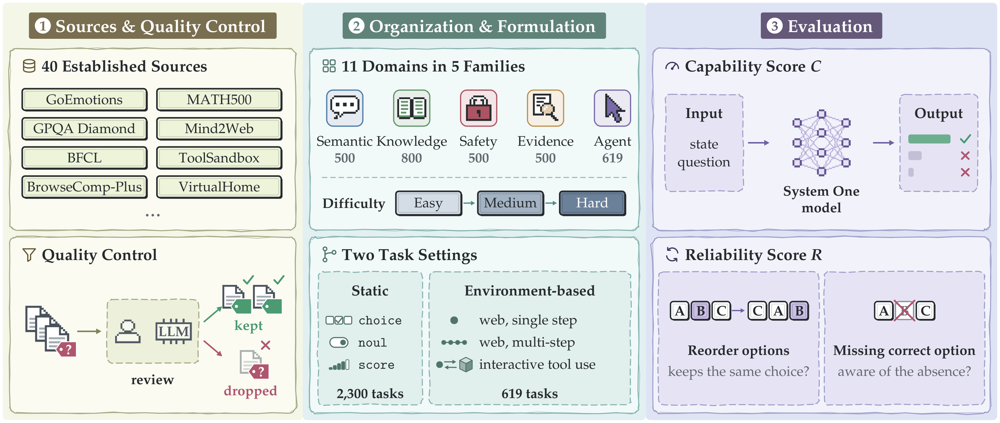
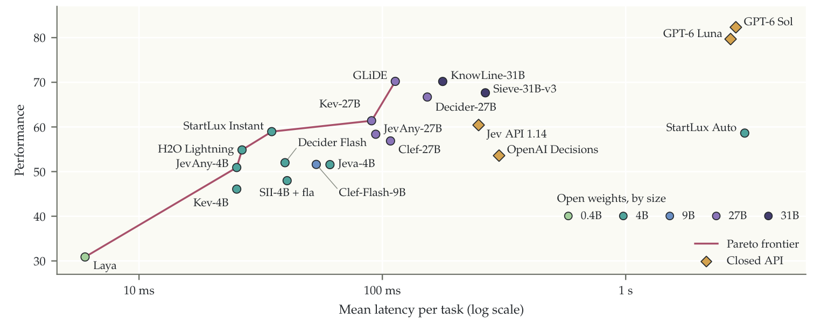
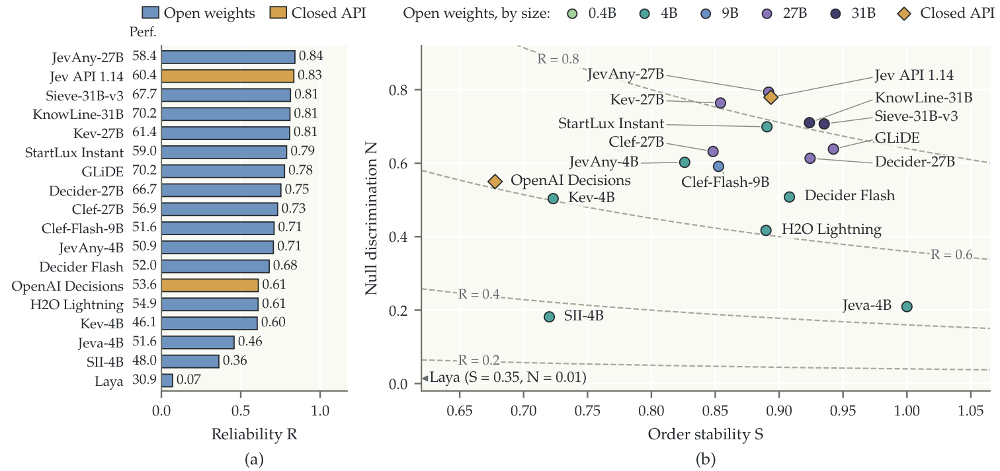
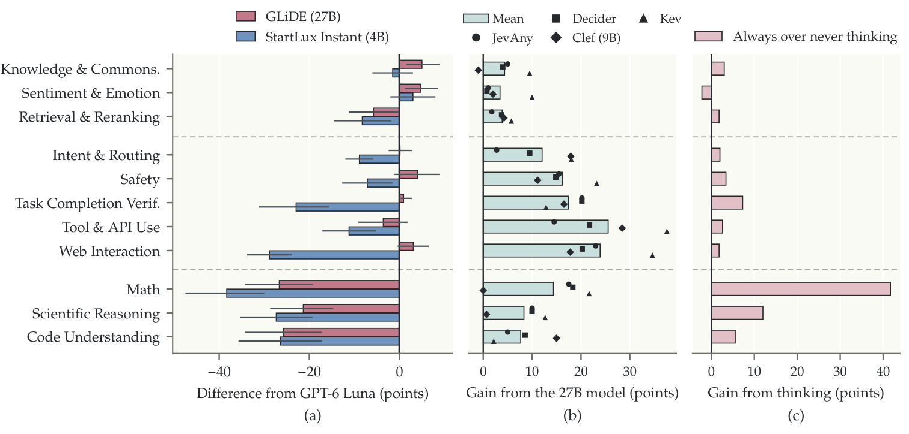

> **원문**: [arXiv](https://arxiv.org/abs/2611.15777) · [HuggingFace](https://huggingface.co/papers/2611.15777) (👍 73) · [GitHub](https://github.com/holdrain/SO-Arena)
{: .prompt-info }

## 들어가며

오늘 고른 논문은 HuggingFace Daily Papers에서 73 upvote를 받은 "SO-Arena: Benchmarking the Capability Spectrum and Reliability of System One Models"입니다. "System One"이라는 이름부터 눈에 띄었는데, 카너먼의 그 이분법(직관적인 System 1 vs 숙고하는 System 2)을 그대로 모델 분류에 가져다 쓴 겁니다. 요즘 LLM 생태계는 "더 오래 생각하게 하자"(reasoning, CoT, 추론 토큰)는 방향으로 쏠려 있는데, 이 논문은 반대쪽, 즉 "생각 없이 한 번의 forward pass로 바로 결정만 내리는" 모델들을 다룹니다.

라우팅, 분류, 안전성 필터링, 툴 선택처럼 초당 수백~수천 건씩 처리해야 하는 실무 워크로드에서는 추론 토큰을 생성할 여유가 없습니다. 그래서 Jev 같은 "결정 전용" 모델들이 나왔는데, 이들을 제대로 평가하는 벤치마크는 의외로 부실했다는 게 저자들의 문제의식입니다. 특히 "정확히 맞혔다"는 것과 "믿을 만하게 결정한다"는 것은 다른 이야기라는 지적이 흥미로워서 골랐습니다. 실제로 이 논문의 핵심 결과 하나는, 성능 1위 모델이 신뢰성 순위에서는 7위로 떨어진다는 겁니다.

## 한눈에 보기

- **핵심 기여**: ① 40개 공개 데이터셋·환경에서 가져오거나 파생시킨 2,919개 과제를 11개 도메인·5개 능력군(의미 이해, 지식·추론, 안전·정책, 증거 평가, 에이전트 과제 수행)으로 구성하고, 참조 라벨을 모델이 실제로 볼 수 있는 입력과 대조해 수동 검증. ② 9개 도메인에 난이도 계층(easy/medium/hard, Math는 very hard까지)을 둬서 "평균 정확도" 뒤에 숨는 성능 차이를 드러냄. ③ 정적 판단뿐 아니라 웹·툴 샌드박스에서의 순차적 행동 선택, 그리고 실행 이력까지 따져야 하는 완료 검증(verification)까지 포함. ④ 정확도와는 별도로 "옵션 순서를 바꿔도 같은 답을 내는가"와 "정답이 없을 때 그걸 알아채는가"를 묶은 **신뢰성 점수**를 도입.
- **성능**: System One 최강자인 GLiDE·KnowLine-31B(70.2점)가 System Two 참조 모델 GPT-6 Luna(79.7)·Sol(82.3)에 약 10점 뒤짐. 그런데 신뢰성 순위는 완전히 다릅니다 — 성능 1위 GLiDE는 신뢰성 7위, 반대로 성능 11위인 JevAny-27B가 신뢰성 1위입니다.
- **한 줄 요약**: "빠른 결정 모델이 정답을 잘 맞히는 것과, 그 결정을 믿어도 되는 것은 전혀 다른 질문이라는 걸 숫자로 보여준 벤치마크."

## 어떤 문제를 풀려고 했나

배경 설명이 좀 필요합니다. 여기서 말하는 **System One 모델**은 "상태 $s$와 질의 $q$, 후보 집합 $\mathcal{C}=\{c_1,\dots,c_K\}$"를 받아서 각 후보에 확률을 할당하는, 한 번의 forward pass로 끝나는 결정 모델입니다. 분류(choice), 예/아니오 판단(noul), 순서형 평가(score) 세 가지 출력 형식을 지원하는 Jev라는 인터페이스를 따릅니다. 수백~수천 토큰씩 "생각"을 생성하는 추론 모델(System Two)과 달리 지연시간이 극도로 짧다는 게 장점입니다.

문제는 이런 모델을 제대로 평가할 벤치마크가 마땅치 않았다는 겁니다. 저자들은 기존 평가들이 ① 참조 라벨이 모델이 실제로 보는 정보와 어긋나는 경우가 있고, ② 난이도별로 모델을 구분하지 못하며(다들 비슷하게 높은 점수를 받아 변별력이 없음), ③ 정적 질문-답변에 그쳐 에이전트처럼 환경 안에서 여러 스텝을 거치는 상황을 못 담고, ④ 무엇보다 "결정이 얼마나 안정적인가"를 아예 재지 않는다고 지적합니다. SO-Arena는 이 네 가지를 한 번에 해결하겠다고 나선 벤치마크입니다.

## 핵심 아이디어

다음은 SO-Arena의 전체 구축 파이프라인입니다.

_Figure 1. 소스 수집·품질관리 → 11개 도메인 조직 → 능력 점수 C·신뢰성 점수 R 산출의 3단계 파이프라인_

왼쪽 패널을 보면 GoEmotions, GPQA Diamond, Mind2Web, BFCL 등 40개의 기존 데이터셋·벤치마크·환경에서 과제를 가져오거나 변형해서 만들었다는 걸 알 수 있습니다. 중요한 건 가운데 "Quality Control" 박스인데, 사람과 LLM이 함께 라벨을 검토해서 의심스러운 참조 라벨은 그냥 버립니다. 오른쪽 "Evaluation" 패널에 있는 두 점수(능력 점수 C, 신뢰성 점수 R)가 이 논문이 실제로 재는 것입니다. 하나씩 뜯어보겠습니다.

**능력 점수.** 단순히 "맞은 문제 수"를 세지 않고, 도메인별 최고 난이도 구간만 뽑아서 도메인 간 가중치를 동일하게 둡니다.

$$C(m)=\frac{100}{D}\sum_{d=1}^{D}\frac{1}{|\mathcal{T}_d|}\sum_{i\in\mathcal{T}_d}c_i(m)$$

$D$는 도메인 수, $\mathcal{T}_d$는 도메인 $d$의 가장 어려운 난이도 구간(난이도가 없는 도메인은 전체), $c_i(m)$은 모델 $m$이 과제 $i$에서 받은 점수(0~1)입니다.

여기서 눈여겨볼 부분은 "가장 어려운 구간만" 쓴다는 설계입니다. 쉬운 문제는 다들 90점 이상을 받아 변별력이 없으니, 리더보드 자체를 어려운 쪽에 민감하게 만든 겁니다. 그리고 도메인마다 과제 수가 200개에서 500개까지 다른데도 "도메인 평균의 평균"을 내서, 과제가 많은 도메인(예: Safety 500개)이 전체 점수를 독식하지 못하게 막았습니다. 개인적으로는 합리적인 설계라고 생각하지만, "가장 어려운 구간"의 기준 자체가 도메인마다 다르게 정의돼 있어서(논문도 이 점을 "티어는 도메인 간에 보정되지 않았다"고 명시합니다) 도메인 간 점수를 직접 비교하기는 어렵다는 점은 염두에 둬야 할 것 같습니다.

**옵션 순서 안정성.** "같은 문제를 선택지 순서만 바꿔서 다시 물어봐도 같은 답을 내는가"를 잽니다.

$$S(m)=\frac{A(m)-p_e}{1-p_e},\qquad A(m)=\frac{1}{12M}\sum_{i=1}^{M}\sum_{r=1}^{12}\mathbf{1}\{a_i^{(r)}=a_i^{(0)}\},\qquad p_e=\frac{1}{M}\sum_{i=1}^{M}\frac{1}{K_i}$$

$a_i^{(0)}$은 원래 순서에서의 답, $a_i^{(r)}$은 12가지 재배열 중 $r$번째에서의 답, $M$은 문항 수, $K_i$는 문항 $i$의 선택지 개수입니다. $p_e$는 "아무렇게나 찍어도 우연히 같은 답이 나올 확률"이라, 이를 빼고 정규화하면 찍기 수준은 0점, 완벽히 일관되면 1점이 됩니다.

핵심은 **답의 내용**(선택지 텍스트)으로 일치 여부를 판단한다는 점입니다. 선택지 A, B, C의 순서를 뒤섞었을 때 모델이 "B"가 아니라 "B였던 내용"을 계속 고르는지를 보는 거죠. 사람도 선택지 순서에 따라 응답이 미묘하게 바뀐다는 심리학 연구가 있는데, LLM도 포지션 편향이 있다는 건 이미 알려진 사실입니다. 이 지표는 그 편향이 "최종 결정"에까지 얼마나 영향을 미치는지를 수치화한 겁니다.

**정답 없음 인식.** 반대로, 제공된 선택지 중에 정답이 아예 없을 때 그걸 알아채는지를 봅니다. $p_{\mathrm{null}}=1-p(\mathrm{inc})$($p(\mathrm{inc})$는 모델이 추정한 "선택지 중 정답이 있다"는 확률)를 가지고, 정답을 뺀 버전과 정답이 있는 원본 버전을 구별하는 AUC를 씁니다.

$$N(m)=2\,\mathrm{AUC}(m)-1$$

$N=0$이면 우연 수준, $N=1$이면 정답 없는 쪽을 항상 더 높은 $p_{\mathrm{null}}$로 맞춘다는 뜻입니다. 이 지표가 흥미로운 이유는, 보통 객관식 벤치마크는 "정답이 선택지 안에 반드시 있다"는 전제를 깔고 가는데, 실제 서비스 환경(예: 툴 호출 후보 목록에 맞는 툴이 없는 경우)에서는 그 전제가 깨질 수 있기 때문입니다. "모르면 모른다고 말하는" 능력을 객관식 포맷 안에서 억지로 측정하는 꽤 영리한 방법이라고 생각합니다.

**종합 신뢰성.** 두 지표를 기하평균으로 묶되, 둘 다 우연 수준을 넘을 때만 양수를 줍니다.

$$R(m)=\begin{cases}\sqrt{S(m)N(m)}, & S(m)>0\ \text{and}\ N(m)>0\\ 0,&\text{otherwise}\end{cases}$$

기하평균을 쓴 이유는 명시돼 있지 않지만, 한쪽이 극단적으로 낮으면 다른 쪽이 아무리 높아도 전체 점수가 끌려 내려가게 만드는 효과가 있습니다. 즉 "순서는 안정적인데 정답 없음은 전혀 못 알아채는" 모델이 평균(산술평균)보다 더 낮은 점수를 받게 되는 구조입니다.

## 실험 결과

21개 모델(0.4B~31B 오픈소스 16종, 자동으로 System 1/2를 전환하는 StartLux Auto, 비공개 결정 API 2종, System Two 참조 모델 GPT-6 Sol·Luna)을 평가했습니다. 먼저 성능과 지연시간의 관계입니다.

_Figure 3. 가로축은 과제당 평균 지연시간(로그 스케일), 세로축은 능력 점수. 점선은 Pareto frontier_

가로축이 로그 스케일이라는 걸 감안하고 보면, GPT-6 Sol·Luna(오른쪽 위 주황 다이아몬드)는 1초 이상 걸려서 80점대를 받는 반면, GLiDE나 KnowLine-31B 같은 System One 모델은 100밀리초 안쪽에서 70점을 냅니다. 즉 10배 이상 빠른데 성능은 10점 정도만 손해 보는 셈이라, "빠른 결정이 필요한 자리"라면 꽤 합리적인 트레이드오프로 보입니다. 다만 눈에 띄는 예외가 StartLux Auto인데, 오른쪽 가운데 혼자 떨어져 있습니다. 자동으로 "생각"을 켜고 끄는 모델이라 느릴 때는 GPT-6급으로 느려지면서도(3초대) 점수는 58.6점에 그칩니다. System 1/2 자동 전환이 말처럼 쉽지 않다는 걸 보여주는 사례 같습니다.

다음은 이 논문에서 가장 흥미로웠던 신뢰성 결과입니다.

_Figure 4. (a) 18개 System One 모델의 신뢰성 R(막대 옆 숫자는 능력 점수), (b) 정답없음 인식 N 대 순서안정성 S_

(a)의 막대 정렬 순서가 능력 점수 순서가 아니라 **신뢰성 순서**라는 걸 눈치채셨다면 바로 이해하실 텐데, JevAny-27B(능력 58.4, 신뢰성 1위 0.84)와 Jev API 1.14(능력 60.4, 신뢰성 2위 0.83)가 맨 위에 있고, 능력 점수 1위였던 GLiDE(70.2)는 신뢰성 0.78로 7위까지 밀려납니다. (b) 산점도를 보면 이유가 좀 더 명확해지는데, GLiDE·KnowLine-31B·Sieve-31B-v3(오른쪽 보라/남색 점들)는 순서 안정성(S)은 가장 높지만 정답없음 인식(N)은 오히려 JevAny-27B보다 낮습니다. 반대로 Jeva-4B는 S가 1.0(구조상 항상 같은 답)인데 N이 0.21밖에 안 됩니다. 두 지표가 서로 다른 걸 재고 있다는 게 확인되는 대목입니다.

왜 이런 괴리가 생기는지는 아래 분석에서 좀 더 드러납니다.

_Figure 5. (a) GLiDE(27B)·StartLux Instant(4B)와 GPT-6 Luna의 점수 차이, (b) 같은 계열 4B→27B로 키웠을 때의 성능 향상, (c) StartLux Auto의 "항상 생각함" vs "전혀 생각 안 함" 격차_

저자들은 11개 도메인을 세 범주로 나눕니다. 직접 묻는 표에 숫자를 그대로 옮기기보다, 이 범주 구분이 어떤 패턴을 짚는지가 더 중요해서 핵심 수치만 아래 표로 정리했습니다.

| 도메인 | 과제수 | Luna 점수 | GLiDE 격차 | StartLux Instant 격차 | 백본 확장 이득 | 생각 안 함→항상 생각 |
|---|---:|---:|---:|---:|---:|---:|
| **직접 의미 판단** | | | | | | |
| 지식·상식 | 200 | 90.0 | +5.0 | −1.5 | +4.4 | 85.0 → 87.5 |
| 감정·정서 이해 | 200 | 84.8 | +4.8 | +3.0 | +3.4 | 88.0 → 86.0 |
| 검색·재순위 | 200 | 76.5 | −5.8 | −8.2 | +3.9 | 69.0 → 71.2 |
| **세밀한 근거기반 결정** | | | | | | |
| 의도·라우팅 | 200 | 79.5 | +0.1 | −8.9 | +12.0 | 68.8 → 71.1 |
| 안전성 | 323 | 75.2 | +4.0 | −7.1 | +16.2 | 60.4 → 63.5 |
| 완료 검증 | 109 | 98.2 | +0.9 | −22.9 | +17.4 | 58.7 → 73.4 |
| 툴·API 사용 | 182 | 75.8 | −3.6 | −11.2 | +25.6 | 61.9 → 61.9 |
| 웹 상호작용 | 237 | 64.4 | +3.1 | −28.8 | +23.9 | 40.8 → 40.4 |
| **다단계 유도(추론)** | | | | | | |
| 수학 | 120 | 100.0 | −26.7 | −38.3 | +14.4 | 50.8 → 87.5 |
| 과학적 추론 | 150 | 91.3 | −21.3 | −27.3 | +8.3 | 58.7 → 70.7 |
| 코드 이해 | 140 | 88.6 | −25.7 | −26.4 | +7.7 | 55.7 → 59.3 |

패턴이 꽤 선명합니다. **직접 의미 판단**(지식·감정·검색)에서는 System One이 System Two와 거의 비등하고, 백본을 키우거나 생각을 시켜도 별 차이가 없습니다. 애초에 "생각"이 필요 없는 영역이라는 뜻이겠죠. **세밀한 근거기반 결정**(의도 분류, 안전성 판단, 완료 검증, 툴·웹 행동 선택)에서는 백본을 키우는 게 뚜렷하게 효과가 있습니다(+12~+26점). 특히 완료 검증에서 StartLux Instant(4B)가 Luna보다 22.9점이나 떨어진다는 건, 작은 모델이 "실행 이력을 따져서 판단"하는 일에 특히 취약하다는 신호로 보입니다. 반면 **다단계 유도**(수학·과학·코드)에서는 백본을 키워도 한계가 뚜렷하고, 대신 "생각을 시키는 것"이 압도적으로 효과적입니다 — 수학에서는 50.8점에서 87.5점으로, 거의 40점 가까이 뜁니다. Chain-of-thought가 수학·기호 추론에서 특히 잘 듣는다는 기존 통념과 정확히 들어맞는 결과입니다.

흥미로운 사례 하나는 본문에 텍스트로만 실려 있는 "거부(refusal)" 사례 연구입니다. OpenAI Decisions는 유해한 맥락이 섞인 안전성 분류 과제에서 "분류만 해 달라"는 요청에도 아예 답을 거부해서 0점을 받았고, 웹 예약 과제에서도 진단명·접종 이력 중에서 정확한 값을 골라야 하는 선택에서 거부해 17단계 결정 중 3단계(17.65%)까지만 인정받았습니다. 흥미로운 건 이게 "능력이 부족해서"가 아니라 "답을 거부해서" 깎인 점수라는 겁니다. 안전성에 민감하게 반응하도록 조정된 모델이 분류·추출 같은 중립적인 하위 과제에서까지 거부하면서 손해를 보는 구조인데, 이게 벤치마크의 결함인지 모델의 실제 약점인지는 좀 더 따져볼 문제라고 생각합니다.

## 아쉬운 점 / 의문점

몇 가지 걸리는 부분이 있습니다.

먼저, 안전성 분류 거부를 0점 처리하는 방식입니다. 안전 정렬이 잘 된 모델일수록 "유해 맥락이 섞인 요청"에는 분류 과제라도 일단 거부하는 경향이 있을 텐데, 이걸 "결정 능력 부족"과 같은 축에서 깎는 게 맞는지 의문입니다. 논문은 이 현상을 사례로만 보여줄 뿐, 거부를 별도로 집계해서 능력 점수와 분리해 보여주지는 않습니다. 거부율 자체를 하나의 축으로 떼어냈다면 더 공정했을 것 같습니다.

둘째, Math 영역의 객관식 변환 방식이 조금 거슬립니다. 원래 주관식인 GSM8K·MATH500·AIME 문제를 객관식으로 바꾸면서, 오답 선택지를 "베이스 모델의 틀린 답"으로 만들었다고 합니다(2절). 그런데 그 베이스 모델이 무엇인지, 그 모델의 오답 패턴이 평가 대상 모델들의 오답 패턴과 얼마나 겹치는지는 논문에 명시되어 있지 않습니다. 오답 선택지가 "너무 쉽게 배제되는" 형태라면 수학 영역 점수가 실제 추론 능력보다 부풀려질 수 있는데, 이 부분에 대한 검증(예: 사람이 선택지만 보고도 추론 없이 맞히는 비율)이 있었으면 더 설득력 있었을 것 같습니다.

셋째, 비교 대상으로 쓰인 모델들(Fastino, PelaAI, Sthanika AI, StartLux, TypeSafe 등)이 대부분 생소한 회사들입니다. 각 모델의 학습 레시피나 아키텍처 세부사항은 이 논문의 범위 밖이라 어쩔 수 없다고 해도, "문서화된 추론 경로를 그대로 따른다"는 평가 방식이 회사마다 최적화 정도가 다른 서빙 스택을 비교하는 셈이라, 지연시간 비교(Figure 3)에는 공정성 변수가 섞여 있을 수 있다는 점은 염두에 둬야 할 것 같습니다.

마지막으로, 논문이 스스로 인정하듯 난이도 티어는 "도메인 간에 보정되지 않았습니다." 그래서 능력 점수 $C(m)$에서 도메인을 동일 가중치로 묶어도, 그 "가장 어려운 구간"이 도메인마다 실제로 얼마나 어려운지는 다를 수 있습니다. 이 논문 안에서는 상대적 순위를 매기는 데는 문제가 없지만, 다른 벤치마크와 절대 점수를 비교하려는 후속 연구자라면 주의가 필요해 보입니다.

## 마치며

개인적으로 이 논문에서 가장 기억에 남는 건 수치 자체보다 "측정 설계"입니다. 정확도 하나로 줄 세우면 안 보이는 것(옵션 순서에 흔들리는 정도, 정답이 없을 때의 반응)을 별도 축으로 떼어내 측정했다는 게, 이후에 작은 분류·라우팅 모델을 만들거나 고를 때 참고할 만한 틀이라고 생각합니다. 특히 "정답 없음 인식"은 저도 작은 모델로 분류기를 만들 때 거의 신경 쓰지 않던 축이었는데, 앞으로는 한 번쯤 넣어봐야겠다는 생각이 들었습니다.

다음에 더 보고 싶은 건, 이 신뢰성 지표가 System One 모델에 국한되지 않고 추론 모델(System Two)이나 에이전트 파이프라인 전체에도 적용됐을 때 어떤 그림이 나오는가입니다. 이 논문의 GPT-6 Sol·Luna는 참조로만 쓰였을 뿐 신뢰성 점수가 따로 보고되지 않는데, 추론 토큰을 생성하는 모델이 옵션 순서 흔들림에 더 강할지 아니면 "생각이 길어질수록 흔들릴 여지도 많아질지"는 꽤 궁금한 질문입니다.
