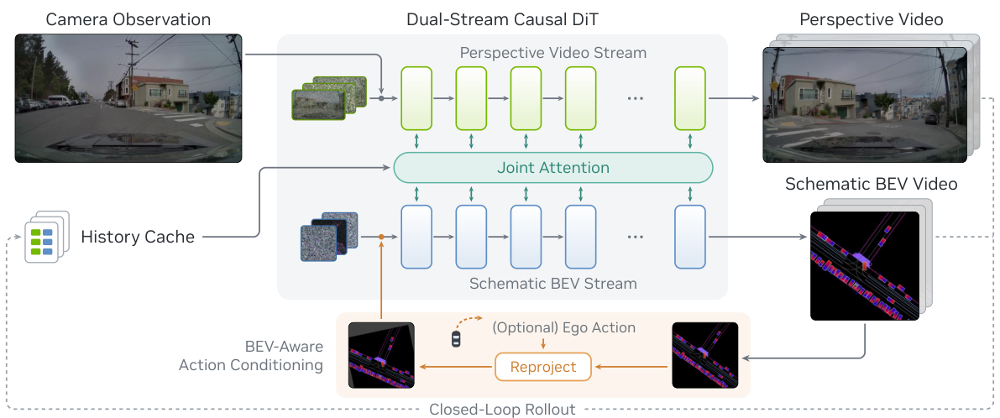
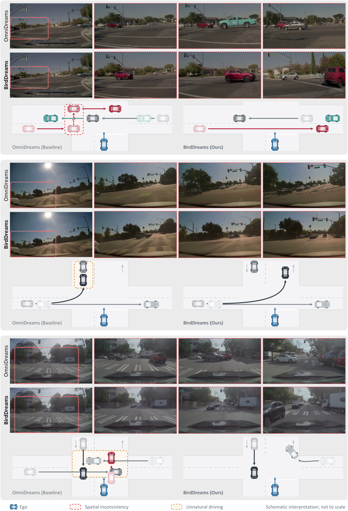
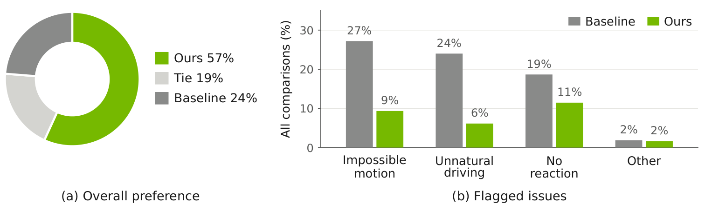

> **원문**: [arXiv](https://arxiv.org/abs/2611.14815) · [HuggingFace](https://huggingface.co/papers/2611.14815) (👍 50) · [프로젝트 페이지](https://research.nvidia.com/labs/sil/projects/birddreams/)
{: .prompt-info }

## 들어가며

오늘 고른 논문은 HuggingFace Daily Papers에서 50 upvote를 받은 NVIDIA·KAIST의 "BirdDreams: Joint Perspective and BEV Video Generation for a Plausible, Reactive Driving World Model"입니다. 주행 월드 모델(driving world model)은 자율주행 시뮬레이션에서 "이 순간 핸들을 이렇게 꺾으면 주변 차들이 어떻게 반응할까"를 영상으로 보여주는 모델인데, 이 논문이 흥미로웠던 지점은 제목 그대로 "BEV를 같이 그린다"는 설정입니다.

기존에는 주변 차량의 미래 경로를 사람이 — 혹은 다른 모델이 — 미리 정해서 레이아웃으로 넣어줘야 했습니다. 그러면 그 차량은 입력받은 경로를 그대로 따라가기만 할 뿐, 자아(ego) 차량이 다른 행동을 해도 반응하지 않습니다. 저자들의 표현을 빌리면 "녹화 재생"에 가깝다는 겁니다. BirdDreams는 이 외부 레이아웃 입력을 아예 없애고, 1인칭 RGB 영상과 schematic한 조감도(bird's-eye-view, BEV) 영상을 모델이 스스로 "같이" 상상하게 만들었습니다. HD맵도, 주변 차량의 미래 상태도 필요 없이 카메라 이미지 한 장에서 시작한다는 게 핵심입니다.

## 한눈에 보기

- **핵심 기여**: ① 1인칭 영상과 도로·차량을 단순 도형으로 그린 schematic BEV 영상을 같은 모델이 joint attention으로 묶어서 동시에 생성 — 장면 레이아웃 자체를 예측 대상으로 만듦. ② Diffusion Forcing에 스트림별(perspective/BEV) 독립 노이즈 샘플링을 더해, 한쪽이 깨끗할 때 다른 쪽을 돕는 학습 신호를 만듦. ③ BEV의 고정 미터 스케일과 정사영(orthographic) 특성을 이용해 직전 BEV 프레임을 입력 궤적만큼 평행이동·회전시켜 "소프트 조건"으로 되먹이는 BEV-aware action conditioning 고안. ④ Resampling Forcing으로 2단계 미세조정해 자기 회귀 롤아웃에서 오차가 누적되는 문제를 줄임.
- **성능**: PhysicalAI-AV·nuScenes 두 벤치마크에서 기존 공개 주행 월드 모델들과 OmniDreams 변형들을 모두 제치고 궤적 추종 오차(ADE/minADE)와 영상 품질(FVD/FID)에서 최상위. 사람 평가에서는 BirdDreams가 57%, 기존 OmniDreams 기반 베이스라인이 24%, 무승부가 19%로 선호됨.
- **한 줄 요약**: "주변 차량의 미래를 외부에서 받아쓰지 않고, 1인칭 영상과 함께 조감도까지 스스로 그리게 했더니 반사실적 상황에서도 더 그럴듯하게 반응하더라."

## 어떤 문제를 풀려고 했나

주행 월드 모델이 풀어야 하는 문제는 사실 두 개가 얽혀 있습니다. 하나는 "자아 차량이 입력받은 궤적을 영상 속에서 정확히 따라가게 만들기"이고, 다른 하나는 "그 과정에서 주변 차량이 그럴듯하게 반응하게 만들기"입니다. 둘 다 말처럼 쉽지 않은데, 이유가 다릅니다.

궤적 추종이 어려운 이유는 미터 단위로 지정된 움직임이 영상의 픽셀 변화로 자연스럽게 번역되지 않기 때문입니다. 미세한 조향 변화는 생성 과정에서 뭉개지기 쉽습니다. 주변 차량 반응이 어려운 이유는 조금 다른데, 1인칭 영상만 가지고 차량의 움직임을 배우려면 그 움직임이 텍스처·조명과 뒤엉켜 있고, 다른 차에 가려 보이지 않는 경우(occlusion)도 많고, 같은 픽셀 이동량이라도 카메라에서 먼 차와 가까운 차는 실제 속도가 다르기 때문이라고 합니다. 그래서 선행 연구인 OmniDreams는 HD맵과 주변 차량의 미래 상태(위치·궤적)를 외부에서 레이아웃으로 넣어주는 방식을 택했는데, 이러면 주행 로그에 기록된 궤적을 그대로 재생하는 셈이라 자아 차량의 행동이 달라져도 주변 차량은 반응하지 않습니다. 별도의 교통 모델로 레이아웃을 새로 생성하는 방법(DriveArena)도 있지만, 그러면 "차량 간 상호작용을 예측하는 일"이 영상 생성 모델 바깥으로 빠져나가 버립니다.

BirdDreams의 해법은 "그러면 그 레이아웃 자체를 예측 대상으로 만들자"는 겁니다. 외부에서 받는 게 아니라 모델이 직접 생성하는 미래의 일부로 만들어버리는 거죠.

## 핵심 아이디어

### 왜 하필 BEV인가

저자들이 BEV를 보조 예측 대상으로 선택한 이유를 뜯어보면 나름 설득력이 있습니다. 조감도는 도로와 차량을 색깔로 구분된 단순 도형(차량은 쿠보이드, 도로는 폴리라인·폴리곤)으로 그리기 때문에 텍스처나 조명 변화가 없습니다. 그리고 고정된 미터 스케일의 정사영이라, 화면 어디서든 같은 픽셀 이동량이 같은 실제 거리를 의미합니다. 1인칭 영상에서는 카메라에서 먼 차와 가까운 차의 같은 픽셀 이동이 전혀 다른 속도를 의미하는 것과 대조적입니다. 게다가 위에서 내려다보니 교차로에서 겹쳐 보이던 차량들도 BEV에서는 떨어져 보여서 occlusion이 줄어듭니다. 대신 BEV는 신호등 상태나 노면 디테일, 먼 거리의 물체처럼 schematic 표현에서 빠지는 정보를 담지 못하는데, 이건 1인칭 영상이 보완합니다. 결국 "BEV는 기하학적 정확성을, 1인칭 영상은 시각적 디테일을 각자 맡고 joint attention으로 서로를 보완한다"는 설계입니다.

다음은 이 모델의 전체 구조를 보여주는 그림입니다.

_Figure 2. 카메라 이미지 하나에서 시작해 두 개의 인과적(causal) 비디오 diffusion transformer가 1인칭 영상 스트림과 schematic BEV 스트림을 joint attention으로 묶어 함께 생성한다. BEV-aware action conditioning(주황색 박스)은 직전 BEV 프레임을 입력 궤적만큼 재투영해 조건으로 되먹인다._

가로로 두 개의 스트림(초록=1인칭, 파랑=BEV)이 나란히 쌓여 있고, 그 사이를 "Joint Attention"이라는 가로 막대가 잇는 구조입니다. 이게 Mixture-of-Transformers 아키텍처인데, 두 브랜치가 attention 레이어의 쿼리는 양쪽 스트림의 키·값을 모두 보되, 피드포워드 레이어나 출력 헤드는 각자 따로 가진다는 뜻입니다. 전부 공유하면 두 표현(사진 같은 질감 vs 단순 도형)이 서로 간섭해서 망가지고, 전혀 안 섞으면 애초에 joint 모델링을 하는 의미가 없으니, 절충안을 택한 셈입니다. 아래쪽의 "BEV-Aware Action Conditioning" 박스가 바로 이 논문에서 가장 영리하다고 느낀 부분인데, 뒤에서 수식으로 설명하겠습니다.

### 수식으로 보는 핵심 메커니즘

먼저 모델이 풀려는 문제 자체를 정의한 식부터 보겠습니다.

$$p_\phi\left(I_{1:T},B_{0:T}\mid I_0,c\right), \qquad c\in\{\mathcal{A}_{0:T},\varnothing\}$$

$I_0$는 처음 주어지는 1인칭 카메라 이미지, $I_{1:T}$는 생성할 1인칭 영상, $B_{0:T}$는 첫 프레임부터 생성하는 BEV 영상, $\mathcal{A}_{0:T}=\{(p_t,\theta_t)\}$는 선택적으로 줄 수 있는 자아 차량의 궤적(평면 위치 $p_t$와 헤딩 $\theta_t$)입니다.

여기서 눈여겨볼 점은 BEV도 $B_0$부터 생성 대상이라는 겁니다. 즉 추론 시점에 HD맵이나 차량 상태를 전혀 받지 않고, 카메라 이미지 한 장만으로 BEV까지 처음부터 상상해서 그려낸다는 뜻입니다. 그리고 $c$가 궤적이면 자아 차량의 움직임이 고정되고, $c$가 공집합이면 자아 차량의 움직임조차 모델이 알아서 예측합니다. 두 경우 모두 주변 차량의 반응은 항상 모델이 예측해야 할 몫으로 남습니다.

학습은 Diffusion Forcing을 따르는데, 여기에 "스트림별 독립 노이즈 샘플링"이라는 변형을 더합니다.

$$x_k^s = (1-\sigma_k^s)z_k^s + \sigma_k^s\epsilon_k^s, \qquad \epsilon_k^s\sim\mathcal{N}(0,I)$$

$z_k^s$는 스트림 $s\in\{\text{persp}, \text{bev}\}$의 $k$번째 청크(3개 latent 프레임 묶음)에 대한 깨끗한 VAE latent, $\sigma_k^s\in[0,1]$는 노이즈 비율입니다. 핵심은 이 $\sigma_k^s$를 청크마다는 물론 **두 스트림 사이에서도 독립적으로** 뽑는다는 점입니다. 왜 이게 중요하냐면, 이렇게 하면 학습 데이터에 "BEV는 거의 깨끗한데 1인칭 영상은 노이즈투성이"인 경우와 그 반대 경우가 둘 다 섞여 들어갑니다. 전자의 경우 모델은 깨끗한 BEV의 도로 기하학·차량 위치를 보고 지저분한 1인칭 영상을 복원하는 법을 배우고, 후자의 경우 반대로 1인칭의 시각 단서(신호등 색 같은)를 보고 BEV를 복원하는 법을 배웁니다. 논문의 ablation(§ 실험 결과에서 다룸)에 따르면 이 독립 샘플링이 실제로 FVD·FTD를 낮춥니다.

이 논문에서 제가 가장 영리하다고 느낀 부분은 BEV를 이용한 action conditioning입니다.

$$\widetilde B_t(u) = B_r\!\left(\Pi\!\left[R(\theta_r)^{\mathsf T}\left(R(\theta_t)\Pi^{-1}(u)+p_t-p_r\right)\right]\right)$$

$B_r$은 직전에 생성한 청크의 마지막 BEV 프레임, $\Pi$는 자아 좌표(미터 단위)를 BEV 픽셀로 바꾸는 사영, $R(\theta)$는 2차원 회전행렬입니다. 식 자체는 복잡해 보이지만 하는 일은 간단합니다 — "주변 환경은 가만히 있고 자아 차량만 $(p_t,\theta_t)$로 움직였다면 BEV가 어떻게 보일지"를 기하학적으로 계산해서 미리 그려주는 겁니다. 비유하자면 지도 앱에서 내 위치 마커가 움직이는 대신 지도 자체를 반대 방향으로 미끄러뜨리는 것과 같은 원리입니다. BEV가 고정 미터 스케일의 정사영이기 때문에 이런 평행이동·회전만으로 "자아가 이렇게 움직이면 주변이 상대적으로 이렇게 보인다"를 깔끔하게 계산할 수 있습니다. 이렇게 만든 $\widetilde B_t$를 그대로 정답으로 쓰는 게 아니라 **소프트 조건**으로만 넣고, 실제 정답(새로 보이는 물체, 주변 차량의 움직임이 반영된 진짜 미래 BEV)으로 학습시킵니다. 즉 "이 정도로 움직였으니 대략 이렇게 보일 거야"라는 힌트만 주고 나머지는 모델이 채우게 하는 설계입니다. 이게 핵심인 이유는, 만약 이 reprojection 없이 숫자로 된 궤적만 토큰으로 넣어준다면 모델이 "3.2미터 앞으로"라는 추상적인 수치를 영상의 픽셀 이동으로 번역해야 하는데, 이 변환 자체가 어렵습니다. BEV라는 기하학적으로 명확한 중간 표현을 거치면 이 번역 문제가 훨씬 쉬워집니다.

마지막으로 자기회귀 롤아웃 중 오차가 누적되는 문제(모델이 자기 자신이 생성한, 다소 틀린 과거를 보고 다음을 또 생성하다 보면 오류가 눈덩이처럼 불어나는 현상)를 줄이기 위해 Resampling Forcing으로 2단계 미세조정을 합니다. 정답 청크에 일부러 노이즈를 섞고 한 스텝만 디노이징해서 "모델이 실제로 만들어낼 법한 약간 틀린 과거"를 흉내 낸 뒤, 그걸 조건으로 다음 청크를 학습시키는 방식입니다. 이 부분은 저자들이 새로 제안한 건 아니고 기존 Resampling Forcing 기법을 그대로 가져다 썼다고 하는데, 학습-추론 간 분포 불일치(exposure bias)를 줄이는 비교적 표준적인 트릭입니다.

## 실험 결과

PhysicalAI-AV(NVIDIA가 공개한 주행 영상 데이터셋에서 200개 클립을 뽑은 서브셋)와 nuScenes 공식 검증 셋, 두 벤치마크로 평가했습니다. "자아 액션 조건 없음"과 "있음" 두 설정으로 나눠서 비교하는데, 먼저 조건 없이 돌렸을 때 결과입니다.

| Method | minADE↓ | minDTW↓ | FTD↓ | FVD↓ | FID↓ | Image Qual.↑ |
|---|---|---|---|---|---|---|
| Vista | 14.65 / 8.70 | 890 / 512 | 9.02 / 14.24 | 388 / 460 | 27.34 / 30.75 | 0.363 / 0.360 |
| UniFuture | 17.53 / 7.16 | 1069 / 432 | 18.11 / 10.34 | 535 / 393 | 35.50 / 30.47 | 0.363 / 0.366 |
| GEM | 10.43 / 7.03 | 580 / 420 | 4.00 / 12.42 | 359 / 401 | 23.45 / 29.84 | 0.385 / 0.388 |
| DrivingDojo | 14.81 / 11.43 | 967 / 744 | 14.58 / 15.44 | 367 / 469 | 32.56 / 34.21 | 0.395 / **0.443** |
| OmniDreams (Vanilla)* | _7.76_ / _6.20_ | _413_ / _393_ | _3.17_ / _4.15_ | _281_ / _351_ | _11.37_ / _15.58_ | **0.445** / 0.430 |
| **BirdDreams** | **6.15** / **3.91** | **258** / **205** | **1.77** / **0.43** | **271** / **309** | **10.70** / **11.48** | _0.428_ / _0.439_ |

(각 셀은 PhysicalAI-AV / nuScenes, **볼드**=1위, _이탤릭_=2위)

자아 액션을 조건으로 줬을 때는 다음과 같습니다.

| Method | ADE↓ | DTW↓ | FTD↓ | FVD↓ | FID↓ | Image Qual.↑ |
|---|---|---|---|---|---|---|
| Vista | 9.65 / 6.65 | 343.6 / 298.9 | 4.75 / 12.11 | 341.2 / 407.8 | 21.23 / 25.89 | 0.396 / 0.405 |
| UniFuture | 10.33 / 4.28 | 361.2 / _175.3_ | 7.87 / 10.08 | 608.0 / 349.2 | 44.63 / 33.11 | 0.361 / 0.371 |
| GEM | 6.59 / 5.55 | 235.6 / 245.0 | _1.99_ / 9.06 | 336.1 / 386.1 | 24.50 / 32.29 | 0.394 / 0.406 |
| DrivingDojo | 9.87 / _3.81_ | 390.1 / 225.2 | 9.21 / 8.26 | 410.3 / 406.8 | 27.28 / 40.61 | 0.404 / 0.411 |
| OmniDreams (Plücker) | _5.88_ / 5.38 | _197.1_ / 234.8 | 3.02 / _1.47_ | _271.5_ / _343.1_ | _15.35_ / _18.27_ | _0.416_ / **0.443** |
| **BirdDreams** | **3.83** / **3.42** | **95.2** / **133.3** | **0.48** / **0.56** | **238.9** / **294.0** | **11.81** / **14.80** | **0.435** / _0.436_ |

두 표에서 공통적으로 보이는 패턴은, BirdDreams가 궤적 지표(ADE·DTW·FTD)에서 격차를 크게 벌린다는 겁니다. 특히 자아 액션을 조건으로 줬을 때 DTW가 OmniDreams(Plücker) 대비 PhysicalAI-AV에서 95.2 대 197.1로 절반 이하로 줄었는데, 이건 궤적을 "대략 비슷하게"가 아니라 "미터 단위로 정확하게" 따라간다는 뜻입니다. 반면 Image Quality(프레임 단위 화질)에서는 1위를 놓치는 경우가 종종 보입니다 — 조건 없음·PhysicalAI-AV에서는 OmniDreams(Vanilla)에, 조건 없음·nuScenes에서는 DrivingDojo에 밀립니다. 궤적 정확도를 높이는 쪽으로 설계가 쏠리면서 순수 화질 면에서는 약간의 트레이드오프가 있는 것으로 보입니다. 다만 FVD·FID(영상 전체의 분포 유사도)는 거의 모든 설정에서 1위를 유지하니, 프레임 하나하나의 선명도보다는 영상 전체의 동역학적 그럴듯함 쪽에서 더 확실한 우위가 있다고 해석하는 게 맞을 것 같습니다.

수치보다 더 흥미로운 건 "반사실적(counterfactual) 시나리오"에서의 정성적 비교입니다. 다음 그림은 OmniDreams와 BirdDreams가 같은 초기 관측·같은 도로 기하(HD맵 조건)에서, 주변 차량의 상태는 전혀 받지 않고 어떻게 다르게 반응하는지 보여줍니다.

_Figure 6. 세 가지 교차로 시나리오에서 OmniDreams(위)와 BirdDreams(아래)의 롤아웃. 빨간 점선은 공간적으로 어긋난 위치, 주황 점선은 부자연스러운 주행을 표시한다. 아래 도식은 흐릿한 색에서 진한 색으로 시간이 흐르는 차량의 경로를 보여준다._

세 묶음 모두 구조가 같습니다. 위는 1인칭 프레임 네 장의 시간 순서, 아래는 그 장면의 BEV 해석 도식인데, 자아 차량(파랑)이 특정 경로로 움직일 때 주변 차량들이 어디서 와서 어디로 가는지를 화살표로 표시합니다. 첫 번째 사례(맨 위 블록)를 보면, OmniDreams에서는 두 차량이 빨간 점선 박스 안에서 서로 반대 방향으로 자리를 "바꾸는" 것처럼 보이는데, 이는 실제로는 불가능한 움직임입니다. 반대쪽 차선의 차와 자리가 뒤바뀌는 것이기 때문입니다. BirdDreams 쪽은 같은 조건에서 차량들이 교차로를 가로지르긴 하지만 서로 자리를 맞바꾸는 식의 비현실적 궤적 없이 정리됩니다. 두 번째 블록(주황 점선)에서는 OmniDreams가 한 차량을 "순간이동"에 가깝게 다른 위치로 옮겨버리는 반면 BirdDreams는 연속적인 좌회전 궤적을 그립니다. 이 그림에서 읽어야 할 건 숫자가 아니라 "스키매틱 BEV라는 명시적 기하 표현을 학습 목표에 넣었더니, 모델이 공간적으로 일관된 궤적을 만드는 능력 자체가 좋아졌다"는 질적인 차이입니다.

이 질적 차이를 정량화하기 위해 25명을 대상으로 한 사람 평가(쌍별 비교 375건)를 진행했는데, 결과가 아래 그림입니다.

_Figure 8. (a) 전체 선호도: BirdDreams 57%, 무승부 19%, 베이스라인 24%. (b) 비선호 영상에 체크된 문제 유형별 비율._

왼쪽 도넛 차트는 "어느 영상의 주변 차량 움직임이 더 그럴듯한가"를 물었을 때의 전체 선호 비율이고, 오른쪽 막대그래프는 둘 중 하나를 고른 사람이 "덜 선호한 쪽"에서 어떤 문제를 봤는지 체크한 비율입니다(한 사람이 여러 개 체크 가능). 왼쪽만 보면 "57% 대 24%, 그래도 19%는 비겼네" 정도로 끝낼 수 있지만, 오른쪽을 같이 봐야 의미가 분명해집니다. "불가능한 움직임"(순간이동·미끄러짐·갑작스러운 출현/소멸)으로 베이스라인이 지적된 비율이 27%인데 BirdDreams는 9%로 3분의 1 이하입니다. "부자연스러운 주행"도 24% 대 6%로 차이가 큽니다. 반면 "적절한 반응 없음"(다른 차가 끼어드는데 안 서는 것 같은)은 19% 대 11%로 격차가 상대적으로 작습니다. 이건 BirdDreams가 "공간적으로 말이 되는 궤적을 그리는 능력"은 확실히 개선했지만, "다른 차의 행동에 실제로 반응하는 지능적인 판단"까지는 아직 완전히 해결하지 못했다는 뜻으로 읽힙니다. 개인적으로는 이 두 번째 격차가 더 어려운 문제라고 생각하는데, 공간 일관성은 기하학적 중간 표현(BEV)을 추가하는 것만으로도 상당 부분 개선되지만, "진짜 반응성"은 차량 간 상호작용에 대한 더 깊은 이해를 요구하기 때문입니다.

추가로, 독립 노이즈 샘플링 ablation에서는 스트림 간 노이즈를 공유했을 때보다 독립적으로 뽑았을 때 FVD가 489.9→439.4, FTD가 1.144→1.018로 개선됐다고 합니다. 그리고 BirdDreams 구조를 world-action model(궤적 예측 헤드를 붙이는 post-training)로 확장하는 예비 실험에서는 minADE가 OmniDreams 대비 0.318m→0.295m로 7.3% 개선됐다고 하는데, 저자들 스스로 "preliminary"라고 표현한 만큼 본 실험만큼 확정적인 결과는 아닌 것 같습니다.

## 아쉬운 점 / 의문점

몇 가지 걸리는 부분이 있습니다. 첫째, 코드나 체크포인트가 공개되어 있지 않습니다. 프로젝트 페이지는 있지만 GitHub 저장소 링크를 찾지 못했는데, NVIDIA의 기존 Cosmos 계열 프로젝트들과 달리 이번 연구는 재현이나 직접 실험이 당장은 어려워 보입니다.

둘째, 반사실적 시나리오 비교에서 베이스라인으로 쓴 "OmniDreams (HDMap)"은 독립적인 제3의 모델이 아니라 저자들이 직접 "주변 차량 조건을 제거해서" 만든 자사 모델의 변형입니다. 공정한 비교를 위한 통제라는 취지는 이해되지만, 완전히 다른 계열의 주행 월드 모델(예: GAIA 계열이나 DriveArena)과도 같은 반사실적 평가를 했다면 더 설득력이 있었을 것 같습니다. 사람 평가 규모도 25명·375건의 비교로, 통계적으로 크다고 보기는 어렵습니다.

셋째, 학습에 64장의 H100 GPU와 약 670시간 분량의 주행 데이터(RDS-HQ-1M 서브셋)가 들어갔습니다. 4B 파라미터 규모의 듀얼 브랜치 transformer를 처음부터 학습하는 게 아니라 사전학습된 OmniDreams 백본에서 시작한다는 점은 다행이지만, 그래도 개인이나 소규모 연구실이 직접 재현하기는 쉽지 않은 규모입니다.

넷째, 논문이 "극단적인 시나리오에서는 충돌로 끝나는 것도 그럴듯한 결과일 수 있다"고 설명하는 대목이 있는데, 이 모델에는 실제 물리 법칙에 대한 제약이 전혀 없고 순전히 데이터에서 학습된 패턴만 있다는 점을 감안하면, 이걸 실제 자율주행 안전성 검증 파이프라인에 쓰려면 "그럴듯해 보이는 충돌"과 "물리적으로 타당한 충돌"을 구분할 추가 장치가 필요해 보입니다. 이 부분은 논문에 명시적으로 다뤄지지 않습니다.

## 마치며

BEV를 보조 타겟으로 써서 레이아웃 자체를 예측하게 만든다는 아이디어는 단순하지만 효과가 분명하게 보이는 설계였습니다. "모델에게 더 쉬운 표현을 보조 목표로 주면 어려운 표현(사진 같은 영상)에서의 성능도 같이 좋아진다"는 식의 구조화된 보조 지도(auxiliary supervision)는 최근 여러 영역에서 반복적으로 등장하는 패턴인데, 주행 월드 모델에도 잘 들어맞는 것 같습니다. 여담으로, NVIDIA가 이 연구를 Cosmos 생태계(예: Cosmos-Predict2.5의 VAE를 그대로 가져다 쓴 것)와 묶어서 쌓아가는 걸 보면, 결국 "범용 비디오 월드 모델 백본 + 도메인별 보조 표현"이라는 조합이 다음 세대 시뮬레이터의 기본 틀이 될 가능성이 커 보입니다. 다음에 관전 포인트로 삼고 싶은 건, 코드가 공개되면 작은 스케일로도 비슷한 구조(1인칭 + 저해상도 schematic 보조 스트림)가 로보틱스나 다른 임베디드 환경에서도 통할지입니다.
