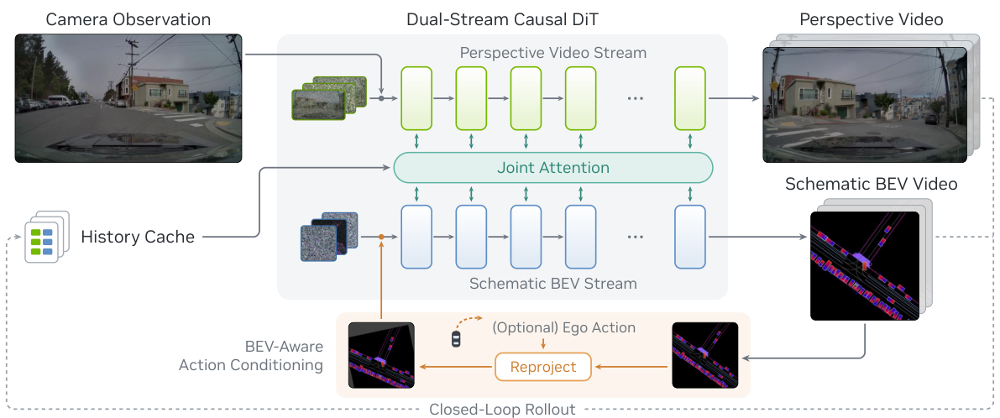
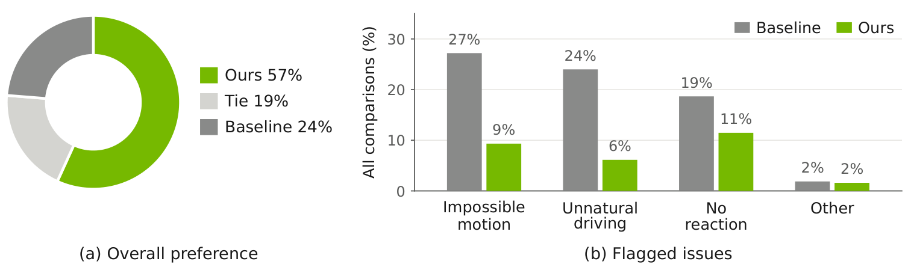
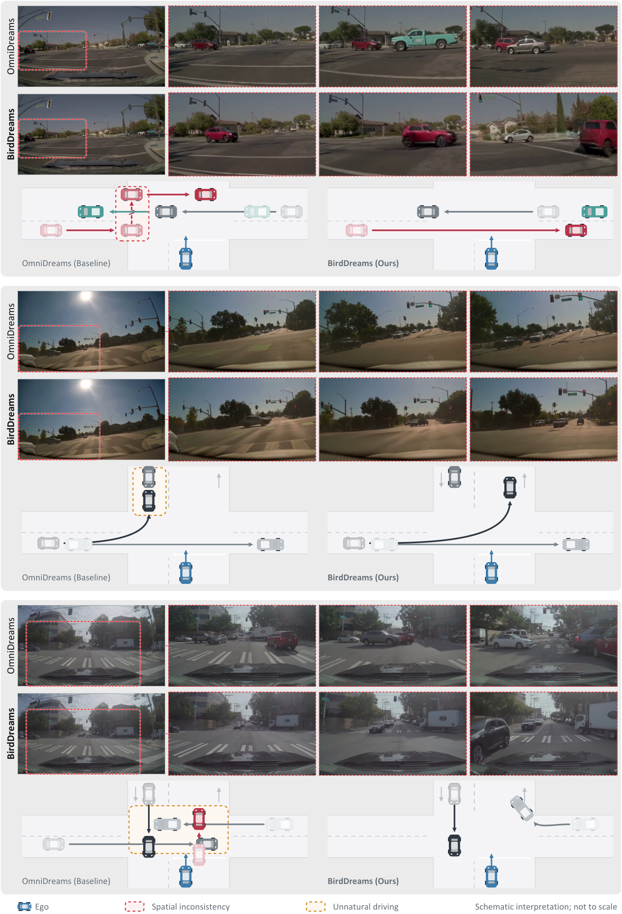
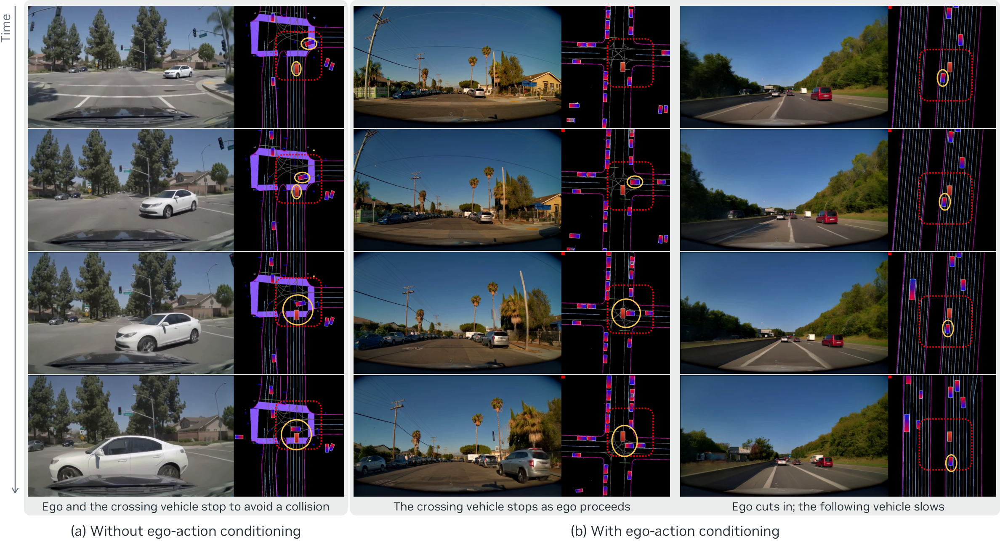

> **원문**: [arXiv](https://arxiv.org/abs/2611.14815) · [HuggingFace](https://huggingface.co/papers/2611.14815) (👍 51) · [Project Page](https://research.nvidia.com/labs/sil/projects/birddreams/)
{: .prompt-info }

## 들어가며

오늘 고른 논문은 HuggingFace Daily Papers에서 51 upvote를 받은 NVIDIA·KAIST의 "BirdDreams: Joint Perspective and BEV Video Generation for a Plausible, Reactive Driving World Model"입니다. 주행 월드 모델(driving world model)은 "자율주행차가 이렇게 움직이면 주변은 어떻게 반응할까"를 영상으로 시뮬레이션하는 모델인데, 사실 이 분야 많은 모델들이 자동차 주변의 '다른 차'를 다루는 방식이 좀 치사합니다 — 로그에 찍힌 미래 궤적을 그대로 재생시켜 버리거든요. 그러면 ego 차량이 로그와 다르게 움직이는 순간 주변 차들은 "원래 하려던 대로" 움직이기 때문에 서로 충돌하거나 비현실적인 장면이 나옵니다. 이 논문은 주변 차량의 미래 궤적을 외부에서 넣어주지 않고, 모델이 영상 생성 과정에서 스스로 예측하게 만드는 방법을 제안합니다. 핵심 아이디어가 "투시 영상과 조감도(BEV) 영상을 같이 생성한다"는 꽤 직관적인 발상이라 읽어볼 만하다고 판단했습니다.

## 한눈에 보기

- **핵심 기여**: 투시(perspective) 영상과 단순화된 조감도(BEV) 영상을 하나의 듀얼 스트림 diffusion transformer로 동시에 생성해, 외부 레이아웃·궤적 입력 없이도 주변 차량의 그럴듯한 반응을 만들어낸다.
- **성능**: PhysicalAI-AV·nuScenes 두 벤치마크에서 ego 궤적 재현 오차(ADE)를 ego-action 조건 유무와 관계없이 기존 모델 대비 20~37% 줄였고, 사람 평가에서 57% vs 24%로 주변 차량 행동의 현실성에서 우위를 보였다.
- **한 줄 요약**: "다른 차를 어떻게 움직일지"를 입력으로 받지 말고, 조감도라는 더 쉬운 과제로 바꿔서 모델이 직접 예측하게 하자.

## 어떤 문제를 풀려고 했나

자율주행 시뮬레이션용 월드 모델이 풀어야 하는 문제는 사실 두 가지입니다. 첫째, ego 차량(내 차)이 입력된 궤적을 정확히 따라가는 영상을 만들어야 하고, 둘째, 그 궤적 변화에 주변 차량들이 그럴듯하게 반응해야 합니다. 저자들이 베이스라인으로 삼은 OmniDreams 같은 모델은 외부에서 HD 맵과 "미래 차량 상태"를 레이아웃으로 넣어줘야 영상을 생성합니다. 문제는 이 레이아웃이 로그에서 그대로 가져온 것이라, ego가 로그와 다르게 움직이는 반사실적(counterfactual) 시나리오에서는 주변 차량이 전혀 반응하지 않습니다. 교차로에서 ego가 양보 대신 그냥 진행해도, 레이아웃에 박제된 다른 차는 원래 하려던 대로 움직이다가 결국 이상한 그림이 나오는 거죠.

그렇다고 레이아웃 입력을 아예 없애고 투시 영상만으로 학습시키면 이번엔 다른 문제가 생깁니다. 투시 영상에서는 거리에 따라 같은 픽셀 이동량이 다른 실제 속도를 의미하고(원근 때문에), 차량끼리 가려지는 occlusion도 흔합니다. 그 결과 저자들이 레이아웃 없이 학습시킨 OmniDreams 베이스라인에서는 복잡한 교차로에서 차가 갑자기 사라지거나 말이 안 되는 경로로 움직이는 현상이 나타났다고 합니다(뒤에 나올 Figure 6에서 직접 확인할 수 있습니다). 즉, "외부에서 미래를 알려주거나" 혹은 "투시 영상만으로 알아서 배우거나" 둘 다 아쉬운 선택지였던 셈입니다.

## 핵심 아이디어

BirdDreams의 해법은 "장면 레이아웃을 입력이 아니라 예측 대상으로 바꾸자"는 겁니다. 즉 모델이 투시 영상을 만들면서 동시에, 도로와 차량을 단순한 도형으로 그린 스키매틱 BEV(조감도) 영상도 함께 만들어내게 합니다. 이 BEV는 학습 때는 데이터셋의 지도·3D 박스 주석으로부터 렌더링해서 정답(ground truth)으로 쓰고, 추론 때는 모델이 투시 영상과 함께 스스로 생성합니다.

다음은 BirdDreams의 전체 구조를 보여주는 그림입니다.

_Figure 2. 투시 영상 스트림과 BEV 영상 스트림을 각각 담당하는 두 개의 causal diffusion transformer가 Joint Attention으로 연결된 구조. ego-action이 주어지면 직전 BEV 프레임을 입력 궤적을 따라 재투영(reproject)해 BEV 스트림의 조건으로 사용한다._

왼쪽의 카메라 관측값이 들어오면, 위쪽 초록색 블록들(Perspective Video Stream)과 아래쪽 파란색 블록들(Schematic BEV Stream)이 각자 자기 영상을 denoising하면서, 중간의 "Joint Attention"을 통해 서로의 정보를 주고받습니다. 두 스트림은 어텐션의 query는 공유하되(즉 서로를 참조하되) attention projection, feed-forward, 출력 head는 따로 가져서 각자의 표현에 특화되도록 설계했습니다. 아래쪽 주황색 박스가 ego-action 조건화 메커니즘인데, 이건 뒤에서 수식으로 자세히 보겠습니다. 전체 backbone은 사전학습된 OmniDreams를 가져와 초기화하고, BEV 브랜치는 그 가중치를 복사해서 시작합니다. 즉 완전히 새로 학습하는 게 아니라 기존 투시 영상 생성 능력 위에 BEV 예측 능력을 얹는 구조입니다.

**왜 하필 "조감도"를 예측 대상으로 골랐을까요?** 저자들이 드는 이유가 두 가지입니다. 첫째, BEV는 고정된 미터 단위 스케일을 쓰기 때문에, 화면 어디서든 같은 픽셀 이동량이 같은 실제 거리를 의미합니다. 투시 영상처럼 "가까운 차는 크게, 먼 차는 작게 움직이는" 왜곡이 없어서 모델이 속도·방향을 배우기 더 쉽다는 거죠. 둘째, 위에서 내려다보는 시점이라 차량끼리 가려지는 일이 줄어듭니다. 교차로에서 투시 영상에서는 겹쳐 보이는 두 차가 BEV에서는 떨어져서 보이니, 각자의 경로를 추적하기가 쉬워집니다. 개인적으로는 이게 일종의 "보조 과제(auxiliary task)를 통한 표현 학습"처럼 느껴지는데, 다만 여기서는 보조 과제의 출력 자체가 최종 산출물(궤적 제어 인터페이스)로도 쓰인다는 점이 흥미롭습니다.

### 수식으로 보는 핵심 메커니즘

모델이 풀어야 하는 문제를 수식으로 먼저 정리하면 이렇습니다.

$$p_\phi\!\left(I_{1:T},B_{0:T}\mid I_0,c\right), \qquad c\in\{\mathcal{A}_{0:T},\varnothing\}$$

$I_0$는 초기 카메라 이미지, $I_{1:T}$는 생성할 투시 영상, $B_{0:T}$는 생성할 BEV 영상이고, $c$는 선택적 ego 궤적 조건 $\mathcal{A}_{0:T}=\{(p_t,\theta_t)\}$(평면 위치 $p_t$와 헤딩 $\theta_t$)입니다. 의미는 단순합니다 — ego 궤적이 주어지면 그 궤적을 따르는 미래를, 주어지지 않으면 ego 동작까지 포함한 미래 전체를 투시·BEV 두 영상으로 동시에 생성한다는 겁니다. 여기서 눈여겨볼 부분은 초기 BEV 프레임 $B_0$조차 입력이 아니라 $I_0$로부터 생성된다는 점입니다. 즉 추론 시점에 HD맵이나 차량 상태 입력이 정말로 하나도 필요 없습니다.

두 스트림을 학습할 때는 diffusion forcing 방식을 쓰는데, 여기에 저자들이 더한 독자적인 아이디어가 "스트림별로 독립적인 노이즈 레벨"입니다.

$$x_k^s = (1-\sigma_k^s)z_k^s + \sigma_k^s\epsilon_k^s, \qquad \epsilon_k^s\sim\mathcal{N}(0,I)$$

$z_k^s$는 스트림 $s$(투시 또는 BEV)의 $k$번째 청크(3프레임 단위)의 깨끗한 latent이고, $\sigma_k^s\in[0,1]$은 노이즈 강도입니다. 이 $\sigma_k^s$를 청크마다는 물론 **스트림마다도 독립적으로** 뽑는다는 게 포인트입니다. 그러면 학습 중에 "BEV는 깨끗한데 투시는 노이즈투성이"이거나 그 반대인 상황이 자주 생기고, 모델은 자연스럽게 상대적으로 깨끗한 스트림에서 정보를 가져와 노이즈 낀 스트림을 복원하는 법을 배우게 됩니다. 두 스트림을 항상 같은 노이즈 레벨로 묶어서 학습시키면 이런 "서로 돕는" 상호작용을 배울 기회 자체가 줄어든다는 논리입니다. 실제로 이 설계를 노이즈를 공유하는 버전과 비교한 ablation(Figure 9)에서 독립 샘플링 쪽이 FVD·FTD 모두 더 낮았다고 합니다.

손실 함수에서도 소소하지만 눈에 띄는 설계가 있습니다.

$$\mathcal{L}_{\mathrm{flow}} = \mathbb{E}_{z,\sigma,\epsilon}\!\left[ \tfrac{1}{2K}\sum_{s\in\{\mathrm{persp},\mathrm{bev}\}}\sum_{k=1}^{K} \tfrac{1}{N_s}\left\|\hat v_k^s-(\epsilon_k^s-z_k^s)\right\|_2^2 \right]$$

$N_s$는 스트림 $s$의 청크 하나에 들어있는 latent 원소 개수입니다. 투시 영상은 BEV보다 해상도가 크기 때문에($848\times480$ vs $480\times480$) latent 원소 수도 더 많은데, 이를 그냥 더하면 투시 쪽 손실이 자연스럽게 더 큰 비중을 차지하게 됩니다. 그래서 각 스트림 안에서 원소·청크 평균을 먼저 낸 뒤(그래서 $1/N_s$가 안쪽에 있습니다), 두 스트림을 동등하게($1/2$씩) 합산합니다. 사소해 보이지만, 이런 정규화가 없으면 BEV 스트림이 덜 학습돼 애초에 이 논문이 노리는 "BEV가 투시를 돕는" 효과 자체가 약해졌을 수 있습니다.

마지막으로, 이 논문에서 가장 독창적이라고 느낀 부분은 ego 궤적 조건화를 순수하게 기하학적으로 처리한다는 점입니다.

$$\widetilde B_t(u) = B_r\!\left( \Pi\!\left[ R(\theta_r)^{\mathsf T} \left(R(\theta_t)\Pi^{-1}(u)+p_t-p_r\right) \right]\right)$$

$B_r$은 가장 최근에 생성된 BEV 프레임(기준 프레임), $\Pi$는 미터 단위 ego 좌표를 BEV 픽셀로 바꾸는 변환, $R(\theta)$는 2차원 회전 행렬입니다. 이 식은 목표 시점 $t$의 BEV 픽셀 $u$ 하나하나를, "ego가 $(p_t, \theta_t)$로 이동했을 때 기준 프레임 $B_r$의 어느 위치에 해당하는가"로 역산해서 값을 가져오는 재투영(reprojection) 연산입니다. 쉽게 말해 "장면은 가만히 있고 ego만 $(p_t,\theta_t)$만큼 움직였다면 BEV가 어떻게 보일까"를 순수 기하학 계산으로 미리 만들어주는 겁니다. 이렇게 만든 프레임을 BEV 스트림에 약한 조건(soft condition)으로 넣어주고, 실제 정답(주변 차량이 반응한 결과)을 예측하도록 학습시킵니다. BEV가 고정된 미터 스케일의 정사영(orthographic)이라 가능한 트릭인데, 투시 영상에서 이런 재투영을 하려면 깊이 추정이 필요하지만 여기서는 깊이 추정 없이 평면 기하만으로 해결한다는 점이 영리합니다. 이 조건은 Joint Attention을 통해 투시 브랜치에도 전달되어, 결과적으로 투시 영상의 ego 움직임도 이 기하학적 조건을 따라가게 됩니다.

## 실험 결과

PhysicalAI-AV(NVIDIA 공개 주행 데이터셋에서 200개 클립 추출)와 nuScenes 두 벤치마크에서, ego-action 조건이 없을 때와 있을 때를 각각 평가했습니다.

**ego-action 조건이 없을 때** (모델이 ego 동작까지 스스로 예측):

| Method | minADE↓ | minDTW↓ | FTD↓ | FVD↓ | FID↓ | Image Qual.↑ |
|---|---|---|---|---|---|---|
| Vista | 14.65 / 8.70 | 890 / 512 | 9.02 / 14.24 | 388 / 460 | 27.34 / 30.75 | 0.363 / 0.360 |
| UniFuture | 17.53 / 7.16 | 1069 / 432 | 18.11 / 10.34 | 535 / 393 | 35.50 / 30.47 | 0.363 / 0.366 |
| GEM | 10.43 / 7.03 | 580 / 420 | 4.00 / 12.42 | 359 / 401 | 23.45 / 29.84 | 0.385 / 0.388 |
| DrivingDojo | 14.81 / 11.43 | 967 / 744 | 14.58 / 15.44 | 367 / 469 | 32.56 / 34.21 | 0.395 / **0.443** |
| OmniDreams (Vanilla)* | _7.76_ / _6.20_ | _413_ / _393_ | _3.17_ / _4.15_ | _281_ / _351_ | _11.37_ / _15.58_ | **0.445** / 0.430 |
| **BirdDreams** | **6.15** / **3.91** | **258** / **205** | **1.77** / **0.43** | **271** / **309** | **10.70** / **11.48** | _0.428_ / _0.439_ |

(각 셀은 PhysicalAI-AV / nuScenes, 굵게는 1위, 이탤릭은 2위. $^*$OmniDreams (Vanilla)는 BirdDreams와 동일 데이터로 후속학습된, 외부 레이아웃을 쓰지 않는 버전입니다.)

**ego-action 조건이 있을 때** (ego 궤적을 그대로 따라가야 하는 상황):

| Method | ADE↓ | DTW↓ | FTD↓ | FVD↓ | FID↓ | Image Qual.↑ |
|---|---|---|---|---|---|---|
| Vista | 9.65 / 6.65 | 343.6 / 298.9 | 4.75 / 12.11 | 341.2 / 407.8 | 21.23 / 25.89 | 0.396 / 0.405 |
| UniFuture | 10.33 / 4.28 | 361.2 / _175.3_ | 7.87 / 10.08 | 608.0 / 349.2 | 44.63 / 33.11 | 0.361 / 0.371 |
| GEM | 6.59 / 5.55 | 235.6 / 245.0 | _1.99_ / 9.06 | 336.1 / 386.1 | 24.50 / 32.29 | 0.394 / 0.406 |
| DrivingDojo | 9.87 / _3.81_ | 390.1 / 225.2 | 9.21 / 8.26 | 410.3 / 406.8 | 27.28 / 40.61 | 0.404 / 0.411 |
| OmniDreams (Plücker) | _5.88_ / 5.38 | _197.1_ / 234.8 | 3.02 / _1.47_ | _271.5_ / _343.1_ | _15.35_ / _18.27_ | _0.416_ / **0.443** |
| **BirdDreams** | **3.83** / **3.42** | **95.2** / **133.3** | **0.48** / **0.56** | **238.9** / **294.0** | **11.81** / **14.80** | **0.435** / _0.436_ |

두 표에서 공통된 패턴이 보입니다. BirdDreams는 궤적 관련 지표(minADE/ADE, minDTW/DTW, FTD)에서 두 벤치마크 모두 압도적인 1위를 차지하는데, 특히 ego-action 조건이 있을 때 DTW가 OmniDreams 대비 거의 반토막(197.1→95.2, 234.8→133.3)이 났습니다. 반면 프레임 단위 Image Quality는 1위를 놓치는 경우가 종종 있습니다(두 표 모두 PhysicalAI-AV나 nuScenes 중 한쪽에서 2위). 이는 BirdDreams의 개선이 "그림을 더 예쁘게 그리는 능력"보다는 "기하학적으로 정확하게 움직이는 능력"에서 나온다는 걸 시사합니다 — BEV라는 명시적 공간 표현을 예측 대상이자 조건화 인터페이스로 쓴 설계가 정확히 의도한 효과를 낸 셈입니다.

정량 지표만으로는 "주변 차량이 그럴듯하게 반응하는가"를 평가하기 어렵기 때문에, 저자들은 반사실적(counterfactual) 시나리오에 대한 사람 평가도 진행했습니다. 아래는 그 결과입니다.

_Figure 8. (a) 25명이 매긴 375건의 쌍대비교 중 BirdDreams(HDMap) 선호 57% vs OmniDreams(HDMap) 선호 24%, 동률 19%. (b) 선호되지 않은 쪽에 대해 지적된 문제 유형별 비율._

왼쪽 도넛 차트를 보면 BirdDreams가 절반 이상(57%)의 비교에서 선호됐고, 베이스라인 선호는 24%에 그쳤습니다. 오른쪽 막대그래프가 더 흥미로운데, "불가능한 움직임"(순간이동, 미끄러짐, 물체 통과)이 베이스라인에서는 27%의 비교에서 지적된 반면 BirdDreams에서는 9%로 크게 줄었습니다. "비정상적 주행"(역주행, 비정상적 간격)도 24%→6%로 줄었고요. 다만 "적절한 반응 없음"(끼어들기에도 안 멈춤 등) 항목은 19%→11%로 개선 폭이 상대적으로 작습니다 — 즉 BirdDreams가 물리적으로 말이 안 되는 움직임은 잘 없앴지만, "사회적으로 적절한 반응"을 만드는 부분은 아직 완전히 해결되지 않았다는 뜻으로 읽힙니다.

다음은 실제 베이스라인과의 비교 예시입니다.

_Figure 6. 같은 초기 관측과 도로 지형을 조건으로, 주변 차량 상태 정보 없이 OmniDreams(HDMap)와 BirdDreams(HDMap)가 생성한 주행 장면 비교. 아래 스키매틱은 시간에 따른 차량 위치(옅음→진함)와 이동 방향(화살표)을 요약한 것._

첫 번째 예시(맨 위)를 보면, OmniDreams의 스키매틱에서는 빨간 차와 초록 차가 서로 반대 방향으로 가로질러 지나가는데 경로가 교차 지점에서 꼬여 있습니다(빨간 점선으로 표시된 "공간적 비일관성"). BirdDreams에서는 같은 초기 조건에서 두 차가 깔끔하게 각자의 차선을 유지한 채 지나갑니다. 두 번째 예시에서는 OmniDreams가 주황 점선으로 표시된 "비정상적 주행" — 회전해야 할 차가 다른 차와 거의 겹친 채로 움직이는 장면을 만든 반면, BirdDreams는 회전하는 차와 직진하는 차를 공간적으로 분리해서 그립니다. 이 그림들이 BEV를 보조 예측 대상으로 쓴 효과를 꽤 직접적으로 보여준다고 생각합니다 — 투시 영상만으로는 깨지기 쉬운 "공간적 일관성"이 메트릭 스케일의 BEV 덕분에 유지되는 것으로 보입니다.

ego-action 조건이 없을 때와 있을 때 주변 차량이 어떻게 다르게 반응하는지도 예시로 보여줍니다.

_Figure 5. (a) ego-action 조건이 없을 때는 ego와 교차 차량이 서로 반응해 충돌을 피한다. (b) ego-action 조건이 있을 때는 ego가 입력 궤적을 따르는 동안 주변 차량이 그 궤적에 반응한다(교차 차량이 멈추거나, 끼어든 ego 뒤의 차가 속도를 줄이는 식)._

오른쪽 열의 "ego cuts in; the following vehicle slows" 예시가 특히 인상적입니다. ego가 차선을 바꿔 끼어드는 궤적이 입력되자, 뒤따르던 차량(노란 원으로 표시)이 거리를 벌리며 속도를 줄이는 모습이 BEV 상에서도 확인됩니다. 다만 이런 예시들은 논문에서 저자들이 선별해서 보여준 사례이기 때문에, 실패 사례가 얼마나 자주 나오는지는 논문만 봐서는 알기 어렵습니다. 사람 평가의 "no reaction" 11%라는 수치가 간접적으로 그 빈도를 암시하는 정도입니다.

## 아쉬운 점 / 의문점

몇 가지 걸리는 부분이 있습니다.

첫째, **BEV 렌더링 자체가 가진 한계가 그대로 상한선이 됩니다.** BEV는 지도·3D 박스 주석으로부터 렌더링하는데, 각 데이터셋이 커버하는 지리적 범위와 주석 밀도에 성능이 묶여 있을 수밖에 없습니다. 논문은 RDS-HQ-1M(약 670시간)과 nuScenes(약 3.9시간)만 다루는데, 이 정도 규모에서 학습된 모델이 완전히 새로운 도시나 희귀한 도로 구조(예: 복잡한 로터리, 비보호 좌회전이 많은 지역)에서도 비슷한 품질을 낼지는 논문에 명시되어 있지 않습니다.

둘째, **BEV 스트림 자체의 생성 품질 평가가 상대적으로 약합니다.** 논문 전체가 "BEV가 투시 영상 생성을 얼마나 개선했는가"에 초점이 맞춰져 있고, 정작 BEV 영상 자체가 얼마나 정확한지(예: 생성된 BEV의 차량 위치가 실제 미래와 얼마나 가까운지)를 정량적으로 평가하는 지표는 보이지 않습니다. BEV가 "보조 예측 대상"이자 "ego 조건화 인터페이스"로 두 가지 역할을 겸하는데, 후자의 역할, 즉 재투영된 BEV 조건이 실제로 얼마나 정확한지에 대한 별도 ablation이 있었다면 더 설득력 있었을 것 같습니다.

셋째, World-Action Model(WAM) 후속학습 실험(ego 궤적 예측 헤드 추가)에서 BirdDreams가 OmniDreams 대비 minADE를 0.318m→0.295m로 7.3% 개선했다고 보고하는데, 저자들 스스로도 이를 "예비 실험(preliminary experiment)"이라 부릅니다. 개인적으로는 이 수치 하나로 "BEV 학습이 궤적 예측에도 도움이 된다"고 결론짓기엔 샘플(100개 클립)이 다소 적어 보입니다. 통계적 유의성 검증 같은 건 따로 없어서, 이 부분은 참고 정도로만 받아들이는 게 맞을 것 같습니다.

넷째, 코드나 모델 가중치 공개 계획이 논문과 프로젝트 페이지 어디에도 명시돼 있지 않았습니다. 4B 규모 모델을 64개 H100으로 학습했다는 걸 생각하면 애초에 개인이 재현하기는 어렵겠지만, 그래도 아쉬운 부분입니다.

## 마치며

이 논문을 보면서 "구조를 예측 대상으로 만든다"는 발상이 생각보다 여러 곳에 적용될 수 있겠다는 생각이 들었습니다. 꼭 자율주행이 아니어도, 어떤 복잡한 신호를 직접 예측하기 어려울 때 그 신호의 "단순화된 기하학적 투영"을 보조 예측 대상으로 세우고, 둘을 attention으로 묶어 서로 돕게 만드는 패턴은 로보틱스나 다른 영상 생성 과제에도 응용해볼 만해 보입니다. 특히 per-stream 노이즈 샘플링이라는 비교적 단순한 학습 트릭이 ablation에서 분명한 효과를 보인 점도 눈에 띄었습니다 — 작은 설계 변경 하나가 "두 모달리티가 서로를 돕는 방식"을 바꿀 수 있다는 걸 보여주는 사례로 기억해둘 만합니다.

여담으로, 이 논문이 "GAIA", "Genie", "Dreamer" 같은 월드 모델 계보를 쭉 훑고 들어가는 Related Work 섹션이 꽤 잘 정리돼 있어서, 주행 월드 모델 분야의 흐름을 빠르게 파악하고 싶은 분들께는 그 부분만 읽어도 도움이 될 것 같습니다.
