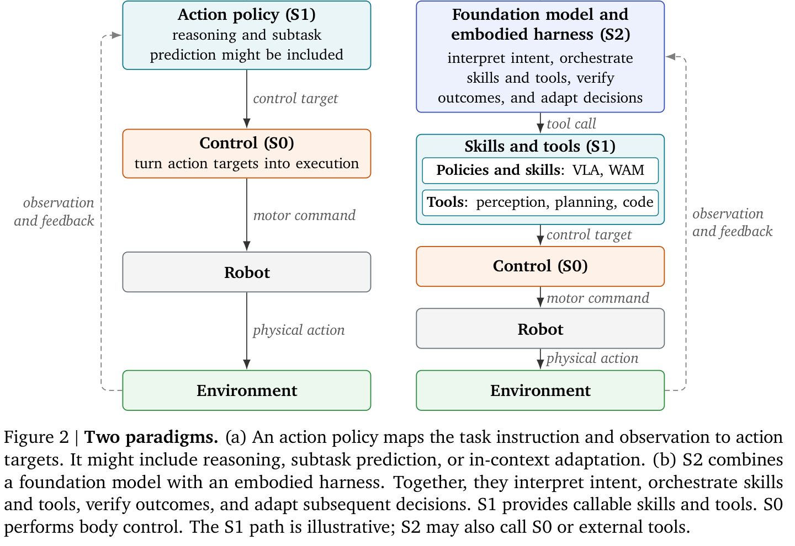
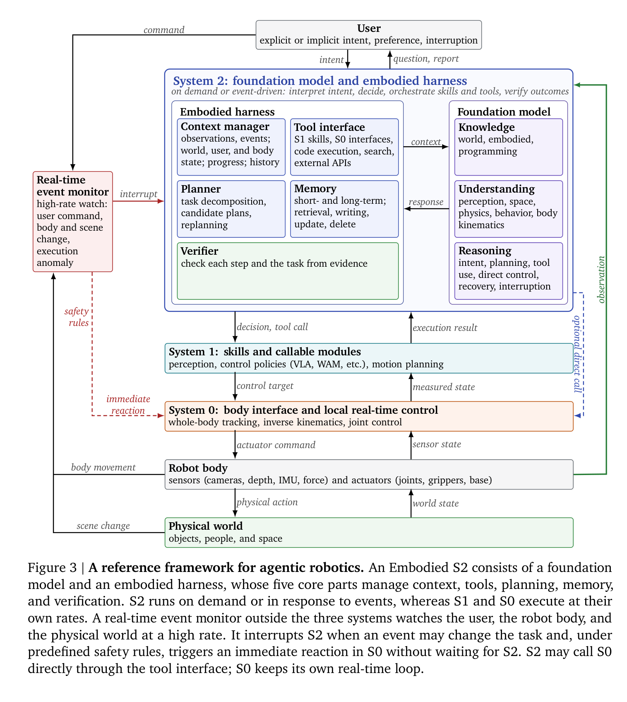
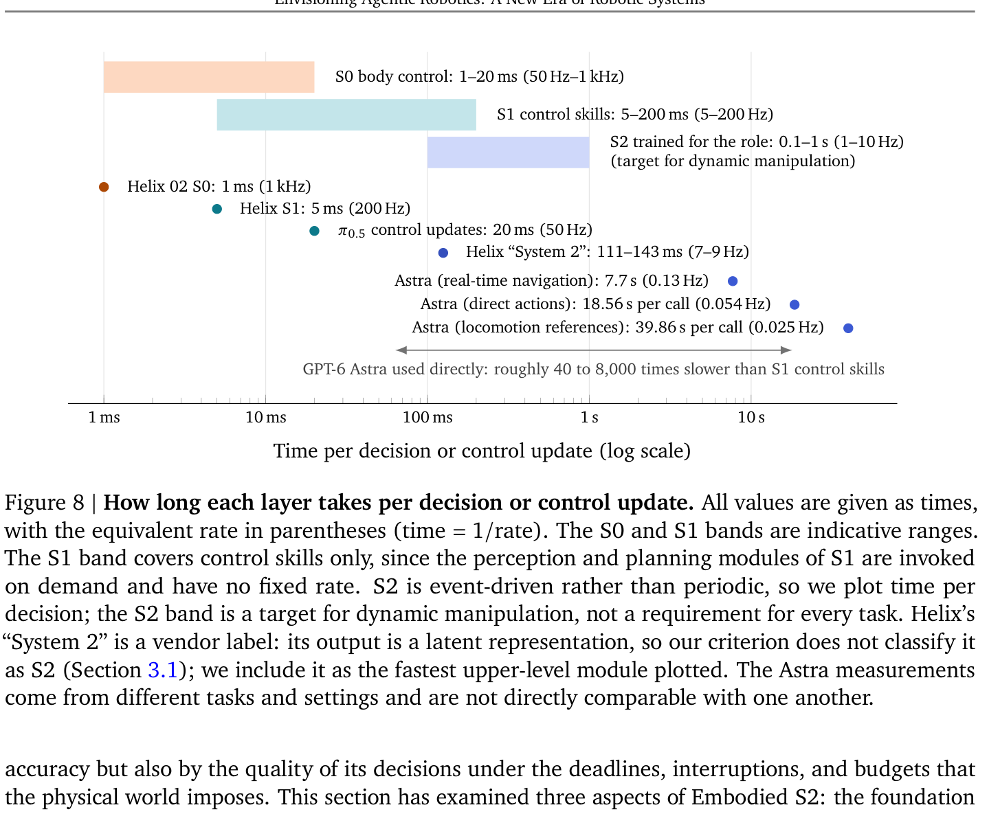
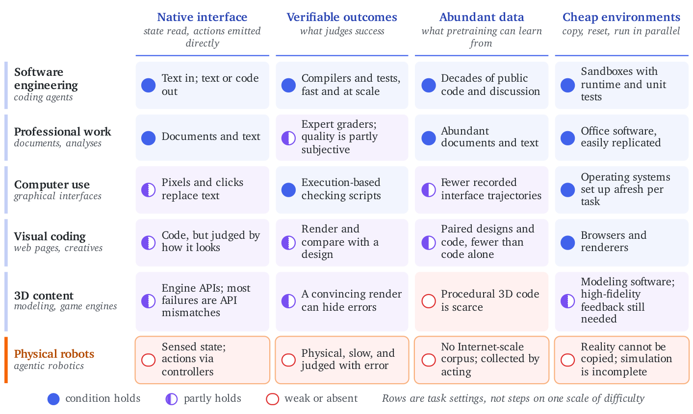
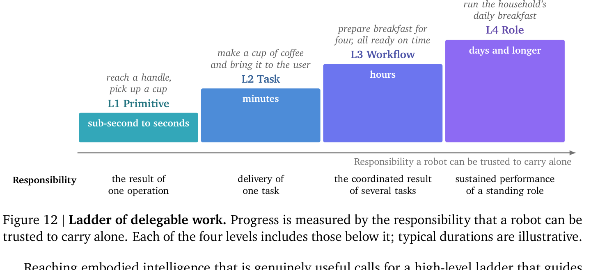

> **원문**: [arXiv](https://arxiv.org/abs/2611.18359) · [HuggingFace](https://huggingface.co/papers/2611.18359) (👍 107) · [프로젝트 페이지](https://grid-robotics-official.github.io/agentic-robotics-roadmap)
{: .prompt-info }

## 들어가며

오늘 리뷰할 논문은 HuggingFace Daily Papers에서 107 upvote를 받은 Grid Robotics의 "Envisioning Agentic Robotics: A New Era of Robotic Systems"입니다. 직접 실험 결과를 내놓는 논문이 아니라, 최근 로봇 분야에서 벌어지고 있는 소란을 정리하는 **서베이/포지션 페이퍼**입니다.

배경을 짧게 설명하면 이렇습니다. 범용 프론티어 모델인 GPT-6 Astra가 로봇 하네스(agentic harness)를 두르고 등장하자, 몇 주 만에 특정 작업용으로 학습된 전용 정책(policy)들을 여러 임베디드 벤치마크에서 따라잡거나 앞질러버렸다고 합니다. 태스크마다 정책을 새로 학습시키는 대신, 범용 모델 하나가 그때그때 필요한 스킬과 도구를 불러 쓰면서 열린 환경의 과제를 처리하는 방식, 저자들은 이걸 **agentic robotics**라고 부릅니다. 문제는 이 흐름에 다들 올라타고 있는데 정작 "agentic robotics가 정확히 뭔지", "뭘 어떻게 평가해야 공정한지"에 대한 합의가 전혀 없었다는 겁니다. 같은 RoboDojo 벤치마크에서 Astra 성공률이 하네스와 프로토콜에 따라 22%에서 85%까지 널뛰는 상황이었다고 하니, 이 정도면 숫자 자체가 거의 의미가 없는 수준이죠. 이 논문은 그 혼란에 질서를 잡아보려는 시도입니다.

참고로 "GPT-6 Astra"라는 이름이 생소하실 수 있는데, 논문이 OpenAI의 공식 발표(OpenAI, 2026a,b)를 인용하는 걸로 보아 이 글이 쓰인 시점(2026년 11월) 기준 실제 출시된 모델을 가리키는 것으로 보입니다. 다만 제가 직접 검증한 사실은 아니니 참고만 해주세요.

## 한눈에 보기

- **핵심 기여**: ① 로봇 에이전트의 의사결정 핵심을 "Embodied System 2(S2) = 파운데이션 모델 + 임베디드 하네스"로 정의하고, 어떤 컴포넌트가 S2인지 판별하는 기능적 기준을 제시 ② 모델 단위와 시스템 단위 평가를 분리하는 9차원 평가 프레임워크와 "harness card" 보고 체크리스트 제안 ③ 코딩 에이전트 같은 디지털 에이전트의 성공 원리가 물리 세계에서 왜, 어디까지 깨지는지 분석 ④ "한 동작 → 한 과제 → 한 워크플로우 → 하나의 역할"로 이어지는 4단계 책임 위임 사다리(ladder of delegable work) 제안
- **성능**: 저자들의 독자 실험이 아니라 문헌 종합이라, "이 모델이 몇 점을 받았다"보다 "그 점수들을 어떻게 읽어야 신뢰할 수 있는가"가 본문의 핵심 기여입니다.
- **한 줄 요약**: 범용 모델을 로봇에 꽂아 넣는 게 유행인데, "무엇을 S2라고 부를지", "무엇을 어떻게 재야 하는지", "다음 단계는 뭔지"를 하나의 지도로 그려낸 논문입니다.

## 어떤 문제를 풀려고 했나

로봇에게 자연어 지시를 내리고 알아서 움직이게 만드는 방법은 크게 두 갈래로 갈립니다. 하나는 기존 **policy-centric** 접근으로, 작업 지시와 관측을 입력받아 바로 행동을 출력하는 액션 정책(VLA, world-action model 등)을 학습시키는 방식입니다. 추론이나 서브태스크 예측이 포함될 수는 있지만, 결국 하나의 모델이 지시를 받아 바로 동작을 뱉습니다.

다른 하나가 이 논문이 주목하는 **agentic robotics**입니다. 파운데이션 모델과 그 주변을 감싸는 "하네스(harness)"가 짝을 이뤄서, 사용자의 의도를 해석하고, 그때그때 필요한 스킬·도구를 골라 호출하고, 결과를 확인한 뒤 다음 결정을 내리는 닫힌 루프를 돕니다. 아래 그림이 이 둘의 차이를 보여줍니다.

_Figure 2. (a) 정책 하나가 지시와 관측을 받아 바로 제어 타겟을 내는 policy-centric 구조. (b) 파운데이션 모델과 하네스가 결합한 S2가 스킬·도구(S1)를 오케스트레이션하고, S1 혹은 S0(제어)에 직접 명령을 보낼 수도 있는 agentic 구조._

왼쪽 (a)는 익숙한 구조입니다. 지시가 들어오면 정책(S1)이 바로 제어 타겟을 만들고, 그걸 Control(S0)이 모터 명령으로 바꿔 로봇을 움직입니다. 오른쪽 (b)가 이 논문이 그리는 그림인데, 맨 위에 "파운데이션 모델 + 임베디드 하네스"로 이뤄진 S2가 새로 얹힙니다. S2는 스킬과 도구(S1)를 호출할 수도 있고, 필요하면 S1을 건너뛰고 Control(S0)에 바로 명령을 보낼 수도 있습니다. 여기서 중요한 포인트는 S2가 "한 번 명령하고 끝"이 아니라, 결과를 검증하고 그 평가를 다음 결정에 반영한다는 점입니다. 바로 이 폐루프 검증·적응 구조가 agentic robotics의 본질이라는 게 저자들의 주장입니다.

문제는 이 구조를 다들 느슨하게 쓰다 보니 "System 2", "임베디드 브레인", "오케스트레이터" 같은 용어가 논문마다 다르게 쓰이고, 평가 결과도 서로 비교가 안 된다는 점입니다. 저자들은 이걸 바로잡기 위해 S2를 명시적으로 정의하고, 평가 원칙을 세우고, 현재 어디까지 왔는지와 앞으로 뭘 해야 하는지를 정리합니다.

## 핵심 아이디어

### S2/S1/S0 참조 아키텍처

논문의 뼈대는 로봇 시스템을 세 기능 계층으로 나누는 것입니다. **S2**는 의도를 해석하고 목표·제약을 추론해 결정하고, 스킬과 도구를 오케스트레이션하며, 결과를 검증해 다음 결정에 반영하는 계층입니다. **S1**은 S2가 호출하는 스킬과 콜러블 모듈(지각, 제어 정책, 모션 플래닝)을 제공하고, **S0**은 로봇 몸체 인터페이스와 실시간 제어를 담당합니다. 아래 그림이 전체 그림입니다.

_Figure 3. Embodied S2(파운데이션 모델 + 임베디드 하네스)가 S1(스킬·도구)과 S0(몸체 제어)을 감싸고, 실시간 이벤트 모니터가 사용자·몸체·물리 세계를 고주파로 감시하다가 필요할 때 S2를 인터럽트하거나 S0에 즉각 반응을 넣는 구조._

재미있는 부분은 S2를 "모델"이 아니라 "모델 + 하네스"로 정의했다는 점입니다. 저자들이 꼽은 하네스의 다섯 가지 핵심 부품은 ① 관측·진행상황·이력을 정리하는 **컨텍스트 매니저**, ② S1 스킬과 S0 인터페이스를 모델에 노출하는 **툴 인터페이스**, ③ 과제를 분해하고 재계획하는 **플래너**, ④ 컨텍스트 창 너머의 정보를 저장·검색하는 **메모리**, ⑤ 각 단계와 과제 전체의 성공 여부를 증거로 판단하는 **버리파이어**입니다. 그리고 왼쪽의 **실시간 이벤트 모니터**가 따로 떠서 사용자 명령, 몸체 충돌, 장면 변화 같은 걸 고주파로 감시하다가, S2가 응답할 시간이 없을 때는 안전 규칙에 따라 S0에 즉시 개입합니다(그림에서 빨간 점선 "immediate reaction" 경로). 개인적으로 이 모니터를 S2와 분리해둔 설계가 마음에 들었습니다 — 모델이 느리거나 멈춰도 안전 정지만큼은 모델 판단에 기대지 않겠다는 뜻이니까요.

S2가 S1·S0에 명령을 전달하는 경로는 하나가 아니라 세 가지입니다: S1을 거치는 **layered orchestration**, S1을 건너뛰고 S0에 바로 명령을 보내는 **direct control**, S2가 코드를 짜서 런타임이 실행하게 하는 **code as policy**. 한 태스크 안에서 이 세 경로를 섞어 써도 된다고 합니다.

### "이게 S2인가?"를 가르는 기준

흥미로웠던 대목은 저자들이 "S2라는 라벨이 아니라 기능으로 판별하자"고 못박은 부분입니다. 어떤 컴포넌트가 S2로 인정받으려면 두 종류의 결정을 **외부에서 식별 가능하게** 내려야 합니다: (i) 다음에 뭘 할지 결정하기(서브골·스킬·도구 선택, 혹은 계속/재시도/재계획/중단 결정), (ii) 결과에 대해 판단하기(이전 단계나 과제 전체가 목표를 달성했는지 증거로 판단). 둘 중 하나만 하면 S2가 아닙니다. 예를 들어 스킬 순서만 정하고 결과를 확인하지 않는 플래너는 오케스트레이션은 하지만 검증은 안 하는 반쪽짜리고, 관측 점수만 매기는 성공 탐지기는 그 점수가 뭘 의미하는지 정하지 않으므로 둘 다 안 합니다.

경계 사례도 짚어주는데, Helix나 GR00T N1처럼 상위 모듈이 latent representation만 내보내는 dual-system VLA는 "그 출력이 읽히지 않으니" 기본적으로 S2로 분류하지 않는다고 합니다(교체 실험으로 반증되지 않는 한). 반대로 $\pi_{0.5}$처럼 서브태스크를 먼저 뱉고 그다음 행동을 내는 모델은, 그 서브태스크 단계가 식별 가능한 결정이므로 S1과 가중치를 공유하더라도 그 부분만큼은 S2로 인정합니다. 결정 빈도나 출력의 세밀함(그래뉼래러티)은 기준에 들어가지 않는다는 점도 분명히 하는데, 느리게 생각하는 프론티어 모델도, 초당 한 번 결정하는 전용 모델도 두 조건만 만족하면 다 S2라는 겁니다.

### 속도의 벽: capped scaling

제가 이 논문에서 가장 인상 깊게 읽은 대목입니다. 디지털 세계의 프론티어 모델은 추론 토큰을 더 쓸수록 답이 좋아지는 **monotonic scaling** 체제를 따릅니다. 그런데 로봇은 그럴 수가 없습니다. 물리 세계에는 데드라인이 있으니까요 — 컵이 미끄러지기 전에, 접시가 떨어지기 전에 결정이 도착해야 의미가 있습니다. 저자들은 이걸 **capped scaling**이라고 부르는데, "더 오래 생각해서 더 똑똑해지기"가 아니라 "정해진 시간 안에서 더 똑똑해지기"가 목표가 되어야 한다는 뜻입니다.

이 격차가 실제로 얼마나 큰지 보여주는 그림이 있습니다.

_Figure 8. S0(몸체 제어, 50Hz~1kHz)·S1(제어 스킬, 5~200Hz)과 비교했을 때, GPT-6 Astra를 S2로 직접 쓰면 결정 하나에 최대 40초 가까이 걸린다._

가로축이 로그 스케일의 '결정 하나당 걸리는 시간'입니다. 왼쪽 끝 주황색 S0 제어 루프는 1~20ms, 청록색 S1 제어 스킬은 5~200ms 구간에 몰려 있습니다. 그런데 오른쪽 끝을 보면 Astra를 S2로 직접 써서 행동을 내보낼 때 호출당 18.56초, 보행 참조를 생성할 때는 호출당 39.86초가 걸렸다고 합니다. 그래프 아래 화살표에 적힌 "**S1 제어 스킬보다 40배에서 8000배 느리다**"는 문구가 이 간극을 압축해서 보여줍니다. 더 불편한 건, 월드가 멈추지 않고 계속 흘러가는 "라이브" 환경(RT-Safe 벤치마크)에서는 지연이 길수록 충돌이 더 자주 일어났다는 점입니다 — 즉 레이턴시가 그냥 불편함이 아니라 안전 변수가 된다는 거죠. 이 부분을 읽으면서 "시뮬레이터를 멈춰놓고 잰 성공률"이 얼마나 많은 걸 숨기고 있는지 새삼 느꼈습니다.

### 디지털 에이전트가 성공한 이유, 그게 로봇에서 무너지는 이유

이 논문의 또 다른 축은 "코딩 에이전트 같은 디지털 에이전트의 성공 공식을 로봇에 그대로 베낄 수 없는 이유"를 짚는 섹션입니다. 저자들은 디지털 에이전트가 덕을 본 네 가지 조건을 꼽습니다: 상태를 직접 읽고 쓸 수 있는 **네이티브 인터페이스**, 컴파일러·테스트로 빠르게 결과를 확인하는 **검증 가능한 결과**, 수십 년 치 공개 코드라는 **풍부한 데이터**, 복제·리셋·병렬 실행이 가능한 **값싼 환경**.

_Figure 9. 소프트웨어 엔지니어링에서는 네 조건이 모두 충족(파란 점)되지만, 오른쪽 아래 물리 로봇으로 갈수록 네 조건이 전부 약하거나 없음(빈 원)으로 바뀝니다._

이 표를 보면 흐름이 한눈에 들어옵니다. 소프트웨어 엔지니어링 행은 네 칸 모두 꽉 찬 파란 점이고, 컴퓨터 사용이나 3D 콘텐츠로 갈수록 반쯤 채워진 점(부분적으로만 성립)이 늘어나다가, 맨 아래 물리 로봇 행에 가면 네 칸 모두 비어있는 원(약하거나 없음)으로 바뀝니다. 즉 로봇은 이 네 조건을 "동시에, 전부" 잃는 유일한 도메인이라는 겁니다. 카메라로는 안 보이는 질량·마찰·접촉력, 느리고 재현하기 어려운 물리적 검증, 인터넷 스케일 데이터가 없는 조작(manipulation) 데이터, 완벽하게 복제되지 않는 시뮬레이터 — 이 네 가지를 다 다시 만들어야 한다는 게 저자들의 결론입니다. 거기에 더해 디지털 세계에는 없는 세 가지 제약도 추가됩니다: 숙고는 공짜가 아니고(로봇이 1분 고민하는 사이 장면이 바뀜), 실수는 되돌릴 수 없고(버전 관리 같은 게 없음), 몸은 가만히 있지 않습니다(모터가 과열되면 같은 명령도 다르게 반응).

다만 저자들이 흥미롭게 구분한 지점은, "원리"는 살아남는다는 겁니다. 증거에 기반해 루프를 닫기, 도구를 계약(contract)으로 다루기, 컨텍스트를 명시적으로 관리하고 지속 상태는 바깥에 두기, 수행과 판단을 분리하기, 능력을 재사용 가능한 스킬로 패키징하기 — 이 다섯 원칙은 Anthropic 등 디지털 에이전트 설계 문헌에서 그대로 가져와서 로봇 하네스에도 적용하고 있습니다. 즉 "로봇은 완전히 다른 게임"이 아니라 "같은 원칙을, 조건이 훨씬 나쁜 바닥에서" 다시 구현해야 한다는 입장입니다.

### 관측의 '나이'를 재자: 평가 프레임워크의 한 조각

평가 섹션은 아홉 가지 측정 차원과 "어떻게 재야 공정한가"에 대한 10가지 원칙으로 이뤄져 있는데, 그중 제가 가장 실용적이라고 느낀 건 **관측 나이(observation age)**라는 개념입니다.

$$\Delta t_{\mathrm{obs}} = t_{\mathrm{effect}} - t_{\mathrm{capture}}$$

여기서 $t_{\mathrm{capture}}$는 결정의 근거가 된 관측이 찍힌 시각이고, $t_{\mathrm{effect}}$는 그 결정에 따른 행동이 실제로 효과를 내는 시각입니다.

이 값이 왜 중요하냐면, 모델 추론 레이턴시만 재면 지각·통신·큐잉·실행 지연을 다 놓치기 때문입니다. 즉 "모델이 1초 만에 답했다"와 "그 답의 근거가 된 관측이 사실은 3초 전 장면이었다"는 완전히 다른 이야기입니다. 센서·연산·액추에이터가 서로 다른 장치에서 돌아간다면 이 시계들을 반드시 동기화해서 재야 한다고 강조하는데, 실무적으로 아주 당연하지만 막상 많은 평가에서 빠뜨리기 쉬운 지점이라고 생각합니다.

이 외에도 평가 원칙 중 눈에 띄는 것들만 꼽아보면: "월드 시계로 돌려라(world clock)" — 시뮬레이터를 멈춰놓고 재면 완전히 다른 능력을 측정하는 것이다, "완료를 독립적으로 검증하라" — 에이전트 스스로의 성공 선언이나 툴 리턴을 증거로 받아들이지 말아라(RoboDojo에서 툴 리턴이 성공을 더 이상 알려주지 않게 바꾸자 두 시스템의 평균 점수가 83.2→63.5, 42.0→26.1로 떨어졌다고 합니다), "예산을 통제하고 스윕하라" — 추론 노력을 medium에서 extra-high로 올려도 성공률이 72.7%→74.5%로 겨우 오르는데 레이턴시는 2.6배, 비용은 2.2배 뛴 사례(Astranomy)를 들면서, 더 생각한다고 꼭 더 잘하는 게 아니라는 걸 숫자로 보여줍니다.

### 책임의 사다리: L1에서 L4로

마지막 핵심 아이디어는 "로봇에게 얼마나 믿고 맡길 수 있는가"를 측정하는 4단계 사다리입니다.

_Figure 12. L1(한 동작, 초 단위)부터 L4(하나의 역할, 일 단위 이상)까지, 각 단계가 아래 단계를 포함하며 로봇이 혼자 책임질 수 있는 범위가 넓어집니다._

**L1 Primitive**는 컵을 집는 것 같은 단일 동작 하나를 수행하고 결과를 확인하는 수준, **L2 Task**는 커피를 내려서 갖다주는 것처럼 완결된 과제 하나를 끝내는 수준(S2가 목표를 분해하고 모니터링하고 실패에 대응), **L3 Workflow**는 4인분 아침식사를 제시간에 준비하는 것처럼 서로 얽힌 과제 여러 개를 조율하는 수준, **L4 Role**은 매일 아침식사를 가족 일정에 맞춰 알아서 챙기는 것처럼 하나의 워크플로우가 끝난 뒤에도 계속되는 책임을 지는 수준입니다.

그리고 저자들은 현재 위치를 꽤 솔직하게 평가합니다. L1·L2는 꽤 올라왔다고 봅니다(Sunday사는 낯선 집에서도 빨래 개기 99.1% 성공을 보고했고, Dyna Robotics는 전에 본 적 없는 배포 현장에서 87% 고객 인수 기준 통과율을 보고). L3는 이제 막 첫 사례가 나오는 수준(한 시간짜리 세탁실 워크플로우 데모 정도)이고, **L4는 "사람의 수리 없이 역할을 유지한 비정형 환경 로봇 시스템 사례를 아직 본 적이 없다"**고 명시적으로 밝힙니다. 17일간 돌아간 자율 소재실험실 사례가 있긴 한데, 이건 구조화된 환경이고 나중에 "그 발견의 참신성 자체가 논쟁거리였다"는 각주까지 달아둡니다. 야심찬 사다리를 세워놓고 맨 위 칸이 거의 비어있다고 스스로 인정하는 서술 방식이 오히려 신뢰가 갔습니다.

## 실험 결과: 지금 숫자들을 어떻게 읽어야 하나

앞서 말했듯 이 논문 자체는 실험을 하지 않고, 2026년 10월 전후로 쏟아진 선행 연구들의 결과를 한데 모아 정리합니다. 아래는 논문의 Table 8을 그대로 옮긴 것입니다 (저자들이 직접 재현한 게 아니라 "발표된 그대로" 인용한 것이라는 점, 그리고 설정이 제각각이라 행 간 비교는 불가능하다는 점을 저자들도 명시하고 있습니다).

| 벤치마크 | S2 파운데이션 모델 | S1 구성요소 | 비교 결과 |
|---|---|---|---|
| **좁은 시뮬레이션 스위트에서는 학습된 정책과 경쟁** | | | |
| RoboDojo-Sim | GPT-6 Astra | 없음 | 22.48%, 당시 공개된 정책 40개 전부보다 높음 |
| RoboDojo-Sim (공식 평가) | GPT-6 Astra | 에이전트가 직접 짠 도구(대부분 태스크 특화) | 46.9%, 발표 당시 리더보드 1위 |
| RoboLab-120 | GPT-6 Astra (direct / agentic) | 없음 | 66.3% / 74.8%, 최고 학습 정책은 51.0% |
| LIBERO-PRO | GPT-6 Astra | 모션 프리미티브·세그멘테이션·$\pi_{0.5}$를 코드로 조합 | 94.0%, $\pi_{0.5}$ 단독은 53.0%(평가 설정 다름) |
| RoboMME | GPT-6 Astra | 없음 | 92.1%, 리더보드 최고 기록은 60.8% |
| LADDER | GPT-6 Astra | 없음 | 62.0%, 학습된 정책 시스템은 최대 29.6% |
| **넓거나 탐색적인 벤치마크에서는 아직 한참 부족** | | | |
| RobotWorld | GPT-6 Astra | 없음 | 19.0%, 63개 과제는 5개 모델 전부 실패 |
| RoboQuest | GPT-6 Astra | 없음 | 23.2%, 파인튜닝된 $\pi_{0.5}$는 거의 항상 실패 |
| HumanCLAW | 9개 VLM 중 최고 | 걷기·돌기·계단 오르기 등 전신 스킬 | 16.8%, 실패 원인 대부분은 자기 몸 상태를 놓침 |
| **인터페이스·실시간 실행·물리적 행동에 민감** | | | |
| EmbodiedSkillBench | GPT-6 Astra | 없음 / 선택된 스킬만 / 온디맨드 스킬 | 92% / 61% / 85% — 인터페이스가 모델 성능의 상한을 깎을 수 있음 |
| RT-Safe (어려운 경로) | VLM 8종 | 없음 | 안전 성공률 19.8%(일시정지) vs 0.7%(실시간), 충돌은 12.3배 증가 |
| RoboHarm (실물 로봇) | 프론티어 모델 6종 | 없음 | 거부율 72%(텍스트) vs 18%(로봇), 텍스트의 안전 거부가 행동으로는 일부만 이전 |

표를 쭉 보면 숫자 나열보다 **패턴**이 먼저 보입니다. 첫 번째 그룹은 전부 '좁은' 시뮬레이션 스위트이고, 같은 모델이 두 번째 그룹의 '넓은' 벤치마크로 가면 성공률이 뚝 떨어집니다. 즉 지금 쏟아지는 고득점 뉴스는 과제 범위가 좁게 설계된 무대에서 나온 것이고, 탐색이나 도메인 전환이 필요해지는 순간 다시 바닥을 긴다는 뜻입니다. 세 번째 그룹은 더 불편한데, EmbodiedSkillBench 행에서 Astra가 "스킬만 쓰게 강제"당하면 92%에서 61%로 떨어지는 걸 보면 — 도구를 쥐여준다고 늘 좋은 게 아니라, 모델이 이미 더 잘할 수 있는 일에 괜히 제약을 걸면 오히려 손해라는 걸 보여줍니다. RT-Safe와 RoboHarm 행은 "실험실에서 잰 안전·성공 지표가 실제 조건에서는 그대로 안 통한다"는 걸 같은 방향으로 가리키고 있고요.

## 아쉬운 점 / 의문점

몇 가지 걸리는 부분이 있었습니다.

먼저 이 논문은 본질적으로 **서베이+포지션 페이퍼**라서, 저자들이 제안한 "harness card"(모델·버전·추론 예산·하네스 버전·관측 계약·시간 의미론·반복 횟수·개입률을 전부 보고하라는 체크리스트) 자체는 설득력이 있지만, 이걸 커뮤니티가 실제로 채택할 유인이 뭔지는 논문에 나와 있지 않습니다. 같은 모델이라도 하네스·프로토콜 차이로 성공률이 9~52%p씩 흔들린다는 걸 보여준 바로 그 논문이, 정작 그 혼란을 바로잡을 강제력은 갖고 있지 않다는 점이 아이러니했습니다.

둘째, L4(Role) 레벨에 대한 근거가 사실상 전무하다는 걸 저자들 스스로 인정했는데도, 사다리 전체를 "미래로 가는 로드맵"으로 제시하는 구성이 다소 낙관적으로 느껴졌습니다. L1·L2는 실제 배포 사례(Sunday, Dyna Robotics)가 있지만 L3는 데모 하나, L4는 전무한 상황에서 사다리의 '칸 간격'이 실제로 비슷한 난이도인지, 아니면 L3→L4 사이에 질적으로 전혀 다른 벽이 있는 건지는 이 논문만으로는 판단하기 어렵습니다. 여담이지만, 가정에서 매일 아침을 챙기는 L4 로봇이 나오기까지 얼마나 걸릴지는 각자 상상에 맡겨야 할 것 같습니다.

셋째, Table 8의 수치들이 전부 "저자들이 재현하지 않은, 발표된 그대로의" 결과라는 점은 논문도 명시하고 있지만, 그럼에도 이 숫자들을 조합해서 "좁은 벤치마크 경쟁력 vs 넓은 벤치마크 한계"라는 내러티브를 그리는 건 살짝 사후적(post-hoc)인 느낌도 들었습니다. 다른 조합으로 다른 내러티브도 충분히 만들 수 있었을 것 같거든요. 다만 이건 애초에 메타 분석이 가지는 한계이기도 해서, 논문의 결함이라기보다는 이 장르 자체의 한계로 보는 게 맞을 것 같습니다.

## 마치며

솔직히 처음엔 "또 하나의 포지션 페이퍼인가" 하는 마음으로 열었는데, S2 판별 기준이나 capped scaling, 관측 나이 같은 개념은 생각보다 뾰족하고 실무적이었습니다. 특히 "디지털 에이전트의 원칙은 살아남지만 그 원칙이 기댔던 조건은 다 무너진다"는 프레이밍은, 로봇이 아니라 다른 영역의 에이전트를 설계할 때도 한 번쯤 적용해볼 만한 사고방식이라고 생각합니다. 어떤 작업이 "검증 가능한 결과"와 "값싼 재시도 환경"을 갖고 있는지 체크해보면, 그 작업에 에이전트형 접근이 먹힐지 아닐지 미리 가늠할 수 있을 것 같거든요.

다음에 지켜볼 지점은 L3(워크플로우) 레벨 벤치마크가 실제로 얼마나 빨리 등장하는가입니다. 이 논문이 지적한 대로 지금 벤치마크 대부분이 한 워크셀 안의 단일 에피소드에 몰려 있는데, 만약 몇 달 안에 건물·사이트 스케일에 며칠짜리 책임을 지우는 벤치마크가 나온다면 그게 agentic robotics가 다음 단계로 넘어가는 신호일 것 같습니다.
