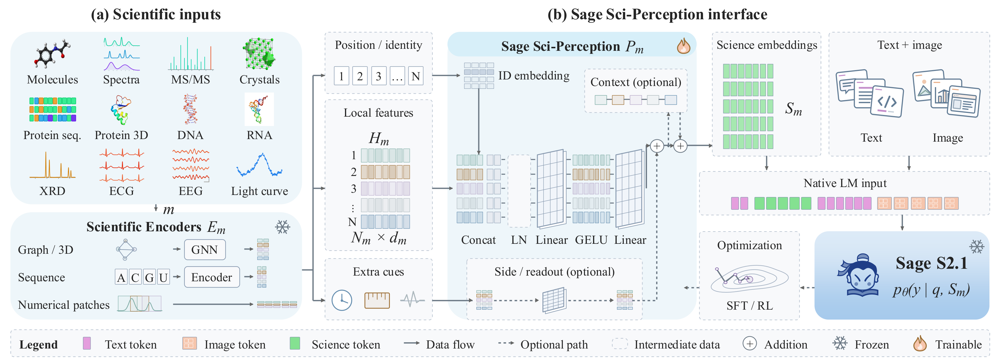
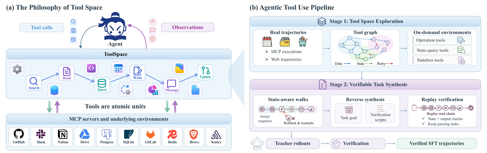
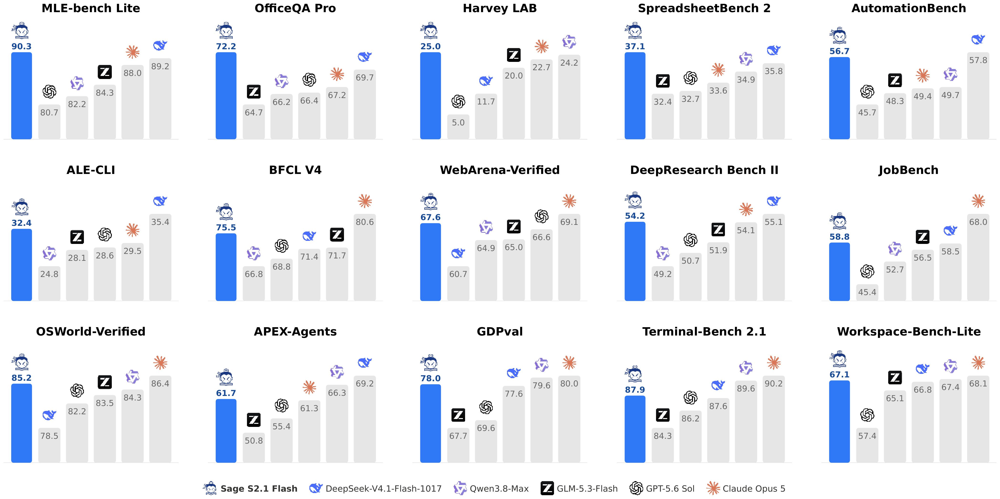
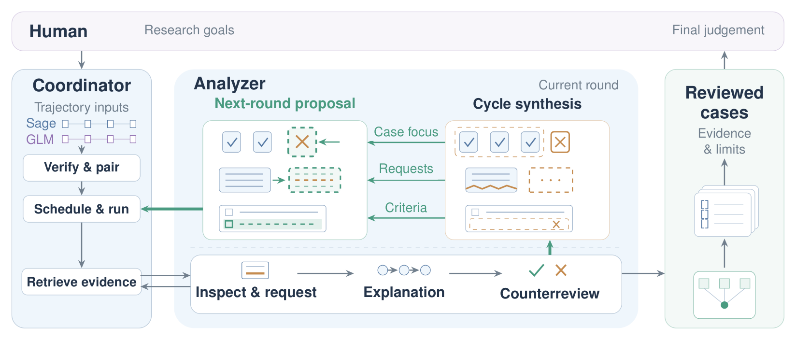
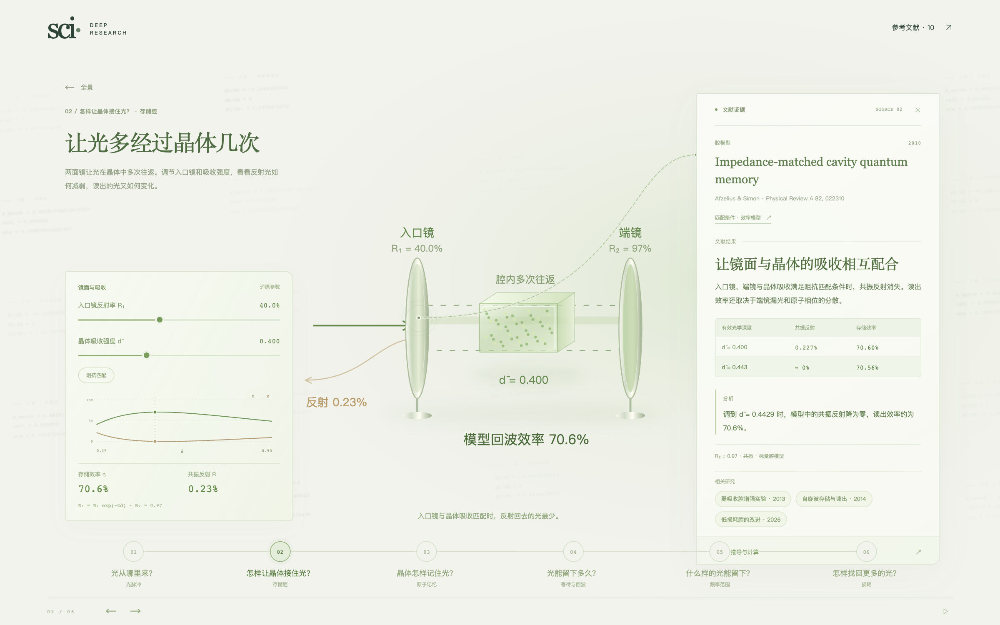

> **원문**: [arXiv](https://arxiv.org/abs/2611.21072) · [HuggingFace](https://huggingface.co/papers/2611.21072) (👍 85) · [GitHub](https://github.com/InternLM/Sage-S2.1-Flash)
{: .prompt-info }

## 들어가며

오늘 리뷰할 논문은 HuggingFace Daily Papers에서 85 upvote를 받은 Shanghai AI Laboratory(InternLM 팀) 등 8개 기관 공동 저자의 "Sage S2.1 Flash Technical Report"입니다. 320B 파라미터짜리 MoE(mixture-of-experts) 모델 한 개가 분자 그래프, 단백질·DNA·RNA 서열, 스펙트럼 같은 과학 데이터를 읽는 동시에 데스크톱 화면을 보고 마우스를 클릭하는 컴퓨터 사용 에이전트(computer-use agent) 역할까지 겸한다는 게 핵심입니다. "과학 논문을 읽고 실험을 설계하는 AI"와 "브라우저를 조작하는 AI"를 별개 모델로 만들지 않고 하나의 백본에 욱여넣었다는 점이 눈길을 끌었습니다.

여담이지만 재미있는 점을 하나 발견했는데, HuggingFace Daily Papers에 올라온 초록 요약은 "We introduce Sage **S1.5** Flash..."로 시작합니다. 반면 실제 논문 본문과 제목은 일관되게 "Sage **S2.1** Flash"를 씁니다. 아마 arXiv에 초기 버전을 올린 뒤 모델 이름을 바꿨는데 HuggingFace가 그 이전 버전 초록을 캐싱한 것으로 보입니다. 본 리뷰는 실제 본문(LaTeX 원본)을 기준으로 "Sage S2.1 Flash"로 통일해서 씁니다.

이 모델은 바닥부터 새로 학습한 게 아니라 Zhipu의 GLM-5.3-Flash를 백본으로 가져다 쓴 320B MoE라고 밝히고 있습니다. 즉 이 보고서의 진짜 기여는 "새 언어모델"이 아니라, 기존 강력한 백본 위에 ① 과학 데이터를 읽는 인터페이스(Sage Sci-Perception)와 ② 광범위한 verifiable 환경에서의 에이전트 후속 학습을 얹은 "개조 공정"에 있습니다.

## 한눈에 보기

- **핵심 기여**: ① 분자·단백질·DNA/RNA·스펙트럼을 전용 인코더 + 수치 패칭으로 처리해 언어모델 입력 공간에 투영하는 통합 인터페이스 Sage Sci-Perception ② 실행 결과·환경 상태·제출물로 검증 가능한 대규모 에이전트 환경을 도구 사용·검색·코딩·ML 실험·과학 소프트웨어 전반에 걸쳐 구축 ③ 실제 실행 트레이스에서 도구 조합 그래프를 복원해 긴 호흡의 도구 오케스트레이션 데이터를 합성하는 ToolSpace ④ 과학 인터페이스만 떼어내 GRPO로 추가 강화학습하는 2단계 적응
- **성능**: 5개 주요 베이스라인(GLM-5.3-Flash, DeepSeek-V4.1-Flash-1017, Qwen3.8-Max, GPT-5.6 Sol, Claude Opus 5) 대비 33개 벤치마크 중 OfficeQA Pro(72.2), MLE-bench Lite(90.3 HumanRank), Harvey LAB(25.0), SpreadsheetBench 2(37.1)에서 1위, OSWorld-Verified·WebArena-Verified·DeepResearch Bench II에서 2위를 기록했습니다.
- **한 줄 요약**: "과학 데이터를 읽는 눈"과 "컴퓨터를 조작하는 손"을 같은 백본에 붙이고, 그 사이를 검증 가능한 에이전트 환경으로 채운 기술 보고서입니다.

## 어떤 문제를 풀려고 했나

저자들이 짚은 문제의식은 이렇습니다. 과학 연구는 분자 구조, 유전 서열, 실험 스펙트럼처럼 텍스트가 아닌 형태의 증거를 다루는 일이 많은데, 정작 이런 증거를 "읽고" 그 위에서 코드를 짜고 소프트웨어를 조작하는 일은 각각 따로 노는 경우가 많다고 합니다. 과학 전용 모델은 도메인 인코더는 잘 쓰지만 범용 에이전트처럼 도구를 오케스트레이션하지 못하고, 반대로 범용 에이전트 모델은 분자 그래프나 단백질 서열을 애초에 입력으로 받을 방법이 없습니다.

그래서 이 논문은 "과학적 증거를 사용하는 것"과 "도구를 써서 행동하는 것"을 같은 토대 위에 놓으려고 합니다. 과학 소프트웨어(3D Slicer, Fiji, EEGLAB, QGIS 같은)를 다루려면 결국 화면을 보고 클릭하는 일반적인 컴퓨터 사용 능력이 필요하고, 그 화면에 뜨는 내용은 또 과학적으로 해석해야 하니, 두 능력을 분리하기보다 묶어서 학습시키는 쪽이 낫다는 판단으로 보입니다.

## 핵심 아이디어

### Sage Sci-Perception: 과학 데이터를 토큰처럼 만들기

다음은 Sage Sci-Perception의 구조를 보여주는 그림입니다.

_Figure 3. (a) 분자·결정·단백질·DNA/RNA·스펙트럼 같은 입력을 과학 인코더가 지역 상태로 바꾸고, (b) 모달리티별 프로젝터가 이를 언어모델 임베딩 공간으로 투영한다_

왼쪽 (a)를 보면 분자는 GNN류 그래프 인코더로, 서열(단백질/DNA/RNA)은 전용 서열 인코더(ESM-2, DNABERT-2, RNA-FM)로, 스펙트럼처럼 숫자가 나열된 신호는 "수치 패칭(numerical patching)"이라는 방식으로 처리합니다. 수치 패칭은 특별한 신경망이 아니라 스펙트럼을 일정 구간(window)으로 잘라서 각 구간을 하나의 "패치"로 취급하는 결정적(deterministic) 절차라는 점이 흥미롭습니다. 이미지 모델에서 쓰는 패치 임베딩을 숫자 신호에 그대로 적용한 셈이죠.

이렇게 얻은 지역 표현을 식으로 쓰면 다음과 같습니다.

$$H_m = E_m(x_m) \in \mathbb{R}^{N_m \times d_m}$$

여기서 $E_m$은 모달리티 $m$을 위한 과학 인코더(또는 수치 패칭 절차)이고, $N_m$은 분자의 원자 수나 서열의 길이 같은 "지역 상태의 개수", $d_m$은 각 지역 상태의 특징 차원입니다.

눈여겨볼 부분은 이 단계에서 각 지역 상태의 **정체성과 위치를 그대로 보존**한다는 점입니다. 저자들은 "단백질 상호작용 부위를 묻는 질문에 답하려면 예측을 특정 잔기(residue) 위치와 연결할 수 있어야 한다"는 예시를 듭니다. 이 정체성 정보는 (b)의 "Position / identity" 입력으로 다시 들어가, ID 임베딩을 통해 프로젝터에 전달됩니다.

다음은 프로젝터의 핵심 변환입니다.

$$z_{m,i} = f_m\!\left([\,h_{m,i}\,;\,e_m(i)\,]\right)$$

$h_{m,i}$는 $H_m$의 한 행(원자 하나, 잔기 하나, 혹은 스펙트럼 패치 하나의 특징), $e_m(i)$는 그 위치의 식별 임베딩이고, $[\,\cdot\,;\,\cdot\,]$은 두 벡터를 이어붙이는 concatenation입니다. $f_m$은 LayerNorm → Linear → GELU → Linear로 이어지는 단순한 2층 MLP입니다.

의미를 풀어보면, 모델은 "이 특징이 무엇인가"(지역 특징 $h_{m,i}$)와 "이게 어디에 있는가"(식별 임베딩 $e_m(i)$)를 한꺼번에 받아서 언어모델이 쓸 수 있는 벡터로 바꿉니다. 그림 (b)의 "Context (optional)" 잔차 경로는 같은 분자/서열에 속한 다른 상태들끼리 정보를 섞어주는 역할인데, 이 선택적 경로가 켜져 있으면 지역 정보뿐 아니라 "같은 분자 안에서 이 원자 주변이 어떻게 생겼는가"도 함께 반영됩니다.

최종적으로 완성된 투영은 다음과 같이 쓸 수 있습니다.

$$S_m = P_m(H_m, I_m, A_m) \in \mathbb{R}^{N_m \times d_{\mathrm{LM}}}$$

$I_m$은 지역 식별자, $A_m$은 시간·스케일 같은 추가 측정값이고, $d_{\mathrm{LM}}$은 백본의 임베딩 차원입니다. 결국 $S_m$은 텍스트 토큰·이미지 토큰과 차원이 같은 "과학 토큰"이 되어, 같은 attention 레이어 안에서 텍스트·이미지와 뒤섞여 처리됩니다. 개인적으로는 이 설계가 그리 새로운 아이디어는 아니라고 생각합니다. LLaVA류의 비전-언어 프로젝터를 과학 모달리티로 확장한 것에 가깝고, 저자들도 이를 명시적으로 인용하고 있습니다(Liu et al., 2023). 다만 "식별 임베딩을 꼭 붙여서 위치 정보를 보존한다"는 선택과, 이 전체 인터페이스를 뒤에서 설명할 RL로 한 번 더 다듬는다는 점이 이 논문만의 포인트입니다.

### ToolSpace: 도구 사용을 "그래프 탐험"으로 바꾸기

에이전트 능력을 키우려면 결국 검증 가능한 학습 환경이 많이 필요한데, 저자들은 "도구가 에이전트 능력의 원자 단위"라는 통찰에서 출발해 ToolSpace라는 프레임워크를 제안합니다.

_Figure 4. (a) 실제 MCP 서버·웹 트레이스에서 도구 호출 패턴을 모아 하나의 "도구 공간"으로 묶고, (b) 이를 이용해 상태 인식 랜덤워크로 긴 호흡의 작업을 만든 뒤 역방향 합성으로 검증 스크립트까지 생성한다

오른쪽 (b) 파이프라인을 보면 두 단계로 나뉩니다. 1단계(Tool Space Exploration)는 GitHub, Slack, Notion, Drive, Postgres, Redis 같은 실제 MCP 서버 실행 기록과 웹 트레이스를 모아 도구 호출 패턴을 노드로, 데이터 의존성·상태 의존성·재시도 의존성을 엣지로 하는 그래프를 만듭니다. 여기서 "데이터 의존성"은 한 도구의 출력이 다른 도구의 입력으로 들어가는 관계, "상태 의존성"은 같은 객체에 대한 상태 변경 작업들의 순서 관계, "재시도 의존성"은 실패 후 대안 도구로 복구하는 관계를 뜻합니다. 저자들은 저빈도 엣지를 쳐내고 데이터 의존성은 실제 값 전달 흔적이 있을 때만 인정해서, 단순히 같은 상수를 썼다는 이유만으로 생기는 가짜 연결을 걸러냅니다.

2단계(Verifiable Task Synthesis)는 이 그래프 위에서 "상태 인식 랜덤워크"로 도구 호출 순서를 생성하고, 실패하면 직전 상태로 롤백해서 다른 도구를 시도합니다(rollback sampling). 완성된 워크플로우는 거꾸로 "이 결과를 만들려면 어떤 작업 지시문이어야 하는가"를 역산해서 자연어 과제와 검증 스크립트를 동시에 만들어내는데, 이게 "reverse verifiable task synthesis"입니다. 생성된 과제는 반드시 초기 상태에서 재생(replay)이 통과해야 살아남습니다.

규모를 보면 77,760개의 도구 호출 패턴 노드, 2,042개의 정규화된 도구, 804개의 환경을 구성했고, 생성된 SFT 트레이스는 평균 18.86회의 도구 호출(최대 209회), 평균 2.29개 환경(최대 22개)에 걸쳐 있다고 합니다. 숫자만 보면 상당히 공격적인 스케일인데, 이 수치들이 전부 저자들 자체 집계라 외부에서 검증할 방법은 없다는 점은 감안해야 할 것 같습니다.

### 나머지 후속 학습 파이프라인

Agentic Search는 지식 그래프에서 출발하는 forward synthesis(사실들을 모아 역으로 질문을 만드는 방식)와 시드 쿼리에서 재사용 가능한 구조를 뽑아내는 reverse synthesis를 병행합니다. 특이한 점은 "정답으로 이어지는 관계(answer relation)는 모든 단서에서 철저히 숨긴다"는 제약과, 독립된 모델이 "이 질문이 답을 유출하지 않는지, 지름길로 풀리지 않는지"를 검사하는 단계를 명시적으로 넣었다는 겁니다.

Agentic Coding 쪽에서는 "Hacking Detection" 섹션이 개인적으로 가장 흥미로웠습니다. 저자들은 정답 유출이나 verifier 악용을 막으려고 온라인 정답 조회 차단, Git 히스토리 정리 같은 예방 조치를 했는데도 "에이전트가 하네스 자체가 설치한 의존성을 통해 과제 관련 저장소 내용에 접근한 사례를 관찰했다"고 솔직하게 적어놓았습니다. 즉 아무리 환경을 깨끗하게 만들어도 에이전트가 생각지 못한 경로로 답을 엿볼 수 있다는 뜻인데, 이런 잔여 위험을 감추지 않고 보고한 점은 좋게 평가하고 싶습니다.

ML Coding은 Kaggle, HuggingFace, 논문에서 실제 데이터와 코드를 가져와 과제를 만드는데, 그 규모를 요약한 표가 있습니다.

| 소스/자료 | 개수 | 비고 |
|---|---|---|
| Kaggle 소스 | 4,936 | 중복 제거 인덱스: 데이터셋 소스 2,660개, 대회 소스 2,276개 |
| Hugging Face 데이터 항목 | 129 | 공개 데이터셋 후보 |
| GitHub 데이터 릴리스 | 144 | 공개 데이터셋 후보 (검색된 코드 저장소 수가 아님) |
| 공식 사이트·기타 공개 저장소 | 427 | 공개 데이터셋 후보 |
| 연구 논문 | 2,960 | 검증된 입력 목록의 항목 수 |
| Hugging Face 베이스 모델 | 11 | 모델 카드: 공개 10개, 격리(quarantine) 1개 |

표 아래에 저자들도 명시했듯 이 숫자는 "최종 학습 과제 수"가 아니라 "후보 인벤토리 크기"입니다. 즉 수천 개의 Kaggle 소스를 긁어모았다고 해서 수천 개의 과제가 나온다는 뜻은 아니고, 이후 코드-데이터 페어링과 검증을 거쳐 상당수가 걸러진다는 의미로 읽힙니다. 흥미로운 디테일은 "격리(quarantine)된 베이스 모델 1개"인데, 왜 격리됐는지는 본문에 설명이 없어서 정확히는 알 수 없네요.

한편 Cybersecurity 섹션도 본문에는 꽤 상세하게 서술되어 있습니다(취약점 재현과 익스플로잇 두 과제 유형, CWE 기반 분류, 차등 검증 등). 그런데 정작 결과 표(Table 2)에서는 CyberGym과 ExploitGym 행이 LaTeX 소스상 주석 처리(`%`)되어 **실제로는 출력되지 않습니다**. 즉 이 영역에 대한 학습 인프라는 상세히 설명해놓고, 정작 그 결과는 최종 보고서에서 조용히 빠진 셈입니다. 의도적인 편집 판단인지 단순 누락인지는 알 수 없지만, 리뷰어로서는 짚고 넘어가야 할 부분이라고 생각합니다.

Scientific Modality Adaptation은 지도학습으로 초기화한 뒤 과학 인코더와 언어 백본은 모두 얼리고(frozen) **프로젝터만** GRPO(group relative policy optimization)로 추가 강화학습합니다. 보상은 과제 성격에 따라 다르게 설계되는데, 분류는 정답 일치 여부, 부위/집합 예측은 겹침 기반 점수, 수치 답변은 오차 허용 범위, 분자 생성/편집은 화학적 동등성과 구조 유사도로 매깁니다. 다시 말해 이 모델의 "과학 하는 능력"을 실제로 바꾸는 유일한 학습 가능 부분은 인코더와 백본 사이의 저 얇은 프로젝터 하나뿐이라는 뜻입니다. 이 설계는 계산 비용을 크게 아낄 수 있다는 장점이 있지만, 동시에 "프로젝터가 아무리 잘 조정돼도 인코더 자체의 표현력 한계는 넘을 수 없다"는 천장을 스스로 설정한 셈이기도 합니다.

## 실험 결과

저자들은 7개 도메인(Agentic Coding, Productivity, Tool Use, ML Engineering, Deep Research, Search, Vision) 33개 벤치마크에서 Sage S2.1 Flash를 5개 주요 베이스라인과 비교하고, GPT-6 Astra·GPT-6.1 Sol·Claude Opus 5.5의 공개된 점수는 참고용 3개 열로 별도 표시합니다(이 세 모델은 굵게 표시되는 "1위" 경쟁에서는 제외됩니다).

다음은 15개 벤치마크를 뽑아 막대그래프로 비교한 그림입니다.

_Figure 1. 6개 모델 중 Sage S2.1 Flash(파란 막대)가 4개 벤치마크에서 1위, 7개에서 2위를 기록했다_

가로로 나열된 15개 패널 각각이 벤치마크 하나이고, 파란 막대가 Sage S2.1 Flash입니다. 왼쪽 위 MLE-bench Lite(90.3)와 OfficeQA Pro(72.2), Harvey LAB(25.0)에서는 파란 막대가 확실히 다른 막대보다 높은 반면, OSWorld-Verified나 APEX-Agents처럼 주황색(Claude Opus 5)이 더 높은 칸도 섞여 있습니다. 전체적으로 보면 "모든 영역에서 1등"이 아니라 "직접 설계한 verifiable 환경과 가까운 영역(ML 실험, 오피스 문서, 스프레드시트)에서 강하고, 시각적 상호작용이 중심인 데스크톱/브라우저 조작에서는 상위권이지만 1위는 아닌" 패턴이 뚜렷합니다. 이는 저자들이 후속 학습에서 도구 사용·코딩·ML 실험에 비중을 많이 둔 것과도 들어맞는 결과로 보입니다.

전체 결과표는 다음과 같습니다.

| 벤치마크 | Sage S2.1 Flash | GLM-5.3-Flash | DeepSeek-V4.1-Flash-1017 | Qwen3.8-Max | GPT-5.6 Sol | Claude Opus 5 | GPT-6 Astra | GPT-6.1 Sol | Claude Opus 5.5 |
|---|---|---|---|---|---|---|---|---|---|
| **Agentic Coding** | | | | | | | | | |
| Terminal-Bench 2.1 | 87.9 | 84.3 | 87.6 | 89.6 | 86.2 | **90.2** | 87.4 | -- | 87.6 |
| DeepSWE | 67.9 | 63.7 | **73.9** | 67.0 | 70.6 | 72.6 | 74.1 | 75.2 | 74.2 |
| NL2Repo-Bench | 57.2 | 53.0 | 62.7 | 63.2 | 60.7 | **79.9** | -- | -- | -- |
| SWE-bench Pro | 60.6 | 60.3 | 61.8 | 65.3 | 59.8 | **76.5** | -- | -- | 89.9 |
| **Productivity** | | | | | | | | | |
| SpreadsheetBench 2 | **37.1** | 32.4 | 35.8 | 34.9 | 32.7 | 33.6 | -- | 32.0 | 35.1 |
| ALE-CLI | 32.4 | 28.1 | **35.4** | 24.8 | 28.6 | 29.5 | 33.3 | 29.5 | 34.3 |
| APEX-Agents | 61.7 | 50.8 | **69.2** | 66.3 | 55.4 | 61.3 | 64.7 | 60.0 | 73.5 |
| GDPval | 78.0 | 67.7 | 77.6 | 79.6 | 69.6 | **80.0** | -- | -- | -- |
| Workspace-Bench-Lite | 67.1 | 65.1 | 66.8 | 67.4 | 57.4 | **68.1** | -- | -- | -- |
| Workspace-Bench | 61.7 | 59.7 | 63.0 | **63.9** | 50.9 | 62.0 | -- | -- | -- |
| **Tool Use** | | | | | | | | | |
| OfficeQA Pro | **72.2** | 64.7 | 69.7 | 66.2 | 66.4 | 67.2 | -- | -- | -- |
| Harvey LAB | **25.0** | 20.0 | 11.7 | 24.2 | 5.0 | 22.7 | -- | -- | -- |
| AutomationBench | 56.7 | 48.3 | **57.8** | 49.7 | 45.7 | 49.4 | 41.4 | 49.3 | 58.0 |
| BFCL V4 | 75.5 | 71.7 | 71.4 | 66.8 | 68.8 | **80.6** | -- | -- | -- |
| JobBench | 58.8 | 56.5 | 58.5 | 52.7 | 45.4 | **68.0** | 50.4 | -- | -- |
| SkillsBench | 62.3 | 58.3 | 52.8 | **66.7** | 62.5 | 63.7 | -- | 72.6 | 71.8 |
| τ³-bench Banking | 45.4 | 39.2 | 47.4 | **55.2** | 46.9 | 48.7 | -- | -- | -- |
| **ML Engineering** | | | | | | | | | |
| MLE-bench Lite | **90.3** | 84.3 | 89.2 | 82.2 | 80.7 | 88.0 | -- | -- | -- |
| PostTrainBench | **39.2** | 36.8 | -- | -- | 31.0 | 35.7 | 41.9 | 38.8 | 43.8 |
| PaperBench | 88.0 | 83.0 | 88.6 | **95.1** | 94.3 | 86.9 | -- | -- | -- |
| MLS-Bench | 42.0 | 39.9 | 44.3 | 41.0 | 46.2 | **49.8** | 50.0 | -- | -- |
| **Deep Research** | | | | | | | | | |
| DeepResearch Bench II | 54.2 | 51.9 | **55.1** | 49.2 | 50.7 | 54.1 | -- | -- | -- |
| **Search** | | | | | | | | | |
| DeepSearchQA | 94.4 | 92.6 | **95.3** | -- | 93.2 | -- | -- | -- | -- |
| BrowseComp-VL | 60.5 | **61.0** | 60.6 | -- | -- | -- | -- | -- | -- |
| WideSearch | 81.5 | 77.2 | **86.3** | 81.9 | 83.3 | 84.0 | -- | -- | -- |
| BrowseComp | 91.2 | 88.3 | **93.8** | -- | 92.2 | 90.8 | 91.5 | 87.5 | 90.8 |
| **Vision** | | | | | | | | | |
| OSWorld v2.1 | 69.3 | 66.4 | 70.1 | 66.4 | 70.4 | **74.0** | 75.8 | 75.2 | 81.8 |
| OSWorld-Verified | 85.2 | 83.5 | 78.5 | 84.3 | 82.2 | **86.4** | -- | -- | -- |
| WebArena-Verified | 67.6 | 65.0 | 60.7 | 64.9 | 66.6 | **69.1** | -- | -- | -- |
| Vision2Web | 78.0 | 75.8 | -- | 75.2 | 73.5 | **80.2** | -- | -- | -- |
| WeaveBench | 68.4 | 60.9 | -- | 71.9 | 79.6 | **86.4** | -- | -- | -- |
| OSWorld-G | 84.8 | 83.7 | 61.4 | **88.6** | 77.7 | 76.8 | -- | -- | -- |
| BabyVision | 75.8 | 51.3 | 58.0 | **83.8** | 80.7 | 63.1 | -- | -- | -- |

표를 패턴으로 읽어보면, Sage S2.1 Flash가 1위를 차지한 네 벤치마크(SpreadsheetBench 2, OfficeQA Pro, Harvey LAB, MLE-bench Lite, PostTrainBench)는 하나같이 "문서/스프레드시트에서 증거를 찾아 검증 가능한 산출물을 만드는" 과제이거나 "ML 실험을 돌리고 결과를 확인하는" 과제입니다. 반대로 SWE-bench Pro, DeepSWE, PaperBench, 그리고 Search 영역 전체에서는 Claude Opus 5나 DeepSeek-V4.1-Flash-1017에 꾸준히 밀립니다. 저자들 자신도 결론에서 "저장소 단위 코딩과 웹 검색에서는 개선의 여지가 있다"고 인정하고 있는데, 이는 저자들이 공들인 학습 환경(도구 오케스트레이션, 오피스/스프레드시트, ML 실험)과 벤치마크 성과가 거의 1:1로 겹친다는 뜻이기도 합니다. 즉 "verifiable 환경으로 환원되는 능력"은 확실히 올라갔지만, 레포지토리 전체를 이해해야 하는 SWE-bench Pro나 개방형 웹 검색처럼 환원하기 어려운 능력에서는 상대적으로 덜 두드러진다는 해석이 가능합니다.

### 트레이젝토리 분석: 점수가 같아도 과정은 다르다

저자들은 숫자 비교만으로는 보이지 않는 차이를 보려고, GLM-5.3-Flash와의 48개 페어 트레이젝토리(Terminal-Bench 2.1 17쌍, SWE-bench Pro 16쌍, AutomationBench 15쌍)를 사람이 개입하는 반복적 분석 시스템으로 들여다봅니다.

_Figure 6. 왼쪽 Coordinator가 Sage와 GLM의 트레이젝토리를 짝짓고 증거를 검색해주면, 가운데 Analyzer가 사례를 조사해 설명을 만들고 별도 호출이 이를 counterreview하며, 오른쪽 Reviewed cases에 증거와 해석의 한계가 함께 쌓인다_

왼쪽 Coordinator 블록은 Sage와 GLM 두 트레이젝토리를 단계별로 짝짓고(Verify & pair), 필요한 도구 호출·코드 변경·실행 피드백을 검색해 가운데 Analyzer에 넘깁니다. Analyzer는 "Inspect & request → Explanation → Counterreview" 순서로 한 사례를 조사하는데, 같은 기록을 보고도 다른 해석이 나올 수 있으니 별도 호출이 그 설명을 다시 검토(counterreview, 그림의 체크/엑스 표시)합니다. 위쪽 "Cycle synthesis"는 지금까지의 사례 검토 결과를 모아 다음 라운드에서 어떤 사례(Case focus)를 더 볼지, 어떤 증거(Requests)를 요청할지, 어떤 기준(Criteria)으로 평가할지를 제안합니다. 이 제안들은 점선으로 표시되어 있는데, 바로 채택되는 게 아니라 사람(Human)이 최종 판단을 내리는 구조라는 점이 핵심입니다. 결국 이 파이프라인 자체가 "에이전트로 에이전트의 실패를 분석하되, 사람이 최종 승인한다"는 또 하나의 작은 에이전트 시스템인 셈입니다.

여기서 발견한 패턴 중 인상적이었던 건 "같은 최종 점수를 받은 두 모델이 전혀 다른 이유로 거기에 도달한다"는 사례들입니다. 예를 들어 단백질 조립 과제에서 두 모델 모두 같은 하위 문제들을 풀었지만, 베이스라인은 도메인 관례에 따라 소스 서열에서 태그를 제거하고는 같은 가정으로 처리된 서열에 대해서만 검증해 요구사항과의 충돌을 놓친 반면, Sage S2.1 Flash는 요구된 전체 서열을 그대로 유지해 검증을 통과했다고 합니다. 티켓 마이그레이션 과제에서도 베이스라인은 Critical/Major/Minor를 Highest/High/Low로 임의로 매핑해버린 반면, Sage S2.1 Flash는 요청된 우선순위 값을 그대로 보존했다는 사례가 나옵니다. 두 경우 다 "정보를 못 찾아서"가 아니라 "찾은 정보를 다루는 방식(변환·매핑·검증 범위)"에서 갈렸다는 공통점이 있습니다.

개인적으로는 이 섹션이 이 보고서에서 가장 솔직하고 유용한 부분이라고 느꼈습니다. 벤치마크 숫자만으로는 "왜" 이기고 지는지 알 수 없는데, 이 정성 분석은 실패 모드를 구체적인 행동 패턴("요구사항과 다른 값으로 임의 매핑", "검증 범위가 전제 조건에 종속됨")으로 짚어줍니다. 다만 48쌍이라는 표본 크기와, 분석 자체도 LLM 기반 analyzer가 수행한다는 점에서 이 역시 완전히 객관적인 증거라기보다는 "또 다른 모델 판단"이라는 한계는 남습니다.

## 아쉬운 점 / 의문점

- **벤치마크 설정이 베이스라인마다 다릅니다.** 부록을 보면 같은 벤치마크라도 어떤 모델은 Claude Code를, 어떤 모델은 OpenHands나 Codex를 하네스로 써서 평가했습니다(예: GDPval, Workspace-Bench, NL2Repo-Bench). 하네스 차이가 성능에 영향을 줄 수 있다는 점은 저자들도 암묵적으로 인정하는 셈인데, 이게 공정한 비교인지는 논문만으로 판단하기 어렵습니다.
- **Cybersecurity 결과의 조용한 누락.** 앞서 짚었듯 본문에는 취약점 재현/익스플로잇 환경 구축을 상세히 설명해놓고, 실제 CyberGym·ExploitGym 결과 행은 최종 표에서 주석 처리되어 빠져 있습니다. 왜 뺐는지 설명이 없어서, 결과가 안 좋아서 뺐는지 단순 편집 과정에서 빠진 건지는 논문에 명시되어 있지 않습니다.
- **ToolSpace·데이터 규모 수치의 외부 검증 불가.** 77,760개 노드, 804개 환경 같은 숫자는 전부 저자들 내부 집계입니다. GitHub 저장소가 공개되어 있긴 하지만, 이 보고서만으로는 재현해서 확인할 방법이 없습니다.
- **과학 성능 자체에 대한 벤치마크가 없습니다.** Sage Sci-Perception이 실제로 "과학적으로 올바른" 답을 내는지를 정량적으로 보여주는 벤치마크는 본문에 없고, CT 재구성·3D 모델링·EEG 분석 같은 정성적 데모만 제시됩니다. 분자/단백질/DNA 인코더를 투영해 넣었다는 아키텍처 설명은 자세하지만, "그래서 분자 속성 예측이나 단백질 상호작용 부위 예측에서 몇 점이 나오는가"에 대한 수치가 Table 2 어디에도 없다는 점은 의외였습니다.

## 마치며

이 보고서를 읽으면서 든 생각은, 결국 가장 어려운 일은 "새로운 아키텍처"가 아니라 "검증 가능한 환경을 대량으로, 그것도 여러 도메인에 걸쳐 일관되게 만드는 일"이라는 점이었습니다. Sage Sci-Perception의 프로젝터 설계 자체는 비전-언어 모델의 익숙한 패턴을 과학 모달리티로 확장한 정도지만, ToolSpace의 도구 그래프 탐색이나 역방향 작업 합성, 그리고 Hacking Detection 섹션에서 드러난 "에이전트가 하네스의 의존성을 통해 답을 엿본 사례"처럼 세세한 엔지니어링 디테일에 이 논문의 진짜 노력이 들어가 있는 것 같습니다.

흥미로웠던 디테일 하나를 덧붙이자면, Application 섹션에서 모델이 양자 메모리 실험을 분석해 만들었다는 인터랙티브 데모 화면을 하나 들여다봤는데, 데모의 UI 텍스트가 전부 한국어로 되어 있었습니다(아래 이미지).

_모델이 생성한 인터랙티브 HTML 데모. "입구 거울", "모델 회보 효율 70.6%" 등 UI 전체가 한국어로 렌더링되어 있습니다_

중국 기관이 주도한 논문의 데모가 왜 한국어로 나왔는지는 본문에 설명이 없어 정확한 이유는 모르겠지만, 데모 생성 과정에서 어떤 로케일 설정이 한국어로 잡혀 있었을 가능성이 있어 보입니다. 사소한 디테일이지만 이런 애플리케이션 데모를 직접 열어보지 않았다면 놓쳤을 부분이라 적어둡니다.

다음에 관전할 포인트는 두 가지입니다. 첫째, 과학 인터페이스에 대한 정량 벤치마크가 다음 버전에서 추가되는지. 둘째, 이번에 빠진 Cybersecurity 결과가 다음 기술 보고서에서 다시 등장하는지 — 등장한다면 이번에 왜 뺐는지에 대한 단서가 될 수도 있을 것 같습니다.
