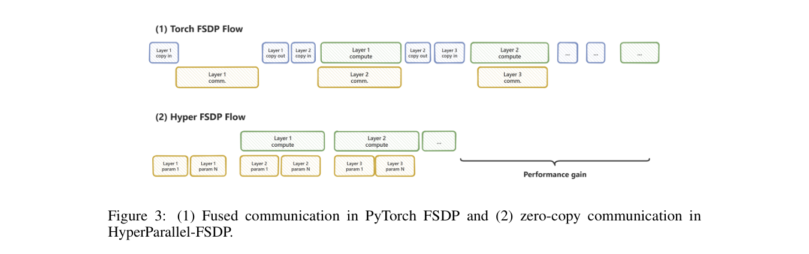
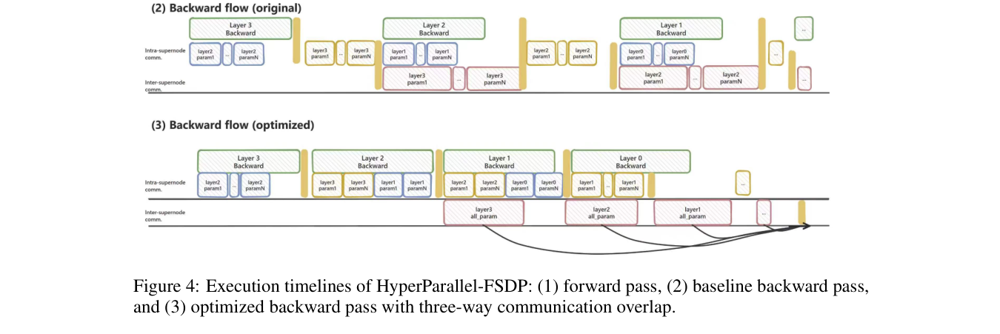
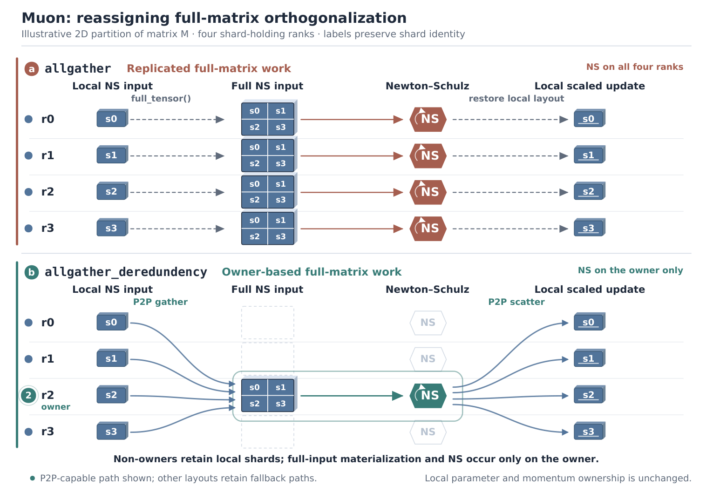
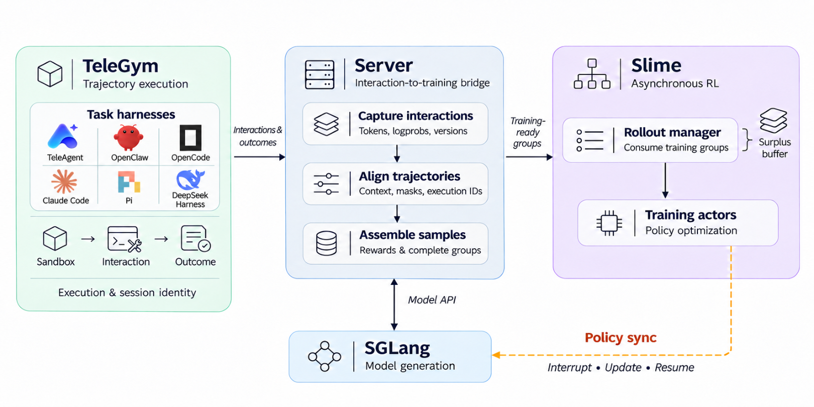
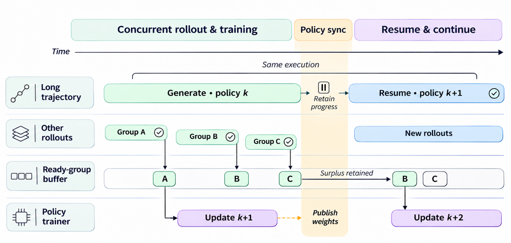

> **원문**: [arXiv](https://arxiv.org/abs/2611.22115) · [HuggingFace](https://huggingface.co/papers/2611.22115) (👍 149) · [모델](https://huggingface.co/XingChen-AGI/Xing4.0-29B-A4B)
{: .prompt-info }

## 들어가며

오늘 리뷰할 논문은 HuggingFace Daily Papers에서 149 upvote를 받은 China Telecom Xingchen AGI Lab의 "TeleChat to Xing4: Advancing Frontier Agentic Models on Domestic Chips and Frameworks"입니다. 제목만 보면 또 하나의 LLM 기술보고서처럼 보이지만, 부제의 "Domestic Chips and Frameworks"가 이 논문의 진짜 포인트입니다. NVIDIA GPU와 PyTorch가 아니라 **Huawei Ascend 910C NPU와 MindSpore 프레임워크**로 285B 파라미터 MoE 모델을 8,192장 카드에서 훈련했다는 보고서입니다.

개인적으로 이 논문이 흥미로웠던 이유는, 보통 기술보고서가 "우리 모델이 벤치마크에서 몇 점 받았다"에 초점을 맞추는 것과 달리, 이 논문은 벤치마크 점수를 거의 다루지 않고 **"어떻게 하면 PyTorch/CUDA 생태계 밖에서도 대규모 훈련이 돌아가게 만들 것인가"**에 지면 대부분을 씁니다. Pipeline parallelism을 아예 버리고 그 대신 FSDP를 하드웨어 토폴로지에 맞춰 재설계했다는 게 핵심 주장인데, 이게 왜 가능했는지 뜯어보는 재미가 있었습니다.

## 한눈에 보기

- **핵심 기여**: ① Ascend SuperPoD의 네트워크 토폴로지(SuperPoD 내부 고대역폭 / 외부 저대역폭)에 맞춰 설계한 HSDP(HyperParallel-FSDP)로 pipeline parallelism 없이 285B 모델을 훈련 ② Muon optimizer의 중복 계산을 없애는 owner 기반 분산 실행 ③ 0-1 knapsack으로 재계산할 연산을 고르는 fine-grained selective recomputation ④ DSA(sparse attention) 긴 시퀀스 훈련의 load balancing·KV 압축 ⑤ CPU affinity/core isolation으로 호스트 스케줄링 지연 제거 ⑥ 이기종 에이전트 하네스를 하나의 RL 루프로 묶는 TeleGym 플랫폼
- **성능**: 1,024-NPU 프로파일링 클러스터에서 PP 기반 베이스라인(36.4초/step) 대비 HSDP+Muon+selective recomputation+layer-wise indexer backward를 모두 적용해 24.5초/step까지 단축(약 1.49배). 285B 모델 기준 long-context 추론에서 MLA+DSA+IndexShare 조합이 MLA 단독 대비 prefill throughput 4.68배, DSpark 추론 가속이 base 대비 디코딩 throughput 2.67~3.77배.
- **한 줄 요약**: NVIDIA/PyTorch 생태계의 암묵적 가정(저대역폭 전역 샤딩, 레이어 단위 재계산, uniform latency) 하나하나를 Ascend 하드웨어 특성에 맞춰 다시 설계해서, "pipeline parallelism이 필수"라는 통념을 깬 시스템 엔지니어링 보고서입니다.

## 어떤 문제를 풀려고 했나

대규모 MoE 모델을 훈련하려면 보통 data parallelism(DP), tensor parallelism(TP), expert parallelism(EP), pipeline parallelism(PP)을 섞어 씁니다. 이 중 PP는 모델을 레이어 단위로 여러 디바이스에 나눠 올려서 메모리 압박을 줄여주지만, 구조적으로 "파이프라인 버블"이라는 비용을 피할 수 없습니다. 논문은 이걸 수식으로 짚고 들어갑니다.

$p=4$개 파이프라인 스테이지, $m=8$개 마이크로배치로 1F1B 스케줄을 쓸 때 이론적 버블 비율은 다음과 같습니다.

$$\frac{p-1}{m+p-1}=\frac{3}{11}\approx 27\%$$

여기서 $p$는 파이프라인 스테이지 수, $m$은 마이크로배치 개수입니다. 분자의 $p-1$은 파이프라인이 채워지고 비워지는 데 걸리는 "손해 보는" 구간이고, 분모는 전체 실행 구간입니다.

즉 스테이지를 4개로 나누면 계산 시간의 약 27%가 그냥 버려진다는 뜻입니다. VPP(virtual pipeline parallelism) 같은 인터리빙 기법으로 줄일 수는 있어도 완전히 없앨 수는 없다고 저자들은 말합니다. 그런데 PP를 쓰는 이유는 결국 "레이어 전체 파라미터를 한 디바이스에 다 올리지 않아도 되게" 하기 위한 메모리 절약 수단일 뿐입니다. 그렇다면 **data-parallel 차원에서 같은 메모리 절약을 해낼 수 있다면 PP 자체가 필요 없어지지 않을까?** — 이게 이 보고서 3장 전체를 관통하는 질문입니다.

여기에 더해 Ascend 하드웨어 특성도 걸립니다. Ascend 910C는 행렬 연산(Cube) 성능은 강하지만 Vector 연산과 HBM 대역폭은 상대적으로 제약이 있다고 합니다. 그래서 저자들은 설계 원칙을 아예 문장으로 박아둡니다: "Cube를 최대한 쓰고, Vector 병목은 구조적으로 피하고, sparse memory access로 HBM 부담을 줄여라." 이 원칙이 어텐션 설계, depth-width 선택, 재계산 전략까지 전부를 관통합니다.

## 핵심 아이디어

### 1. 파이프라인을 버리다 — HyperParallel-FSDP

다음은 PyTorch FSDP와 HyperParallel-FSDP의 통신 방식을 비교한 그림입니다.

_Figure 3. (1) PyTorch FSDP의 fused 통신과 (2) HyperParallel-FSDP의 zero-copy 통신_

PyTorch FSDP는 여러 파라미터를 하나의 연속된 버퍼로 flatten한 뒤 collective 통신을 한 번에 묶어서 보냅니다. 통신 횟수는 줄지만, 통신 전에 각 파라미터를 버퍼로 복사(copy-in)하고 AllGather 후 다시 원래 텐서로 복사(copy-out)하는 추가 작업이 생깁니다. 특히 copy-out은 바로 다음 계산이 그 결과에 의존하기 때문에 숨길 수 없는 critical path에 그대로 노출됩니다.

Ascend SuperPoD는 내부 대역폭이 워낙 높아서, 굳이 파라미터를 묶지 않고 **개별 텐서 단위로 바로 AllGather/ReduceScatter**를 해도 통신 효율이 떨어지지 않는다고 합니다. 그래서 flatten-복사 과정을 통째로 없애버린 게 zero-copy communication입니다. 이 설계가 가능한 이유가 PyTorch 생태계의 일반적인 네트워크(상대적으로 낮은 대역폭의 전역 인터커넥트)가 아니라 SuperPoD라는 특수한 고대역폭 토폴로지라는 점이 눈에 띕니다. 즉 이건 범용 최적화가 아니라 "이 하드웨어라서 가능한" 최적화입니다.

여기에 더해 backward pass의 통신 오버랩도 손봤습니다. 다음 그림이 baseline과 최적화된 backward 스케줄을 비교합니다.

_Figure 4. (2) baseline backward: SuperPoD 간 AllReduce 일부만 계산과 겹침. (3) 최적화된 backward: intra-SuperPoD AllGather/ReduceScatter와 inter-SuperPoD AllReduce가 동시에 여러 레이어에 걸쳐 겹쳐 있음_

위쪽 (2) baseline을 보면, 각 레이어의 backward 계산(초록 박스) 사이사이에 intra-SuperPoD 통신(파란 박스)과 inter-SuperPoD AllReduce(빨간 박스)가 끼어들면서 계산이 끊기는 구간(세로 노란 막대)이 눈에 띕니다. 아래쪽 (3) 최적화된 버전은 같은 레이어 수의 backward 계산을 거의 끊김 없이 이어 붙이고, inter-SuperPoD AllReduce(빨간 박스, "all_param")를 뒤쪽으로 몰아서 여러 레이어의 backward 계산 구간과 한꺼번에 겹치게 만듭니다. 화살표로 표시된 것처럼 여러 레이어의 그래디언트가 모였다가 한 번에 SuperPoD 밖으로 나가는 걸 볼 수 있는데, 이게 본문에서 말하는 "fused AllReduce로 통신 빈도 자체를 줄인다"는 설계가 그림으로 드러난 부분입니다.

Baseline 구현은 AllReduce 일부를 backward 계산과 겹치긴 하지만, 두 가지 한계가 있었다고 합니다. 첫째, fine-grained AllReduce가 자주 발생하는데 SuperPoD *바깥* 대역폭은 안쪽보다 제한적이라 비효율적입니다. 둘째, intra-SuperPoD ReduceScatter와 동기화가 critical path에 그대로 노출되어 레이어 사이에 통신 공백이 생깁니다.

HyperParallel-FSDP는 세 가지를 동시에 겹칩니다: layer $i$의 backward 계산 중에 layer $i+1$의 ReduceScatter, layer $i-1$의 AllGather, 그리고 SuperPoD 간 AllReduce를 전부 같이 진행합니다. SuperPoD 간 동기화는 backward 끝까지 미뤄버리고, 여러 레이어의 그래디언트 샤드를 모아서 한 번에 fused AllReduce로 보냅니다. 이게 "3-way communication overlap"입니다.

1,024-NPU 클러스터, 285B 모델, 시퀀스 길이 262,144 설정에서 측정한 결과가 아래 표입니다.

| Scheme | Pipeline | DP (Replica×Shard) | mbs | Step Time | Speedup |
|---|---|---|---|---|---|
| PP-1F1B (Baseline) | pp=4, vpp=1 | 2×1 | 8 | 36.4s | 1.00× |
| PP-Interleaved | pp=4, vpp=2 | 2×1 | 4 | 34.2s | 1.06× |
| **HSDP (Ours)** | **pp=1** | **4×2** | **2** | **31.8s** | **1.14×** |

VPP로 인터리빙만 해도 6% 개선되긴 하지만(버블이 진짜 병목이라는 방증), PP를 아예 없애고 그 자리를 하이브리드 샤딩으로 대체한 HSDP가 12.6% 더 빠릅니다. 여담이지만, 이 표에서 재미있는 부분은 PP-Interleaved가 PP-1F1B보다 조금이라도 빠르다는 사실 자체가 "버블이 실제로 손해를 보고 있다"는 걸 실험적으로 보여준다는 점입니다. 저자들이 이걸 일부러 통제 실험으로 끼워 넣은 것 같습니다.

### 2. Muon optimizer의 숨은 중복 계산 없애기

Muon optimizer는 행렬 파라미터를 Newton-Schulz(NS) 반복으로 직교화(orthogonalize)하는데, 이 연산은 전체 행렬이 필요합니다. 문제는 샤딩된 훈련 환경에서는 각 rank가 파라미터의 일부(shard)만 들고 있다는 겁니다. 순진하게 구현하면 **샤드를 들고 있는 모든 rank가 각자 전체 행렬을 재구성해서 NS를 돌린 다음, 자기 몫만 남기고 나머지는 버립니다.** 즉 같은 NS 연산을 참여 rank 수만큼 중복으로 계산하는 셈입니다.

다음 그림이 이 중복을 어떻게 없애는지 보여줍니다.

_Figure 5. 위: 4개 rank가 각자 전체 행렬을 복원해 NS를 돌리는 기존 방식(allgather). 아래: r2를 owner로 지정해 owner만 NS를 수행하고 나머지는 P2P로 결과를 받는 방식(allgather_dereduplicate)_

위쪽 allgather 방식에서는 r0~r3 네 개 rank 전부가 전체 행렬을 복원하고 NS를 각자 돌립니다(빨간 NS 아이콘 4개). 아래쪽 owner 방식에서는 r2 하나만 owner로 지정되어 point-to-point로 다른 rank들의 shard를 모아 전체 행렬을 복원하고, NS도 r2에서 한 번만 수행한 뒤 결과를 다시 scatter로 각 rank에 돌려줍니다. 흐린 색으로 표시된 r0, r1, r3의 NS 아이콘은 "이제 이 작업을 하지 않는다"는 뜻입니다. 파라미터와 모멘텀은 그대로 샤딩된 레이아웃을 유지하고, 전체 행렬 계산만 owner로 옮긴 거죠.

재미있는 디테일은, owner 배정이 전역이 아니라 **행렬 단위**라는 점입니다. shape, shard group, 추정 비용으로 행렬들을 묶어서 적절한 owner들에게 분산시키고, 모양이 맞는 입력들은 batched matmul로 묶어 커널 launch 오버헤드도 줄입니다. 대신 owner에게 일이 몰리는 트레이드오프가 생기는데, 이건 "작업 배정을 얼마나 잘하느냐"에 달린 문제라고 솔직하게 인정하고 있습니다. 같은 HSDP 레이아웃에서 optimizer 실행 경로만 바꿔 측정한 결과, step time이 31.8초에서 28.9초로 9.1% 줄었습니다(1.10배).

### 3. 메모리 예산을 knapsack으로 푸는 선택적 재계산

레이어 전체를 통째로 재계산(recompute)하거나 통째로 저장하는 기존 방식은 "비싸지만 출력이 작은" 연산자와 "싸지만 출력이 큰" 연산자를 구분하지 못합니다. 특히 DSA(sparse attention)의 긴 시퀀스 훈련에서는 연산 비용과 출력 크기가 전혀 비례하지 않는다고 합니다.

저자들은 각 후보 연산자 $i$에 대해 forward 실행 시간 $t_i$와 출력 메모리 비용 $m_i$를 프로파일링으로 측정한 뒤, 남은 activation 메모리 예산 $M$ 안에서 재계산을 "건너뛸"(즉 출력을 저장해둘) 연산자를 고르는 문제를 0-1 knapsack으로 정식화합니다.

$$\max_{x_i\in\{0,1\}}\;\sum_i x_i t_i \qquad \text{subject to} \qquad \sum_i x_i m_i\leq M$$

여기서 $x_i=1$은 연산자 $i$의 출력을 저장해 재계산에서 제외한다는 뜻이고, $x_i=0$이면 backward 때 다시 계산합니다. $t_i$는 그 연산자를 다시 계산하는 데 드는 시간, $m_i$는 출력을 저장하는 데 드는 메모리입니다.

이 식의 의미는 단순합니다. 정해진 메모리 예산 $M$ 안에서, "저장해두면 가장 많은 재계산 시간을 아낄 수 있는" 연산자들을 우선적으로 골라내는 겁니다. 논문이 실제로 측정한 256K 토큰 run의 한 레이어 데이터를 보면 이 식이 왜 필요한지 바로 드러납니다. 가장 비싼 커널(SparseLightningIndexerGradKLLoss, 38.32ms)은 출력이 193MiB밖에 안 되는데, 가장 큰 출력을 내는 커널(SparseFlashAttention, 516MiB)은 정작 13.47ms밖에 안 걸립니다. 출력 크기 순으로만 고르면 완전히 틀린 선택을 하게 되는 셈이죠. 이 지점이 개인적으로 가장 인상 깊었는데, "저장 공간이 큰 걸 재계산 대상에서 빼자"는 직관적인 휴리스틱이 실제로는 틀릴 수 있다는 걸 프로파일링 숫자로 바로 보여줬기 때문입니다.

이 전략을 적용해 HSDP+Muon 기준 28.9초에서 26.9초로 6.9%가 더 줄었습니다. 여기에 DSA indexer의 backward를 main branch와 분리해 레이어 단위로 더 일찍 실행하는 기법(layer-wise indexer backward)까지 더하면 24.5초까지 내려갑니다(15.2% 감소, 단일 기법 중 가장 큰 개선). 결국 31.8 → 28.9 → 26.9 → 24.5초로, baseline PP 대비 총 1.49배 가속입니다.

### 4. TeleGym — 이기종 에이전트를 하나의 RL 루프로

아키텍처/인프라 이야기가 끝나면 논문 후반부는 완전히 다른 주제로 넘어갑니다. reasoning·coding·multi-turn agent 작업을 위한 강화학습 인프라 TeleGym입니다.

_Figure. TeleGym이 TeleAgent, OpenClaw, OpenCode, Claude Code, Pi, DeepSeek Harness 같은 이기종 에이전트 하네스를 실행하면, 중간 서버가 상호작용을 토큰·logprob·버전 정보로 정리해 훈련 그룹을 만들고, Slime이 비동기 RL로 정책을 업데이트하는 구조_

왼쪽 TeleGym은 다양한 에이전트 하네스(TeleAgent, OpenClaw, Claude Code 등)를 공통 "episode" 인터페이스로 실행합니다. 가운데 Server는 이 실행 과정에서 나온 토큰·behavior-policy log probability·정책 버전을 기록하고, context와 response를 정렬해서 훈련 그룹으로 조립합니다. 오른쪽 Slime이 실제 비동기 RL 학습을 돌립니다. 주황색 점선 "Policy sync" 경로가 눈에 띄는데, Training actor가 정책을 업데이트하면 SGLang의 생성 엔진에 Interrupt → Update → Resume 순서로 반영된다는 걸 보여줍니다.

이 구조에서 가장 실용적인 설계는 **partial rollout**입니다. 에이전트 작업은 도구 호출이나 환경 실행 시간이 제각각이라, 어떤 trajectory는 다른 샘플들보다 훨씬 오래 걸립니다. 모든 trajectory가 끝날 때까지 기다렸다가 정책을 업데이트하면 비효율적이죠.

_Figure. 긴 trajectory는 policy sync 시점에 일시정지했다가 진행 상황을 유지한 채 새 정책으로 재개된다. Group A는 바로 소비되어 업데이트에 쓰이고, surplus인 B·C는 버퍼에 남아 B는 다음 업데이트에 쓰인다_

정책을 publish하는 시점(주황 "Policy sync" 구간)이 되면 컨트롤러는 새 요청 admission을 멈추고, 진행 중인 생성이 안전한 동기화 지점에 도달할 때까지 기다린 뒤, 새 가중치를 설치하고 다시 admission을 엽니다. 이때 중요한 건 **긴 trajectory가 중간에 끊기지 않고 진행 상황(execution identity)을 유지한 채 새 정책으로 이어서 실행**된다는 점입니다. 그림에서 "Group A"는 policy sync 이전에 이미 끝나서 바로 Update $k+1$에 쓰이고, surplus로 남은 B, C 중 B는 버려지지 않고 다음 업데이트 $k+2$에 쓰입니다.

이렇게 정책 버전이 다른 샘플들이 섞이는 걸 다루기 위해, 각 생성 segment는 자기가 샘플링될 때의 log probability를 그대로 들고 다닙니다(importance ratio 계산에 쓰는 behavior-policy 확률). 너무 오래된 trajectory는 옵션으로 통째로 걸러낼 수 있는데, 이때 group 전체를 버려서 group-relative reward 계산에 쓰이는 멤버십을 깨뜨리지 않는다고 합니다. 이런 디테일들이 "비동기로 돌리되 학습 신호의 일관성은 깨지 않는다"는 설계 철학을 잘 보여줍니다.

## 실험 결과

아키텍처 선택 근거가 된 attention 비교 표를 보겠습니다. P/D(prefill/decode) 분리 배포, 256K 컨텍스트 조건에서 MLA를 기준(1.00×)으로 정규화한 수치입니다.

| Architecture | KV HBM Access | Index Computation | Relative TTFT | Relative TPOT | Prefill Throughput | Decode Throughput |
|---|---|---|---|---|---|---|
| MLA | 1.00× | None | 1.00× | 1.00× | 1.00× | 1.00× |
| MLA + DSA | 0.85× | Per-DSA-layer | 0.37× | 0.84× | 2.67× | 1.18× |
| **MLA + DSA + IndexShare** | **0.80×** | **Cross-layer** | **0.21×** | **0.79×** | **4.68×** | **1.27×** |

패턴을 보면, DSA를 추가하는 것만으로 TTFT(첫 토큰까지 시간)가 0.37배로 줄고 prefill throughput이 2.67배로 뛰는데, 이는 sparse attention이 historical KV 접근량 자체를 줄여주기 때문입니다. 그런데 IndexShare를 더했을 때도 비슷한 수준의 추가 개선(TTFT 0.37→0.21, throughput 2.67→4.68)이 일어난다는 게 흥미롭습니다. IndexShare는 "레이어마다 따로 계산하던 sparse index를 레이어 간에 재사용"하는 것뿐인데, 그 index 재계산 비용이 생각보다 크다는 뜻이겠죠. 반면 decode throughput 쪽 개선폭(1.18×→1.27×)은 prefill보다 훨씬 작습니다. decode는 한 번에 한 토큰씩 생성하니 index 재사용의 이득이 prefill만큼 누적되지 않는 걸로 보입니다.

DSpark 추론 가속 결과도 패턴이 뚜렷합니다. 6개 수학·코드 벤치마크에서 base 대비 MTP3는 1.80~1.93배, DSpark는 2.67~3.77배 output throughput을 냅니다. 특히 HumanEval에서 DSpark/MTP3 비율이 2.10배로 가장 크게 벌어지는데, 코드 생성처럼 토큰 패턴이 비교적 예측 가능한 태스크에서 block-wise draft의 수락률(acceptance rate)이 더 높게 나오는 것으로 추정됩니다. 다만 논문은 이 차이의 원인을 직접 분석하지는 않습니다.

마지막으로 호스트 CPU 스케줄링 최적화 결과도 짚을 만합니다.

| Optimization | Cluster size | Throughput gain |
|---|---|---|
| CPU resource isolation (pinning+isolation) | 512장 | 1–2% |
| CPU resource isolation (pinning+isolation) | 8,192장 | 5–10% |

같은 최적화인데 클러스터가 커질수록 이득이 더 커집니다(1-2% → 5-10%). 저자들은 이걸 "큰 클러스터일수록 collective 통신에 참여하는 프로세스 수가 많아져서, 호스트 스케줄링 지연으로 뒤늦게 도착하는 하나의 프로세스가 전체를 기다리게 만드는 효과(straggler)가 더 커지기 때문"이라고 설명합니다. 이 부분은 개인적으로 가장 "엔지니어링다운" 결과라고 느꼈습니다. CPU affinity 같은 건 모델 구조와 전혀 상관없는 영역인데, 8,192장 규모에서는 이게 알고리즘 최적화만큼 체감되는 숫자(5~10%)로 돌아온다는 걸 실측으로 보여주니까요.

## 아쉬운 점 / 의문점

몇 가지 걸리는 지점이 있습니다.

먼저 **attention 비교와 depth-width 비교가 "simulation 기반"**이라는 점입니다. 논문 스스로도 "Huawei의 Zhanlu 시뮬레이션 프레임워크를 쓰며, 실제 production serving의 모든 오버헤드를 담지 못해 결과가 실제보다 낙관적일 수 있다"고 밝힙니다. 4.68배 같은 수치가 실제 서빙 환경에서도 그대로 재현되는지는 불확실합니다. Table 7의 training throughput(PP vs HSDP)처럼 실측값이 명시된 부분과, Table 2·4처럼 simulation 기반인 부분을 독자가 구분해서 읽어야 합니다.

둘째, **owner 기반 Muon 실행이 수치 결과를 바꿀 수 있다는 점을 논문이 직접 인정**합니다. "연산 순서를 바꾸고 batched kernel을 쓰면 floating-point 결과가 달라질 수 있다", "구조적 속성일 뿐 bitwise 동일성이나 수렴 보장은 아니다"라고 써놨는데, 그러면서도 정작 수렴 곡선이나 최종 모델 품질에 영향이 없었는지는 보여주지 않습니다. step time만 측정했지 "이 최적화가 학습 품질을 실제로 바꾸지 않았다"는 증거는 빠져 있습니다.

셋째, **벤치마크 점수가 사실상 없습니다.** 이 보고서는 시스템 엔지니어링에 집중한 나머지, Xing4 285B나 29B 모델이 MMLU, GSM8K, 코딩 벤치마크 등에서 경쟁 모델(Qwen3, GLM-5, DeepSeek-V4 등 서론에서 언급한) 대비 어느 수준인지를 전혀 보여주지 않습니다. "efficient training infrastructure를 만들었다"는 주장은 설득력 있지만, "그래서 좋은 모델이 나왔다"는 연결고리는 이 논문만 읽어서는 확인할 수 없습니다. 29B 모델이 HuggingFace에 공개되어 있으니 직접 벤치마크를 돌려보지 않는 한 품질은 독자가 따로 검증해야 하는 부분입니다.

마지막으로, 이 모든 최적화가 **MindSpore + Ascend SuperPoD라는 특정 조합에 강하게 결합되어 있다**는 점도 짚고 싶습니다. zero-copy 통신이 가능한 이유가 "SuperPoD 내부 대역폭이 유난히 높아서"이고, HSDP가 PP 없이도 잘 돌아가는 이유도 이 토폴로지 덕분입니다. 즉 이 설계를 다른 하드웨어(GPU 클러스터 등)에 그대로 이식할 수 있을지는 별개 문제입니다. 다만 역으로 생각하면, 이게 바로 이 논문의 존재 이유이기도 합니다 — "NVIDIA GPU가 아닌 하드웨어에서 대규모 학습을 하려면 PyTorch의 암묵적 가정부터 다시 세워야 한다"는 걸 구체적 숫자로 보여준 사례니까요.

## 마치며

이 논문을 읽고 나니, "대규모 모델 훈련 = NVIDIA GPU + Megatron/DeepSpeed 스타일 3D 병렬화"라는 공식이 사실 특정 하드웨어 생태계에 최적화된 하나의 선택지일 뿐이라는 생각이 들었습니다. Ascend SuperPoD처럼 네트워크 토폴로지가 다른 하드웨어에서는 pipeline parallelism이 당연한 선택이 아니라 오히려 제거 대상이 될 수 있다는 게 이 보고서의 핵심 메시지인 듯합니다.

개인적으로는 지식 그래프나 작은 모델을 다루는 입장에서 285B짜리 모델을 직접 돌릴 일은 없겠지만, 0-1 knapsack으로 재계산 대상을 고른다거나, "출력 크기와 연산 비용이 비례하지 않는다"는 프로파일링 관찰 같은 건 훨씬 작은 스케일에서도 그대로 써먹을 수 있는 아이디어라고 생각합니다. 다음에 트레이닝 파이프라인 메모리 최적화를 할 일이 있으면 이 knapsack 공식부터 떠올리게 될 것 같습니다. 중국의 domestic chip 생태계가 어디까지 따라왔는지 지켜보는 관전 포인트로도, 또 "트릴리언 파라미터 훈련을 진행 중"이라고 예고한 후속 보고서가 나올지도 궁금해집니다.
