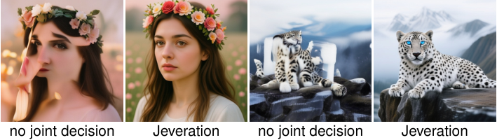
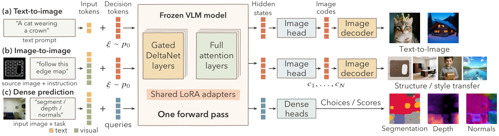
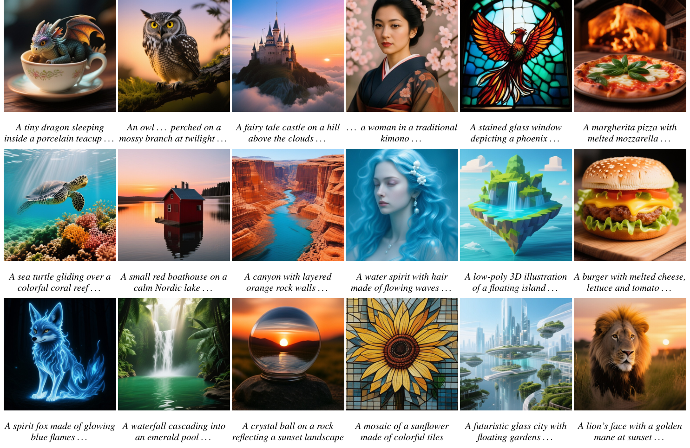
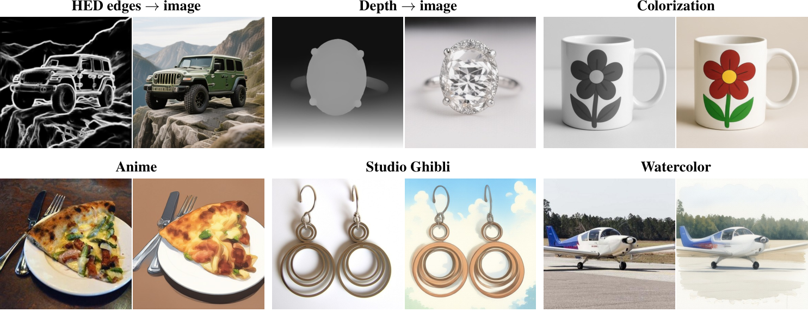
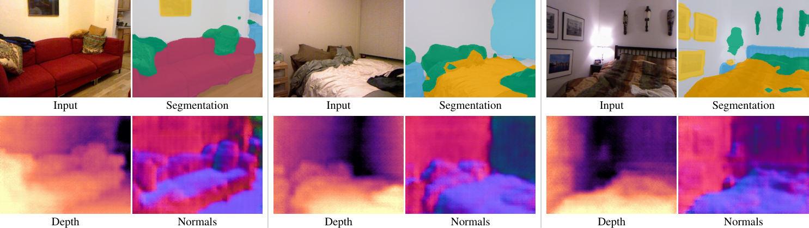

> **원문**: [arXiv](https://arxiv.org/abs/2611.24738) · [HuggingFace](https://huggingface.co/papers/2611.24738) (👍 111) · [GitHub](https://github.com/Carol-lyh/Jeveration)
{: .prompt-info }

## 들어가며

오늘 리뷰할 논문은 HuggingFace Daily Papers에서 111 upvote를 받은 싱가포르국립대(NUS)의 "Jeveration: System One Models Now Generate"입니다. 제목부터 좀 독특한데, "System One"은 Jev(Jevons? 정확한 어원은 논문에 안 나옵니다만 Kahneman의 빠르고 직관적인 'System 1' 사고를 빗댄 이름으로 보입니다)라는 선행 연구 계열에서 쓰는 용어로, 긴 추론 없이 한 번의 병렬 질의로 Choice나 Score 같은 "타입이 있는 결정(typed decision)"을 내놓는 모델을 가리킵니다. 지금까지는 객체 위치 찾기, 로봇 행동 점수 매기기, 생성된 이미지 평가하기 같은 "판단" 작업에만 쓰였는데, 이 논문은 "그 판단 능력으로 이미지 자체를 생성할 수 있지 않을까?"라는 질문에서 출발합니다.

흥미로웠던 지점은 이게 단순한 속도 최적화 논문이 아니라는 겁니다. diffusion은 수십 번의 denoising step을, autoregressive 모델은 토큰 수만큼의 순차 생성을 필요로 합니다. 이 논문은 "이미지 하나를 통째로 하나의 결정"으로 보고 **정말로 한 번의 forward pass**만에 끝내버립니다. 당연히 "그게 가능해?"라는 의문이 드는데, 바로 이 의문—병렬로 찍은 조각들이 어떻게 하나의 그림으로 맞아떨어지는가—이 논문 전체를 관통하는 핵심 문제입니다.

## 한눈에 보기

- **핵심 기여**: ① Jev 스타일의 System One 모델이 이미지 생성 자체를 한 번의 forward pass로 해낼 수 있음을 처음 보임 ② 모든 코드 위치를 하나의 공유 random state에 조건화해서 병렬 결정들이 하나의 일관된 이미지로 수렴하게 만드는 학습법 ③ 하나의 frozen VLM + 공유 LoRA 어댑터로 text-to-image, image-to-image, dense prediction(세그멘테이션·깊이·법선) 세 작업을 전부 커버
- **성능**: 512×512 이미지를 H200 한 장에서 78ms에 생성(Janus-Pro-7B 대비 122배 빠름), GenEval 0.74로 같은 해상도의 multi-step 모델들보다 높은 점수. image-to-image는 구조 추종 F1 0.880(HED edge), dense prediction은 NYUv2 mIoU 67.7로 dense 전용 모델과 대등.
- **한 줄 요약**: diffusion의 반복적 denoising도, autoregressive의 순차 토큰 생성도 아닌 "병렬 결정"이라는 제3의 이미지 생성 패러다임을 제시하고, 그 핵심 난제(전역 일관성)를 공유 random state와 2단계 distribution-matching 학습으로 풀어낸 논문입니다.

## 어떤 문제를 풀려고 했나

오늘날 이미지 생성은 크게 두 진영으로 나뉩니다. Chameleon, Emu3, Janus-Pro 같은 autoregressive 계열은 이미지를 토큰 하나하나 순서대로 생성하고, SANA나 FLUX 같은 diffusion 계열은 노이즈를 여러 단계에 걸쳐 제거해가며 이미지를 만듭니다. 둘 다 공통점이 있는데, **하나의 이미지를 만드는 데 모델을 여러 번(수십~수백 번) 호출해야 한다**는 겁니다. 이게 곧 지연 시간(latency)으로 직결됩니다.

그렇다면 "한 번만 호출해서 이미지를 통째로 뽑으면 안 되나?"라는 생각이 자연스럽게 듭니다. 저자들이 실제로 가장 먼저 시도한 게 이겁니다 — 이미지 토크나이저의 코드북에서 각 위치(position)별로 독립적으로 코드를 하나씩 뽑는 방식이죠. 그런데 이게 바로 망가집니다. 아래 그림을 보면 바로 체감이 됩니다.

_Figure 1. "no joint decision"(독립적으로 샘플링한 코드) vs "Jeveration"(제안 방식). 꽃관을 쓴 인물 사진과 눈표범 사진 두 쌍 모두 왼쪽은 이목구비·털결이 뭉개지고 흐릿하게 섞여 있는 반면, 오른쪽은 선명하고 일관됩니다._

왼쪽 두 장을 보면 얼굴 윤곽이 두 가지 각도가 겹친 것처럼 흐릿하고, 눈표범 사진도 배경과 동물이 서로 다른 "버전"이 섞인 듯 뭉개져 있습니다. 반면 오른쪽(Jeveration)은 또렷합니다. 왜 이런 차이가 생기는지를 저자들은 수식으로 짚습니다.

각 코드 위치 $c_i$를 조건 $y$(프롬프트)에 대해 독립적으로 샘플링한다고 하면,

$$q_{\mathrm{ind}}(c\mid y)=\prod_{i=1}^{N}q_i(c_i\mid y)$$

인데, 여기서 $N$은 이미지를 구성하는 코드의 개수(이 논문에서는 128개)이고 $q_i$는 $i$번째 위치의 코드에 대한 예측 분포입니다. 이렇게 "각자 알아서" 뽑으면 한 이미지 안에서 코드들이 서로 다른 그림을 가리킬 수 있다는 게 문제입니다.

이걸 정량화한 게 다음 식입니다.

$$\min_{q_{\mathrm{ind}}}\mathrm{KL}(p\,\|\,q_{\mathrm{ind}})=\sum_{i=1}^{N}H(c_i\mid y)-H(c\mid y)$$

$H$는 실제 이미지 분포 $p(c\mid y)$ 하에서의 엔트로피입니다. 좌변은 "독립 분포로 실제 분포를 가장 잘 근사했을 때 생기는 오차(KL divergence)"이고, 우변은 각 위치의 개별 엔트로피 합에서 전체 결합 엔트로피를 뺀 값, 즉 **total correlation**(코드들 사이의 상호의존성 총량)입니다.

이 식이 말하는 건 명확합니다 — 이미지의 각 조각들이 서로 얼마나 "약속되어 있는지"가 클수록(즉 total correlation이 클수록), 독립 샘플링과 진짜 분포 사이의 간극이 커진다는 겁니다. 여러 조각이 맞아떨어져야 말이 되는 이미지(사람 얼굴처럼 좌우가 대칭이어야 하는 경우)일수록 독립 샘플링이 더 크게 망가진다는 뜻이고, 이게 바로 Figure 1에서 본 뭉개짐의 원인입니다.

## 핵심 아이디어

### 공유 random state로 "같은 그림을 그리고 있다"는 약속을 주기

해법은 의외로 단순합니다. 모든 코드 위치가 **하나의 공유된 random state $\xi$**를 함께 바라보게 만드는 겁니다.

$$q_\theta(c\mid y)=\mathbb{E}_{\xi\sim p_0}\!\left[\prod_{i=1}^{N}q_{\theta,i}(c_i\mid y,\xi)\right]$$

여기서 $\xi$는 이미지 하나당 한 번만 샘플링되는 랜덤 시퀀스이고, $q_{\theta,i}(\cdot\mid y,\xi)$는 조건 $y$와 이 공유 상태 $\xi$가 주어졌을 때 $i$번째 코드의 분포입니다. 각 위치의 코드는 여전히 $(y,\xi)$가 고정된 상태에서는 독립적으로 뽑히지만, 128개 위치 모두가 **같은 $\xi$**를 참조하기 때문에, $\xi$를 통해 "우리가 지금 같은 그림을 그리고 있다"는 정보가 암묵적으로 전파됩니다. $\xi$를 바꾸면 완전히 다른(하지만 각자 일관된) 이미지가 나오고요.

비유하자면, 여러 사람이 눈을 가린 채 한 그림의 각자 다른 부분을 동시에 그려야 하는데, 서로 대화는 못 해도 "오늘의 주제어 카드"는 다 같이 쥐고 있는 상황과 비슷합니다. 그 카드($\xi$) 하나만으로도 서로 다른 조각들이 어느 정도 같은 방향을 향하게 되는 거죠. 다만 이것만으로는 부족한데, 모델이 이 $\xi$를 "제대로 활용"하도록 가르쳐야 합니다. 그냥 목표 이미지로 직접 지도학습(supervised)을 시키면 $\xi$는 타겟 이미지와 무관하게 뽑히는 값이라 모델이 이걸 무시하는 법을 배워버립니다(논문이 명시한 실패 사례입니다).

### 2단계 학습: 먼저 분포를 배우고, 그 다음 그 분포로 "채점"하며 학습

그래서 저자들은 2단계 절차를 씁니다.

**1단계 — 마스크 예측으로 이미지 분포 자체를 배우기.** VLM은 얼린 채로, 일부 코드를 가리고(masking) 나머지로부터 가려진 코드를 맞추는 모델 $\phi$를 학습합니다.

$$\mathcal L_{\mathrm{mask}}(\phi)=\mathbb E\!\left[\frac{1}{|M|}\sum_{i\in M}-\log p_{\phi,i}(c_i\mid c_{\bar M},y)\right]$$

$M$은 가려진 위치 집합, $c_{\bar M}$은 보이는 코드들입니다. 이 모델은 "다른 코드들을 보면 이 위치에 뭐가 와야 하는지" 즉 코드 사이의 상호의존 구조를 배우게 됩니다. 이게 바로 MaskGIT류 masked generative model이고, 이 단계 하나만으로는 아직 "한 번의 forward pass"가 아닙니다(여러 라운드에 걸쳐 마스크를 채워야 하니까요).

**2단계 — distribution matching으로 "한 번에 맞히는" 모델 $\theta$를 학습.** 여기가 진짜 핵심입니다. $\theta$는 $(y,\xi)$만 보고 128개 코드를 **한 번에** 전부 샘플링합니다. 그 다음 샘플링 결과 $\hat c$ 중 일부를 다시 가리고, 1단계의 frozen 모델 $\phi$와 보조 모델 $\psi$(처음엔 $\phi$의 복사본으로 시작해서 $\theta$의 샘플을 계속 따라가며 업데이트됨) 둘 다에게 가려진 부분을 예측시킵니다. 두 예측의 차이로 $\theta$를 업데이트합니다.

$$\mathcal L_{\mathrm{DM}}(\theta)=\mathbb E\!\left[\frac{1}{|M|}\sum_{i\in M}\mathrm{sg}(p_{\psi,i}-p_{\phi,i})^{\!\top}\ell_{\theta,i}\right]$$

$\mathrm{sg}$는 gradient를 막는 stop-gradient, $\ell_{\theta,i}$는 $\theta$가 뽑은 로짓입니다. 핵심 직관은 이렇습니다 — $\phi$는 "진짜 이미지라면 이 위치에 뭐가 와야 하는지"를 알고, $\psi$는 "$\theta$가 지금 실제로 뭘 만들고 있는지"를 추적합니다. 두 예측이 일치한다는 건 $\theta$가 뽑은 코드들이 이미 서로 앞뒤가 맞는(진짜 이미지 분포를 따르는) 상태라는 뜻이고, 어긋난다는 건 $\theta$의 샘플들이 아직 "따로 노는" 조각이라는 신호입니다. 이 차이를 줄이도록 학습시키면, $\theta$는 128개를 한 번에 뽑으면서도 서로 들어맞는 코드를 고르는 법 — 즉 공유된 $\xi$를 실제로 활용해 전역 일관성을 만드는 법 — 을 배우게 됩니다. 이 접근은 Di[M]O라는 선행 distillation 기법의 token-level matching을 가져온 것이라고 밝히고 있습니다.

### 하나의 frozen VLM으로 세 가지 일을 시키기

구조적으로는 Qwen3.5-4B라는 기존 VLM을 통째로 얼려두고, 거기에 LoRA 어댑터와 작업별 head만 붙입니다.

_Figure 2. 세 작업(text-to-image, image-to-image, dense prediction) 모두 같은 frozen VLM + 공유 LoRA를 한 번만 통과한다._

그림을 보면 세 작업 모두 구조가 똑같습니다. 텍스트 토큰(노랑)과 시각 토큰(연두)이 입력으로 들어가고, 거기에 "결정 토큰"(주황)이 덧붙습니다. 이 결정 토큰이 이미지 생성에서는 random state $\xi$로 초기화되고, dense prediction에서는 입력 이미지 위치에 대응하는 "공간 질의(spatial query)"로 쓰입니다. 전부 같은 frozen VLM + 공유 LoRA 어댑터를 한 번 통과한 뒤, 작업별 head(이미지 head 또는 dense head)가 최종 hidden state를 이미지 코드나 세그멘테이션/깊이/법선 예측으로 변환합니다. 재미있는 건 이미지 생성 head가 두 갈래로 나뉜다는 점인데, 토크나이저의 코드북 구조를 그대로 물려받는 codebook branch와, 거기서 자유롭게 벗어날 수 있는 wide branch를 더해서 쓴다고 합니다(ablation에서 둘을 합쳤을 때가 각각보다 낫다고 확인됩니다).

여담이지만, "frozen VLM + LoRA만 추가해서 새 modality를 다루게 만든다"는 접근 자체는 최근 멀티모달 연구에서 꽤 자주 보이는 패턴입니다. 이 논문의 차별점은 그 어댑터가 "생성"까지 담당하게 만들었다는 것, 그리고 그걸 반복 없이 한 번에 해냈다는 것이라고 봅니다.

## 실험 결과

### Text-to-image: 속도가 압도적이고 품질도 밀리지 않는다

다음은 핵심 비교 표입니다. 표가 꽤 긴데, 원문 구조를 그대로 가져왔습니다.

| Model | Unified | Params (B) | Steps | Res. (px) | Speedup↑ | GenEval↑ | DPG↑ | HPSv2.1↑ | Latency (ms)↓ |
|---|---|---|---|---|---|---|---|---|---|
| PixArt-α | ✗ | 0.6 | 20 | 512 | 25.1× | 0.49 | 71.6 | 29.98 | 378.8 |
| PixArt-Σ | ✗ | 0.6 | 20 | 512 | 22.7× | 0.54 | 79.5 | 30.49 | 419.5 |
| SANA-0.6B | ✗ | 0.6 | 20 | 512 | 16.2× | 0.65 | 84.3 | 29.86 | 587.3 |
| SANA-Sprint 0.6B | ✗ | 0.6 | 1 | 1024 | 78.5× | 0.72 | 78.63 | 28.74 | 121.2 |
| SDXL-DMD2 | ✗ | 2.6 | 1 | 1024 | 46.6× | 0.56 | 74.09 | 28.20 | 204.0 |
| SDXL-LCM | ✗ | 2.6 | 4 | 1024 | 28.2× | 0.53 | 71.08 | 26.99 | 336.7 |
| FLUX.1-schnell | ✗ | 12.0 | 1 | 1024 | 27.5× | 0.69 | 85.97 | 29.63 | 345.6 |
| Z-Image-Turbo | ✗ | 6.2 | 8 | 1024 | 4.8× | 0.76 | 84.99 | 29.76 | 1,965.2 |
| SD3-medium | ✗ | 2.0 | 28 | 1024 | 4.6× | 0.62 | 84.1 | 29.88 | 2,086.0 |
| JanusFlow-1.3B | ✓ | 1.3 | 30 | 384 | 21.3× | 0.63 | 80.09 | 22.90 | 445.8 |
| Janus-Pro-1B | ✓ | 1.5 | 576 | 384 | 1.3× | 0.73 | 82.63 | 27.73 | 7,593.2 |
| Janus-Pro-7B | ✓ | 7.0 | 576 | 384 | 1.0× | 0.80 | 83.91 | 28.47 | 9,508.4 |
| Show-o Turbo-512 | ✓ | 1.3 | 4 | 512 | 101.0× | 0.63 | 83.35 | 27.35 | 94.1 |
| Show-o-512 | ✓ | 1.3 | 50 | 512 | 5.8× | 0.68 | 67.27 | 27.85 | 1,631.0 |
| MMaDA-8B | ✓ | 8.0 | 15 | 512 | 2.5× | 0.63 | 69.97 | 23.74 | 3,860.9 |
| **Jeveration** | ✓ | 5.2 | **1** | 512 | **122.2×** | 0.74 | 78.24 | 28.06 | **77.8** |

패턴을 짚어보면, Jeveration은 **unified 모델(이해+생성 겸용) 중에서 가장 빠르면서 GenEval도 가장 높습니다**(Janus-Pro-7B의 0.80에는 못 미치지만, Janus-Pro-7B는 Jeveration보다 122배 느립니다). step 수가 다른 모든 모델이 최소 4단계 이상인데 Jeveration만 유일하게 1단계입니다. 흥미로운 건 DPG-Bench와 HPSv2.1에서는 1위가 아니라는 점인데, 특히 DPG-Bench 78.24는 표의 중위권 수준입니다. GenEval은 "프롬프트의 속성(색상, 개수, 위치 등)을 제대로 반영했는가"를 보는 벤치마크이고 DPG-Bench는 더 복잡한 prompt-following을 요구하는데, 이 차이는 Jeveration이 "단순한 속성 지시는 잘 따르지만 복잡하고 긴 프롬프트의 세부 묘사까지는 diffusion 계열만큼 못 따라간다"는 신호로 읽힙니다. 1단계로 모든 걸 결정해야 하는 구조상 자연스러운 trade-off로 보이는데, 논문은 이 부분을 직접 짚지는 않습니다.

실제 생성 샘플도 확인해봤습니다.

_Figure 3. 최종 Jeveration 체크포인트의 512px 생성 결과. 찻잔 속 작은 용, 올빼미, 스테인드글라스 불사조, 저폴리 3D 섬 등 다양한 스타일._

전체적으로 디테일이 살아있고 스타일 다양성(사진풍, 일러스트, 3D 렌더, 스테인드글라스)도 꽤 넓습니다. 다만 개인적으로는 이런 선별 샘플(cherry-picked)만으로는 실패 사례가 얼마나 되는지 가늠하기 어렵다는 점이 아쉬웠습니다. 부록에 추가 샘플이 더 있다고는 하지만, 이 역시 저자가 고른 "좋은 예"일 가능성이 높습니다.

### Image-to-image와 dense prediction: 같은 체크포인트로 구조를 따라가기

| Model | HED↑ | Depth↑ | Colorize↑ | Style PSNR↑ |
|---|---|---|---|---|
| **Jeveration** | **0.880** | **0.802** | 0.937 | **15.40** |
| Copy the input | 0.828 | 0.713 | **0.998** | — |
| Decoder without source | 0.792 | 0.767 | 0.757 | 14.37 |

여기서 눈여겨볼 비교 대상은 "Copy the input"(입력을 그대로 베낀 베이스라인)입니다. Jeveration이 HED·Depth에서는 이걸 이기지만 Colorize에서는 집니다(0.937 vs 0.998). 생각해보면 당연한 결과인데, 흑백 사진에 색을 입히는 작업은 입력 엣지를 그대로 베끼는 게 구조적으로는 "완벽한 정답"에 가깝기 때문입니다(색은 이미 안 보고 평가하는 edge F1 기준이라서요). 오히려 중요한 건 "Decoder without source"와의 비교인데, 소스 이미지를 디코더에 안 주고 코드만으로 복원해도 HED 0.792, Depth 0.767까지 나온다는 겁니다. 즉 **128개 코드 자체가 이미 이미지의 전역 구조 대부분을 담고 있고**, 소스 이미지는 세부 디테일을 보강하는 역할만 한다는 뜻입니다. 아래 image-to-image 샘플을 보면 이 구조 보존 능력이 꽤 자연스럽게 체감됩니다.

_Figure 4. HED 엣지→이미지, 깊이맵→이미지, 컬러화, 그리고 애니메·지브리·수채화 스타일 변환까지 같은 체크포인트로 수행._

엣지맵만 보고 지프 자동차의 입체감과 재질을 복원하거나, 흐릿한 깊이맵만으로 반지의 보석 디테일을 그려내는 건 꽤 인상적입니다. 스타일 변환(지브리풍 귀걸이, 수채화 비행기)도 원본의 구도를 그대로 유지하면서 화풍만 바뀐 걸 볼 수 있습니다.

| Model | Seg. mIoU↑ | Depth abs.(m)↓ | Depth δ₁↑ | Normal mean(°)↓ |
|---|---|---|---|---|
| **Jeveration** | 67.7 | 0.267 | 0.898 | 24.2 |
| Dense-only, one task each | 67.8 | 0.246 | 0.915 | 21.2 |
| Dense-only, three tasks | 67.3 | 0.253 | 0.912 | 23.0 |
| DeepLabV3+ R50 | 53.5 | 0.393 | — | 22.0 |

dense prediction에서는 세그멘테이션 mIoU가 작업 전용 모델(67.8)과 거의 차이가 없는데(67.7), surface normal만 유독 뒤처집니다(24.2° vs 21.2°). 논문은 이걸 "세밀한 지역 기하 정보가 여러 작업 간 용량 공유에 가장 민감하기 때문"이라고 추측하는데, 솔직히 이 설명만으로는 왜 하필 normal만 그런지 완전히 납득되지는 않습니다. 세그멘테이션/깊이는 비교적 저주파(덩어리 단위) 정보인 반면 surface normal은 픽셀 단위의 미세한 기울기 변화를 요구하는데, 그 차이가 원인일 수는 있겠습니다.

_Figure 5. NYUv2 테스트 이미지에 대한 13-클래스 세그멘테이션, 깊이, 법선 예측. 소파·침대·벽 구역 분할은 뚜렷한 반면 깊이/법선 맵은 해상도가 낮고 경계가 흐릿합니다._

실제로 그림을 보면 세그멘테이션은 소파와 침대 영역을 꽤 깔끔하게 나누는 반면, 깊이와 법선 맵은 해상도 자체가 낮아 보이고(32×32 수준의 공간 질의 개수 제약으로 추정됩니다) 경계가 뭉개져 있습니다. 세그멘테이션이 "클래스 하나를 고르는" Choice 결정인 반면 깊이/법선은 연속값 Score라서 난이도 차이가 있을 수도 있겠다는 생각이 듭니다.

## 아쉬운 점 / 의문점

- **DPG-Bench 순위가 애매합니다.** GenEval에서는 좋은 성적을 냈지만 DPG-Bench(복잡한 긴 프롬프트 추종력)에서는 중위권입니다. "한 번에 모든 걸 결정"하는 구조가 복잡한 다중 속성 프롬프트에서 한계를 보이는 건지, 아니면 단순히 학습 데이터 분포 문제인지 논문에서 분석하지 않습니다.
- **코드 개수 $N=128$, 공간 질의 432개라는 설정이 고정 해상도·고정 디테일 수준을 암시합니다.** 더 높은 해상도나 더 복잡한 장면(다수의 객체, 긴 텍스트 렌더링 등)에서도 "한 번에 결정"이 유지될지는 논문에 나와 있지 않습니다. 512px가 한계인지, 그냥 이번 실험 범위였는지 명시되어 있지 않네요.
- **GenEval 0.74 중 wide+codebook 두 branch를 합쳐도 1단계(masked) 모델은 0.64에 그칩니다.** 즉 2단계 distribution matching이 0.64 → 0.74로 크게 기여하는 건데, 이 gap이 어디서 오는지(단순히 더 많은 학습 때문인지, distribution matching이라는 방법론 자체의 효과인지) 분리된 ablation은 없습니다.
- 개인적으로는 "System One"이라는 이름이 주는 철학적 포장(Kahneman의 이중과정이론을 빌린 듯한)에 비해, 실제 메커니즘은 상당 부분 기존 MaskGIT류 masked generative model과 Di[M]O distillation 기법을 재조합한 것에 가깝다는 인상을 받았습니다. 다만 "이미지를 판단(decision)으로 재정의"했다는 프레이밍 자체는 참신하고, dense prediction까지 같은 틀로 묶어낸 통합성은 확실히 흥미롭습니다.

## 마치며

이 논문의 가장 큰 재미는 "속도"보다 "이미지 생성을 판단 문제로 재정의했다"는 관점 전환에 있다고 생각합니다. total correlation이라는 정보이론적 틀로 "왜 병렬 생성이 어려운가"를 짚고, 그 해법으로 공유 random state라는 비교적 단순한 아이디어를 쓴 뒤, 그걸 실제로 작동시키기 위해 2단계 distribution-matching 학습이라는 꽤 정교한 장치를 붙인 구성이 설득력 있었습니다.

실용적으로는 78ms라는 지연 시간이 실시간 생성이 필요한 애플리케이션(인터랙티브 편집, 게임 에셋 생성 등)에 흥미로운 가능성을 열어줄 것 같습니다. 다만 GitHub 저장소가 공개되어 있다고는 하나(논문 발행 시점 기준) 실제 코드·체크포인트 공개 여부와 재현성은 직접 확인이 필요해 보입니다. 다음에 비슷한 "병렬 결정 기반 생성" 계열 후속 연구가 나오면, 특히 복잡한 프롬프트 추종력(DPG-Bench 격차)을 어떻게 좁히는지 지켜볼 만할 것 같습니다.
