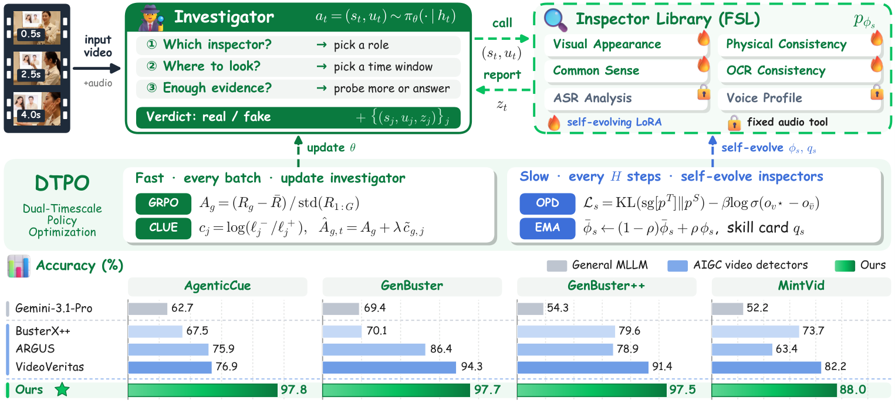
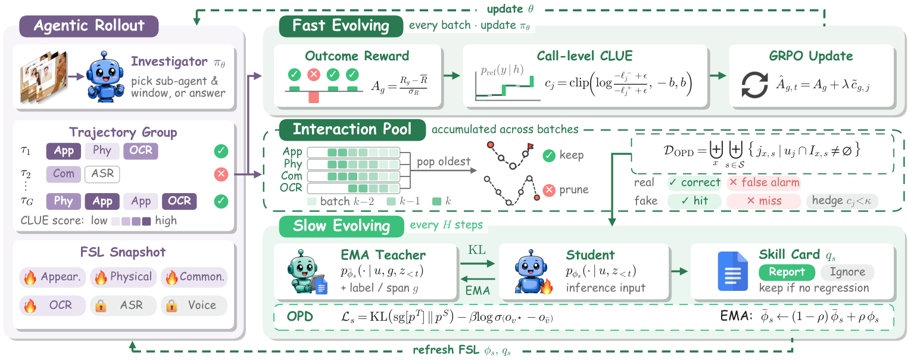
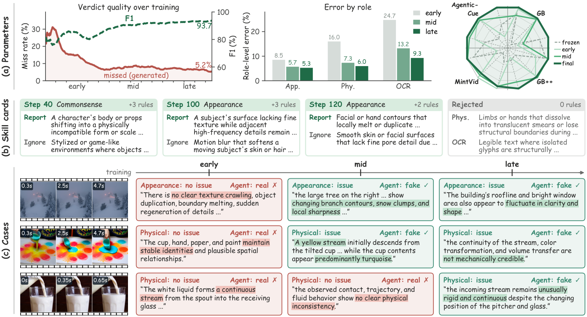
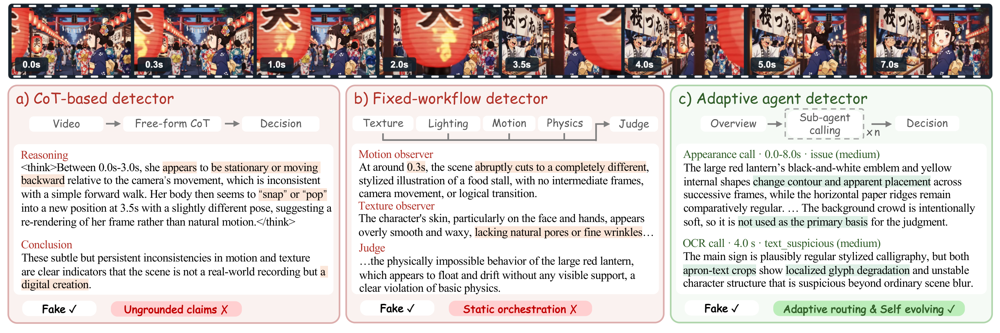

> **원문**: [arXiv](https://arxiv.org/abs/2611.21373) · [HuggingFace](https://huggingface.co/papers/2611.21373) (👍 49) · [GitHub](https://github.com/Tencent/WeVisForensics)
{: .prompt-info }

## 들어가며

어제 HuggingFace Daily Papers에서 49표를 받은 논문입니다. Tencent WeChat Vision 팀이 낸 AI 생성 영상 탐지(AI-generated video detection) 논문인데, 제목에 있는 "Self-Evolving Agent"라는 표현이 눈길을 끌었습니다. 요즘 딥페이크 탐지 논문들은 대부분 "MLLM에게 영상을 보여주고 CoT로 추론시키거나", "여러 전문가 모델을 돌려서 판사 모델이 종합하는" 식인데, 이 논문은 그 판사(투자자, investigator)뿐 아니라 전문가들(inspector)까지 같이 훈련시키겠다고 합니다. 그것도 "서로가 서로의 학습 데이터가 되는" 방식으로요. 코드도 실제로 공개되어 있길래(Apache-2.0, 47 stars) 읽어봤습니다.

## 한눈에 보기

- **핵심 기여**: 투자관(investigator) 하나가 6종의 전문 감식관(inspector)을 필요할 때마다 호출하는 2단 에이전트 구조를 제안하고, 둘을 서로 다른 속도(fast/slow)로 동시에 학습시키는 DTPO(Dual-Timescale Policy Optimization)를 설계
- **데이터**: 3만 개 영상에 역할별 증거를 라벨링한 ForenCue-30K와, 정답률뿐 아니라 "올바른 전문가를 불렀는지"까지 평가하는 AgenticCue 벤치마크를 새로 구축
- **성능**: in-domain·out-of-domain·agentic 네 축 평균 95.2%, 기존 최강 탐지기보다 9.0%p 높음
- **한 줄 요약**: "판사만 똑똑해지는 게 아니라, 판사가 부려먹는 감식관들도 같이 똑똑해져야 한다"는 당연한 것 같지만 아무도 제대로 안 풀었던 문제를 정면으로 다룬 논문입니다.

## 어떤 문제를 풀려고 했나

딥페이크 탐지를 둘러싼 최근 흐름은 크게 두 갈래입니다. 하나는 MLLM 하나가 영상 전체를 보고 한 번의 CoT(chain-of-thought)로 "진짜/가짜"를 판단하는 방식이고(VideoVeritas, Skyra 등), 다른 하나는 여러 전문가 에이전트가 각자 텍스처·조명·움직임 등을 보고 보고서를 올리면 판사 모델이 종합하는 방식입니다(ARGUS 등).

저자들은 이 두 흐름 모두에 구조적인 약점이 있다고 지적합니다. 첫 번째 방식은 영상 전체를 한 번에 보니까 아주 짧게 스쳐 지나가는 artifact(예: 7초 구간의 글자 뭉개짐)를 놓치기 쉽고, 하나의 자유 형식 추론 안에 모든 근거가 뒤섞여 있어서 개별적으로 검증하거나 지도학습하기도 어렵습니다. 두 번째 방식은 "어떤 전문가를 부를지"를 고르는 판사만 훈련시키고 전문가(observer)는 고정해버립니다. ARGUS를 예로 들면, 네 명의 전문가가 항상 다 호출되고 그 보고서 중 다수결 비슷하게 판사가 종합하는데, 정작 artifact를 발견한 보고서 하나가 나머지 무관한 보고서들에 묻혀버릴 수 있다는 겁니다. 라우팅을 아무리 잘 학습해도, 애초에 그 구간의 이상을 못 보는 전문가라면 밑빠진 독에 물 붓기라는 거죠.

개인적으로 이 지적이 꽤 와닿았습니다. "누구에게 물어볼지 잘 고르는 것"과 "물어봤을 때 제대로 대답하는 것"은 완전히 다른 능력인데, 기존 에이전트형 탐지기들은 전자만 학습시키고 후자는 그냥 주어진 것으로 취급했다는 뜻이니까요.

## 핵심 아이디어

### 투자관-감식관 2단 구조

WeVisForensics는 investigator(투자관) 하나와, 시각 4종(appearance, physical consistency, common sense, OCR) + 오디오 2종(voice profile, ASR)으로 이루어진 Forensic Sub-agent Library(FSL)로 구성됩니다. 아래는 전체 구조를 보여주는 그림입니다.

_Figure 1. 투자관이 어떤 감식관을, 어느 시간대에 부를지 결정하고(상단), DTPO가 투자관은 매 배치마다 빠르게, 감식관은 느리게 자가진화시키며(중단), 네 벤치마크 모두에서 기존 최고 성능을 앞선다(하단)._

위쪽 패널을 보면 투자관이 하는 일이 ①어떤 감식관을 부를지, ②어느 시간 구간을 보여줄지, ③증거가 충분한지 판단해 더 조사하거나 답을 낼지, 이렇게 세 가지로 명확히 쪼개져 있습니다. 이게 핵심인데, 사람이 영상을 감식할 때도 한 번 훑어보고 "손가락이 좀 이상한데" 싶으면 그 구간을 확대해서 다시 보지, 전체를 한 번에 판단하지 않는다는 비유를 논문이 씁니다. 아래쪽 막대그래프는 AgenticCue, GenBuster, GenBuster++, MintVid 네 벤치마크에서 Gemini-3.1-Pro, BusterX++, ARGUS, VideoVeritas 같은 기존 강력한 베이스라인들과 비교한 건데, 거의 모든 축에서 격차가 10~20%p대로 꽤 크게 벌어져 있는 걸 볼 수 있습니다.

투자관의 행동은 수식으로 이렇게 정리됩니다.

$$a_t\sim\pi_\theta(\cdot\mid h_t),\qquad z_t\sim p_{\phi_{s_t}}(\cdot\mid v(x,u_t),q_{s_t})$$

$h_t$는 지금까지의 영상 개요와 조사 기록이고, $a_t=(s_t,u_t)$는 투자관이 고른 감식관 $s_t$와 조사 범위(시간 구간) $u_t$입니다. $z_t$는 그 감식관이 범위 $u_t$에서 뽑아낸 입력 $v(x,u_t)$과 역할별 지침 $q_{s_t}$를 받아 내놓는 보고서입니다.

여기서 눈여겨볼 부분은 투자관과 감식관이 완전히 분리된 두 개의 정책이라는 점입니다. 투자관은 "무엇을, 어디를" 결정하고 감식관은 "그 안에 문제가 있는가"만 판단합니다. 이렇게 역할을 쪼개 놓으면 투자관의 계획 능력과 감식관의 지각 능력을 각각 독립적으로 개선할 수 있다는 게 저자들의 설계 원칙 (i)입니다. 조사는 최대 4번의 호출로 제한되고, 같은 (감식관, 구간) 조합은 재호출할 수 없으며, 오디오 감식관은 오디오가 있는 영상에만 부를 수 있는 식의 규칙이 있습니다. 이 budget 제한이 재밌는데, 예산을 다 쓰라고 유도하는 게 아니라 "충분한 최소한의 조사"를 하도록 지시문에 명시되어 있다고 합니다 — 명백한 artifact라면 한 번으로 끝내고, 추가 호출은 독립적인 불확실성이 있을 때만 정당화된다는 식입니다.

### DTPO: 판사와 감식관을 다른 속도로 같이 키우기

이 논문의 진짜 핵심은 투자관과 감식관을 **동시에** 훈련시키는 방법입니다. 둘을 매번 같이 업데이트하면 서로가 서로에게 움직이는 과녁(moving target)이 되어버립니다 — 투자관이 어떤 입력을 감식관에게 줄지 결정하는데, 감식관의 응답이 투자관의 다음 판단에 영향을 주는 순환 구조이기 때문입니다. 그래서 저자들은 투자관은 매 배치마다(fast), 감식관은 $H=20$ 스텝마다(slow) 업데이트하는 "이중 시간축(dual-timescale)" 전략을 씁니다.

_Figure 2. 투자관은 GRPO와 CLUE 신호로 매 배치 업데이트되고, 감식관은 Interaction Pool에 쌓인 호출들 중 "grounded"한 것만 걸러 EMA teacher로부터 증류받으며 스킬카드도 함께 갱신한다._

먼저 투자관 쪽(fast process)을 보면, 기본적으로는 GRPO로 정답 여부(0/1)에 대한 보상을 그룹 내 표준화합니다. 그런데 이것만으로는 "결과는 맞았는데 어느 조사가 실제로 기여했는지"를 알 수 없다는 문제가 있어서, CLUE(Call-Level Utility Estimation)라는 call 단위 신용 할당 신호를 추가합니다.

$$c_j=\operatorname{clip}\!\left(\log\frac{-\ell_j^-+\epsilon}{-\ell_j^++\epsilon},-b,b\right)$$

$\ell_j^-$와 $\ell_j^+$는 각각 call $j$의 응답을 보기 전/후에, 투자관·감식관과는 별개인 고정된 reference 모델이 정답 라벨에 부여하는 로그확률입니다. $\epsilon$은 분모가 0에 가까워지는 걸 막는 완충 값이고 $b$는 점수가 너무 커지지 않게 자르는 상한입니다.

이 수식이 말하는 건 "이 감식관의 보고서를 보고 나서, 제3자 모델이 정답 쪽으로 더 확신하게 됐는가"입니다. 양수면 그 호출이 유용한 증거를 제공한 것이고, 음수면 오히려 헷갈리게 만든 것입니다. reference 모델을 투자관이나 감식관 자신과 분리해 둔 이유가 중요한데, 그래야 "내가 그렇게 믿고 싶어서"가 아니라 증거 자체의 정보량을 재는 셈이 되기 때문입니다. 이 점수를 각 호출에 해당하는 토큰 구간에만 더해서 advantage를 조정하니, 투자관은 "어떤 조사가 실제로 도움이 됐는지"에 대해 직접적인 피드백을 받게 됩니다.

감식관 쪽(slow process)은 조금 더 흥미롭습니다. 투자관이 실제로 호출한 call들 중에서, annotated artifact 구간과 겹치는 것만 골라(이게 "grounded"의 의미) 큐에 쌓고, 그 중에서도 틀렸거나(miss/false alarm) 맞았지만 애매하게 답한 경우(hedge, CLUE 점수가 낮은 inconclusive 응답)만 추려 EMA(exponential moving average) teacher가 학생 모델에 지식을 증류합니다. 여기서 teacher는 정답 라벨이나 artifact 위치 같은 "특권 정보(privileged information)"를 보게 해주는데, 학생은 추론 시점과 똑같은 입력만 봅니다. 이 설계 덕분에 "정답을 알고 있는 선생님"이 "정답을 모르는 학생"에게 어디를 봐야 하는지 알려주는 형태의 증류가 가능해지는 거죠. 추가로 리플렉터(reflector) 모델이 skill card라는 짧은 "Report / Ignore 규칙 목록"을 갱신하는데, 새 규칙 카드가 held-out 데이터에서 기존보다 더 정확해질 때만 채택됩니다(모노톤 수용 테스트).

개인적으로 재밌었던 부분은 "왜 오디오 도구는 안 키우는가"입니다. PaddleOCR과 음성 도구들은 고정(fixed)으로 둡니다 — 이들은 "측정"에 가까운 도구라서 의미가 학습 중에 흔들리면 안 되고, 라벨링된 오디오 위조 데이터가 적어서 적응이 오히려 불안정할 수 있다는 이유입니다. 모든 것을 다 학습시키기보다 "흔들려도 되는 것"과 "고정돼야 하는 것"을 구분한 설계 판단인데, 합리적이라고 생각합니다.

### OCR 감식관의 3단계 파이프라인

$$v=\begin{cases} \texttt{inconclusive}, & \hat v=\texttt{text\_suspicious}\ \text{and}\ g_i\notin\mathcal Q_{\mathrm{gen}}\ \forall\, b_i\in\mathcal R,\\ \hat v, & \text{otherwise}, \end{cases}$$

$\hat v$는 모델이 1차로 내린 판정이고, $g_i$는 각 텍스트 crop에 대해 매긴 라벨(regular, warped, generation-degraded 등)이며, $\mathcal Q_{\mathrm{gen}}$은 그 중 "생성형 손상"에 해당하는 라벨들의 집합입니다.

이 게이트가 의미하는 건, "텍스트가 의심스럽다"는 판정을 내렸더라도 실제로 뒷받침하는 crop이 하나도 없으면 그 판정을 inconclusive로 깎아내린다는 겁니다. 즉 위조 주장은 반드시 "적어도 하나의 crop에서 실제로 보이는 글자 손상"에 근거해야만 살아남습니다. 왜 이런 장치가 필요한가 하면, OCR 탐지기(PaddleOCR)가 텍스처나 얼굴, 압축 패턴에도 오탐을 내는 경우가 많아서 "글자가 있다고 판단된 영역"과 "실제로 글자가 손상된 영역"을 분리해야 하기 때문입니다. 자잘하지만 엔지니어링적으로 꼼꼼한 설계라고 느꼈습니다.

## 데이터와 벤치마크

ForenCue-30K는 3만 개 영상에 대해 역할별(시각 외형/물리/상식/OCR/음성) 증거를 따로 태깅한 데이터셋입니다. 사람이 보기에 이상이 없는 역할은 생성 영상이라도 "no-issue"로 기록해서, 감식관이 "생성 영상 = 무조건 내 분야에 문제 있음"으로 착각하지 않도록 균형을 맞췄다고 합니다.

_Figure 3. ForenCue-30K는 영상-역할 단위로 "이 역할에서 뭐가 문제인지"를 타임스탬프와 함께 기록하고, 이걸 감식관 훈련 레코드와 투자관 궤적으로 변환한다._

가운데 네 박스(Visual appearance, Physical consistency, Common sense, OCR consistency)의 예시 문구를 보면 각 역할이 실제로 뭘 잡아내야 하는지 감이 옵니다. 예를 들어 Physical consistency 칸의 "Glycerin misses the glass, yet the water churns"는 액체가 유리잔을 빗나갔는데 물은 계속 출렁인다는, 물리적으로 말이 안 되는 상황을 짚어낸 겁니다. OCR 칸은 "네온사인의 획이 뒤틀리고 글자가 비정상"이라는, 전형적인 생성 모델의 약점을 겨냥하고 있습니다.

중요한 건 AgenticCue라는 새 벤치마크인데, 기존 벤치마크들이 최종 정답만 채점하는 것과 달리 "관련 있는 감식관을 실제로 호출했는가"까지 invocation precision으로 측정합니다. 이게 왜 중요하냐면, 모든 도구를 항상 다 부르는 전략으로도 꽤 높은 정확도가 나올 수 있어서, 정확도만 보면 "제대로 골라서 부르는지"와 "그냥 다 불러서 운 좋게 맞춘 건지"를 구분할 수 없기 때문입니다.

## 실험 결과

표 4가 이 논문의 중심 결과입니다. 열이 많은데, 원문 그대로 빠짐없이 옮깁니다.

| Method | ID | GB++ | Hailuo | Jimeng | Kling | Seedance | Sora2 | Wan2.5 | Visual | Physical | OCR | Common | Audio | Avg. |
|---|---|---|---|---|---|---|---|---|---|---|---|---|---|---|
| *Binary Detectors* | | | | | | | | | | | | | | |
| NSG-VD (NeurIPS'25) | 46.4 | 53.7 | 57.1 | 48.5 | 52.6 | 54.7 | 57.1 | 51.0 | 41.7 | 43.2 | 41.7 | 34.2 | 44.4 | 48.7 |
| ReStraV (NeurIPS'25) | 51.9 | 66.9 | 59.5 | 56.8 | 55.6 | 64.0 | 50.8 | 54.9 | 55.5 | 54.6 | 51.6 | 47.0 | 51.8 | 57.0 |
| *Generic MLLMs* | | | | | | | | | | | | | | |
| Qwen3.5-4B | 82.9 | 73.2 | 63.5 | 56.5 | 65.1 | 73.8 | 57.0 | 73.2 | 73.7 | 71.8 | 83.8 | 94.4 | 58.1 | 74.3 |
| Qwen3.5-397B | 65.1 | 66.7 | 54.7 | 52.0 | 55.8 | 63.0 | 51.4 | 63.4 | 69.2 | 66.7 | 86.0 | 94.5 | 54.1 | 65.7 |
| Qwen3-VL-8B | 44.8 | 55.2 | 52.0 | 50.4 | 50.5 | 63.0 | 52.6 | 55.9 | 61.7 | 58.6 | 72.2 | 91.9 | 47.8 | 55.1 |
| Qwen3-Omni-30B-A3B | 50.7 | 55.2 | 51.7 | 51.9 | 52.9 | 61.4 | 54.6 | 56.3 | 57.5 | 54.8 | 70.6 | 85.6 | 43.1 | 55.8 |
| Gemini-3.1-Pro | 69.4 | 54.3 | 55.1 | 54.4 | 54.6 | 45.3 | 48.6 | 54.9 | 61.8 | 61.6 | 63.4 | 63.4 | 63.1 | 59.6 |
| *MLLM-based video forgery detectors* | | | | | | | | | | | | | | |
| BusterX++ (NeurIPS'26) | 70.1 | 79.6 | 70.4 | 71.7 | 82.3 | 71.8 | 58.7 | **87.3** | 64.4 | 65.1 | 71.1 | 87.1 | 49.9 | 72.7 |
| DeepTraceReward (COLM'26) | 76.4 | 58.8 | 64.5 | 64.1 | 63.9 | 56.5 | 59.3 | 65.5 | 55.5 | 54.2 | 51.9 | 55.4 | 53.5 | 62.9 |
| Skyra-RL (CVPR'26) | 68.2 | 55.7 | 51.7 | 51.7 | 53.5 | 63.4 | 50.6 | 59.6 | 83.4 | 83.8 | 74.0 | 86.9 | 68.5 | 64.6 |
| VideoVeritas (ICML'26) | _94.3_ | 91.4 | _85.8_ | _80.8_ | _86.0_ | 86.6 | 67.6 | _86.3_ | 72.4 | 75.3 | 76.0 | 91.5 | 69.3 | 86.2 |
| ARGUS | 86.4 | 78.9 | 61.8 | 56.5 | 65.1 | 67.6 | 56.1 | 73.5 | 73.3 | 71.1 | 80.4 | 90.5 | 64.2 | 76.2 |
| *Agentic investigation* | | | | | | | | | | | | | | |
| WeVisForensics-SFT | 93.9 | _94.2_ | 83.8 | 77.9 | 82.1 | _95.6_ | _75.9_ | 82.5 | _92.4_ | _94.2_ | _93.6_ | _96.0_ | _95.2_ | _91.3_ |
| **WeVisForensics-DTPO** | **97.7** | **97.5** | **88.9** | **82.9** | **89.6** | **98.6** | **82.4** | 85.6 | **97.3** | **98.0** | **98.0** | **98.8** | **97.0** | **95.2** |

(굵게는 1위, 이탤릭은 2위. ID는 GenBuster in-domain, GB++/Hailuo~Wan2.5는 out-of-domain, Visual~Audio는 AgenticCue의 다섯 범주)

숫자가 많지만 패턴은 뚜렷합니다. 우선 순수 binary detector(NSG-VD, ReStraV)는 거의 모든 열에서 절반 근처 점수라 사실상 못 쓸 수준이고, 일반 MLLM들(Qwen, Gemini)은 Common sense에는 강하지만(85~94점대) 정교한 artifact가 필요한 열에서는 흔들립니다. 흥미로운 건 Qwen3.5-397B(큰 모델)가 Qwen3.5-4B(작은 모델)보다 거의 모든 열에서 더 낮다는 점인데, 논문은 이걸 딱히 설명하지 않습니다 — 모델 크기가 커진다고 포렌식 판단력이 느는 게 아니라는 흥미로운 반례인데, 왜 그런지는 "논문에 명시되어 있지 않네요".

둘째, WeVisForensics-DTPO는 Visual(85.6) 한 칸만 빼면 전 영역에서 1위입니다. Visual 칸에서는 BusterX++(87.3)에 밀리는데, 이건 살짝 아쉬운 지점입니다 — 저자들이 자기 프레임워크의 약점을 이 표 안에서 굳이 숨기지 않았다는 점은 좋게 봅니다만, 왜 유독 Visual(외형) 범주에서만 전용 CoT 탐지기에 밀리는지에 대한 분석은 본문에 따로 없습니다. 셋째, SFT 단계(DTPO 학습 전)에서 이미 평균 91.3으로 2위권인데, DTPO를 거치면 거의 모든 열에서 추가로 몇 %p씩 더 오릅니다 — 특히 OCR(93.6→98.0)과 Physical(94.2→98.0)에서 폭이 큽니다.

### Table 6 — 뭐가 진짜 기여했나

| Main agent | FSL | GB | GB++ | MintVid | Agentic | Avg. |
|---|---|---|---|---|---|---|
| SFT | SFT | 93.9 | 94.2 | 83.0 | 94.3 | 91.3 |
| GRPO | frozen | 96.8 | 97.0 | 84.3 | 94.7 | 93.2 |
| GRPO + CLUE | frozen | 96.5 | 96.9 | 84.5 | 96.8 | 93.7 |
| DTPO w/o CLUE | evolving | 97.4 | **97.6** | 86.6 | 97.4 | 94.8 |
| **DTPO** | evolving | **97.7** | 97.5 | **88.0** | **97.8** | **95.2** |

이 ablation이 논문에서 가장 설득력 있는 표라고 생각합니다. "투자관만 GRPO로 학습(FSL 고정)"하면 in-domain(GB)은 2.9%p 오르지만 MintVid(unseen 생성기)는 겨우 1.3%p밖에 안 오릅니다. 즉 라우팅만 잘 배우는 건 "훈련 분포에 과적합"에 가깝다는 거죠. 반면 FSL을 evolving으로 바꾸면(감식관도 학습) MintVid가 84.5→86.6으로, 다시 CLUE까지 더하면 88.0까지 오릅니다 — out-of-distribution 일반화는 라우팅이 아니라 감식관 자체의 역량에서 나온다는 걸 숫자로 보여주는 셈입니다.

### Table 9 — 두 레벨이 독립적으로 기여하는가

| Investigator ＼ Inspectors | SFT | DTPO |
|---|---|---|
| SFT | 91.3 | 92.0 |
| DTPO | 93.2 | **95.2** |

투자관만 바꾸면 91.3→93.2(+1.9), 감식관만 바꾸면 91.3→92.0(+0.7)인데, 둘 다 바꾸면 95.2로 단순 합(+2.6)보다 1.3%p 더 오릅니다. 이 초가산적(super-additive) 효과가 이 논문의 핵심 주장 — "둘은 서로를 위한 환경이 되어야 시너지가 난다" — 을 가장 직접적으로 뒷받침하는 숫자라고 생각합니다.

## 자가진화 과정을 들여다보기

말로만 "감식관이 똑똑해진다"고 하면 추상적인데, 논문은 이걸 세 층위로 구체적으로 보여줍니다.

_Figure 4. (a) 학습이 진행될수록 생성 영상에 대한 miss rate가 22.1%→5.2%로 떨어지고 verdict F1은 80.3%→93.7%로 오른다. (b) 채택된 skill card 규칙 예시. (c) 같은 영상을 초기/중기/후기 체크포인트가 어떻게 다르게 판독하는지._

(a) 왼쪽 그래프를 보면 가로축이 학습 진행(early→mid→late)이고, 빨간 선(miss rate)은 꾸준히 떨어지고 초록 점선(F1)은 꾸준히 오릅니다. 두 선이 거의 대칭적으로 움직인다는 게 중요한데, 이게 "감식관이 그냥 더 의심을 많이 하게 됐다(false alarm만 늘었다)"가 아니라 실제로 판별력이 좋아졌다는 뜻이기 때문입니다. (c) 패널이 특히 인상적인데, 똑같은 영상 3개(눈 내리는 창문, 유리잔에 물감 떨어뜨리기, 우유 따르기)를 초기 체크포인트는 전부 "문제없음→real"로 오판하지만, 후기 체크포인트는 "나뭇가지 윤곽이 바뀐다", "노란 액체 줄기가 갑자기 청록색이 된다", "우유 줄기가 부자연스럽게 경직되어 있다"는 식으로 구체적인 근거를 짚어내며 "fake"로 뒤집습니다. 이게 (b)의 skill card와 맞물리는데, 예를 들어 Step 100에서 채택된 규칙은 "인접한 고주파 디테일은 그대로인데 피사체 표면만 질감이 없어지면 보고하라"는 식의, 사람 전문가가 쓸 법한 구체적인 휴리스틱입니다.

다음은 세 가지 탐지 패러다임을 같은 영상(애니메이션풍 축제 장면)에 대해 비교한 그림입니다.

_Figure 8. (a) CoT 탐지기는 "backward motion", "snap/pop" 같은 근거 없는 주장으로 결론에 도달하고, (b) 고정 워크플로우는 4개 관찰자를 무조건 다 돌려 "텍스처가 매끈하다"는 식의 느슨한 근거를 쌓으며, (c) WeVisForensics는 실제로 변하는 랜턴 문양과 4.0초 지점의 글자 뭉개짐을 짚어 판정한다._

(c) 패널에서 투자관이 "배경 군중은 부차적인 근거이므로 판단에 쓰지 않는다"고 명시적으로 말하는 부분이 눈에 띕니다. 이건 역할 분리가 실제로 "관련 없는 신호를 의도적으로 배제하는" 행동으로 이어진다는 증거인데, (b)의 고정 워크플로우가 4명의 관찰자 보고서를 무차별적으로 쌓기만 하는 것과 대조적입니다. 다만 이 비교가 저자들이 고른 사례 하나라는 점은 감안해야 합니다 — 정량적으로는 Table 4/6이 이를 뒷받침하지만, 정성적 사례 하나로 "다른 방법은 항상 이렇게 실패한다"고 일반화하긴 어렵습니다.

## 아쉬운 점 / 의문점

몇 가지 짚이는 부분이 있습니다.

- **Visual 범주에서의 열세**: 앞서 말했듯 AgenticCue의 Visual 카테고리에서는 BusterX++(87.3)에 밀립니다(85.6). 전체 평균을 끌어올리는 다른 범주들에 가려져 있지만, 왜 하필 "외형" 판단에서 전용 CoT 탐지기보다 못한지는 설명이 없습니다. 개인적으로는 BusterX++가 애초에 외형(texture/lighting) artifact에 특화된 학습을 받았을 가능성이 있어 보이는데, 이 부분은 추측일 뿐입니다.
- **397B 모델의 역설**: Qwen3.5-397B가 Qwen3.5-4B보다 거의 전 영역에서 낮은 점수를 받는 건 이 논문의 핵심 주장과는 무관하지만, 읽다가 걸리는 부분이었습니다. 모델 스케일이 포렌식 판단과 반비례할 수도 있다는 건데, 저자들은 이 현상 자체에 대한 논의를 하지 않습니다.
- **고정된 도구에 대한 의존**: OCR은 PaddleOCR, 오디오는 두 개의 고정 분석기에 의존하는데, 이 도구들 자체의 성능 한계는 전체 시스템의 상한이 됩니다. 논문은 이걸 설계상 트레이드오프로 명시하지만, 예를 들어 PaddleOCR이 탐지하지 못하는 매우 양식화된 텍스트(손글씨 등)에 대한 실패 사례 분석은 없습니다.
- **합성 데이터로 생성한 궤적**: Trajectory synthesis가 "VLM 플래너가 어떤 역할·구간을 조사할지 결정하고 실제로 그 감식관을 실행해서 응답을 받는" 방식이라, 투자관의 SFT 단계는 결국 다른 VLM의 조사 전략을 모방하는 셈입니다. 96.0%의 사람 평가로 품질을 검증했다고는 하나, 100개 trajectory 샘플만으로 33,896개 전체의 품질을 보장하기엔 다소 작은 표본이라는 생각이 듭니다.
- **4B 백본 하나로 5개 어댑터**: 투자관과 네 감식관이 모두 같은 Qwen3.5-4B 백본에 LoRA 어댑터만 다르게 얹은 구조인데, 이게 서빙 비용 면에서는 유리하지만 감식관들의 표현력 상한이 결국 하나의 백본으로 제한된다는 뜻이기도 합니다. 논문은 이를 효율성의 장점으로만 서술하는데, 더 큰/다른 백본으로 바꿨을 때의 비교는 없습니다.

## 마치며

이 논문이 재밌었던 이유는 "에이전트를 학습시킨다"고 할 때 보통 떠올리는 그림 — 라우터/플래너만 RL로 훈련시키고 하위 도구는 고정 — 이 사실 절반짜리 해법이라는 걸 숫자로 보여줬기 때문입니다. Table 6의 ablation이 그 증거인데, 라우팅만 잘 배운 모델은 훈련 분포 안에서만 강하고, 감식관 자체가 발전해야 보지 못한 생성기(unseen generator)에도 버틸 수 있다는 게 꽤 직관적이면서도 실제로 입증하기는 까다로운 주장입니다.

여담이지만, 코드가 실제로 공개되어 있고(Apache-2.0) README에 멀티 GPU/싱글 GPU/Transformers 배포 가이드와 Gradio 데모까지 있는 걸 확인했습니다. 다만 TODO 목록에 체크가 안 된 항목(추론 패키지, 모델 가중치)도 있어서 아직 완전히 정리되지는 않은 것 같습니다 — 실제로 돌려보려면 현재 상태를 직접 확인해야 할 것 같습니다. 다음에 영상 포렌식이나 agentic RL 쪽 논문이 또 나오면, 이 DTPO 같은 "서로 다른 시간축으로 공진화"시키는 설계가 다른 멀티에이전트 과제(코딩 에이전트의 서브툴 학습 등)에도 적용될 수 있을지 지켜볼 만한 지점이라고 생각합니다.
