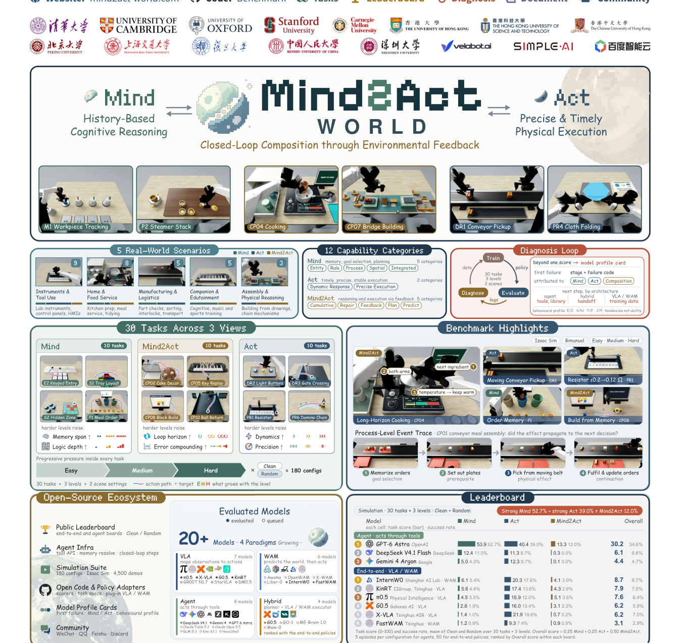
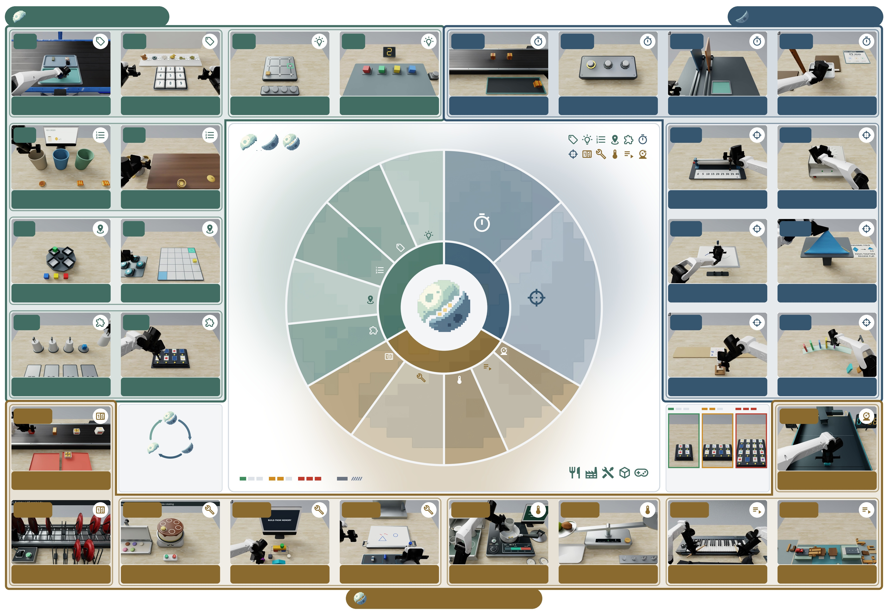
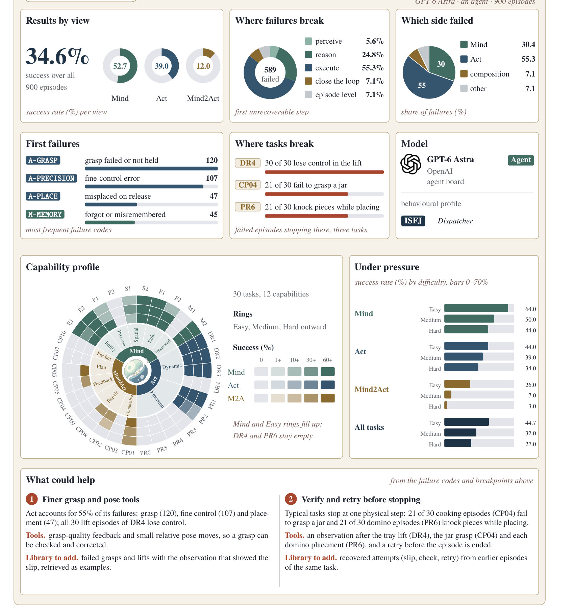
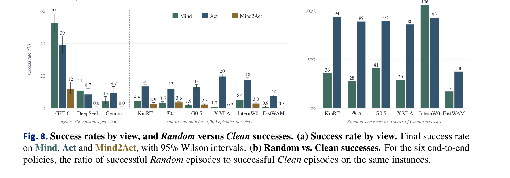

> **원문**: [arXiv](https://arxiv.org/abs/2611.26444) · [HuggingFace](https://huggingface.co/papers/2611.26444) (👍 50) · [GitHub](https://github.com/Mind2Act/Mind2Act_World)
{: .prompt-info }

## 들어가며

HuggingFace Daily Papers에서 50표를 받은 로보틱스 벤치마크 논문입니다. Tsinghua mmlab@SIGS를 비롯해 Cambridge, Oxford, Stanford, CMU 등 16개 기관이 참여한 대형 프로젝트인데, 제목의 "Mind-Action Composition"이라는 표현이 눈에 띄었습니다. 최근 로봇 매니퓰레이션 벤치마크들은 대부분 "기억력 테스트" 아니면 "정밀도 테스트" 둘 중 하나에 집중하는데, 이 논문은 "둘 다 따로 테스트하고, 그걸 합쳐서도 테스트해서 어디서 깨지는지 보자"는 접근을 취합니다. 코드도 MIT 라이선스로 공개되어 있고(★30, eval/task/env/policies 디렉토리가 실제로 채워진 저장소였습니다) GPT-6 Astra, Gemini-4-Argon 같은 2026년 하반기 최신 모델들을 실제로 180개 시뮬레이션 설정에서 56,700개 에피소드나 돌려서 비교했길래 꼼꼼히 읽어봤습니다.

## 한눈에 보기

- **핵심 기여**: 로봇 과제를 Mind(기억 기반 추론)·Act(정밀 실행)·Mind2Act(둘의 폐루프 결합) 세 view로 설계해 "실패가 기억 때문인지 실행 때문인지 결합 때문인지"를 처음으로 분리해서 측정하고, 규칙+LLM판정+사람검수 3단 진단 하네스로 모델별 "profile card"까지 자동 생성
- **데이터/과제**: 5개 실세계 도메인에서 뽑은 30개 과제 × 3난이도 × 2장면(Clean/Random) = 180개 설정, 4,500개 시범 데이터, 총 56,700 에피소드 평가
- **성능**: 최강 에이전트(GPT-6 Astra)가 Mind 52.7%, Act 39.0%까지는 잘하다가 Mind2Act에서 12.0%로 급락. end-to-end 정책은 전부 Mind2Act에서 3.6% 이하
- **한 줄 요약**: "따로는 되는데 합치면 안 된다"는 걸 숫자로 못박은 논문입니다.

## 어떤 문제를 풀려고 했나

임바디드 에이전트가 쓸모 있으려면 세 가지가 필요하다고 저자들은 말합니다. 안 보이게 된 정보를 기억해서 결정하는 능력(Mind), 그 결정을 시공간적으로 정확히 실행하는 능력(Act), 그리고 실행 결과를 보고 다음 결정을 바꾸는 능력(Mind2Act, composition)입니다. 요리 예시가 직관적인데, 로봇이 "다음에 넣을 재료를 기억"하고, "양팔로 재료를 넣"고, "온도 센서 피드백을 보고 가열 모드를 보온으로 전환"해야 하는 장면이죠.

문제는 기존 벤치마크들이 이 셋을 깔끔하게 떼어서 보지 못한다는 겁니다. LIBERO나 RLBench 같은 고전 벤치마크는 기억과 실행을 한 과제 안에 뒤섞어 놓고 성공/실패만 보고하니, 실패 원인을 추적할 수가 없습니다. RoboDojo나 X2Real 같은 최근 벤치마크는 한발 나아가 기억과 실행을 따로 평가하긴 하는데, 정작 "그 둘이 한 워크플로우 안에서 서로 맞물려야 하는 상황"은 거의 다루지 않습니다. 논문의 비교표(Table 1)에 따르면 조사한 21개 벤치마크 중 "isolation + composition을 동시에 평가"하는 곳은 하나도 없었다고 합니다.

개인적으로 이 지적이 타당하다고 느꼈습니다. 어떤 로봇이 "물건을 잘 찾고" "손도 안정적"인데도 실제 작업에서는 자꾸 실패한다면, 그게 "둘 다 못해서"인지 "둘을 이어 붙이는 데서" 새는 건지는 완전히 다른 처방이 필요하니까요. 전자라면 더 많은 데이터로 각 능력을 키우면 되지만 후자라면 아예 다른 종류의 개입(피드백 루프, 검증 단계)이 필요합니다.

## 핵심 아이디어

### 세 개의 view로 쪼갠 30개 과제

다음은 전체 벤치마크 구조를 보여주는 개요도입니다.

_Fig. 1. Mind2Act World 전체 구조. 위쪽은 Mind/Act 두 능력이 Mind2Act에서 결합됨을, 중간은 5개 실세계 도메인과 12개 능력 카테고리·진단 루프를, 아래쪽은 평가된 20여 개 모델과 리더보드를 보여줍니다._

이 그림의 아래쪽 리더보드 패널을 보면 이미 핵심 결론이 요약돼 있습니다. "Strong Mind 52.7% + strong Act 39.0% ≠ Mind2Act 12.0%"라는 문구가 박혀 있는데, 이게 이 논문이 하고 싶은 말 전부라고 해도 과언이 아닙니다.

과제 배치를 좀 더 자세히 보여주는 그림도 있습니다.

_과제 30개(각 10개씩 3개 view)가 중앙의 원형 다이어그램을 중심으로 배치되어 있고, 녹색(Mind)·파랑(Act)·금색(Mind2Act) 테두리로 구분됩니다. 예를 들어 M1(Workpiece tracking)은 커버를 계속 바꿔치기하면서 숨긴 부품을 추적해야 하고, DR4(Ball tray)는 트레이 위 공들을 떨어뜨리지 않고 옮겨야 합니다._

Mind 과제는 "이미 본 정보를 나중에 써먹기"(예: 주문 순서 기억, 버튼 규칙 추론)에 집중하고 물리적 실행 자체는 쉽게 설계되어 있습니다. 반대로 Act 과제는 "뭘 해야 하는지는 화면에 다 나와 있으니 정확하고 제때 실행만 하면 되는" 과제들(컨베이어 물건 낚아채기, 저항값 맞추기)입니다. Mind2Act 과제는 둘을 체인으로 묶어서, 예를 들어 CP04(요리)에서는 레시피 순서를 기억해 재료를 넣고 "온도가 80도에 도달하면 2초 안에" 모드를 바꿔야 합니다 — 기억한 정보가 행동을 이끌고, 행동의 물리적 결과(온도)가 다시 다음 결정을 바꾸는 구조죠.

### 에이전트와 정책을 같은 링 위에 세우기

이 논문이 영리한 지점은 "LLM 에이전트"와 "VLA/WAM 같은 end-to-end 정책"이라는, 원래 비교하기 까다로운 두 부류를 같은 180개 설정, 같은 평가자, 같은 정보 조건 위에서 비교한다는 겁니다. 에이전트는 `move_eef`, `wait_steps`, `memory_resolve` 같은 고정된 도구 세트로 로봇을 움직이고, 정책은 관측을 받아 바로 관절 명령을 뽑습니다. 둘 다 "시뮬레이터 숨겨진 상태"는 못 보고, 완료 판정은 반드시 물리적 조건(물체가 실제로 놓였는지, 다이얼이 안정됐는지)으로만 결정됩니다.

평가 지표부터 짚고 넘어가겠습니다. 기본이 되는 최종 성공률은 이렇게 정의됩니다.

$$\hat{S} = \frac{1}{N}\sum_{i=1}^{N} s_i$$

$N$은 그 과제·난이도에 고정으로 배정된 평가 인스턴스 수이고, $s_i \in \{0, 1\}$는 $i$번째 에피소드의 성공 여부입니다(타임아웃은 실패로 집계).

별것 아닌 공식처럼 보이지만, 중요한 건 모든 시스템이 완전히 동일한 인스턴스 리스트를 받는다는 점입니다. 그래서 시스템 간 성공률 차이가 "운 좋게 쉬운 인스턴스를 만나서"가 아니라 진짜 능력 차이라고 주장할 수 있습니다. 그리고 논문은 성공률 외에 0~100점짜리 "task score"(부분 점수)도 같이 보고하는데, 이 둘의 격차가 진단 정보로 쓰입니다 — 뒤에서 보겠지만 Mind2Act에서는 이 격차가 거의 0이라, "거의 다 갔다가 실패"가 아니라 "초반부터 실패"한다는 걸 보여주는 근거가 됩니다.

리더보드의 Overall 점수는 단순 평균이 아니라 이렇게 가중합됩니다.

$$\text{Overall} = 0.25 \cdot S_{\text{Mind}} + 0.25 \cdot S_{\text{Act}} + 0.50 \cdot S_{\text{Mind2Act}}$$

Mind와 Act는 각각 25%씩이고 Mind2Act 하나가 나머지 둘을 합친 것만큼(50%) 가중치를 받습니다. 이건 그냥 계산 방식이 아니라 저자들의 가치판단이 들어간 설계입니다 — "실제로 쓸모 있는 로봇은 워크플로우 전체를 완수해야 하므로, 둘 중 하나만 잘하는 건 반만 잘하는 것보다도 가치가 낮다"는 입장을 점수 공식에 박아넣은 거죠. 그래서 뒤에 나오듯 InternW0가 Mind와 Act 리더보드에서 각각 1등인데도 Mind2Act에서 π0.5(3.6%)보다 낮은 3.0%를 기록하는 바람에, end-to-end 전체 1위 타이틀이 좀 공허해지는 상황이 벌어집니다.

### 진단 하네스: 어디서, 왜 깨졌는지 자동으로 카드화하기

이 논문에서 가장 실용적이라고 느낀 부분입니다. 단순히 "성공/실패"만 보고하지 않고, 21개 실패 코드(M-MEMORY, A-GRASP, C-NO-UPDATE 등)로 "에피소드 안에서 처음으로 되돌릴 수 없는 오류가 어디서 났는지"를 분류합니다. 분류는 3단계로 이뤄지는데, ①시뮬레이터 이벤트와 채점 기록으로 규칙 기반 판정 → ②규칙이 결론 못 내면 LLM 판사가 영상과 행동 기록을 보고 판정(규칙 결과는 뒤집지 못함) → ③그래도 애매하면 사람이 최종 판정합니다. 이걸 대표 시스템 3개(G0.5, InternW0, GPT-6 Astra)에 대해 실행해서 "모델 profile card"라는 한 장짜리 진단서를 만듭니다. GPT-6 Astra의 카드를 가져와 봤습니다.

_GPT-6 Astra의 profile card. 589개 실패 에피소드 중 55.3%가 실행(execute) 단계에서, 30.4%가 기억/추론(Mind) 단계에서 처음 깨집니다. "Where tasks break" 패널을 보면 DR4(트레이 나르기)는 30번 전부 들어 올리는 순간 실패하고, CP04(요리)는 21/30이 병을 못 잡아서, PR6(도미노)는 21/30이 놓다가 쓰러뜨려서 실패합니다._

재밌는 디테일 하나는, 카드마다 MBTI 형식을 빌린 "행동 프로필" 코드가 붙는다는 겁니다(GPT-6 Astra는 ISFJ "Dispatcher"). Act에서 더 잘하면 E, Mind에서 더 잘하면 I를 받는 식으로 4개 축을 비교해서 글자를 매기는데, 저자들 스스로도 "그냥 재미로"(Just for Fun)라고 appendix 제목을 붙여놨습니다. 여담으로, 이런 장치를 넣은 건 논문치고는 꽤 유머러스하다고 느꼈는데, 동시에 "성능이 아니라 실패 패턴의 성격을 기억하기 쉽게 만든다"는 실용적 의도도 있어 보입니다.

이 진단을 3개 시스템에 돌린 결과, 실패를 Mind/Act/Composition 중 어디에 돌렸는지 비율이 이렇게 나왔습니다(전체 레이어 기준).

| 시스템 | Mind | Act | Composition |
|---|---|---|---|
| G0.5 (VLA) | 27.7% | 41.4% | 6.1% |
| InternW0 (WAM) | 32.8% | 37.2% | 10.5% |
| GPT-6 Astra (Agent) | 30.4% | 55.3% | 7.1% |

패턴을 짚어보면, 세 시스템 모두 Composition(C-NO-VERIFY, C-PREREQ 등) 비율은 가장 낮습니다(6~11%). 그런데 이게 "결합 능력이 뛰어나서"가 아니라, 뒤에서 보듯 애초에 Mind나 Act 단계에서 너무 일찍 막혀서 결합이 테스트될 기회 자체가 적기 때문이라는 게 함정입니다. G0.5와 InternW0는 기억 실패(27.7%, 32.8%)가 GPT-6 Astra(30.4%, 근소하지만 비슷)보다 약간 두드러지는 반면, GPT-6 Astra는 실행 실패(55.3%)가 압도적으로 큽니다 — 잡기 실패 120건, 정밀 제어 오류 107건이 가장 큰 축입니다.

## 실험 결과

9개 시스템(에이전트 3종: GPT-6 Astra, DeepSeek-V4.1-Flash, Gemini-4-Argon / VLA 4종: KinRT, π0.5, G0.5, X-VLA / WAM 2종: InternW0, FastWAM)을 비교한 리더보드입니다. 에이전트와 end-to-end 정책은 평가 조건(에피소드 수, 물리 예산)이 달라 별도 순위로 매기며, 셀은 task score/성공률(%) 형식이고 **볼드**는 해당 리더보드 1위, _이탤릭_은 2위입니다.

| 모델 | 분류 | Mind | Act | Mind2Act | Overall |
|---|---|---|---|---|---|
| **GPT-6 Astra** | Agent | **53.9 / 52.7** | **40.4 / 39.0** | **13.3 / 12.0** | **30.2 / 34.6** |
| _DeepSeek-V4.1-Flash_ | Agent | _12.4 / 11.0_ | 11.3 / 8.7 | _0.3 / 0.0_ | _6.1 / 6.6_ |
| Gemini-4-Argon | Agent | 5.0 / 4.3 | _12.3 / 9.7_ | 0.1 / 0.0 | 4.4 / 4.7 |
| _KinRT_ | VLA | _5.6 / 4.4_ | 17.4 / 13.6 | _4.3 / 2.9_ | _7.9 / 7.0_ |
| π0.5 | VLA | 4.5 / 3.5 | 15.9 / 12.0 | **5.1 / 3.6** | 7.6 / 6.4 |
| G0.5 | VLA | 2.8 / 1.9 | 16.0 / 13.4 | 3.1 / 2.3 | 6.2 / 5.9 |
| X-VLA | VLA | 1.4 / 1.0 | **21.9 / 19.6** | 0.7 / 0.2 | 6.2 / 7.0 |
| **InternW0** | WAM | **6.1 / 5.4** | _20.3 / 17.6_ | 4.1 / 3.0 | **8.7 / 8.7** |
| FastWAM | WAM | 1.2 / 0.9 | 9.3 / 7.4 | 0.9 / 0.5 | 3.1 / 2.9 |

표를 보면 패턴이 뚜렷합니다. Act 열은 전반적으로 두 자릿수인데 Mind2Act 열은 전 시스템이 한 자릿수(GPT-6 Astra만 예외)이고, end-to-end 정책들은 Mind2Act가 아예 Mind 수준(1~5%대)에 머뭅니다. 즉 "Mind2Act가 더 어려운 이유"가 정책마다 다른데, VLA/WAM은 Mind2Act 실패의 주원인이 "기억이 거의 없어서"이고 에이전트는 "기억은 있는데 물리적 접촉에서 깨져서"라는 게 아래 그래프로 더 분명해집니다.

_(a) Mind(녹)·Act(파랑)·Mind2Act(금) 성공률. 에이전트 3종(왼쪽)과 end-to-end 정책 6종(가운데)을 95% 신뢰구간과 함께 비교했고, GPT-6 Astra만 Mind2Act 막대가 눈에 띕니다. (b) Random 장면에서의 성공 수를 Clean 장면 대비 비율로 표시 — VLA들은 Act 성공은 86~94% 유지하지만 Mind 성공은 28~41%로 뚝 떨어집니다._

(a)를 보면 GPT-6 Astra만 Mind2Act 막대(금색)가 눈에 보이는 높이(12%)를 가지고 있고, 나머지 8개 시스템은 거의 바닥에 붙어 있습니다. (b)가 더 흥미로운데, VLA 6종 모두 Random 장면(테이블 재질·조명·잡동사니를 바꾼 스트레스 테스트)에서도 Act 성공은 86~94%나 유지되는데 Mind 성공은 Clean 대비 28~41%로 급감합니다. 저자들은 이걸 "VLA가 장면에 뭐가 있었는지가 아니라 훈련 때 장면이 어떻게 생겼었는지를 기억하는 것 같다"고 해석합니다 — Act 과제는 목표물이 현재 화면에 그대로 보이니 클러터가 늘어도 찾을 수 있지만, Mind 과제는 "이전에 본 것"을 끄집어내야 하는데 그 "이전 장면"의 외형이 훈련 데이터와 달라지면 그 연결이 끊긴다는 거죠.

저자들이 참고용으로 제시하는 비교 하나를 직접 계산해 보고 싶었습니다. 논문은 "Mind와 Act가 서로 독립이라면 Mind2Act 성공 확률은 두 확률의 곱과 같을 것"이라는 기준선을 언급만 하고 구체적 숫자는 주지 않는데, 공식으로 쓰면 이렇습니다.

$$\hat{S}_{\text{Mind2Act}} \overset{?}{=} \hat{S}_{\text{Mind}} \times \hat{S}_{\text{Act}}$$

왼쪽은 실제 관측된 Mind2Act 성공률, 오른쪽은 "Mind도 되고 Act도 돼야 Mind2Act도 된다"는 단순 독립 가정 아래 기대되는 값입니다.

GPT-6 Astra 숫자(Mind 52.7%, Act 39.0%)를 넣어 **제가 직접 곱해보면** $0.527 \times 0.390 \approx 0.206$, 즉 "두 능력이 서로 아무 상관 없이 작동한다 쳐도" 20.6%는 나와야 할 것 같은데 실제 관측치는 12.0%로 그보다도 한참 낮습니다. 단순히 "두 가지를 다 잘해야 하니 확률이 곱해져서 낮아진 것"이라는 설명으로는 부족하고, 결합 자체에 추가 비용이 있다는 정황 증거로 읽힙니다. 다만 논문도 한계 섹션에서 밝히듯 Mind2Act 과제는 단일 view 과제보다 워크숍 길이 자체가 더 길고 내용도 다르기 때문에(평균 99.6초 대 58.5초), 이 비교를 너무 엄밀한 인과 증거로 받아들이진 않는 게 좋을 것 같습니다 — 저자들 스스로도 "이건 개입(intervention)이 아니라 참고용 서술"이라고 선을 긋습니다.

속도·비용도 흥미로운 대목입니다. 시뮬레이션이 추론 중에는 멈추기 때문에 타이밍 과제의 "시간 안에 해냈다"는 결과가 실시간 능력을 보장하진 않는다는 점을 저자들이 명시합니다.

| 모델 | 분류 | 호출당 시간 | 에피소드 시간(분) | API 비용/에피소드 | API 비용/성공 |
|---|---|---|---|---|---|
| GPT-6 Astra | Agent | 11.0s | 22.2 | $25.13 | $72.7 |
| DeepSeek-V4.1-Flash | Agent | 35.6s | 96.1 | $1.24 | $18.9 |
| Gemini-4-Argon | Agent | 27.8s | 18.0 | $1.12 | $24.0 |
| KinRT | VLA | 110.9ms | 4.8 | – | – |
| π0.5 | VLA | 77.1ms | 8.6 | – | – |
| G0.5 | VLA | 170.3ms | 6.7 | – | – |
| X-VLA | VLA | 153.0ms | 16.5 | – | – |
| InternW0 | WAM | 488.1ms | 19.2 | – | – |
| FastWAM | WAM | 262.1ms | 12.4 | – | – |

GPT-6 Astra가 DeepSeek보다 호출당 20배 비싸지만(25.13달러 대 1.24달러), 성공률도 훨씬 높아서 "성공 1건당 비용"으로 따지면 오히려 4배 차이(72.7달러 대 18.9달러)로 좁혀집니다. end-to-end 정책은 호출당 수백 밀리초라 에이전트보다 적게는 20배, 많게는 거의 300배 빠른데, 특히 DR3(순환 게이트) 같은 타이밍 과제에서 GPT-6 Astra가 9.2초짜리 응답으로 2.6초짜리 창을 "통과"한 것으로 기록된다는 지적이 뼈아픕니다. 실제 공장이라면 게이트는 그 사이 이미 닫혔을 거라는 거죠.

응용 도메인별로 보면 가정·식음료(Mind2Act 과제 비중 높음)와 조립 도메인에서 모든 시스템이 가장 저조했고(GPT-6 Astra 각각 17.9%, 4.4%), 반대로 제조/물류(단순 반복 동작 위주)에서 end-to-end 정책들이 상대적으로 선전했습니다. 56,700개 에피소드 전체에서 단 한 번도 성공하지 못한 과제가 8개(M1, DR4, PR5, PR6, CP03, CP04, CP07, CP09)나 된다는 점도 눈에 띕니다 — 이 벤치마크가 "현재 바닥을 찍고 있는 지점"이 어디인지 분명히 보여줍니다.

## 아쉬운 점 / 의문점

저자들이 직접 인정하는 한계들이 꽤 정직합니다. 가장 중요한 건 "제한된 인과적 귀속(limited causal attribution)"인데, Mind2Act 과제가 단일 view 과제보다 워크플로우 자체가 길고 내용도 다르기 때문에, "Mind2Act 성적이 낮은 게 결합 능력 부족 때문인지, 그냥 더 긴 과제라서인지"를 현재 설계로는 깔끔하게 분리할 수 없다는 겁니다. 저자들도 향후 계획에서 "Mind/Act 오라클을 줘서 그 기여도만큼만 떼어 보겠다"는 교정 실험을 예고하는데, 이번 보고서에는 아직 없습니다.

또 하나 걸리는 건 평가 공정성입니다. 에이전트는 IK/모션 플래닝을 대신 해주는 서비스와 end-to-end 정책의 4배에 달하는 물리 예산을 받는 반면, 애초에 벤치마크 데이터로 파인튜닝되지도 않습니다. 그런데도 거의 모든 축에서 end-to-end 정책을 압도하니, "GPT-6 Astra가 정말 더 똑똑해서"인지 "애초에 훨씬 유리한 조건에서 평가받아서"인지 완전히 가르기 어렵습니다. 저자들도 이 비교를 "실시간 능력이 아니라 멈춘 시계 아래서의 결과"라고 스스로 못박아 둔 건 신뢰가 가지만, 그렇다면 애초에 "에이전트가 더 낫다"는 식의 서사로 이어지기 쉬운 결과 제시 방식 자체는 조금 아쉽습니다.

개인적으로는 진단 하네스 쪽이 가장 재사용 가치가 크다고 느꼈습니다. 21개 실패 코드와 3단계 판정(규칙→LLM→사람) 설계는 다른 로봇 벤치마크나, 더 나아가 에이전틱 LLM 평가 전반에도 옮겨볼 만한 아이디어입니다. 다만 LLM 판사가 "규칙 결과를 뒤집지 못한다"는 설계가 규칙 레이어의 편향(예: 스코어러 기록이 기억 오류를 더 쉽게 드러낸다는 점을 저자들도 인정)을 그대로 상속한다는 점은, 이 하네스를 가져다 쓸 때 조심해야 할 부분 같습니다.

## 마치며

"지식과 행동은 하나다(知行合一)"라는 왕양명의 말을 결론에서 인용한 게 이 논문의 톤을 잘 요약합니다. 현재 임바디드 시스템들은 지식(Mind)과 행동(Act)이 여전히 따로 놀고, 그마저도 고르게 발달하지 않았다는 게 결론입니다. 56,700개 에피소드를 다 돌려서 "최강 시스템도 Mind2Act에서는 8번 중 7번 실패한다"는 숫자를 만든 건 상당한 공학적 노력으로 보이고, MIT 라이선스로 코드·과제·평가 하네스를 다 공개한 점도 높이 살 만합니다. 다음에 볼 만한 지점은 저자들이 예고한 "오라클을 끼운 교정 실험"이 실제로 나와서, 지금의 "Mind2Act가 왜 어려운가"라는 질문에 조금 더 정량적인 답을 줄 수 있을지일 것 같습니다.
