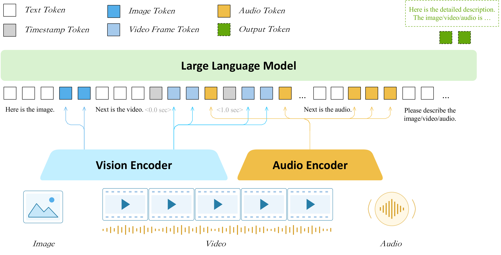
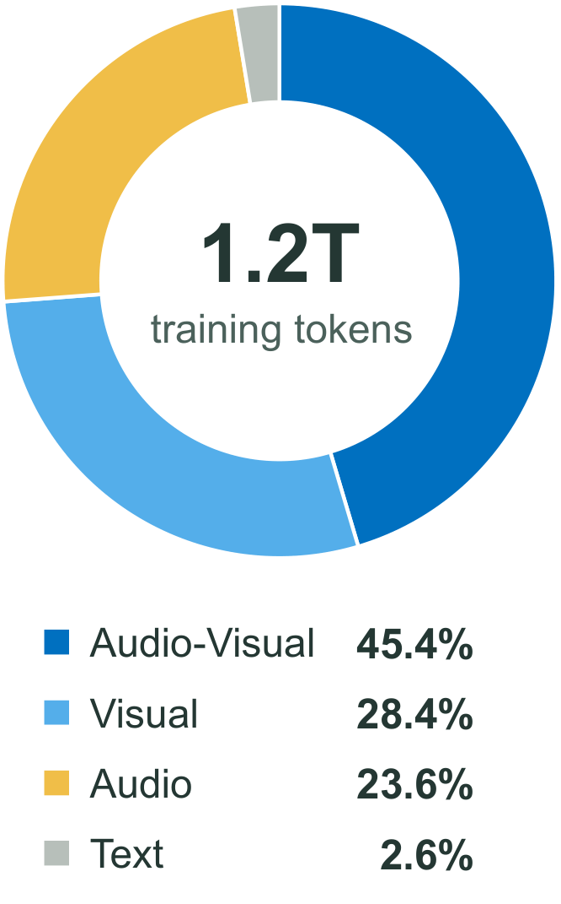
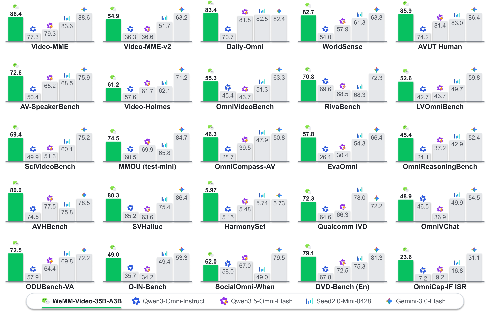

> **원문**: [arXiv](https://arxiv.org/abs/2611.26409) · [HuggingFace](https://huggingface.co/papers/2611.26409) (👍 45) · [GitHub](https://github.com/Tencent/WeMM-Video)
{: .prompt-info }

## 들어가며

어제 HuggingFace Daily Papers에서 45표를 받은 논문입니다. 텐센트 위챗(WeChat) 팀이 낸 테크니컬 리포트인데, 제목에 있는 "Omni-Modal"이라는 단어 때문에 골랐습니다. 요즘 비전-언어 모델은 많이 나오지만, 영상의 화면과 소리를 "따로" 보는 게 아니라 "같이" 묶어서 이해하고 추론하는 오픈소스 모델은 아직 드뭅니다. 이 논문은 2B부터 35B-A3B(MoE)까지 네 가지 크기로 모델을 공개했고, 플래그십 모델이 오디오-비주얼 벤치마크 33개 중 상당수에서 Gemini-3.0-Flash에 근접하거나 앞선다고 주장하길래 실제로 본문을 읽어봤습니다. GitHub 저장소도 확인해보니 placeholder가 아니라 커밋 13개짜리 실제 코드 저장소였고, vLLM/SGLang 서빙 패치와 GGUF 양자화 버전까지 올라와 있었습니다.

## 한눈에 보기

- **핵심 기여**: 영상+오디오를 하나의 토큰 시퀀스로 섞어 넣고(interleaving), "바로 답하기(Instruct)"와 "단계별로 생각하기(Thinking)" 두 모드를 모두 지원하는 옴니모달 모델 패밀리(2B/4B/9B/35B-A3B)를 학습·공개
- **학습 데이터**: 약 1.2조 토큰, 그중 오디오-비주얼 결합 데이터가 45.4%로 가장 큰 비중
- **학습 파이프라인**: 3단계 점진적 사전학습(오디오 정렬 → 지식 주입 → 긴 컨텍스트 확장) 이후, multi-teacher distillation → anti-repetition DPO → specialist RL의 3단계 후처리
- **성능**: 35B-A3B 모델이 오디오-비주얼 벤치마크 17개 중 16개에서 Qwen3.5-Omni-Flash를 앞섰고, Gemini-3.0-Flash에는 근접
- **한 줄 요약**: "영상을 볼 때 소리를 끄고 보지 않는다"는 당연한 말을 실제로 모델에 구현해서 오픈소스 최고 수준까지 끌어올린 리포트입니다.

## 어떤 문제를 풀려고 했나

저자들은 실제 영상 이해에는 단순히 "이 장면에 뭐가 있는지" 아는 것 이상이 필요하다고 말합니다. 프레임 사이의 미세한 변화를 포착하고, 시간에 따라 벌어지는 사건들을 연결하고, 무엇보다 화면과 소리를 같이 종합해서 추론해야 한다는 겁니다. 그런데 기존 오픈소스 모델들은 여기서 자주 무너집니다 — 중요한 오디오-비주얼 디테일을 놓치거나, 소리 신호와 그에 대응하는 화면 이벤트를 못 엮거나, 영상에 없는 내용을 지어내는 cross-modal hallucination을 일으킨다고 지적합니다.

재밌는 건 이 문제의식이 추상적인 벤치마크 점수가 아니라 구체적인 배포 맥락에서 나왔다는 점입니다. 논문은 WeMM-Video가 위챗 내 라이브 커머스, 숏폼 드라마 분석, 인터랙티브 영상 서비스에 이미 투입되고 있다고 밝힙니다. 즉 "논문을 위한 벤치마크 모델"이 아니라 실서비스에서 쓰는 모델을 오픈소스로 공개한 셈인데, 이 지점이 개인적으로는 신뢰도를 올려주는 요소였습니다. 실제 트래픽에서 안 돌아가는 모델이었다면 이렇게 선뜻 코드와 가중치를 다 풀지는 않았을 테니까요.

## 핵심 아이디어

### 소리와 영상을 한 줄로 섞어 넣기

다음은 WeMM-Video의 전체 아키텍처를 보여주는 다이어그램입니다.

_Figure 3. 텍스트·이미지·오디오·비디오 토큰이 하나의 시퀀스로 들어가는 구조_

그림을 직접 보면, 이미지 토큰(파란색), 비디오 프레임 토큰(연파랑), 오디오 토큰(주황), 타임스탬프 토큰(회색)이 텍스트 토큰 사이사이에 끼워져서 LLM에 한 줄로 들어가는 걸 볼 수 있습니다. 특히 "Next is the video. <0.0 sec>" 다음에 비디오 프레임 토큰이 오고, 그 직후 오디오 토큰이 오고, 다시 "<1.0 sec>" 타임스탬프가 끼어드는 패턴이 반복됩니다. 이게 핵심인데, 영상과 오디오를 "따로 인코딩한 뒤 나중에 합치는" 방식이 아니라 "시간 순서대로 교차 삽입(interleaving)"해서 LLM이 처음부터 두 모달리티를 같은 타임라인 위에서 보게 만드는 겁니다.

오디오 처리 쪽을 조금 더 뜯어보면, Whisper 기반 인코더가 16,000Hz로 샘플링된 오디오를 30초 단위로 쪼개 특징을 뽑고, 그 다음 window-level Q-Former가 0.1초 단위 윈도우를 압축해서 초당 10개의 오디오 토큰으로 변환합니다. 즉 1초짜리 소리 구간이 LLM 입장에서는 딱 10개 토큰짜리 "단어"가 되는 셈입니다. 비주얼 인코더는 각 백본(Qwen3.5-2B/4B/9B, Qwen3.6-35B-A3B)이 원래 가진 걸 그대로 쓰고, 오디오 인코더만 Qwen2.5-Omni에서 초기화해서 새로 학습시켰다고 합니다. 기존에 검증된 비전 능력은 건드리지 않고 청각 능력만 새로 이식한다는 접근인데, 이는 처음부터 전부 다시 학습하는 것보다 훨씬 안전한 선택으로 보입니다.

### 1.2조 토큰, 그중 거의 절반이 "소리+영상"

다음은 학습 데이터 구성을 보여주는 그래프입니다.

_Figure 4(a). 모달리티별 학습 토큰 비중 — 전체 1.2조 토큰 중 오디오-비주얼 결합 데이터가 45.4%_

이 도넛 차트를 보면 네 조각으로 나뉘어 있는데, 오디오-비주얼(진한 파랑)이 45.4%로 절반에 가깝고, 순수 비주얼(연파랑) 28.4%, 순수 오디오(주황) 23.6%, 텍스트(회색)는 2.6%에 불과합니다. 저자들은 이 분포가 의도적이라고 밝힙니다. "조밀한 시간적 지도학습(dense temporal supervision)"을 위해 오디오-비주얼 결합 데이터를 가장 크게 가져갔다는 건데, 텍스트 비중이 2.6%밖에 안 된다는 점이 눈에 띕니다. 언어 능력은 이미 강력한 사전학습 백본(Qwen3.5/3.6)에서 물려받으니 새로 투자할 필요가 적다는 판단으로 보이는데, 뒤에 나오는 텍스트 평가에서 이 판단이 맞아떨어지는지 확인할 부분입니다.

### 3단계 사후학습 — "증류 → 반복 억제 → 강화학습" 순서가 중요한 이유

$$\text{OPD} \rightarrow \text{MrDPO} \rightarrow \text{Specialist RL}$$

이 순서 자체가 하나의 설계 결정입니다. 첫 단계인 multi-teacher OPD(on-policy distillation)에서는 모달리티별로 다른 선생 모델을 씁니다. 텍스트·비전-언어 과제에는 더 크고 강한 외부 모델을, 오디오-비주얼 과제에는 자기 자신의 사전학습 체크포인트를 "self-teacher"로 씁니다. 왜 이렇게 나눴을까 생각해보면, 외부의 강한 선생을 오디오-비주얼에도 똑같이 쓰면 그 선생이 애초에 오디오-비주얼을 못 다루니 모델이 애써 익힌 청각 능력을 잃어버릴 위험이 있기 때문으로 보입니다. 논문은 이를 명시하지는 않았지만 구조상 합리적인 추론입니다.

문제는 증류를 거치면 모델이 반복적이고 끝없는 디코딩(repetitive, endless decoding)에 빠지는 경향이 다시 심해진다는 점입니다. 그래서 두 번째 단계로 MrDPO(anti-repetition multi-round DPO)를 둡니다. 온라인 RL 대신 오프라인에서 미리 캐낸 hard-negative 샘플로 학습하는 이유에 대해, 저자들은 반복 디코딩 같은 "저빈도 이상 현상(low-frequency anomalies)"은 온라인 샘플링으로는 잘 안 걸리기 때문이라고 설명합니다. 안정성을 위해 전체 파라미터가 아니라 LoRA 어댑터만 학습하고, 라운드마다 합치고 다시 초기화하는 방식을 씁니다.

마지막 단계인 Specialist RL은 화자 식별, 비디오-사운드트랙 매칭처럼 아직 포화되지 않은 특화 과제를 겨냥합니다. 정답이 명확한 STEM/분석 과제는 규칙 기반 보상을, 열린 과제는 루브릭 기반 보상과 선생 모델과의 일치도 보상을 섞어 씁니다. 개인적으로 흥미로웠던 부분은 각 배치마다 instruct 모드와 thinking 모드를 확률적으로 섞어서 동시에 최적화한다는 점인데, 이렇게 하면 "빠른 답변"과 "깊은 추론" 두 행동 양식을 별도 모델이 아니라 하나의 체크포인트 안에 공존시킬 수 있습니다.

## 실험 결과

가장 핵심적인 결과인 오디오-비주얼 벤치마크 비교표를 그대로 가져왔습니다. 음영 처리된 Gemini-3.0-Flash 열은 참고용(최상위 비교 대상)이고, 굵게 표시된 숫자는 그 열을 제외한 나머지 중 최고 점수입니다.

| Benchmark | Gemini-3.0-Flash | Seed2.0-Mini-0428 | Qwen3.5-Omni-Flash | WeMM-Video-35B (Instruct) | WeMM-Video-35B (Thinking) |
|---|---|---|---|---|---|
| **일반 오디오-비주얼 이해** | | | | | |
| Video-MME (audio) | 88.6 | 83.6 | 79.3 | 84.2 | **86.4** |
| Video-MME-v2 (audio) | 63.2 | 51.7 | 36.6 | 47.5 | **54.9** |
| Daily-Omni | 82.4 | 82.5 | 81.8 | 81.5 | **83.4** |
| WorldSense | 63.8 | 61.3 | 57.9 | 59.6 | **62.7** |
| AVUT Human | 86.4 | 83.0 | 81.4 | 83.6 | **85.9** |
| AV-SpeakerBench | 75.9 | 68.5 | 65.2 | 66.5 | **72.6** |
| Video-Holmes | 71.2 | 62.1 | 61.7 | 63.2 | **63.4** |
| OmniVideoBench | 63.3 | 51.3 | 43.7 | 48.6 | **55.3** |
| RivaBench | 72.3 | 68.3 | 68.5 | 67.9 | **70.8** |
| LVOmniBench | 59.8 | 49.7 | 43.7 | 50.3 | **52.6** |
| FutureOmni | 65.3 | 52.2 | 55.4 | **58.4** | 56.2 |
| JointAVBench | 68.4 | 64.7 | **69.0** | 67.4 | 65.9 |
| SciVideoBench | 75.2 | 60.1 | 51.3 | 57.8 | **69.4** |
| MMOU (test-mini) | 84.7 | 65.8 | 69.9 | 71.4 | **74.5** |
| OmniCompass-AV | 50.8 | **47.9** | 39.5 | 41.5 | 46.3 |
| EvaOmni | 66.4 | 54.3 | 30.4 | 48.8 | **57.8** |
| OmniReasoningBench | 52.4 | 42.9 | 37.2 | 44.3 | **45.4** |
| **오디오-비주얼 환각(Hallucination)** | | | | | |
| AVHBench Judgement | 78.5 | 75.8 | 77.5 | **80.3** | 80.0 |
| SVHalluc | 86.4 | 75.4 | 63.6 | 75.3 | **80.3** |
| **비디오-음악 이해** | | | | | |
| MUSIC-AVQA | 76.2 | 74.2 | **82.1** | 79.6 | 79.5 |
| HarmonySet | 5.73 | 5.74 | 5.48 | 5.63 | **5.97** |
| **오디오-비주얼 인터랙션** | | | | | |
| Qualcomm IVD | 72.2 | 70.0 | 66.3 | 70.2 | **72.3** |
| OmniVChat | 54.5 | **49.8** | 36.9 | 44.8 | 48.9 |
| O-IN-Bench | 53.3 | **49.4** | 34.2 | 38.4 | 49.0 |
| **오디오-비주얼 캡셔닝** | | | | | |
| Omni-Cloze | 34.3 | 39.9 | 41.8 | **44.2** | 42.6 |
| UGCVideoCap | 71.0 | 74.8 | 70.5 | **75.1** | 74.9 |
| DVD-Bench (En) | 81.2 | 75.3 | 72.5 | 76.2 | **79.1** |
| DailyOmni (Caption QA) | 51.8 | 50.9 | 44.0 | 51.9 | **62.2** |

(ODU-Bench, SocialOmni처럼 서브 지표가 여러 개인 벤치마크 몇 개는 표가 너무 길어져 생략했습니다. 전체는 원문 Table 1 참고)

패턴을 짚어보면, **Thinking 모드 쪽이 Instruct 모드보다 거의 모든 항목에서 점수가 높습니다.** 같은 가중치인데 "생각하고 답하기"만 켰을 뿐인데 점수가 오른다는 건, 추론 과정 자체가 답을 찾는 데 실질적으로 기여한다는 뜻입니다. 특히 SciVideoBench(57.8→69.4)나 DailyOmni Caption QA(51.9→62.2)처럼 복잡한 추론이 필요한 과제에서 격차가 크게 벌어지는데, 이는 저자들의 "thinking mode가 cross-modal hallucination을 줄이고 복잡한 과제에서 성능을 끌어올린다"는 주장과 일치합니다. 반대로 JointAVBench, OmniVChat, O-IN-Bench처럼 Qwen3.5-Omni-Flash나 Seed2.0-Mini가 1위를 차지하는 항목도 있는데, 공교롭게도 이런 항목들은 대부분 "인터랙션"이나 "비디오-음악 이해"처럼 즉각적인 반응이 중요한 과제들입니다. 긴 사고가 꼭 모든 상황에 유리한 건 아니라는 뜻으로 읽힙니다.

다음은 플래그십 모델이 오픈소스·독점 모델들과 25개 벤치마크에서 비교되는 모습을 한눈에 보여주는 그래프입니다.

_WeMM-Video-35B-A3B(초록)와 Qwen3-Omni-Instruct, Qwen3.5-Omni-Flash, Seed2.0-Mini-0428, Gemini-3.0-Flash 비교_

각 막대그래프에서 초록색(WeMM-Video)이 왼쪽에 고정되어 있고, 오른쪽 네 개 회색 막대가 각각 경쟁 모델입니다. 전체 25개 그래프를 훑어보면 WeMM-Video가 Qwen3-Omni-Instruct와 Qwen3.5-Omni-Flash(파랑/보라 아이콘)를 거의 전 항목에서 앞서는 것을 확인할 수 있습니다. Gemini-3.0-Flash(다이아몬드 아이콘)는 대부분의 항목에서 여전히 최고점을 지키고 있지만, AVHBench나 ODUBench-VA, Qualcomm IVD 같은 일부 항목에서는 WeMM-Video가 Gemini를 넘어선 모습도 보입니다. "오픈소스가 독점 모델 턱밑까지 쫓아왔다"는 표현이 과장이 아니라는 걸 그래프로 확인할 수 있는데, 다만 "대부분 앞선다"가 아니라 "일부 항목에서 역전"이라는 점은 분명히 구분해야 합니다.

텍스트/이미지 평가에서는 음성·영상 모달리티를 추가했다고 해서 원래 백본(Qwen3.6-35B-A3B)의 순수 언어 능력이 손상되지 않았다는 점이 확인됩니다. 예를 들어 HMMT Nov 25 수학 벤치마크에서 WeMM-Video-35B-A3B(Thinking)는 90.0점으로 백본 Qwen3.6-35B-A3B의 89.1점을 오히려 살짝 웃돌았고, IFEval에서도 93.2점으로 백본(90.9)보다 높았습니다. 반면 텍스트 비중이 2.6%뿐인 학습 데이터로 과연 복잡한 추론 능력까지 유지될지 걱정했던 부분인데, 적어도 숫자상으로는 기우였던 것 같습니다. 오디오 단독 평가에서도 음성 인식(WER)이나 음악 이해 벤치마크에서 독점 모델 Qwen3.5-Omni-Flash와 거의 대등한 수준을 유지했습니다.

## 아쉬운 점 / 의문점

논문이 스스로 인정하는 한계는 딱히 명시되어 있지 않습니다 — "Conclusion"이 전형적인 성과 요약으로만 끝나는데, 이 부분은 솔직히 조금 아쉬웠습니다. 리뷰어로서 몇 가지 의문을 던져보면:

- **왜 2.6%뿐인 텍스트 데이터로 충분했는지에 대한 설명이 없습니다.** 결과는 좋아 보이지만, "백본이 이미 충분히 강했다" 정도의 추측 말고는 논문이 직접 설명하지 않습니다. ablation(텍스트 비중을 조절했을 때 어떻게 달라지는지)이 있었다면 훨씬 설득력이 있었을 텐데, 그런 실험은 보이지 않습니다.
- **Instruct와 Thinking 중 어느 쪽이 더 "기본값"에 가까운지, 추론 시간(latency) 트레이드오프가 어느 정도인지** 수치로 나와 있지 않습니다. 실무에서는 "몇 배 느려지는데 몇 점 오른다"는 정보가 배포 결정에 중요한데, 이 리포트에는 빠져 있습니다. (원래 Inference Budget Analysis라는 섹션이 있었던 흔적이 LaTeX 소스에 주석 처리된 채로 남아 있는 걸 보면, 공개 전에 통째로 들어낸 것으로 보입니다. 아마 아직 수치가 덜 정리됐거나 시간에 쫓겨 뺐을 가능성이 있는데, 정확한 이유는 논문에 나와 있지 않습니다.)
- **2B/4B/9B 모델의 "self-teacher" 선택 기준이 불명확합니다.** 2B 모델만 별도의 "전용 omni-modal teacher"를 썼다고 하는데(“2B 모델은 표현 분포가 취약해 훈련 붕괴에 취약하다”는 이유), 이게 사전에 알고 설계한 것인지 실험 중 실패를 겪고 나서 수정한 것인지는 불분명합니다.
- **평가 judge 모델이 GPT-4o, GPT-6.1-Sol, GPT-6-Luna, Qwen3-235B-A22B 등 제각각**입니다. judge가 벤치마크마다 다르면 모델 간 비교의 공정성에 미세한 편차가 생길 수 있는데, 이 부분에 대한 교차검증(동일 judge로 재평가했을 때 순위가 바뀌는지)은 보고되어 있지 않습니다.

## 마치며

오디오-비주얼을 "같은 타임라인 위에서" 처리한다는 아이디어 자체는 새롭지 않습니다(video-SALMONN 2 계열 작업을 그대로 계승했다고 저자들도 밝힙니다). 이 논문의 기여는 아이디어의 참신함보다는, 그 아이디어를 1.2조 토큰·4개 모델 크기·3단계 후처리로 꼼꼼하게 스케일업해서 실제로 오픈소스 SOTA를 찍었다는 실행력에 있다고 봅니다. 개인적으로는 작은 모델(2B/4B)에서도 비슷한 설계(모달리티 interleaving + Q-Former 압축)가 잘 먹힌다는 점이 더 흥미로웠습니다. 리소스가 제한된 개인 프로젝트에서 "영상+소리"를 같이 다뤄야 할 일이 생긴다면, 이 리포트의 데이터 구성 비율(오디오-비주얼 45%, 오디오 24%, 텍스트 2.6%)과 Q-Former 압축 비율(초당 10토큰)은 참고할 만한 시작점이 될 것 같습니다. 다음에 챙겨볼 지점은 이 모델이 실제로 WeChat 서비스에 배포된 후 커뮤니티에서 어떤 실패 사례를 보고하는지입니다.
