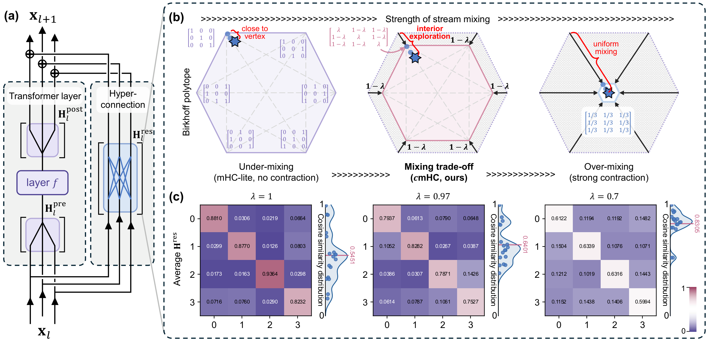
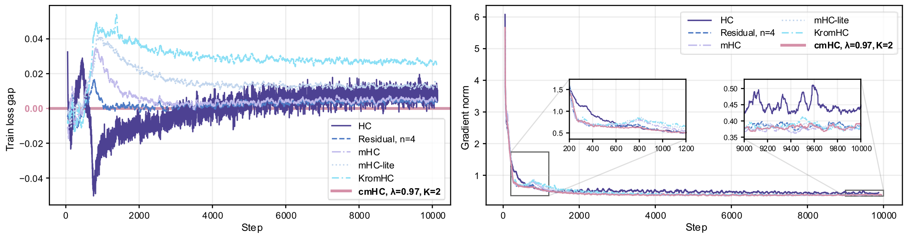
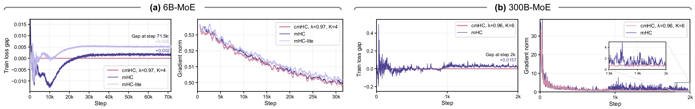

> **원문**: [arXiv](https://arxiv.org/abs/2611.27193) · [HuggingFace](https://huggingface.co/papers/2611.27193) (👍 88) · [GitHub](https://github.com/Newiz430/cmHC)
{: .prompt-info }

## 들어가며

HuggingFace Daily Papers에서 88표를 받은 논문입니다. Related Work를 보면 TeleChat2, TeleChat3-MoE, Ascend NPU용 fused 커널까지 저자들이 직접 구현해 넣은 걸로 봐서 Huawei 계열 팀으로 보이는데, 이론 증명부터 45M짜리 GPT-2급 모델, 6B·300B 규모 MoE 실전 프리트레이닝, 거기에 하드웨어 커널 최적화까지 한 편에 다 들어 있는 보기 드문 구성이라 눈이 갔습니다. 제목의 "Geometric Contraction"이라는 표현도 흥미로웠고, Birkhoff polytope(버코프 폴리토프)라는 다소 낯선 조합론적 기하 개념을 잔차 연결 설계에 그대로 가져다 쓴다는 발상이 신선해서 골라봤습니다.

## 한눈에 보기

- **핵심 기여**: mHC·mHC-lite 계열이 공유하는 "믹싱 트레이드오프"(under-mixing ↔ over-mixing)를 이론과 실험으로 규명하고, 퍼뮤테이션 행렬을 계수 $\lambda$로 살짝 뭉개는 geometric contraction을 제안합니다. 새 파라미터 없이 "모든 입력 스트림이 모든 출력 스트림에 양의 기여를 한다"는 수학적 하한을 보장합니다.
- **성능**: nanoGPT-S/M/L(45M~0.36B) 전 구간에서 평균 loss 랭킹 1위(λ=0.97, K=2), 6B-MoE·300B-MoE 프리트레이닝까지 스케일 검증, Ascend NPU fused 커널로 하이퍼커넥션 연산 지연 최대 44.8% 절감.
- **한 줄 요약**: 스트림을 섞는 행렬이 극점(퍼뮤테이션 행렬)에 달라붙지 못하게 폴리토프를 안쪽으로 살짝 조이되, 그 조임을 얕은 층 몇 개에만 걸어서 "적당히만" 섞이게 만든 논문입니다.

## 어떤 문제를 풀려고 했나

표준 잔차 연결(residual connection)은 레이어의 입력과 출력을 단순히 더합니다. Hyper-Connections(HC)는 이걸 확장해서 하나의 스트림 대신 $n$개의 병렬 스트림을 유지하고, 레이어마다 학습 가능한 행렬로 이 스트림들을 모으고·섞고·다시 나눕니다. 업데이트 식은 이렇습니다.

$$\mathbf{x}_{l+1} = \mathbf{H}^{\mathrm{res}}_l \mathbf{x}_l + {\mathbf{H}^{\mathrm{post}}_l}^{\top} f(\mathbf{H}^{\mathrm{pre}}_l \mathbf{x}_l; \mathbf{\Theta}_l)$$

$\mathbf{x}_l \in \mathbb{R}^{n \times d}$는 $l$번째 레이어의 $n$개 스트림 상태이고, $\mathbf{H}^{\mathrm{res}}_l \in \mathbb{R}^{n \times n}$이 스트림끼리 섞는 행렬, $\mathbf{H}^{\mathrm{pre}}_l, \mathbf{H}^{\mathrm{post}}_l \in \mathbb{R}^{1 \times n}$가 각각 스트림을 하나로 모아 트랜스포머 서브레이어 $f(\cdot;\mathbf{\Theta}_l)$(어텐션 또는 MLP)에 넣고, 그 결과를 다시 스트림별로 재분배하는 역할을 합니다.

이 식에서 문제는 $\mathbf{H}^{\mathrm{res}}_l$에 아무 제약이 없으면 학습이 불안정해진다는 점입니다. 그래서 mHC는 이 행렬을 Birkhoff polytope — 모든 행과 열의 합이 1인 이중확률행렬(doubly stochastic matrix)들의 집합 — 안에 가두는데, Sinkhorn-Knopp 반복으로 근사할 뿐 정확히는 아닙니다. mHC-lite는 이걸 정확하게(exact) 만드는데, $\mathbf{H}^{\mathrm{res}}_l$을 $n!$개 퍼뮤테이션 행렬의 볼록결합(convex combination)으로 직접 파라미터화합니다.

$$\mathbf{H}^{\mathrm{res}}_l = \sum_{m=1}^{n!}\alpha_{l,m}\mathbf{P}_m, \qquad \boldsymbol{\alpha}_l = \mathrm{softmax}\left(a_l^{\mathrm{res}}\mathbf{x}'_l\mathbf{W}^{\mathrm{res}}_l + \mathbf{b}^{\mathrm{res}}_l\right)$$

$\mathbf{P}_m$은 $m$번째 퍼뮤테이션 행렬(스트림 위치를 단순히 뒤섞기만 하는 0/1 행렬)이고, $\boldsymbol{\alpha}_l$은 이 $n!$개 퍼뮤테이션에 대한 softmax 가중치, $\mathbf{x}'_l$은 정규화·평탄화된 스트림이며 $a_l^{\mathrm{res}}, \mathbf{W}^{\mathrm{res}}_l, \mathbf{b}^{\mathrm{res}}_l$은 학습 파라미터입니다.

Birkhoff-von Neumann 정리 덕분에, 계수가 1로 합산되는 볼록결합이기만 하면 결과는 **항상** 정확히 이중확률행렬입니다 — Sinkhorn 반복 없이도요. 똑똑한 트릭인데, 저자들은 여기서 실제로 학습을 시켜보면 문제가 생긴다는 걸 지적합니다. softmax가 학습 중에 거의 항상 **단 하나의 퍼뮤테이션으로 수렴**해버립니다. 꼭 항등행렬(identity)이 아니라, 초기화 시점에 우연히 유리했던 임의의 퍼뮤테이션으로요. 그러면 $\mathbf{H}^{\mathrm{res}}_l$ 자체가 그냥 하나의 퍼뮤테이션 행렬이 되어버리는데, 퍼뮤테이션 행렬은 스트림의 "위치만 바꿀" 뿐 서로 다른 스트림의 정보를 실제로 섞지는 않습니다. 결과적으로 $n$개 스트림을 두는 설계 의도와 달리, 스트림들은 거의 독립적으로 흘러가는 "under-mixing" 상태에 빠집니다.

## 핵심 아이디어

### Geometric Contraction — 퍼뮤테이션 행렬을 살짝 뭉개다

이 논문의 핵심 트릭은 간단합니다. 퍼뮤테이션 행렬 $\mathbf{P}_m$ 자체를 더 "뭉툭한" 버전으로 바꿔버리는 겁니다.

$$\mathbf{P}'_m = \mathcal{C}(\mathbf{P}_m;\lambda) = \lambda\mathbf{P}_m + \frac{1-\lambda}{n-1}(\mathbf{1}_n\mathbf{1}_n^\top-\mathbf{P}_m)$$

$\lambda \in (1/n, 1)$은 "뭉개는 강도"를 정하는 하나의 스칼라이고, $\mathbf{1}_n$은 모든 성분이 1인 벡터라 $\mathbf{1}_n\mathbf{1}_n^\top$은 전부 1로 채워진 $n\times n$ 행렬입니다. $\lambda \to 1$이면 원래 mHC-lite(뾰족한 퍼뮤테이션 행렬 그대로)로 돌아가고, $\lambda \to 1/n$이면 모든 성분이 $1/n$인 완전 균일 혼합 행렬이 됩니다.

여기서 눈여겨볼 부분은, 이 변환이 $\mathbf{P}_m$ 자체를 미리 계산해서 바꿔치기하는 것뿐이라는 점입니다. $\boldsymbol{\alpha}_l$을 만드는 softmax 구조는 전혀 건드리지 않고, 학습 파라미터도 늘지 않습니다. mHC-lite 구현이 있다면 "참조하는 기저 행렬 테이블"만 바꾸면 되는 수준의 변경입니다.

이렇게 뭉갠 기저로 만든 $\mathbf{H}^{\mathrm{res}'}_l$에 대해 논문은 두 가지를 증명합니다. 첫째, $\lambda \in (1/n,1)$인 한 여전히 정확히 이중확률행렬이라(기존 폴리토프 안에 완전히 포함되므로) mHC가 가진 안정성(스펙트럴 노름 1 이하)을 그대로 유지합니다. 둘째, 더 중요한 건 다음 하한입니다.

$$h^{\mathrm{res}'}_{l,ij}\ge \min \left( \lambda, \frac{1-\lambda}{n-1} \right) > 0$$

$h^{\mathrm{res}'}_{l,ij}$는 뭉개진 잔차 행렬의 $(i,j)$ 성분, 즉 $j$번째 입력 스트림이 $i$번째 출력 스트림에 기여하는 정도입니다. 이 부등식이 말하는 건, $\boldsymbol{\alpha}_l$이 학습 중에 아무리 하나의 퍼뮤테이션으로 완전히 쏠려버려도(즉 under-mixing이 일어나려고 해도), 결과로 나오는 $\mathbf{H}^{\mathrm{res}'}_l$의 모든 성분은 구조적으로 0보다 큰 값을 갖도록 강제된다는 뜻입니다. softmax가 "착하게 학습되길" 바라는 게 아니라, 기저 자체를 바꿔서 애초에 0으로 떨어질 수 없게 만든 셈입니다.

다음은 이 아이디어를 시각화한 논문의 Figure 1입니다.

_Figure 1. (a) 레이어 $l$에서 하이퍼커넥션 모듈의 구조. (b) $n=3$일 때 폴리토프의 2차원 투영과, 학습 중 층 평균 잔차 행렬의 궤적. (c) $n=4$일 때 평균 $\mathbf{H}^{\mathrm{res}}$ 히트맵과 스트림 간 코사인 유사도 분포._

(a)는 지금까지 설명한 구조 그대로입니다. (b)가 핵심인데, 육각형으로 그려진 건 $n=3$ 퍼뮤테이션(총 6개)들의 볼록결합으로 이루어진 폴리토프를 2차원에 투영한 것입니다. 왼쪽(mHC-lite, 조임 없음)에서는 궤적(별표로 끝나는 점선)이 꼭짓점 중 하나에 딱 붙어서 끝납니다 — 이게 앞서 설명한 under-mixing입니다. 가운데(저자들의 cmHC, 적당한 조임)는 궤적이 폴리토프 안쪽으로 파고들어 가서 끝나고요. 오른쪽(강한 조임)은 아예 폴리토프의 정중앙, 즉 모든 성분이 $1/n$인 균일 혼합(uniform barycenter) 쪽으로 쏠려버립니다. "조금 조이면 적당히 섞이고, 너무 세게 조이면 다 똑같아진다"는 트레이드오프가 그림 한 장에 담겨 있습니다.

(c)는 이걸 $n=4$, nanoGPT-L 스케일 실제 학습 결과로 보여줍니다. $\lambda=1$(조임 없음)일 때는 대각 성분이 평균 0.88로 지배적이고(즉 각 스트림이 거의 자기 자신만 유지) 스트림 간 코사인 유사도 중앙값은 0.5451입니다. $\lambda=0.97$로 살짝만 조이면 대각 성분이 0.78~0.83 선으로 내려가고 코사인 유사도 중앙값은 0.6401로 올라갑니다. 그런데 $\lambda=0.7$까지 세게 조이면 대각 성분이 0.6 근처로, 코사인 유사도 중앙값은 0.8305까지 치솟습니다 — 서로 다른 스트림의 표현이 거의 평행한 벡터가 되어버린다는 뜻으로, 4개의 독립된 스트림을 두는 의미 자체가 희미해지는 지점입니다. 개인적으로 이 숫자들이 "트레이드오프"라는 추상적 개념을 가장 설득력 있게 뒷받침한다고 느꼈습니다.

### Banach 고정점과 "나비효과" — 왜 전 층에 조이면 안 되는가

흥미로운 건, 이 contraction이 수학적으로 완전한 **축소사상(contraction mapping)**이라는 점입니다. Banach 고정점 정리에 따르면, 이 변환을 반복 적용하면 유일한 고정점인 균일 혼합 행렬 $\mathbf{J}_n$(모든 성분이 $1/n$)으로 수렴합니다. 즉 모든 층에 조임을 걸면, 층이 깊어질수록 누적된 혼합 효과가 "확실하게" 균일 상태로 수렴한다는 걸 증명으로 보여준 겁니다. 이걸 정량화하기 위해 저자들은 Dobrushin's ergodicity coefficient $\tau$라는 도구를 쓰는데, $\tau \to 0$이면 서로 다른 출력 행이 거의 똑같아진다(= 과도하게 섞였다)는 뜻입니다. 핵심 정리는 다음입니다.

$$\tau\left(\prod_{l=0}^{L-1} \mathbf{H}^{\mathrm{res}'}_{L-1-l}\right) \leq \prod_{l=0}^{L-1}\lambda'_l$$

$\lambda'_l = (n\lambda_l-1)/(n-1)$은 $\lambda_l$을 정규화한 값으로, $\lambda_l<1$인 모든 층에 대해 $0<\lambda'_l<1$입니다. 우변은 각 층의 $\lambda'_l$을 전부 곱한 값인데, $\lambda'_l<1$인 층이 $L$개 쌓이면 이 곱은 $L$에 대해 **지수적으로** 0에 가까워집니다.

이게 왜 무서운 숫자냐면, $\lambda=0.97$처럼 1에서 아주 살짝만 벗어난 조임이라도 층이 깊어지면(예: 48층) 지수적으로 누적되어 결국 심각한 over-mixing을 유발한다는 뜻이기 때문입니다. 저자들은 이걸 "나비효과(butterfly effect)"라고 부르는데, 수치적으로 작은 조임이 충별로 반복되며 증폭된다는 비유가 적절해 보입니다. 논문은 여기서 한 걸음 더 나가, 조임이 스트림 간 차이의 노름(norm) 상한도 똑같이 층별로 곱해지며 줄어든다는 것, 그리고 서로 다른 퍼뮤테이션 계수 사이의 그래디언트 차이 상한도 조임 강도에 비례해 줄어든다는 것(즉 학습 중 $\boldsymbol{\alpha}$가 더 고르게 퍼지도록 유도된다는 것)까지 증명합니다. 조임이 "기하학적으로" under-mixing을 막는 동시에 "학습 역학적으로"도 간접 효과를 낸다는 이야기인데, 반대로 보면 이 이중 효과가 조임을 전 층에 걸었을 때 over-mixing을 더 빨리 유발하는 이유이기도 합니다.

### 해법: 얕은 층에만, 적당히만

이 모든 분석이 가리키는 결론은 단순합니다. **첫 $K$개 얕은 층에만** 조임을 걸고, 그보다 깊은 층은 원래 mHC-lite(조임 없음, $\lambda=1$)로 둡니다.

$$\mathbf{P}'_{l,m} = \begin{cases} \lambda \mathbf{P}_m + \frac{1 - \lambda}{n-1} (\mathbf{1}_n\mathbf{1}_n^\top - \mathbf{P}_m), &l \le K-1, \\ \mathbf{P}_m, &l > K-1. \end{cases}$$

왜 깊은 층이 아니라 얕은 층이어야 할까요? 누적 혼합 정리를 조금만 비틀면, 임의의 중간 층 $k$까지의 누적 혼합 상한은 **첫 $k$개 층의 조임에만** 의존한다는 따름정리가 나옵니다. 즉 얕은 층에 건 조임의 효과는 이후 모든 층으로 전파되어 "먼 거리까지" 영향을 미치는 반면, 깊은 층에만 조임을 걸면 그 효과는 마지막 몇 단계에만 국한됩니다. 여기에 "얕은 층은 일반적인 특징을, 깊은 층은 더 전문화된 특징을 담는다"는 표현학습의 일반적인 직관까지 더해, 저자들은 혼합이 꼭 필요한 건 얕은 층이라고 주장합니다.

## 실험 결과

nanoGPT 프레임워크로 OpenWebText와 FineWeb-Edu 두 데이터셋에서 nanoGPT-S(12층, ~45M), nanoGPT-M(24층, ~0.12B), nanoGPT-L(48층, ~0.36B)을 각 3회 반복 학습시켜 비교합니다. 베이스라인은 Residual(단일/4스트림, 믹싱 없음), HC(제약 없음), mHC(Sinkhorn), mHC-lite(정확한 퍼뮤테이션 볼록결합), KromHC(이중확률행렬을 작은 행렬들의 Kronecker 곱으로 분해)입니다.

**표 1. nanoGPT 결과 — OpenWebText** (평균 ± 3회 반복 표준편차, **볼드**는 해당 모델 크기에서 최고)

| Method | S Train | S Val | S Grad | M Train | M Val | M Grad | L Train | L Val | L Grad | Avg Rank |
|---|---|---|---|---|---|---|---|---|---|---|
| Residual, n=1 | 3.5677±0.0006 | 3.5636±0.0007 | 0.4239±0.0194 | 3.3371±0.0008 | 3.3363±0.0007 | 0.3452±0.0099 | 3.2311±0.0009 | 3.2442±0.0001 | 0.3330±0.0064 | 11.8 |
| Residual, n=4 | 3.4777±0.0039 | 3.4742±0.0036 | 0.3877±0.0339 | 3.2591±0.0029 | 3.2587±0.0028 | 0.3751±0.0150 | 3.1801±0.0009 | 3.1909±0.0011 | 0.4537±0.0325 | 6.0 |
| HC | 3.4749±0.0017 | 3.4796±0.0072 | 0.4300±0.0584 | 3.2697±0.0008 | 3.2681±0.0006 | 0.4990±0.1291 | 3.2232±0.0013 | 3.2356±0.0011 | 0.5519±0.1373 | 9.7 |
| mHC | 3.4813±0.0059 | 3.4775±0.0064 | 0.3882±0.0269 | 3.2562±0.0016 | 3.2558±0.0013 | 0.3734±0.0146 | 3.1795±0.0020 | 3.1920±0.0020 | 0.4665±0.0357 | 6.0 |
| mHC-lite | 3.4801±0.0027 | 3.4759±0.0021 | 0.3688±0.0155 | 3.2578±0.0034 | 3.2564±0.0034 | 0.3854±0.0197 | 3.1821±0.0033 | 3.1949±0.0033 | 0.4317±0.0202 | 6.7 |
| KromHC | 3.4809±0.0024 | 3.4766±0.0029 | 0.3898±0.0338 | 3.2612±0.0041 | 3.2602±0.0041 | 0.3867±0.0177 | 3.1807±0.0019 | 3.1934±0.0024 | 0.4589±0.0322 | 8.0 |
| cmHC, λ=0.70, all | 3.4790±0.0045 | 3.4756±0.0046 | 0.3637±0.0134 | 3.2626±0.0021 | 3.2618±0.0023 | 0.3760±0.0160 | 3.2063±0.0016 | 3.2169±0.0013 | 0.4346±0.0164 | 9.0 |
| cmHC, λ=0.85, all | 3.4770±0.0025 | 3.4732±0.0026 | 0.3634±0.0166 | 3.2579±0.0031 | 3.2575±0.0029 | 0.3758±0.0150 | 3.2012±0.0012 | 3.2119±0.0014 | 0.4334±0.0155 | 6.7 |
| cmHC, λ=0.97, all | 3.4745±0.0014 | 3.4713±0.0014 | 0.3629±0.0121 | 3.2550±0.0018 | 3.2542±0.0020 | 0.3790±0.0159 | 3.1915±0.0016 | 3.2026±0.0013 | 0.4456±0.0252 | 4.2 |
| cmHC, λ=0.97, K=10 | 3.4755±0.0035 | 3.4718±0.0037 | 0.3805±0.0195 | 3.2588±0.0029 | 3.2584±0.0029 | 0.3705±0.0141 | **3.1785**±0.0009 | **3.1893**±0.0011 | 0.4340±0.0150 | 4.2 |
| cmHC, λ=0.97, K=5 | 3.4731±0.0028 | 3.4693±0.0035 | 0.3726±0.0182 | 3.2563±0.0014 | 3.2549±0.0017 | 0.3734±0.0142 | 3.1801±0.0007 | 3.1913±0.0005 | 0.4341±0.0141 | 3.2 |
| **cmHC, λ=0.97, K=2** | **3.4723**±0.0025 | **3.4686**±0.0027 | 0.3774±0.0200 | **3.2548**±0.0006 | **3.2540**±0.0007 | 0.3726±0.0137 | 3.1791±0.0032 | 3.1904±0.0032 | 0.4353±0.0140 | **1.3** |

**표 1 (계속). FineWeb-Edu**

| Method | S Train | S Val | S Grad | M Train | M Val | M Grad | L Train | L Val | L Grad | Avg Rank |
|---|---|---|---|---|---|---|---|---|---|---|
| Residual, n=1 | 3.5284±0.0023 | 3.5319±0.0021 | 0.4395±0.0204 | 3.3228±0.0042 | 3.3206±0.0042 | 0.3603±0.0094 | 3.2308±0.0002 | 3.2270±0.0002 | 0.3347±0.0059 | 11.2 |
| Residual, n=4 | 3.4644±0.0017 | 3.4684±0.0017 | 0.3645±0.0127 | 3.2489±0.0005 | 3.2474±0.0008 | 0.3689±0.0136 | 3.1837±0.0023 | 3.1819±0.0023 | 0.4587±0.0297 | 5.3 |
| HC | 3.4699±0.0001 | 3.4724±0.0003 | 0.4493±0.0708 | 3.2900±0.0053 | 3.2898±0.0056 | 2.7226±2.2325 | 3.2413±0.0188 | 3.2363±0.0179 | 0.9607±0.6755 | 10.8 |
| mHC | 3.4626±0.0009 | 3.4667±0.0010 | 0.3684±0.0125 | 3.2483±0.0010 | 3.2471±0.0005 | 0.3663±0.0121 | 3.1862±0.0009 | 3.1838±0.0008 | 0.4755±0.0338 | 4.0 |
| mHC-lite | **3.4621**±0.0008 | **3.4660**±0.0013 | 0.3709±0.0137 | 3.2480±0.0026 | 3.2477±0.0023 | 0.3742±0.0163 | 3.1884±0.0020 | 3.1846±0.0021 | 0.4502±0.0250 | 4.3 |
| KromHC | 3.4643±0.0016 | 3.4673±0.0016 | 0.3653±0.0123 | 3.2485±0.0021 | 3.2480±0.0018 | 0.3695±0.0138 | 3.1836±0.0006 | **3.1802**±0.0004 | 0.4531±0.0249 | 4.3 |
| cmHC, λ=0.70, all | 3.4678±0.0020 | 3.4718±0.0020 | 0.3648±0.0118 | 3.2514±0.0018 | 3.2503±0.0021 | 0.3683±0.0161 | 3.2067±0.0010 | 3.2049±0.0011 | 0.4320±0.0014 | 9.3 |
| cmHC, λ=0.85, all | 3.4652±0.0022 | 3.4691±0.0019 | 0.3653±0.0130 | 3.2466±0.0017 | 3.2454±0.0019 | 0.3750±0.0174 | 3.2059±0.0019 | 3.2043±0.0019 | 0.4393±0.0155 | 6.0 |
| cmHC, λ=0.97, all | 3.4673±0.0022 | 3.4713±0.0024 | 0.3593±0.0118 | 3.2477±0.0011 | 3.2463±0.0009 | 0.3800±0.0221 | 3.1936±0.0013 | 3.1924±0.0013 | 0.4644±0.0346 | 6.3 |
| cmHC, λ=0.97, K=10 | 3.4679±0.0004 | 3.4718±0.0004 | 0.3682±0.0137 | **3.2465**±0.0019 | **3.2453**±0.0018 | 0.3685±0.0128 | 3.1883±0.0023 | 3.1864±0.0021 | 0.4563±0.0290 | 5.7 |
| cmHC, λ=0.97, K=5 | 3.4642±0.0008 | 3.4677±0.0009 | 0.3651±0.0125 | 3.2487±0.0027 | 3.2474±0.0024 | 0.3691±0.0125 | 3.1845±0.0024 | 3.1832±0.0026 | 0.4556±0.0253 | 5.0 |
| **cmHC, λ=0.97, K=2** | 3.4634±0.0002 | 3.4672±0.0006 | 0.3683±0.0136 | 3.2480±0.0021 | 3.2464±0.0020 | 0.3707±0.0130 | **3.1834**±0.0012 | 3.1817±0.0014 | 0.4364±0.0181 | **2.8** |

가장 눈에 띄는 패턴은, 단일 설정이 모든 지표에서 1등을 하지는 못하지만 **cmHC(λ=0.97, K=2)가 Avg. Loss Rank에서 두 데이터셋 모두 압도적으로 1위**라는 점입니다. 개별 수치로는 mHC-lite나 KromHC가 특정 셀(예: FineWeb-Edu nanoGPT-S)에서 근소하게 앞서는 경우도 있지만, 전 구간에 걸쳐 일관되게 좋은 건 cmHC뿐입니다. 또 하나 짚을 만한 건 HC(제약 없음) 행의 FineWeb-Edu nanoGPT-M 그래디언트 노름이 $2.7226 \pm 2.2325$로 폭주한다는 점인데, 표준편차가 평균보다 큰 수준이라 사실상 일부 시드에서 학습이 불안정하게 터졌다는 뜻입니다. 이중확률 제약이 왜 필요한지를 역설적으로 보여주는 숫자입니다.

다음은 nanoGPT-S의 학습 곡선입니다.

_Figure 3. cmHC(λ=0.97, K=2) 대비 각 방법의 train loss gap(왼쪽)과 gradient norm(오른쪽), nanoGPT-S/OpenWebText._

왼쪽 그래프의 분홍색 수평선이 cmHC 자신을 기준선(0)으로 삼은 겁니다. HC(남색)는 학습 초반 1000스텝 근방에서 -0.05에서 +0.04까지 요동치다가 이후로도 꾸준히 cmHC보다 높은 loss를 유지합니다. mHC, mHC-lite, KromHC 모두 중반 이후 cmHC보다 위쪽(즉 더 나쁜 loss)에 자리 잡습니다. 오른쪽 그래디언트 노름 그래프에서는 두 개의 확대 구간(초반 200~1200스텝, 후반 9000~10000스텝)을 따로 보여주는데, 두 구간 모두에서 HC가 다른 방법들보다 뚜렷하게 높고 들쭉날쭉합니다. 반면 cmHC는 두 구간 모두에서 가장 아래쪽, 가장 매끈한 선에 속합니다.

λ 강도에 대한 ablation에서는 흥미로운 패턴이 나옵니다. 전 층에 조임을 걸었을 때, 모델이 깊어질수록(12→48층) $\lambda=0.97$(약한 조임)이 $\lambda=0.70$(강한 조임)을 이기는 폭이 OpenWebText에서 0.0043 → 0.0143으로, FineWeb-Edu에서 0.0005 → 0.0125로 커집니다. 즉 깊은 네트워크일수록 과도한 조임의 악영향(over-mixing)이 더 크게 드러난다는 걸 실측으로 확인해 줍니다.

**표 2. 얕은 층 vs. 깊은 층 조임** (λ=0.97 고정, OpenWebText)

| Method | S Train | S Val | S Grad | M Train | M Val | M Grad | L Train | L Val | L Grad | Avg Rank |
|---|---|---|---|---|---|---|---|---|---|---|
| **cmHC, K=2** | **3.4723**±0.0025 | **3.4686**±0.0027 | 0.3774±0.0200 | 3.2548±0.0006 | 3.2540±0.0007 | 0.3726±0.0137 | **3.1791**±0.0032 | **3.1904**±0.0032 | 0.4353±0.0140 | **1.3** |
| cmHC, K=-1 | 3.4780±0.0028 | 3.4743±0.0027 | 0.3770±0.0199 | 3.2557±0.0019 | 3.2549±0.0020 | 0.3728±0.0148 | 3.1812±0.0023 | 3.1918±0.0026 | 0.4360±0.0153 | 3.0 |
| cmHC, K=-2 | 3.4847±0.0022 | 3.4802±0.0022 | 0.3940±0.0337 | 3.2576±0.0047 | 3.2569±0.0046 | 0.3738±0.0167 | 3.1795±0.0018 | 3.1908±0.0018 | 0.4368±0.0151 | 3.2 |
| cmHC, K=-10 | 3.5225±0.0496 | 3.5184±0.0492 | 1.3792±0.1961 | **3.2528**±0.0019 | **3.2518**±0.0017 | 0.3761±0.0169 | 3.1798±0.0022 | 3.1906±0.0021 | 0.4449±0.0172 | 2.5 |

($K=-m$은 조임을 마지막 $m$개 층에 거는 설정입니다.) 여기서 "어디에 거느냐"가 "얼마나 거느냐" 못지않게 중요하다는 게 분명히 드러납니다. K=-10(깊은 층 10개에 조임)은 nanoGPT-S에서 val loss가 3.4686→3.5184로 튀고 그래디언트 노름은 0.3774→1.3792로 거의 4배가 됩니다 — 명백한 학습 불안정화입니다. nanoGPT-M에서만 예외적으로 K=-10이 평균 손실 면에서 가장 낮게 나오는데, 저자들도 이걸 "유일한 예외"라고 인정하면서 전체적으로는 깊은 층 조임이 일관되고 안정적인 개선을 주지 못한다고 결론 내립니다. 개인적으로는 nanoGPT-S에서의 큰 그래디언트 폭주가 꽤 설득력 있는 반례라고 느꼈습니다.

### 스케일업: 6B에서 300B까지

DeepSeek 스타일 멀티레이턴트 어텐션 + 스파스 MoE 구조로 6B, 300B 파라미터 모델을 FineWeb-Edu에서 학습시킨 결과입니다.

_Figure 4. (a) 6B-MoE, (b) 300B-MoE에서 cmHC 대비 train loss gap과 gradient norm._

6B 모델(λ=0.97, K=4)에서는 71.5k 스텝 시점 기준 cmHC가 mHC보다 0.002, mHC-lite보다 0.005 낮은 loss로 마칩니다. 그래디언트 노름 그래프를 보면 세 방법이 전체적으로 함께 감소하는 추세이지만, cmHC가 시종일관 가장 아래쪽 선을 그립니다. 300B 모델(λ=0.96, K=6)에서는 비교군이 mHC 하나로 줄어드는데, mHC의 train loss gap이 초반에 -0.2~+0.5 사이에서 크게 출렁이다가 2k 스텝 시점에는 cmHC보다 0.0157 높은 수준에서 안정됩니다. 더 인상적인 건 오른쪽 그래디언트 노름 그래프인데, 확대 구간(1.8k~2k스텝)을 보면 mHC는 뾰족하게 4 가까이 튀는 스파이크가 반복되는 반면 cmHC는 그 구간 내내 거의 평평합니다. 45M짜리 nanoGPT-S에서 관찰된 "HC류가 그래디언트 노름이 불안정하다"는 패턴이 300B 규모에서도 그대로 재현된다는 게, 이 방법이 단순히 작은 모델에서만 통하는 트릭이 아니라는 가장 강한 증거로 보입니다.

### Ascend NPU 전용 fused 커널

조임 자체는 추가 연산량(FLOPs)을 늘리지 않지만, 실제 구현에서는 작은 연산들이 여러 번 launch되고 넓어진 다중 스트림 상태에 반복 접근하는 오버헤드가 생깁니다. 저자들은 이를 Ascend C로 fused Pre/Post 연산자를 직접 구현해서 줄였습니다.

**표 3. Ascend 910C에서 fused cmHC vs. mHC 전체 지연시간** ($B{=}1, S{=}4096, n{=}4$)

| Input [B,S,n,D] | cmHC (μs) | mHC (μs) | Speedup | Reduction |
|---|---|---|---|---|
| [1,4096,4,2048] | **1,474.59** | 2,670.02 | 1.81× | 44.8% |
| [1,4096,4,3584] | **2,706.02** | 3,923.59 | 1.45× | 31.0% |
| [1,4096,4,7168] | **6,472.56** | 8,523.01 | 1.32× | 24.1% |

패턴을 보면 hidden dimension $D$가 작을수록(2048) 감소 폭이 가장 크고(44.8%), $D$가 커질수록(7168) 감소 폭이 줄어듭니다(24.1%). 이건 $D$가 작을 때는 "진짜 연산"보다 커널 launch·중간 메모리 접근 같은 오버헤드가 전체 시간에서 차지하는 비중이 크기 때문이라고 저자들은 설명하는데, 바꿔 말하면 이 fused 커널의 이득은 hidden dim이 상대적으로 작은(또는 Transformer 본체 연산이 가벼운) 세팅에서 가장 크다는 뜻입니다.

## 아쉬운 점 / 의문점

λ와 K는 여전히 사람이 그리드서치로 고르는 하이퍼파라미터입니다. {0.70, 0.85, 0.97} × {2, 5, 10, all} 조합을 다 돌려본 다음 가장 좋은 걸 고른 셈인데, 표 1을 자세히 보면 OpenWebText에서는 K=2가 가장 좋지만 FineWeb-Edu의 nanoGPT-M에서는 K=10이 더 낫습니다. "얕은 층에 적당히"라는 방향성은 일관되지만, 정확한 $K$와 $\lambda$ 값까지는 데이터셋·모델 크기별로 재탐색이 필요해 보입니다. 이 부분에 대한 원칙적인 선택 기준(예: $K$를 레이어 수의 함수로 자동 설정하는 규칙)은 논문에 제시되어 있지 않습니다.

"얕은 층은 일반적 특징을, 깊은 층은 전문화된 특징을 담는다"는 근거도, 비전 모델 계열 연구를 인용해 가져온 일반론이지, 하이퍼커넥션의 스트림 구조에서 직접 검증된 주장은 아닙니다. 조임을 중간 층에만 걸었을 때는 어떻게 되는지에 대한 비교가 논문에 없는데, "얕은 층이 특별히 중요하다"는 주장을 더 강하게 뒷받침하려면 중간 층 조건도 함께 봤으면 좋았을 것 같습니다.

Dobrushin 계수 $\tau$의 지수적 붕괴와 실제 loss 손실 사이의 연결도 다소 간접적입니다. $\tau \to 0$이 "행들이 거의 동일해진다"는 걸 수학적으로는 보장하지만, 논문이 제시하는 증거는 결국 집계된 train/val loss 숫자뿐이라, "정확히 어떤 능력이 과도한 혼합 때문에 사라지는지"에 대한 더 세밀한 진단(예: 다운스트림 태스크별 성능 분해)이 있었다면 더 설득력 있었을 것 같습니다.

Ascend NPU 커널 최적화는 인상적인 엔지니어링이지만 CANN 9.1.0 / Ascend 910C에 묶여 있어서, NVIDIA GPU 환경에서 작업하는 독자라면 이 부분은 참고만 하고 직접 커널을 새로 짜야 합니다. 그리고 6B·300B 규모 비교가 전부 mHC·mHC-lite로만 한정되어 있는데, Related Work에서 언급된 다른 interior-exploration 계열(shc, ohc, gomhc 등)과의 대규모 비교는 작은 nanoGPT 표에서 빠져 있어서(아예 비교군에 없습니다) 이 방법이 다른 최신 대안들과 비교해서도 우위인지는 이 논문만으로는 판단하기 어렵습니다.

## 마치며

이 논문이 마음에 든 지점은, "학습하다 보면 스트림이 거의 안 섞이더라"는 흔한 경험적 불평을 "폴리토프 안에서 벗어날 수 없는 기하학적 사실"로 바꿔 증명하고, 그 해법도 새 파라미터를 더하는 대신 기존 기저를 재해석하는 선에서 끝냈다는 점입니다. Apache-2.0 라이선스로 공개된 저장소에 `train.py`, `hyper_conn/` 모듈, nanoGPT 학습 스크립트, 심지어 Ascend 커널 코드까지 실제로 들어 있는 걸 확인했는데, nanoGPT-S가 45M 파라미터라 개인 GPU로도 재현해볼 만한 규모라는 점도 좋았습니다. 다음에 볼 만한 지점은, 지금은 $\lambda$와 $K$가 고정 하이퍼파라미터인데 이걸 층별로 학습되는 값으로 바꾸거나 깊이에 따라 스케줄링하는 후속 연구가 나올지일 것 같습니다 — 논문 스스로도 "첫 $K$개 층이 동일한 $\lambda$를 공유한다"는 단순화를 전제로 깔고 있어서, 자연스러운 다음 단계로 보입니다.
