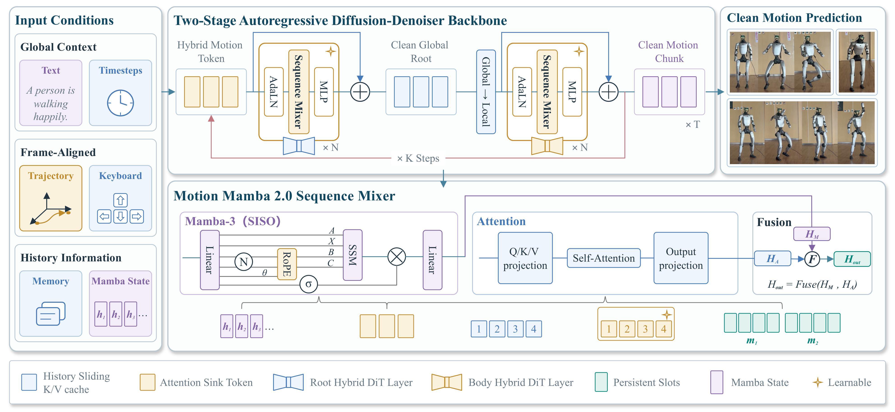
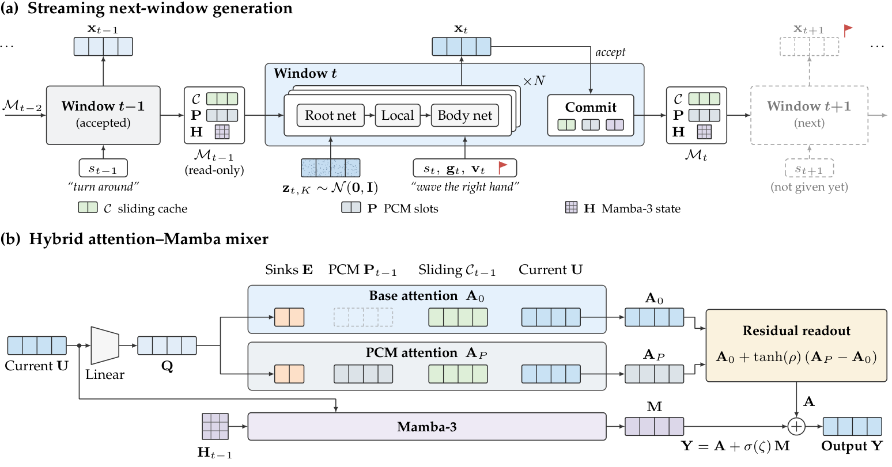
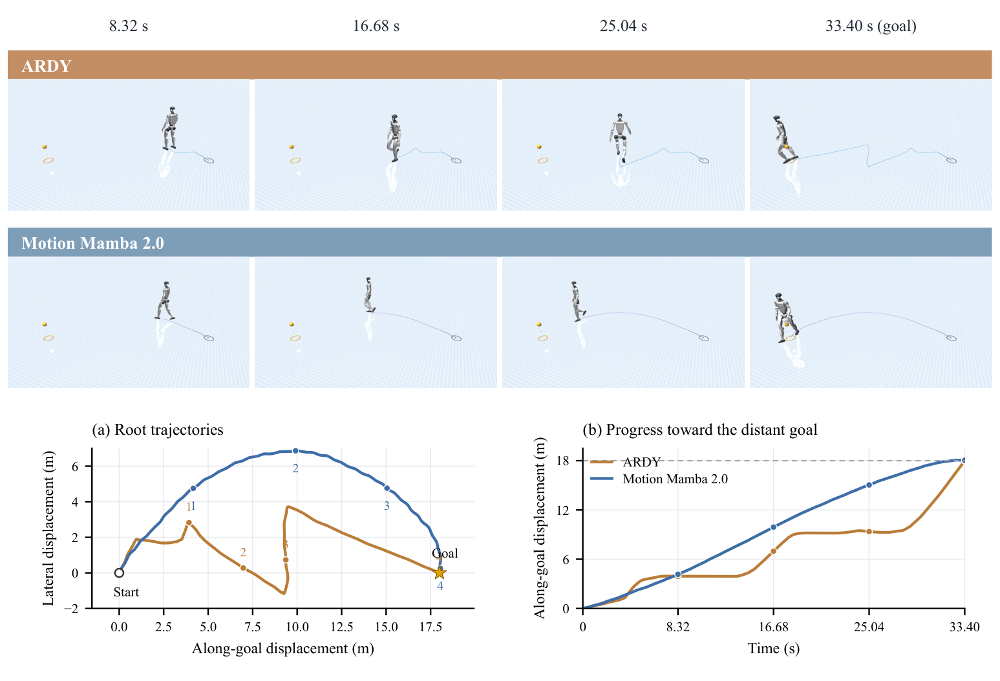
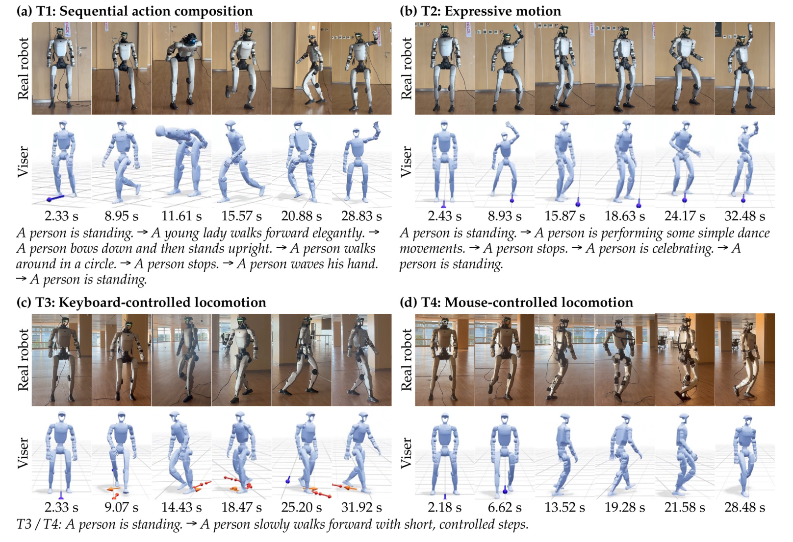

> **원문**: [arXiv](https://arxiv.org/abs/2611.29897) · [HuggingFace](https://huggingface.co/papers/2611.29897) (👍 171) · [GitHub](https://github.com/AIGeeksGroup/MotionMamba2.0)
{: .prompt-info }

## 들어가며

어제 HuggingFace Daily Papers에서 171표를 받은, Peking University·Korea University·Monash University·NTU가 공동 저자로 참여한 IEEE TPAMI 투고 논문입니다. 2024년 ECCV에 실렸던 "Motion Mamba"의 후속작인데, 제목에 큼지막하게 "2.0"이 붙어 있어서 뭐가 달라졌는지 궁금했습니다. 읽어보니 단순 성능 개선 논문이 아니라, "사람이 로봇한테 말로 명령을 계속 바꿔가면서 걷게 하려면 무엇이 필요한가"라는 질문에 꽤 끈질기게 답하려는 논문이었습니다. 특히 실제 Unitree G1 휴머노이드에 올려서 100번 시도 중 94번을 낙상 없이 성공시켰다는 실험 결과가 눈에 띄었고, 코드도 Apache-2.0으로 공개되어 있어(확인해 보니 `motion_mamba2/` 패키지와 학습·평가·시뮬레이션 스크립트가 실제로 들어있는 저장소였습니다) 꼼꼼히 읽어봤습니다.

## 한눈에 보기

- **핵심 기여**: 과거 전체를 쌓아두는 대신 "받아들여진(accepted) 동작 기록"만 Mamba-3 recurrent state로 압축하고, 이를 attention이 읽을 수 있는 slot으로 변환하는 Persistent Content Memory(PCM)를 제안. 여기에 CUDA Graph·커널 퓨전·실행 흐름 단순화를 더해 추론을 6.1배 가속
- **성능**: Retargeted HiPHI 벤치마크에서 39.52초(19윈도우) 롤아웃 끝에 Root CE 7.55cm, End CE 13.64cm로 비교 대상 중 최저 오차. RTX 4090에서 윈도우당 지연시간을 1685ms → 276ms로 단축(동일 출력 보존 확인)
- **실로봇 실험**: Unitree G1에 올려 순차 동작 지시·표현 동작·키보드/마우스 실시간 제어까지 4가지 과제, 100회 시도에서 낙상 0회, 94회 완전 성공
- **한 줄 요약**: "기억은 압축해서 들고 다니고, 필요할 때만 꺼내 쓴다"는 아이디어로 긴 호흡의 로봇 동작 생성 문제를 푼 논문입니다.

## 어떤 문제를 풀려고 했나

사람에게 로봇을 말로 조종하게 해보면 금방 드러나는 문제가 있습니다. "앞으로 걸어" 다음에 "왼쪽으로 돌아"라고 명령을 바꾸고, 걷는 도중에 "저기 책상까지 가서 손을 뻗어"라는 공간 목표를 추가로 줄 수도 있습니다. 이런 상황에서 동작 생성 모델은 두 가지를 동시에 만족해야 합니다. 첫째, 이미 생성된 동작과 자연스럽게 이어 붙어야 하고 둘째, 꽤 먼 미래의 공간적 목표(예: 18미터 떨어진 지점)까지도 놓치지 않고 도달해야 합니다.

기존의 autoregressive diffusion 방식들은 윈도우 단위로 동작을 생성하면서 최근 몇 개 윈도우의 attention cache만 유지하는 식으로 이 문제에 접근했습니다. 그런데 저자들은 여기서 딜레마를 하나 짚습니다. cache를 짧게 두면(bounded) 오래된 맥락이 날아가 버리고, 길게 두면(unbounded) 저장량과 연산량이 시간에 비례해서 계속 불어난다는 겁니다. 반대편에는 Mamba 같은 state-space model이 있는데, 이쪽은 전체 이력을 고정 크기 recurrent state 하나로 압축하긴 하지만, 그 압축된 state가 attention처럼 "직접 조회 가능한 토큰" 형태가 아니라는 문제가 있습니다. 그냥 두 branch를 나란히 붙여놓는다고 recurrent 기억이 attention에서 바로 읽히는 건 아니라는 거죠.

개인적으로 이 지적이 꽤 와닿았습니다. 실제로 많은 하이브리드 아키텍처들이 "Mamba + Attention을 섞었다"고 말은 하면서도, 두 표현 사이의 인터페이스를 어떻게 설계했는지는 얼버무리는 경우가 많거든요. 이 논문은 바로 그 인터페이스(PCM)를 이 논문의 핵심 기여로 내세웁니다.

## 핵심 아이디어

### 전체 구조 — Root 먼저, Body 나중에

다음은 전체 아키텍처를 보여주는 개요도입니다.

_Fig. 3. 텍스트·궤적·과거 동작 이력을 입력으로 받아, Root network가 먼저 전역 궤적을 예측하고 그 로컬 특징을 Body network에 넘겨 전신 동작을 완성하는 2단계 확산 구조. 아래쪽 확대 패널이 이 논문의 핵심인 "Sequence Mixer"입니다._

왼쪽부터 보면, 텍스트("A person is walking happily")와 궤적·키보드 입력 같은 프레임 단위 조건, 그리고 과거 이력(Memory, Mamba State)이 함께 들어갑니다. 가운데 "Two-Stage Autoregressive Diffusion-Denoiser Backbone"이 이 모델의 뼈대인데, 노이즈가 섞인 모션 토큰이 먼저 Root 스택을 거쳐 "Clean Global Root"(전역 궤적)를 예측하고, 이 궤적이 Global→Local 변환을 거쳐 Body 스택의 입력으로 들어갑니다. 이 두 네트워크는 파라미터도 메모리도 따로 갖지만, 디노이징 스텝마다 Root가 먼저 갱신되고 그 결과를 Body가 즉시 받아 쓰는 식으로 매 스텝 결합되어 있습니다. ARDY라는 선행 연구의 root-body 분해 방식을 가져온 것이라고 밝히고 있는데, 전역 이동(어디로 갈지)과 전신 자세(어떻게 움직일지)를 분리해서 다루면 공간 제약 조건을 궤적 쪽에 바로 걸 수 있다는 이점이 있습니다.

아래쪽 "Sequence Mixer" 패널이 이번 논문에서 가장 공들인 부분입니다. 같은 입력 특징을 Mamba-3 branch와 Attention branch가 동시에 처리하고, 거기에 PCM이라는 세 번째 요소가 Attention 쪽에 끼어듭니다.

### Mamba-3 recurrence — "사다리꼴 적분"으로 과거를 들고 다니기

이 모델은 Mamba-3의 resumable recurrence를 그대로 가져다 씁니다. 한 헤드에 대해, 매 토큰 $i$마다 상태가 이렇게 갱신됩니다.

$$
\begin{aligned}
 \boldsymbol\phi_i &=\boldsymbol\phi_{i-1}+\pi\Delta_i\tanh(\boldsymbol\theta_i),\\
 \widetilde{\mathbf{B}}_i &=\mathcal{R}(\boldsymbol\phi_i)\mathbf{B}_i, \quad \widetilde{\mathbf{C}}_i =\mathcal{R}(\boldsymbol\phi_i)\mathbf{C}_i,\\
 \alpha_i&=\exp(\Delta_i A_i), \quad\beta_i=(1-\lambda_i)\Delta_i\alpha_i, \quad\gamma_i=\lambda_i\Delta_i,\\
 \mathbf{H}_i &=\alpha_i\mathbf{H}_{i-1} +\beta_i\mathbf{u}_{i-1}\widetilde{\mathbf{B}}_{i-1}^{\top}+\gamma_i\mathbf{u}_i\widetilde{\mathbf{B}}_i^{\top},\\
\mathbf{y}_i&=\mathbf{H}_i\widetilde{\mathbf{C}}_i+D\mathbf{u}_i.
\end{aligned}
$$

$A_i<0$은 채널별 감쇠율, $\Delta_i>0$은 스텝 크기, $\boldsymbol\theta_i$는 위상 파라미터, $\mathcal{R}(\cdot)$는 상태 좌표쌍을 회전시키는 연산자이고, $\lambda_i\in(0,1)$은 두 시점을 섞는 비율입니다.

여기서 눈여겨볼 부분이 두 군데입니다. 하나는 $\widetilde{\mathbf{B}}_i=\mathcal{R}(\boldsymbol\phi_i)\mathbf{B}_i$인데, 누적 위상 $\boldsymbol\phi_i$만큼 입력 투영을 회전시킵니다. RoPE(rotary position embedding)를 떠올리면 비슷한데, transformer의 위치 인코딩이 토큰 간 "상대적 거리"를 회전으로 표현하듯, 여기서도 recurrent state 안에 상대적 시간 위상을 새겨 넣는 셈입니다. 다른 하나는 $\mathbf{H}_i$ 갱신식에서 $\mathbf{u}_{i-1}$과 $\mathbf{u}_i$를 $\beta_i,\gamma_i$ 가중치로 같이 섞는다는 점입니다. 원래 Mamba는 현재 시점 입력 $\mathbf{u}_i$ 하나만 상태에 꽂아 넣는 Euler 적분에 가까운데, 여기서는 이전 스텝과 현재 스텝을 사다리꼴(trapezoidal) 방식으로 섞어 적분합니다. 수치해석에서 사다리꼴 적분이 단순 오일러 적분보다 오차가 작은 것처럼, 이 변화가 긴 시퀀스에서 상태가 누적되는 정확도에 영향을 줄 거라는 추정이 가능한데, 논문은 "이 메커니즘의 기여는 경험적으로 평가된다"고만 적어 두고 정확히 어떤 수학적 이득인지는 명시하지 않습니다. 이 부분은 솔직히 논문에 더 친절한 설명이 있었으면 좋았겠다 싶었습니다.

중요한 건 $\mathbf{H}_i$의 크기가 시퀀스 길이와 무관하게 고정이라는 점입니다. 이 상태(회전 행렬, 누적 위상, 직전 $\mathbf{u}$와 $\mathbf{B}$ 벡터)만 들고 있으면 다음 윈도우를 생성할 때 전체 과거를 다시 읽을 필요가 없습니다.

### PCM — 압축된 기억을 Attention이 읽게 만들기

다음 그림이 이 논문의 핵심 메커니즘을 가장 잘 보여줍니다.

_Fig. 4. (a) 윈도우 $t$를 디노이징하는 동안에는 이력이 읽기 전용(read-only)으로 고정되고, 결과가 받아들여진(accept) 뒤에야 cache·PCM·Mamba state가 한꺼번에 커밋됩니다. (b) Base attention(최근 cache만 읽음)과 PCM attention(slot까지 읽음)의 차이를 학습된 게이트로 섞고, 여기에 Mamba-3 출력을 더합니다._

(a) 패널이 보여주는 것부터 짚으면, "turn around"라는 이전 지시로 만들어진 윈도우 $t-1$이 받아들여지고 나면, 그 결과가 cache $\mathcal{C}$·PCM slot $\mathbf{P}$·Mamba state $\mathbf{H}$ 세 가지 형태로 동시에 저장됩니다($\mathcal{M}_{t-1}$). 윈도우 $t$를 생성하는 동안에는 "wave the right hand"라는 새 지시가 들어와도 이 저장소는 읽기 전용입니다. Diffusion sampling은 여러 스텝에 걸쳐 후보를 반복해서 다듬는데, 그 중간 후보들이 실제 동작 흐름과 섞이면 안 되기 때문입니다. 깨끗한 결과가 나와야 비로소 commit이 일어나고, 그 다음에야 $\mathcal{M}_t$가 갱신됩니다. 이 "읽기와 쓰기의 분리"는 간단해 보이지만, diffusion과 recurrent state를 같이 쓸 때 흔히 생기는 버그(중간 노이즈 후보가 상태를 오염시키는 문제)를 구조적으로 막아주는 설계라고 봤습니다.

(b) 패널이 PCM 자체의 동작입니다. 과정을 수식 3개로 따라가 보겠습니다.

먼저, 받아들여진 Mamba recurrent matrix $\mathbf{H}_t^\ell$를 풀링·정규화해서 "현재까지의 요약"을 만들고, 직전 윈도우와의 차이도 함께 구합니다.

$$
\overline{\mathbf{s}}_t^\ell = \Pi^\ell(\mathbf{H}_t^\ell), \qquad \mathbf{d}_t^\ell = \overline{\mathbf{s}}_t^\ell - \overline{\mathbf{s}}_{t-1}^\ell.
$$

$\overline{\mathbf{s}}_t^\ell$는 layer $\ell$에서 누적된 맥락을 압축한 벡터이고, $\mathbf{d}_t^\ell$는 "이번 윈도우에서 상태가 얼마나, 어떻게 바뀌었는지"를 나타내는 변화량입니다.

이 요약과 변화량은 텍스트 임베딩과 함께 섞여서(논문 Eq. 9~11 과정, 지면상 생략) 후보 콘텐츠 $\mathbf{Z}_t^\ell$를 만들고, 이게 게이트를 거쳐 실제 slot에 반영됩니다.

$$
\mathbf{w}_t^\ell = \eta\,\sigma\!\left( f_w^\ell\!\left( [\mathbf{j}_t^\ell;\operatorname{vec}(\mathbf{P}_{t-1}^\ell)] \right)\right), \qquad \mathbf{P}_t^\ell = (1-\mathbf{w}_t^\ell)\odot\mathbf{P}_{t-1}^\ell +\mathbf{w}_t^\ell\odot\mathbf{Z}_t^\ell.
$$

$\mathbf{w}_t^\ell$는 0과 $\eta$(실험에서는 0.25로 고정) 사이의 게이트 값이고, $\mathbf{P}_t^\ell$는 이전 slot 값과 새 후보값을 게이트 비율로 섞은 결과입니다.

여기서 의미 있는 설계는 쓰기 비율의 상한을 $\eta=0.25$로 못박아 둔다는 점입니다. 매 윈도우마다 slot이 최대 25%씩만 바뀔 수 있다는 뜻인데, 이렇게 하면 slot이 특정 순간의 정보로 한번에 덮어씌워지는 걸 막고, 오래된 맥락도 서서히만 희석되게 만듭니다. "완전히 새로 쓰기"와 "전혀 안 바꾸기"의 중간 지점을 학습 가능한 비율로 매 순간 결정하는 셈이죠.

그러고 나서 이 slot을 attention이 읽는 과정이 다음 식입니다.

$$
\mathbf{A}^\ell_P =\operatorname{Attn}^\ell (\mathbf{Q}^\ell,\mathbf{K}^\ell_P,\mathbf{V}^\ell_P), \qquad \mathbf{Y}^\ell =\mathbf{A}^\ell_0+\tanh(\rho_\ell) (\mathbf{A}^\ell_P-\mathbf{A}^\ell_0)+\sigma(\zeta_\ell)\mathbf{M}^\ell.
$$

$\mathbf{A}^\ell_0$는 sink 토큰과 최근 cache만 읽은 "기본" attention 결과이고, $\mathbf{A}^\ell_P$는 PCM slot까지 추가로 읽은 attention 결과입니다. $\rho_\ell$과 $\zeta_\ell$은 각각 PCM 기여도와 Mamba 기여도를 조절하는 학습 가능한 스칼라입니다.

여기서 가장 영리하다고 느낀 디테일은 $\rho_\ell$을 0으로 초기화하면 $\tanh(\rho_\ell)=0$이 되어, slot이 추가돼 있어도 PCM을 적용하기 전과 "정확히 동일한" 출력이 나온다는 점입니다. 단순히 slot 값 자체를 0으로 초기화하는 것과는 다른데, slot이 있으면 attention의 정규화(softmax 분모)가 달라지기 때문입니다. 즉 "새 메커니즘을 꽂았는데 학습 초반에 기존 모델을 망가뜨리지 않는다"는 안정성을, 날것의 값이 아니라 게이트 스칼라 쪽을 0으로 초기화하는 방식으로 보장한 겁니다. 이런 종류의 "안전한 초기화" 트릭은 실제로 새 모듈을 큰 모델에 끼워 넣을 때 자주 등장하는데, 여기서는 그 적용이 특히 꼼꼼하다고 느꼈습니다.

### 추론 가속 — 모델은 그대로 두고 실행만 다시 짠다

PCM이 정확도를 담당한다면, 속도는 완전히 별개의 엔지니어링 축에서 다룹니다. 세 가지를 따로 떼어 측정한 결과가 아래 표입니다.

| Flow | Fusion | Graph | p50 (ms) | p95 (ms) | Speedup |
|---|---|---|---|---|---|
| — | — | — | 1685.35 | 2471.65 | 1.000× |
| ✓ | — | — | 1102.82 | 1647.52 | 1.525× |
| ✓ | ✓ | — | 1069.52 | 1588.74 | 1.578× |
| ✓ | — | ✓ | 285.20 | 352.22 | 5.943× |
| **✓** | **✓** | **✓** | **276.14** | **345.82** | **6.138×** |

Flow(실행 흐름 단순화, 안 쓰는 중간 상태를 아예 안 만듦), Fusion(Mamba의 decay·step-size 전처리를 커널 하나로 합침), Graph(CUDA Graph로 root/body 스택과 3개 classifier-free-guidance branch를 한꺼번에 재생)를 하나씩 켜봤는데, 패턴이 뚜렷합니다. Flow와 Fusion만으로는 1.58배가 고작인데, Graph를 더하는 순간 5.94배로 뛰어오릅니다. 즉 "작은 커널을 합치는 것"보다 "호스트가 GPU에 명령을 반복해서 내려보내는 오버헤드 자체를 없애는 것"이 압도적으로 큰 효과를 냈다는 뜻입니다. 실제로 논문은 ordinary host launch 횟수가 83,777회에서 5,519회로 93.4% 줄었다고 보고합니다. 그리고 이 최적화가 단순한 속도 트릭이 아니라는 걸 "4번의 100-윈도우 롤아웃에서 비트 단위로 동일한 출력"을 확인했다고 명시한 점도 신뢰가 갑니다 — 빠른데 다른 답을 내놓는 최적화는 의미가 없으니까요.

## 실험 결과

### 장거리 공간 목표 — PCM이 빛나는 지점

다음은 ARDY(비교 대상 중 가장 강력한 베이스라인)와 Motion Mamba 2.0을 같은 18m 목표, 같은 33.40초 데드라인 조건에서 나란히 비교한 그림입니다.

_Fig. 9. 위 두 줄은 같은 4개 시점에서의 로봇 자세이고, 아래 (a)는 목표 좌표계에서의 궤적, (b)는 시간에 따른 목표 방향 누적 이동 거리입니다._

(a) 그래프를 보면 파란 선(Motion Mamba 2.0)이 거의 완만한 곡선을 그리며 목표(별표)에 도달하는 반면, 주황 선(ARDY)은 중간에 거의 거꾸로 돌아갔다가 다시 전진하는, 상당히 들쭉날쭉한 경로를 그립니다. (b) 그래프가 이 차이를 숫자로 보여주는데, 25.04초 시점에서 Motion Mamba 2.0은 목표 방향으로 15.05m를 이동한 반면 ARDY는 9.36m에 그칩니다. 더 흥미로운 건 마지막 1초 평균 속도인데, 우리 모델은 0.712m/s로 "도착해서 속도를 줄이며 정지하는" 모양새인 반면 ARDY는 1.992m/s로 거의 전속력으로 막판에 몰아치는 모습입니다. 개인적으로 이 디테일이 일반 수치 비교보다 더 설득력 있었습니다 — ARDY가 "목표가 멀다는 걸 뒤늦게 깨닫고 전력 질주"하는 모습이라면, Motion Mamba 2.0은 처음부터 목표까지의 거리를 계속 의식하면서 페이스를 조절하는 것처럼 보이기 때문입니다. 다만 이건 롤아웃 1개짜리 정성적 사례이고, 논문도 "통계적으로 일반화된 증거"로 제시하진 않는다는 점은 짚어둘 필요가 있습니다.

### 정량 비교 — HiPHI 벤치마크

다음은 retargeted HiPHI에서 짧은 호라이즌(2.08초, 1윈도우)과 가장 긴 호라이즌(39.52초, 19윈도우)을 비교한 표입니다. CE는 cm, Cmd.·R@3는 %, Lat.은 윈도우당 ms입니다.

**2.08초 (1윈도우)**

| Method | Root CE↓ | End CE↓ | Cmd.↑ | R@3↑ | L2-FID↓ | Lat.↓ |
|---|---|---|---|---|---|---|
| DiP | 57.07 | 60.45 | 40.78 | 25.66 | 0.402 | 73.6 |
| Go-to-Zero | 29.14 | 29.53 | 71.79 | 26.27 | 0.480 | 12344.9 |
| DreamControl | 31.43 | 35.85 | 75.39 | 22.62 | 0.457 | 94.2 |
| MoLingo | 99.24 | 102.67 | 47.77 | 8.86 | 1.241 | 868.3 |
| HY-Motion | 30.76 | 33.54 | 55.70 | 16.67 | 0.400 | 324.1 |
| OMG | 58.18 | 60.59 | 46.76 | 25.93 | 0.448 | 173.9 |
| TACD | 21.81 | 25.55 | 77.27 | 28.44 | 0.428 | 203.0 |
| PCMDM | 63.86 | 66.65 | 28.71 | 17.59 | 0.434 | 58.4 |
| FlowMDM | 56.67 | 58.01 | 46.25 | 14.29 | 0.400 | 109.9 |
| DartControl | 44.84 | 48.37 | 71.88 | 13.49 | 0.387 | **34.7** |
| Motion-Agent | 20.72 | 24.09 | 22.22 | 23.17 | 0.437 | 13806.4 |
| MG-MotionLLM | 63.77 | 67.99 | 22.39 | 23.02 | 0.434 | 5632.7 |
| IRG-MotionLLM | 43.58 | 46.97 | 24.58 | 21.74 | 0.447 | 13329.8 |
| MotionStreamer | 17.89 | 23.56 | 80.32 | 22.62 | 0.388 | 99.0 |
| CMDM | 24.65 | 27.16 | 84.02 | 23.41 | **0.337** | 157.8 |
| ActionPlan | 69.72 | 83.69 | 52.79 | 9.13 | 0.862 | 72.4 |
| FloodDiffusion 2 | 39.12 | 41.54 | 63.51 | 20.63 | 0.403 | 196.8 |
| ARDY | 5.89 | 9.70 | 86.77 | 23.54 | 0.425 | 95.6 |
| Motion Mamba (v1) | 50.58 | 53.39 | 54.75 | 19.84 | 0.406 | 309.2 |
| **Motion Mamba 2.0** | **2.78** | **7.19** | **86.96** | **35.58** | 0.410 | 283.7 |

**39.52초 (19윈도우, 가장 긴 호라이즌)**

| Method | Root CE↓ | End CE↓ | Cmd.↑ | R@3↑ | L2-FID↓ | Lat.↓ |
|---|---|---|---|---|---|---|
| DiP | 96.99 | 99.26 | 18.45 | 12.45 | 0.490 | 66.8 |
| Go-to-Zero | 86.47 | 88.91 | 25.03 | 12.11 | 0.743 | 12478.5 |
| DreamControl | 61.92 | 67.43 | 20.00 | 14.40 | 0.532 | 89.5 |
| MoLingo | 270.71 | 273.42 | 41.34 | 8.81 | 1.260 | 908.7 |
| HY-Motion | 95.53 | 96.63 | 27.61 | 13.47 | 0.760 | 346.8 |
| OMG | 161.76 | 163.49 | 24.52 | 19.61 | 0.473 | 167.8 |
| TACD | 54.43 | 59.40 | 28.03 | 17.81 | 0.496 | 208.0 |
| PCMDM | 65.18 | 66.99 | 14.27 | 10.96 | 0.544 | 51.4 |
| FlowMDM | 154.71 | 156.35 | 24.12 | 11.07 | 0.454 | 105.7 |
| DartControl | 291.58 | 295.86 | 40.32 | 15.53 | 0.511 | **28.2** |
| Motion-Agent | 61.36 | 62.49 | 15.15 | 12.02 | 0.745 | 13511.1 |
| MG-MotionLLM | 340.84 | 341.01 | 11.52 | 11.60 | 0.431 | 5772.3 |
| IRG-MotionLLM | 113.23 | 131.52 | 13.04 | 13.15 | 0.751 | 12912.6 |
| MotionStreamer | 7.78 | 21.67 | 18.85 | 13.02 | 0.645 | 159.8 |
| CMDM | 54.68 | 59.68 | 15.36 | 12.10 | 0.657 | 311.9 |
| ActionPlan | 799.60 | 790.99 | 40.21 | 6.16 | 1.120 | 110.1 |
| FloodDiffusion 2 | 115.02 | 117.86 | 22.34 | 12.14 | 0.497 | 183.7 |
| ARDY | 10.09 | 14.84 | 23.53 | 15.32 | 0.489 | 105.1 |
| Motion Mamba (v1) | 125.74 | 130.17 | 25.77 | 17.18 | 0.482 | 310.5 |
| **Motion Mamba 2.0** | **7.55** | **13.64** | **46.05** | **23.68** | **0.409** | 333.4 |

패턴을 짚어보면, 짧은 호라이즌에서는 ARDY도 Root/End CE가 각각 5.89/9.70cm로 꽤 준수합니다. 그런데 호라이즌이 39.52초까지 늘어나면 ARDY는 10.09/14.84cm로 소폭만 나빠지는 반면, cache만 쓰는 다른 방법들(DartControl 291.58cm, ActionPlan 799.60cm)은 거의 폭발적으로 오차가 커집니다. 재미있는 건 Motion Mamba 2.0도 2.78cm(짧은 호라이즌)에서 7.55cm(긴 호라이즌)로 오차가 늘어나긴 하지만, 그 증가폭이 ARDY보다 훨씬 완만하면서 절대값은 항상 더 낮다는 점입니다. 또한 Cmd.(명령 일치도)에서 ARDY는 짧은 호라이즌 86.77%에서 긴 호라이즌 23.53%로 거의 반토막나는데, Motion Mamba 2.0은 86.96%에서 46.05%로 비교적 덜 무너집니다. 즉 "먼 미래의 목표는 맞추지만 중간에 지시를 계속 잘 따라가는 능력은 유지하기 어렵다"는 게 이 종류 모델들의 공통된 약점인데, PCM이 그 약화 속도를 눈에 띄게 늦춘다는 해석이 가능합니다.

속도 면에서는 DartControl이 28.2ms로 가장 빠르지만 오차가 10배 이상 크고, Motion Mamba 2.0은 333.4ms로 Mamba/attention을 둘 다 쓰는 만큼 중간 정도 속도를 보입니다 — 이 논문이 말하는 "6.1배 가속"은 이 333ms가 아니라, 같은 완전한 PCM 모델을 그대로 두고 실행 방식만 최적화했을 때의 276ms를 가리킨다는 점(앞서 추론 가속 절의 표)을 헷갈리지 않는 게 좋겠습니다. 즉 이 정확도 비교와 추론 가속 비교는 서로 다른 측정 조건(10-step DDIM 샘플링 비용 포함 여부 등)이라 직접 같은 숫자로 비교할 순 없습니다.

### 구조 Ablation — Mamba와 PCM이 각각 어디에 기여하는가

논문은 Minimal(Mamba 없음) → Native(Mamba만) → Native+PCM(텍스트/차이 성분 제거한 부분판) → 완전판으로 단계를 쌓아 비교합니다. 39.52초 HiPHI 기준 숫자를 따라가 보면, Minimal의 Root CE가 60.00cm인데 Mamba를 넣은 Native는 9.36cm로 떨어집니다. 여기에 PCM까지 완전히 적용하면 7.55cm까지 더 내려갑니다. Cmd.도 Minimal 35.27% → Native 32.20%(오히려 소폭 하락) → 완전판 46.05%로, Mamba만으로는 명령 일치도가 개선되지 않다가 PCM이 더해져야 눈에 띄게 좋아진다는 걸 보여줍니다. 반대로 짧은 호라이즌(1윈도우)에서는 Minimal과 Native의 차이가 Root CE 기준 3.86 대 4.49cm로 거의 없습니다 — recurrent state의 효과가 "호라이즌이 길어질수록" 드러난다는 저자들의 주장과 일치하는 패턴입니다.

### 실로봇 — Unitree G1에서의 안정성

다음은 실제 로봇 실험 결과입니다.

| Task | Full success | SR (%) [95% CI] | Stages | Text switches | Stable | Falls |
|---|---|---|---|---|---|---|
| T1: 순차 동작 조합 | 18/20 | 90.0 [69.9, 97.2] | 136/140 | 117/120 | 19/20 | 0 |
| T2: 표현 동작 | 19/20 | 95.0 [76.4, 99.1] | 99/100 | 78/80 | 20/20 | 0 |
| T3: 키보드 제어 | 29/30 | 96.7 [83.3, 99.4] | 59/60 | 30/30 | 29/30 | 0 |
| T4: 마우스 제어 | 28/30 | 93.3 [78.7, 98.2] | 58/60 | 29/30 | 29/30 | 0 |

4개 과제 100회 시도에서 낙상이 단 한 번도 없었다는 게 가장 눈에 띕니다. 다음은 그 중 T1(순차 동작 조합)과 T3(키보드 제어) 실제 장면입니다.

_Fig. 7. 각 패널 위쪽이 실제 로봇 영상, 아래쪽이 Viser로 시각화한 생성 모션 레퍼런스입니다. T1은 "서 있기 → 우아하게 걷기 → 허리 숙이기 → 원형으로 걷기 → 멈추기 → 손 흔들기"까지 6단계 지시를 순서대로 통과합니다._

T1 패널을 직접 보면, 11.61초 지점에서 허리를 숙이는 bow 동작과 28.83초의 손을 드는 동작이 실제 로봇 영상과 Viser 레퍼런스에서 둘 다 인식 가능한 형태로 재현됩니다. 다만 자세히 보면 몸통 기울기나 발 위치에서 레퍼런스와 실제 로봇 사이에 미묘한 차이가 남아 있는데, 이건 생성 모델의 문제라기보다 SONIC 추적 컨트롤러가 물리 제약(균형, 접촉) 하에서 레퍼런스를 "최대한 비슷하게" 따라가려다 생기는 차이로 보입니다. 논문도 이 생성-추적 분리를 명시적으로 구분해서 설명합니다. 키보드/마우스 실시간 제어에서는 중앙값 물리 반응 지연이 각각 351ms/360ms였고, 1.5초 데드라인 안에 296/300(98.7%), 292/300(97.3%) 이벤트가 성공적으로 반영됐다고 보고합니다.

## 아쉬운 점 / 의문점

저자들이 스스로 밝히는 한계는 명확합니다. "물체 조작(object manipulation)은 아직 다루지 않는다"는 것인데, 이건 상당히 큰 범위의 유보입니다 — 로봇이 걷고 움직이는 것과 뭔가를 집고 조작하는 것은 완전히 다른 난이도의 문제이기 때문에, 이 논문의 성과를 "휴머노이드가 집안일을 할 수 있게 됐다"는 식으로 확대 해석하지 않는 게 중요해 보입니다.

리뷰어로서 몇 가지 더 짚고 싶은 지점이 있습니다. 첫째, Mamba-3의 trapezoidal recurrence가 정확히 어떤 수학적 이점을 주는지 논문이 명시적으로 설명하지 않고 "경험적으로 평가된다"고만 넘어갑니다. 소비한 지면에 비해 설명이 아쉬운 부분입니다. 둘째, PCM의 쓰기 비율 상한 $\eta=0.25$라는 값이 어떻게 정해졌는지에 대한 설명(다른 값으로 ablation 했는지)이 본문에 보이지 않습니다. 하이퍼파라미터 하나가 slot이 얼마나 빨리 과거를 잊는지를 결정하는 꽤 중요한 역할을 하는데, 이 값에 대한 민감도 분석이 없다는 점은 아쉽습니다. 셋째, 비교 대상 베이스라인들이 "모두 원래 사전학습 체크포인트가 아니라 같은 G1 데이터로 100,000-update 예산 하에 재학습됐다"는 점을 투명하게 밝힌 건 신뢰가 가는 태도인데, 반대로 생각하면 ARDY 같은 베이스라인이 원래 설계된 조건(아마 더 긴 학습, 다른 데이터)에서는 격차가 지금과 다를 수도 있다는 뜻이기도 합니다. 공정한 비교를 위한 선택이지만, "이 모델이 ARDY보다 몇 배 낫다"는 식의 해석은 이 재학습 조건 안에서만 성립한다는 걸 염두에 둘 필요가 있습니다.

실시간성과 관련해서도 한 가지 의문이 남습니다. 추론 가속 측정은 "텍스트 임베딩을 미리 로드해 둔 steady-state 생성 시간"만 재는데, 실제 명령-반응 지연(handoff latency, physical-response latency)은 별도 섹션에서 246~360ms 수준으로 보고됩니다. 이 두 숫자를 섞어서 "6.1배 빨라져서 실시간이 됐다"고 받아들이면 안 되고, 둘은 서로 다른 걸 측정한다는 점을 논문도 명확히 구분해 두고 있다는 건 좋은 태도라고 생각합니다.

## 마치며

이 논문을 읽으면서 가장 인상 깊었던 건 "PCM"이라는 아이디어 자체보다, 그 아이디어를 실제로 안전하게(zero-init으로 기존 모델을 보존하고), 효율적으로(diffusion sampling과 state commit을 분리하고), 그리고 물리 로봇까지 검증하는(100회 낙상 없는 실험까지 가는) 일관된 엔지니어링 태도였습니다. 학부생 저자가 1저자로 참여했다는 점도 눈여겨볼 만한데, 저자 소개를 보니 1저자 중 한 명이 학부생이더군요. 개인적으로는 Mamba와 attention을 결합할 때 "어떤 인터페이스로 정보를 주고받게 할 것인가"라는 질문이 앞으로도 계속 중요한 설계 포인트가 될 것 같고, 이 논문의 PCM 쓰기/읽기 게이트 설계는 다른 하이브리드 아키텍처에도 옮겨볼 만한 패턴이라고 느꼈습니다. 다음에 볼 만한 지점은 이 프레임워크가 object manipulation으로 확장될 때 PCM이 "어디에 뭐가 있었는지"까지 기억해야 하는 더 어려운 과제를 감당할 수 있을지일 것 같습니다.
