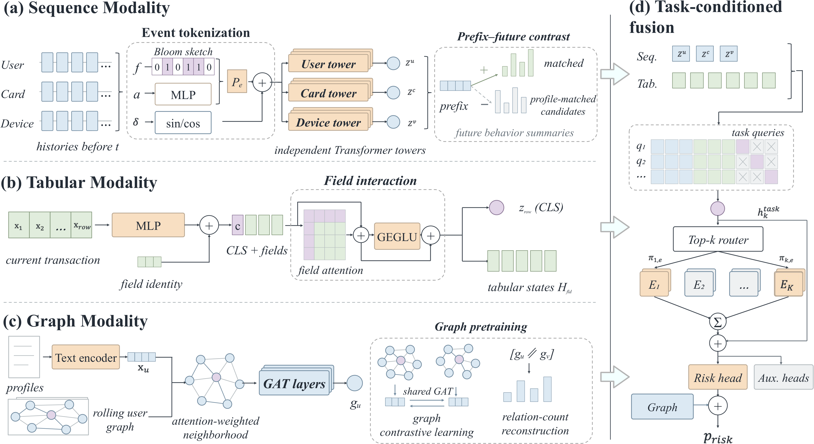
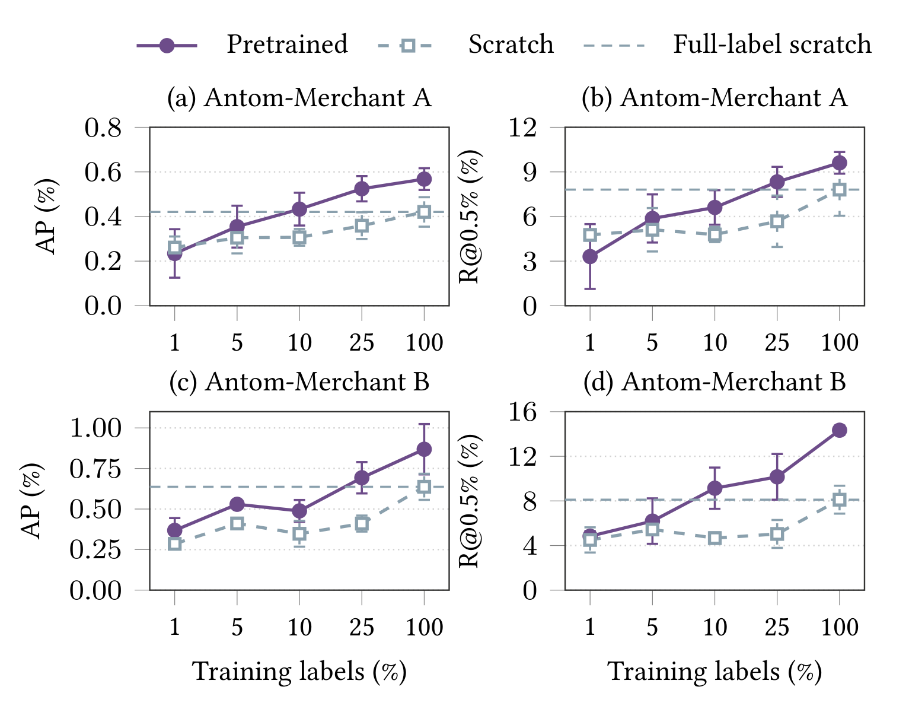
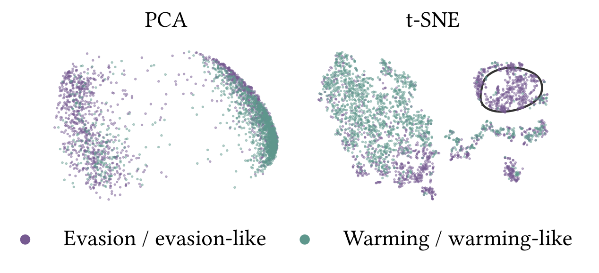
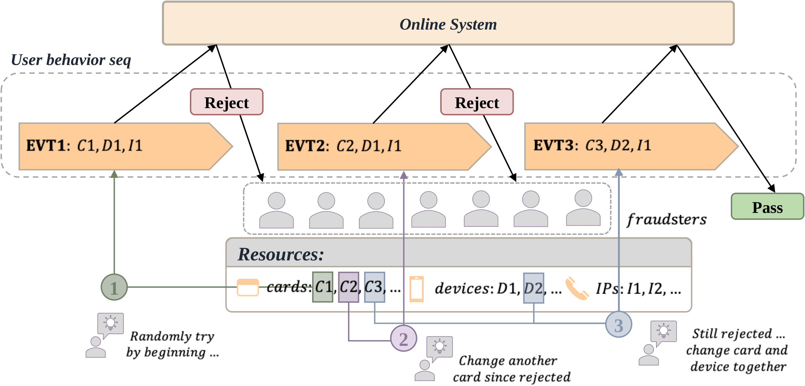

> **원문**: [arXiv](https://arxiv.org/abs/2611.25403) · [HuggingFace](https://huggingface.co/papers/2611.25403) (👍 99)
{: .prompt-info }

## 들어가며

어제 HuggingFace Daily Papers에서 99표를 받은 논문입니다. 저자 소속이 전부 Ant International(앤트 인터내셔널, 알리페이를 운영하는 Ant Group의 해외 사업부)이고, 제목부터 "결제 파운데이션 모델"이라고 못박고 있어서 순수 연구논문이라기보다 산업 기술보고서(technical report)에 가깝습니다. 실제로 논문 2절 제목이 "Scope and Limitations of this Technical Report"인데, 여기서 저자들은 "경쟁 우위와 안전성을 고려해 아키텍처 세부사항과 학습 설정, 데이터 구축 절차는 이 공개 범위 밖에 둔다"고 명시적으로 밝힙니다. 그러니까 이 논문은 애초에 재현 가능한 논문이 아니라, "우리가 이런 걸 만들어서 실제로 돈을 아꼈다"는 걸 보여주는 사례 보고서에 가깝습니다.

그럼에도 읽어볼 가치가 있다고 판단한 이유는 두 가지입니다. 하나는 시퀀스·테이블·그래프라는 세 가지 서로 다른 데이터 형태를 하나의 모델에 녹여내는 설계 철학이 꽤 명료하게 드러나 있다는 점이고, 다른 하나는 "4개월간 실제 서비스 A/B 테스트, 손실률 37.88% 감소"라는, 실험실 벤치마크가 아니라 돈이 걸린 실전 수치를 제시한다는 점입니다. 코드나 모델 가중치는 공개되어 있지 않습니다.

## 한눈에 보기

- **핵심 기여**: 거래 시퀀스(사용자/카드/기기 이력), 테이블(현재 거래 속성), 그래프(계정 간 관계)라는 세 모달리티를 각각 전용 인코더로 학습하고, task query 기반 sparse expert routing으로 융합하는 약 7B 파라미터(태스크당 활성 1.7B) 구조
- **성능**: 2026년 6월~10월 4개월간 실제 결제 플랫폼 트래픽 30%를 대상으로 한 온라인 A/B 테스트에서 기존 XGBoost 기반 모델 대비 chargeback rate 37.74%, 손실률 37.88% 감소
- **라벨 효율**: 라벨의 25%만 써도 사전학습 모델이 라벨 100%로 처음부터 학습한 모델의 성능을 넘어섬
- **한 줄 요약**: "거래를 한 가지 방식으로만 보지 말고, 이력·속성·관계라는 세 가지 눈으로 동시에 보자"는 아이디어를 대규모 산업 시스템에서 검증한 보고서입니다.

## 어떤 문제를 풀려고 했나

결제 리스크 모델링 연구는 최근 크게 두 갈래로 발전해왔다고 합니다. 하나는 TransactionGPT, PRAGMA(Revolut의 파운데이션 모델), PANTHER처럼 개인의 거래 이력을 자기회귀(autoregressive)나 마스킹 방식으로 사전학습해서 재사용 가능한 행동 표현을 얻는 흐름이고, 다른 하나는 계정·기기·가맹점을 노드로 하는 그래프를 구성해 관계 패턴을 포착하는 그래프 신경망(GNN) 흐름입니다. 저자들은 PRAGMA 논문을 인용하며 "개별 이력을 독립적으로 인코딩하는 방식으로는 자금세탁처럼 강하게 관계적인 패턴을 포착하기 어렵다"는 한계를 지적합니다.

여기에 더해 저자들이 강조하는 포인트가 하나 더 있습니다. 똑같은 거래라도 보는 관점에 따라 다른 신호를 낸다는 것인데, 예를 들어 사용자 개인의 이력만 보면 평범해 보이는 거래라도, 그 사용자가 연결된 네트워크상 위치나 기기가 이미 고위험군으로 분류되어 있다면 이야기가 달라집니다. 즉 "이력(시간축)"과 "관계(네트워크축)"는 서로 대체재가 아니라 보완재라는 겁니다. 이 논문은 바로 이 지점, 시퀀스·테이블·그래프를 따로 처리하던 기존 전문화된 리스크 모델들을 하나의 파운데이션 모델로 묶어보려는 시도입니다.

## 핵심 아이디어

다음은 전체 아키텍처를 보여주는 개요도입니다.

_Figure 1. 사용자·카드·기기 이력을 인코딩하는 시퀀스 모달리티(a), 거래 속성 간 상호작용을 모델링하는 테이블 모달리티(b), 계정 간 관계를 학습하는 그래프 모달리티(c), 그리고 이 셋을 태스크별로 융합하는 task-conditioned fusion(d)으로 구성됩니다._

왼쪽부터 순서대로 따라가 보겠습니다. (a) 시퀀스 모달리티는 사용자·카드·기기, 이렇게 세 종류의 과거 이력을 각각 독립적인 Transformer tower로 인코딩합니다. 이벤트 하나하나는 금액·범주형 필드·경과 시간을 합쳐 토큰화하는데, 그림에 "Bloom sketch"라는 표시가 보이는 걸로 봐서 카디널리티가 큰 범주형 필드(아마 가맹점 ID 같은 것)를 해싱 기반 구조로 압축해 넣는 것 같습니다. 이 부분은 논문에 자세한 설명이 없어서 정확한 동작 방식은 "논문에 명시되어 있지 않다"고 해두는 게 맞겠습니다. (b) 테이블 모달리티는 현재 거래의 속성들을 필드 단위로 토큰화한 뒤 self-attention으로 필드 간 상호작용을 학습합니다. (c) 그래프 모달리티는 계정 프로필을 텍스트 인코더로 임베딩하고, 일정 시간 창으로 구성한 "rolling user graph" 위에서 GAT(Graph Attention Network)를 돌려 이웃 관계를 반영합니다. (d) 마지막으로 task-conditioned fusion이 시퀀스·테이블 표현을 학습 가능한 "task query" 기반 attention으로 모으고, top-k router가 이를 sparse expert들에 배분한 뒤, 그래프 임베딩은 risk head 직전에 residual 형태로 더해 넣습니다.

### 시퀀스 사전학습: Prefix-Future Contrast (PFC)

시퀀스 인코더는 라벨 없이 사전학습되는데, 그 방법을 저자들은 "prefix-future contrast(PFC)"라고 부릅니다. 핵심 아이디어는 과거 이력의 앞부분(prefix)을 그 뒤에 실제로 일어난 미래 행동의 통계 요약과 짝지어 대조학습시키는 것입니다. 이때 단순히 무작위 네거티브를 쓰는 게 아니라, "대략적인 활동 프로파일은 비슷하지만 세부는 다른" 네거티브 후보("profile-matched candidates")를 골라 대조시킵니다.

이게 왜 중요한가 하면, 네거티브가 너무 쉬우면(활동 패턴이 완전히 다른 두 사람을 비교) 모델이 변별력 있는 미세한 차이를 학습할 유인이 없어지기 때문입니다. 비슷한 수준의 활동을 하는 사용자들 사이에서 "그래도 다른 점"을 찾아내도록 강제하면, 더 섬세한 행동 표현을 얻을 수 있다는 논리입니다. 실제로 실험 결과에서 이 PFC가 CoLES·BYB·CPC 같은 기존 시퀀스 대조학습 기법들을 꽤 큰 격차로 이기는데, 라벨이 가장 부족한 AlipayHK 도메인(HK)에서는 라벨 10%만으로 AP 0.8214%를 기록한 반면 scratch 학습은 0.0342%에 그쳤습니다. 20배가 넘는 차이인데, 이 도메인이 라벨 극소수(732개 양성 샘플)라는 걸 감안하면 사전학습이 단순히 "성능을 조금 더 올려주는" 역할이 아니라 "라벨이 거의 없을 때 모델을 작동 가능하게 만들어주는" 역할을 한다고 봐도 될 것 같습니다.

### 그래프를 얼마나 세게 섞어야 하는가 — TGRF

그래프 쪽에서는 저자들이 "Transaction Graph Reinforcement Fusion(TGRF)"이라는 방법을 제안합니다. 핵심은 고정된 사전학습 그래프 인코더의 출력을 risk prediction에 residual 형태로 더하는 것인데, 백본과 그래프 인코더를 함께 미세조정하는 TGRF-Joint와 그래프 인코더를 고정한 채로 두는 TGRF-Frozen 두 변형을 비교합니다.

흥미로운 지점은 Amazon·YelpChi·T-Finance·Elliptic 네 개 공개 그래프 벤치마크에서 TGRF-Joint가 개별 지표 1등을 휩쓸지는 못했다는 점입니다(YelpChi는 "graph token" 방식이, Elliptic은 "masked logit stacking"이 각각 근소하게 앞섭니다). 그런데 평균 순위(average rank)로 보면 TGRF-Joint가 1.75로 압도적 1위입니다. 즉 어느 한 벤치마크에서 최고는 아니어도 네 곳 모두에서 꾸준히 상위권을 유지한다는 뜻인데, 이건 실무적으로 중요한 성질입니다. 벤치마크마다 특화된 방법을 하나씩 골라 쓸 수 없는 실제 서비스 환경에서는 "어디서나 안정적으로 잘되는" 방법이 "한 곳에서만 최고인" 방법보다 쓸모 있기 때문입니다.

### Task-Conditioned Fusion — 태스크마다 다른 전문가를 부른다

세 번째 핵심 설계는 시퀀스·테이블 표현을 태스크별로 다르게 융합하는 부분입니다. 각 예측 태스크(주 리스크 태스크 + 보조 비즈니스 태스크들)마다 학습 가능한 벡터인 "task query"를 하나씩 두고, 이 쿼리가 attention으로 시퀀스·테이블 표현에서 필요한 정보를 모읍니다. 모인 태스크 표현은 top-k router를 거쳐 sparse expert들에 분배되는데, 이건 결국 Mixture-of-Experts(MoE) 구조를 멀티태스크 리스크 예측에 적용한 형태입니다.

이 설계를 CE, MMT, UMI, $I^2M^2$, MMPareto, $I^2$MoE, BALM 같은 기존 멀티모달 융합 기법들과 비교했을 때, Sampled Industrial 데이터셋 기준 R@1%(상위 1% 구간 회수율)가 가장 강한 경쟁자인 UMI보다 1.72%p 높았고, TransXion에서는 1.11%p 높았습니다. 개인적으로 눈에 띈 건 UMI가 AP 지표에서는 오히려 B1(고정 단일 모델) 대비 -6.35%p로 뒤로 밀렸다는 부분인데, task-conditioned fusion은 AUROC·AP·R@1% 세 지표 모두에서 양의 개선을 보여줍니다. 한 지표만 최적화하다 다른 지표가 희생되는 일이 흔한 멀티모달 융합 문제에서, 세 지표를 동시에 끌어올렸다는 건 라우팅이 태스크(여기서는 사실상 평가 지표에 가까운)별로 다른 전문가 조합을 쓰도록 유도한 설계가 제 역할을 하고 있다는 신호로 읽힙니다.

### 수식으로 보는 평가 방식: 왜 "상위 q% 회수율"인가

이 논문은 아키텍처 수식을 공개하지 않는 대신, 부록에서 평가 지표를 수식으로 명확히 정의해 둡니다. 그 중 가장 자주 등장하는 것이 고정 예산(budget) 하의 회수율입니다.

$$
\sum_i a_i(q)w_i=q\sum_iw_i,\qquad
\mathrm{R@}q=\frac{\sum_i a_i(q)w_i y_i}{\sum_iw_i y_i}
$$

여기서 $s_i$는 거래 $i$의 리스크 점수, $y_i\in\{0,1\}$은 확정된 라벨, $w_i$는 샘플링 보정을 위한 가중치, $a_i(q)\in[0,1]$은 점수 순위 상위 $q$ 비율 안에 거래 $i$가 선택되는 비율입니다.

이 지표가 왜 핵심인지는 결제 리스크 시스템의 현실적 제약과 맞닿아 있습니다. 실제 서비스에서는 의심스러운 거래를 전부 막을 수 없습니다. 개입(결제 거절, 추가 인증 등)에는 비용과 사용자 경험 손실이 따르기 때문에, 보통 "상위 0.5%" 같은 정해진 예산 안에서만 개입합니다. 그래서 AUROC처럼 전체 순위 품질을 평균적으로 보는 지표보다, "실제로 개입 가능한 예산 안에서 얼마나 많은 위험을 잡아내는가"를 재는 R@0.5%가 비즈니스 의사결정과 직결됩니다. 논문 전체에서 R@0.5%가 거의 모든 실험의 핵심 지표로 반복해서 등장하는 이유도 여기 있습니다.

## 실험 결과

### 실전 투입: 4개월 온라인 A/B 테스트

가장 설득력 있는 결과는 역시 실제 서비스 A/B 테스트입니다.

| System | Traffic share | CB rate change | Loss rate change |
|---|---:|---:|---:|
| XGB-Online | 32.1% | base | base |
| SAINT-style | 37.4% | −13.21% | −18.18% |
| **Antom 3-in-1 Transformer** | 30.4% | **−37.74%** | **−37.88%** |

XGB-Online(주기적으로 재학습하는 gradient-boosted tree)을 기준으로, Transformer 기반 테이블 모델인 SAINT-style도 상당한 개선을 보이지만, 세 모달리티를 합친 Antom 3-in-1 Transformer가 그 두 배 가까운 손실률 감소를 보여줍니다. 흥미로운 건 이 모델이 트래픽 배분을 가장 적게(30.4%) 받았다는 점인데, 논문은 트래픽 배분이 "부하 테스트와 단계적 롤아웃 때문에 일시적으로 변동했다"고 설명합니다. 다만 배정 자체는 무작위였다고 하니 결과 자체가 왜곡될 이유는 없어 보입니다.

### 라벨이 부족할 때 사전학습이 얼마나 도움이 되는가

다음은 Antom-Merchant A와 B 두 비즈니스에서 라벨 비율을 바꿔가며 성능을 비교한 그래프입니다.

_Figure 3. Antom-Merchant A(위)와 Antom-Merchant B(아래)에서 라벨 1/5/10/25/100%로 학습했을 때 AP(왼쪽)와 R@0.5%(오른쪽) 변화. 점선은 라벨 100%로 처음부터 학습(scratch)한 모델의 성능입니다._

가로축은 사용한 학습 라벨 비율, 세로축은 각각 AP와 R@0.5%입니다. 주목할 부분은 보라색 실선(사전학습)이 회색 점선(라벨 100% scratch)을 넘어서는 지점입니다. Merchant A에서는 라벨 25% 근방에서 이미 점선에 근접하거나 넘어서고, Merchant B에서는 더 빠르게, 라벨 10%만으로도 점선을 넘습니다. 이 차이는 두 도메인의 이력 밀도 차이로 설명되는데, Merchant B의 평균 이력 길이는 7.8개, Merchant A는 29.5개로 Merchant B 쪽이 데이터가 훨씬 희박합니다. 직관적으로는 이력이 부족한 도메인일수록 사전학습 효과가 작을 것 같은데, 오히려 반대 결과가 나온 셈입니다. 논문은 이 역설을 깊이 파고들지는 않는데, 아마도 이력이 짧을수록 scratch 학습이 개별 신호를 과적합하기 쉬운 반면, 사전학습된 표현은 다른(더 풍부한) 도메인에서 익힌 일반적 행동 패턴을 '빌려와' 보완하기 때문이 아닐까 싶습니다. 이는 다음에 설명할 교차 도메인 전이 실험과도 맥이 닿습니다.

### 다른 비즈니스에서 배운 게 통하는가 — 교차 시나리오 전이

| | 10% labels (AP) | 10% labels (R@0.5%) | 25% labels (AP) | 25% labels (R@0.5%) |
|---|---:|---:|---:|---:|
| **Target: Merchant A** | | | | |
| Scratch | 0.3067 | 4.79 | 0.3591 | 5.68 |
| Merchant A only | **0.3994** | 5.97 | 0.4361 | 7.85 |
| Merchant B only | 0.3668 | 5.96 | **0.4663** | **8.70** |
| Merchant A + B | 0.3331 | **6.46** | 0.4511 | 7.98 |
| **Target: Merchant B** | | | | |
| Scratch | 0.3476 | 4.67 | 0.4103 | 5.04 |
| Merchant B only | 0.4857 | 6.13 | 0.5095 | 7.86 |
| Merchant A only | **0.5791** | **8.67** | 0.4319 | 6.94 |
| Merchant A + B | 0.4315 | 7.15 | **0.6379** | **9.05** |

이 표에서 가장 눈에 띄는 패턴은 "자기 도메인 사전학습이 항상 최선은 아니다"라는 점입니다. Merchant B를 타깃으로 라벨 10%만 썼을 때, Merchant A 데이터로만 사전학습한 모델(AP 0.5791)이 Merchant B 자신의 데이터로 사전학습한 모델(AP 0.4857)보다 오히려 더 좋습니다. 저자들은 이걸 "Merchant B 이력이 평균적으로 더 짧기 때문에(7.8개 vs 29.5개), 다른 도메인의 더 풍부한 이력이 부분적으로 이를 대체할 수 있다"고 해석합니다. 반면 라벨이 25%로 늘어나면 두 도메인을 섞어 사전학습한 쪽(Merchant A+B)이 거의 모든 지표에서 1등을 차지합니다. 즉 라벨이 극도로 부족할 때는 "풍부한 이력을 가진 다른 도메인"이 도움이 되고, 라벨이 조금 늘어나면 "다양한 도메인을 섞는 것"이 유리해진다는 건데, 이 전환이 왜 라벨 10%와 25% 사이에서 일어나는지에 대한 설명은 없어서 조금 아쉬웠습니다. 우연일 수도 있고 일반화 가능한 경향일 수도 있는데, 샘플 수가 많지 않은 비교라 확답하기는 어려워 보입니다.

### 세 모달리티 각각 얼마나 기여하는가

| Variant | AP | R@0.5% | AddCB@0.5% |
|---|---:|---:|---:|
| **Full SGT (Antom 3-in-1)** | **3.89 ± 0.40** | **10.08 ± 3.24** | **7.59 ± 1.64** |
| w/o Sequence: GT | 1.06 ± 0.26 | 1.79 ± 1.33 | 0.95 ± 1.09 |
| w/o Graph: ST | 2.94 ± 0.19 | 5.53 ± 0.56 | 6.05 ± 1.98 |
| w/o Tabular: SG | 2.49 ± 1.05 | 4.36 ± 1.35 | 4.63 ± 0.00 |
| Sequence only: S | 2.46 ± 1.00 | 4.25 ± 1.22 | 4.51 ± 0.41 |
| Tabular only: T | 0.81 ± 0.02 | 0.33 ± 0.10 | 0.00 ± 0.00 |
| Graph only: G | 0.65 ± 0.13 | 0.72 ± 0.44 | 0.24 ± 0.41 |

AddCB@0.5%는 "같은 개입 예산에서 베이스라인이 놓친 위험 거래를 추가로 얼마나 잡아내는가"를 보는 지표로, 부록에서 아래처럼 정의됩니다.

$$
\mathrm{AdditionalCoverage}(q)=
\frac{\sum_{i\in A_q\setminus B_q}y_i}{\sum_{i\in A_q}y_i}
$$

$A_q$는 제안 모델이, $B_q$는 베이스라인이 같은 개입 예산 $q$에서 선택한 거래 집합입니다. 표를 보면 시퀀스 모달리티를 뺐을 때(w/o Sequence) 성능 하락폭이 압도적으로 큽니다(AP 3.89%→1.06%). 반면 단일 모달리티만 썼을 때는 시퀀스 단독(2.46%)이 테이블 단독(0.81%)이나 그래프 단독(0.65%)보다 훨씬 강합니다. 이건 꽤 직관적인 결과이기도 한데, 결국 "이 사람이 과거에 어떻게 행동해왔는가"라는 시간축 정보가 리스크 판단에서 가장 정보량이 많다는 뜻이고, 테이블과 그래프는 그 위에 추가 신호를 더하는 보완재 역할을 한다고 해석할 수 있습니다. 다만 그래프 단독 성능이 유독 낮은 게 의아할 수 있는데, 이는 그래프 인코더가 애초에 risk head에 직접 연결되지 않고 보조 정보로 설계되었기 때문일 가능성이 높습니다.

### 케이스 스터디: 사전학습 표현이 수상한 행동을 구분하는가

마지막으로 흥미로웠던 부분은 라벨 없이 사전학습된 시퀀스 표현이 실제로 의미 있는 행동 패턴을 구분해내는지 눈으로 확인한 케이스 스터디입니다. 저자들은 회피(evasion, 결제 수단이나 시도 시점을 바꿔 리스크 통제를 피하는 행동)와 계정 길들이기(account nurturing, 나중에 악용하기 위해 평범해 보이는 활동을 미리 쌓아두는 행동) 두 유형으로 라벨링한 2,880개 이력을 사전학습된 표현 공간에 투영해봤습니다.

_Figure 4. 2,880개 주석 이력의 사전학습 표현을 PCA(왼쪽)와 t-SNE(오른쪽)로 투영. 보라색이 회피(evasion)형, 초록색이 길들이기(warming/nurturing)형입니다._

왼쪽 PCA를 보면 두 색이 완전히 분리되지는 않지만 뚜렷한 쏠림이 있습니다. 왼쪽 영역은 보라색(회피)이, 오른쪽 부채꼴 영역은 초록색(길들이기)이 밀집해 있습니다. 오른쪽 t-SNE는 더 조각난(discrete) 클러스터 구조를 보여주는데, 눈여겨볼 곳은 오른쪽 위에 검은 타원으로 표시된 "섬(island)" 영역입니다. 이 영역은 주변 큰 덩어리들과 떨어져 나와 있고, 보라색(회피)이 유독 많이 모여 있습니다(실제로 이 영역 374개 이력 중 상당수가 회피형이라고 합니다). 리스크 라벨을 전혀 쓰지 않은 대조학습만으로 이런 식별 가능한 구조가 만들어졌다는 점이, 사전학습이 단순히 "평균적으로 성능이 좋아지는 블랙박스"가 아니라 실제로 해석 가능한 행동 의미를 담고 있다는 근거로 제시되는 셈입니다.

그 "섬" 영역 안의 구체적인 사례 하나를 더 풀어서 보여주는 그림도 있습니다.

_Figure 5. Figure 4의 섬 영역에서 뽑은 실제 사례. 거절될 때마다 카드·기기를 바꾸지만 IP 주소는 그대로 유지하며 재시도하는 패턴입니다._

첫 시도(EVT1)가 카드 C1·기기 D1·IP I1로 거절되자, 두 번째 시도(EVT2)는 카드만 C2로 바꾸고 기기와 IP는 그대로 둡니다. 이마저 거절되자 세 번째 시도(EVT3)는 카드와 기기를 모두 바꾸지만(C3, D2) IP는 여전히 I1로 동일합니다. 그리고 이 세 번째 시도는 통과(Pass)됩니다. 카드와 기기는 쉽게 바꿀 수 있지만 IP(네트워크 위치)는 상대적으로 바꾸기 번거롭기 때문에 그대로 남아있다는 건데, 이게 바로 "개별 이력만 보면 매번 다른 카드·기기라서 평범해 보이지만, 같은 IP로 묶어서 보면 패턴이 드러난다"는, 이 논문이 서론에서 강조했던 바로 그 문제의식과 맞닿아 있습니다. 실제로 논문은 이 섬 영역 안에서는 같은 가맹점으로 재시도하는 비율이 95.6%(중앙값 간격 4.8분)인 반면, 영역 밖에서는 70.7%(중앙값 간격 22.8시간)라고 보고합니다. 짧은 간격으로 같은 곳을 집요하게 재시도하는 패턴이 이 군집의 정체성인 셈입니다.

## 아쉬운 점 / 의문점

몇 가지 걸리는 부분이 있습니다.

먼저 앞서 언급했듯, 이 논문은 핵심 아키텍처 수식·학습 설정·데이터 구축 절차를 의도적으로 공개하지 않습니다. 저자들 스스로도 "경쟁력과 안전성 고려사항을 추가 투명성 공개의 과학적 가치와 저울질하기 위해 제3자에게 추가 기술 세부사항을 제공할 계획"이라고 밝힙니다. 산업 보고서로서는 이해할 만하지만, 독자 입장에서는 핵심 설계 결정("왜 Bloom sketch를 썼는가", "profile-matched 네거티브는 정확히 어떻게 고르는가" 같은)의 이유를 검증할 방법이 없다는 뜻이기도 합니다. 코드나 가중치도 공개되어 있지 않습니다.

다음으로, 앞서 짚은 라벨 효율 실험과 교차 도메인 전이 실험에서 나타난 "다른 도메인 사전학습이 자기 도메인보다 나은" 현상에 대한 설명이 다소 사후적(post-hoc)입니다. "이력이 짧아서"라는 설명은 그럴듯하지만, 이를 뒷받침하는 추가 통제 실험(예: 이력 길이를 인위적으로 맞춘 비교)은 제시되지 않습니다.

마지막으로 비교 대상이 된 PRAGMA(Revolut), TransactionGPT, PANTHER 등이 모두 2025~2026년 사이에 나온 거래 파운데이션 모델이라는 점도 눈여겨볼 만합니다. 참고문헌을 보면 저자들이 이 논문과 같은 시기에 TAPES, TRIDENT-Seq, PaySeqGen, InterFuse, ID2Pattern 같은 후속·자매 논문들을 arXiv에 함께 올려두고 있는데, 이는 핵심 기술 디테일을 별도 논문들로 쪼개어 공개하는 전략으로 보입니다. 이 보고서 하나만으로는 전체 그림이 완성되지 않으니, 관심 있다면 인용된 자매 논문들을 함께 봐야 할 것 같습니다.

## 마치며

이 논문을 금융권/핀테크에서 "파운데이션 모델"이라는 단어가 어떻게 쓰이고 있는지 보여주는 사례로 읽었습니다. 거대 언어모델처럼 범용적인 생성 능력을 노리는 게 아니라, "한 번 사전학습해두면 여러 비즈니스·여러 태스크에 라벨을 적게 쓰고도 재사용할 수 있다"는, 지극히 실용적인 의미의 파운데이션 모델입니다. PRAGMA(Revolut), TransactionGPT 같은 비슷한 시도가 동시다발적으로 나오는 걸 보면, 결제·핀테크 업계가 리스크 모델링을 개별 비즈니스 단위의 맞춤 모델에서 공유 가능한 사전학습 표현으로 옮겨가는 전환점에 있는 게 아닌가 싶습니다. 개인적으로는 PFC의 "비슷한 프로필끼리 대조시킨다"는 아이디어가 거래 데이터뿐 아니라 사용자 행동 로그를 다루는 다른 추천/이상탐지 문제에도 옮겨볼 만한 설계라고 생각했습니다. 다음에 이 저자 그룹의 자매 논문인 TRIDENT-Seq이나 PaySeqGen도 기회가 되면 읽어볼 계획입니다.
