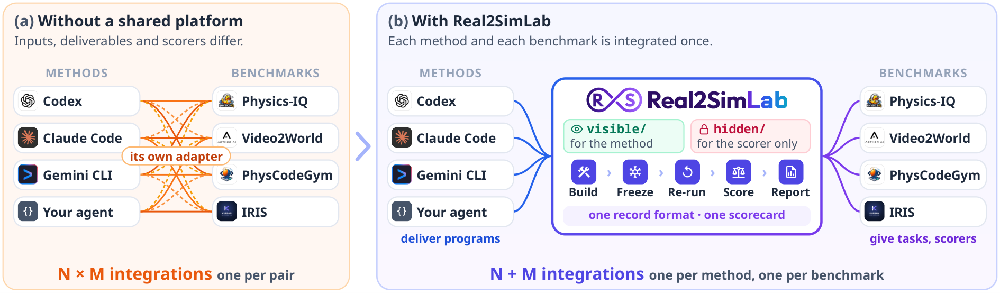
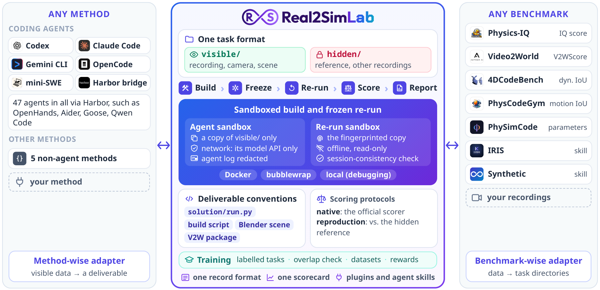
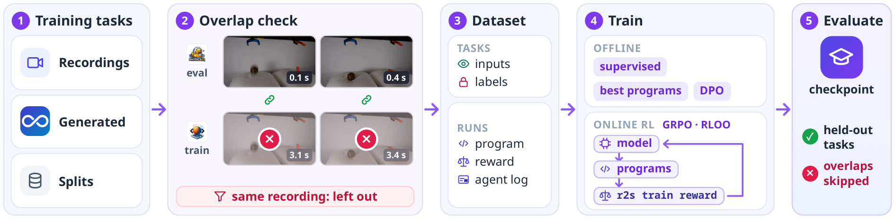

> **원문**: [arXiv](https://arxiv.org/abs/2611.34849) · [HuggingFace](https://huggingface.co/papers/2611.34849) (👍 102) · [GitHub](https://github.com/Real2SimHub/Real2SimLab)
{: .prompt-info }

## 들어가며

오늘 고른 논문은 특이하게도 "더 똑똑한 모델"이 아니라 "평가 인프라" 그 자체를 다룬 논문입니다. 어제 HuggingFace Daily Papers에서 102 upvote를 받았는데, 모델 논문들 사이에서 플랫폼/벤치마크 논문이 이 정도로 주목받는 건 흔치 않아서 눈길이 갔습니다.

주제는 real-to-simulation transfer, 즉 실제 영상에서 물리 시뮬레이션을 복원하는 작업입니다. 최근엔 Claude Fable 5.2나 GPT-6 같은 코딩 에이전트가 영상 하나를 보고 "이 장면을 재현하는 물리 시뮬레이션 프로그램"을 직접 작성할 수 있을 정도로 발전했다고 합니다. 문제는 이걸 평가하는 벤치마크가 6개나 생겼는데, 각자 입력·출력·채점 방식이 전부 달라서 한 에이전트를 모든 벤치마크에 돌려보기가 번거롭다는 점입니다. 저자들은 이걸 소프트웨어 엔지니어링 문제로 보고 해법을 제시합니다. 개인적으로 평소에 "에이전트를 어떻게 비교·평가할 것인가"라는 주제에 관심이 많아서, 이 설계를 자세히 뜯어보고 싶었습니다.

## 한눈에 보기

- **핵심 기여**: 메소드가 내놓는 "프로그램"을 공통 인터페이스로 삼아, 벤치마크별 원 scorer는 그대로 유지하면서 통합 평가(N+M 통합)와 오염 없는 학습 데이터 생성을 동시에 지원하는 오픈소스 플랫폼
- **성능**: 모델 성능 리더보드가 아니라 "어댑터가 원본 벤치마크를 제대로 재현하는지"를 검증 — Physics-IQ·Video2World 어댑터는 공식 파이프라인과 점수가 일치했고, 합성 벤치마크 생성기는 reproduction skill 1.0을 기록
- **한 줄 요약**: 47개 코딩 에이전트와 6개 벤치마크를 "프로그램 하나"로 이어 붙여 N×M 통합 비용을 N+M으로 줄인 real-to-sim 전용 평가·학습 허브

## 어떤 문제를 풀려고 했나

Real-to-simulation transfer는 원래 비전·그래픽스·로보틱스에 흩어져 있던 오래된 주제입니다. 물체의 질량·마찰 같은 물리 파라미터를 영상에 맞추는 연구(fitted twin), 복원한 3D 장면에 물리 속성을 입히는 연구(assigned twin), 실제 공간을 통째로 시뮬레이터로 옮기는 연구(scene twin) 등 다들 입력 하나, 출력 하나에 맞춘 전용 파이프라인이었습니다.

그런데 최근 코딩 에이전트들이 영상을 보고 물리 시뮬레이터를 호출하는 프로그램을 직접 짤 수 있게 되면서 패러다임이 바뀌었다고 합니다. 빨간 음료를 컵에 따르는 영상을 주면, 에이전트가 컵과 액체를 물리 엔진 안에 세팅하고 그 장면을 재현하는 프로그램을 작성하는 식입니다. 한 번만 찍힌 영상과 달리 프로그램은 다시 돌릴 수 있고, 새로운 시점에서 렌더링할 수도 있고, 모든 객체의 상태를 매 순간 들여다볼 수도 있습니다.

이 흐름을 측정하려고 Physics-IQ, Video2World, 4DCodeBench, PhysCodeGym, PhySimCode, IRIS 같은 벤치마크가 속속 등장했는데, 문제는 이들이 완전히 다른 언어로 말한다는 점입니다.

- Physics-IQ는 실제 영상의 앞 3초를 주고 다음 5초의 프레임을 생성하라고 합니다.
- Video2World는 로봇 조작 영상 전체를 주고, 복원한 장면과 로봇 동작이 담긴 "시뮬레이션 패키지"를 요구합니다.
- 4DCodeBench는 "4D 월드(시간에 따라 변하는 3D 장면)"를 만드는 스크립트를 요구합니다.
- PhysCodeGym은 참조 영상을 재현하는 Blender 씬을 요구합니다.

이렇게 입력·산출물·채점 코드가 벤치마크마다 제각각이면, 메소드 하나를 벤치마크 하나에 붙이는 데 전용 어댑터가 필요하고, N개 메소드를 M개 벤치마크에서 평가하려면 N×M개의 어댑터를 짜야 합니다. 당연히 "벤치마크 몇 개 이상은 돌려보지 않는" 쪽으로 다들 타협하게 되고, 논문마다 다른 벤치마크 조합으로 비교하다 보니 결과를 서로 비교하기도 어려워집니다.

## 핵심 아이디어

### "프로그램"을 공통 화폐로 삼는다

Real2SimLab의 통찰은 단순합니다. 어떤 메소드든 결국 "프로그램"을 내놓고, 어떤 벤치마크든 결국 "그 프로그램이 만든 출력"을 채점한다는 점입니다. 그렇다면 프로그램 자체를 메소드와 벤치마크 사이의 공통 인터페이스로 고정하면 됩니다. 메소드 쪽은 메소드별 어댑터 하나로 "과제의 공개 데이터를 받아 프로그램을 내놓는 호출"만 구현하면 되고, 벤치마크 쪽은 벤치마크별 어댑터 하나로 "자기 데이터를 공유 포맷의 과제로 바꾸고 원래 쓰던 scorer를 유지"하기만 하면 됩니다. 그 결과 N개 메소드와 M개 벤치마크를 잇는 데 N+M개의 어댑터면 충분해집니다.

다음은 이 아이디어를 가장 직관적으로 보여주는 그림입니다.

_Figure 2. (a) 공유 플랫폼 없이 메소드-벤치마크 쌍마다 전용 어댑터가 필요한 상황 vs (b) Real2SimLab이 프로그램을 인터페이스로 고정해 메소드와 벤치마크를 각각 한 번만 연결하는 구조_

왼쪽 (a)를 보면 Codex, Claude Code, Gemini CLI 같은 메소드들과 Physics-IQ, Video2World, PhysCodeGym, IRIS 같은 벤치마크들 사이에 X자 모양으로 선이 얽혀 있습니다. 이 선 하나하나가 전용 어댑터라는 뜻이고, 메소드나 벤치마크가 하나 늘어날 때마다 선이 기하급수적으로 늘어납니다. 오른쪽 (b)는 가운데에 Real2SimLab이 끼어들어서, 메소드는 "deliver programs(프로그램을 내놓는다)"는 한 가지 약속만 지키고, 벤치마크는 "give tasks, scorers(과제와 채점기를 준다)"는 한 가지 약속만 지키면 된다는 걸 보여줍니다. 여기서 중요한 건 중간에 있는 `visible/`과 `hidden/`이라는 작은 라벨인데, 이게 공정한 평가의 핵심 장치입니다 — 메소드는 공개된 데이터만 보고, 정답은 채점기만 볼 수 있게 물리적으로 분리합니다.

이 설계 철학 자체는 사실 완전히 새로운 건 아닙니다. 논문의 Table 1에서 보듯 SWE-bench, Harbor, 그리고 특히 로봇 정책 쪽의 XPolicyLab이 이미 N+M 통합이라는 같은 패턴을 쓰고 있습니다. Real2SimLab의 기여는 이 패턴을 real-to-sim이라는, 산출물이 "프로그램"이라는 특수한 도메인에 맞게 구현한 엔지니어링에 가깝습니다.

| Platform | System under test | Characteristics |
|---|---|---|
| lm-evaluation-harness | Language models | Runs many models on many tasks; scores generated text or log-likelihoods against references. |
| HELM | Language models | Scores text completions with several metrics in each scenario. |
| OpenCompass | LLMs and VLMs | Covers language and vision tasks; scores answers by rules or with an LLM judge. |
| SWE-bench | Coding agents | Checks each patch with unit tests in a container; also releases a training split. |
| Harbor | Agents | Checks the final state of each container with a task-specific verifier; also supports RL rollouts. |
| SIMPLER | Robot policies | Queries policies for actions step by step; measures task success in simulated versions of real setups. |
| RoboArena | Generalist robot policies | Runs policies on real robots; ranks them by pairwise preferences of evaluators. |
| XPolicyLab | Robot policies | Connects N policies to M environments with N + M integrations; also supports real-robot deployment. |
| **Real2SimLab (ours)** | **Coding agents** | **Runs the simulation program that each agent writes offline and scores its output with the original benchmark scorer; also creates training data with rewards.** |

이 표에서 눈여겨볼 패턴은, 분야마다 "공유 평가 플랫폼"이 생기는 시점이 그 분야가 성숙해서 비교가 부담스러워질 때쯤이라는 겁니다. LLM(lm-eval-harness), 코딩 에이전트(SWE-bench/Harbor), 로봇 정책(SIMPLER/RoboArena/XPolicyLab)이 이미 거친 길을 real-to-sim도 이제 막 걷기 시작한 셈이고, 저자들도 이걸 명시적으로 "본받을 선례"로 제시하고 있습니다. 다만 Real2SimLab이 평가하는 대상은 로봇 정책처럼 매 스텝 질의에 응답하는 "살아있는" 시스템이 아니라, 한 번 짜여서 세션이 끝난 뒤에도 다시 돌릴 수 있는 "프로그램"이라는 점이 본질적으로 다르다고 저자들은 강조합니다. 이 차이가 다음에 설명할 freeze-rerun 설계로 이어집니다.

### 과제 포맷과 재현성 — "세션이 아니라 프로그램을 채점한다"

구체적인 아키텍처는 Build → Freeze → Re-run → Score → Report의 5단계 파이프라인으로 구성됩니다.

_Figure 4. 왼쪽의 메소드별 어댑터가 과제의 공개 부분을 메소드에 전달하고 산출물을 수거하면, 가운데 샌드박스에서 빌드·동결·재실행을 거쳐 오른쪽 벤치마크별 채점 프로토콜로 점수를 매긴다._

여기서 가장 흥미로운 디자인 결정은 "세션 중 산출물이 아니라, 세션이 끝난 뒤 다시 돌린(frozen re-run) 결과를 채점한다"는 점입니다. 왜 이게 중요하냐면, 에이전트가 작업 세션 안에서 낸 결과물은 그 세션에만 특수한 상태(캐시, 임시 파일, 네트워크 접근 등)에 의존할 수 있는데, 그런 결과는 "재현 가능한 프로그램"이라 보기 어렵기 때문입니다. 그래서 Real2SimLab은 산출물을 복사해서 지문(fingerprint)을 찍고, 읽기 전용 디렉터리에서 숨겨진 데이터 없이 다시 실행한 뒤, 그 결과만 채점합니다. 이 과정에서 두 가지를 체크하는데, 동결된 재실행이 원래 세션의 출력과 같으면 "session-consistent", 같은 시드로 두 번 재실행했을 때 같은 결과가 나오면 "reproducible"이라고 부릅니다.

재미있는 건 이 원칙이 100% 깔끔하게 적용되지는 않는다는 점입니다. Physics-IQ나 PhysCodeGym처럼 원래 세션 중 산출물을 채점하는 공식 프로토콜과 호환성을 유지해야 하는 벤치마크는 "원래 방식"과 "재실행 방식" 두 변형(variant)을 모두 만들어서 둘 다 리포트합니다. 그리고 Video2World는 아예 Real2SimLab이 직접 재실행하지 않고, Video2World의 공식 코드가 동결된 패키지를 실행하도록 맡깁니다. 즉 "모든 벤치마크를 똑같이 다룬다"는 깔끔한 이야기에 예외가 두 군데 있는 셈인데, 이건 뒤에서 다시 짚겠습니다.

### 점수는 어떻게 매기나 — reproduction skill

5개 벤치마크는 원래 쓰던 scorer(native protocol)를 그대로 씁니다. 그런데 IRIS는 조금 특이한 사정이 있습니다. IRIS는 원래 "복원된 물리 파라미터"를 채점하는 벤치마크인데, Real2SimLab에서는 메소드가 파라미터 대신 프로그램을 내놓기 때문에 IRIS의 원래 scorer를 그대로 쓸 수가 없습니다. 그래서 IRIS 영상에서 공과 궤적을 직접 추출해, 시뮬레이션된 움직임과 비교하는 자체 지표를 씁니다. 이게 synthetic suite(저자들이 만든 5가지 합성 물리 현상)에도 똑같이 적용되는 reproduction protocol이고, 그 핵심 지표가 reproduction skill입니다.

시뮬레이션이 실제 사건을 얼마나 잘 복원했는지를 하나의 숫자로 나타내 보겠습니다.

$$\text{skill} = 1 - \frac{e}{e_{\text{static}}}$$

여기서 $e$는 메타데이터가 지정한 주 지표 기준 산출물의 오차(예: 시뮬레이션된 물체 위치와 실제 기록된 위치 사이의 평균 거리)이고, $e_{\text{static}}$은 "모든 물체가 첫 위치에 그대로 멈춰 있는" 정적 장면의 오차입니다.

이 식이 말하는 바는 생각보다 단순합니다. skill이 1이면 완벽 재현, 0이면 "아무것도 안 움직이는 것"과 다를 바 없다는 뜻이고, 음수면 차라리 가만히 있는 게 더 정확했다는 뜻입니다. 굳이 절대 오차 대신 "정적 베이스라인 대비 상대적 개선"으로 정의한 이유는, 장면마다 난이도(물체가 얼마나 빨리, 복잡하게 움직이는지)가 천차만별이라 절대 오차만으로는 벤치마크 간 비교가 무의미하기 때문으로 보입니다. 다만 이 상대화가 완벽한 해법인지는 의문이 남는데, 이 부분은 아쉬운 점에서 다시 다루겠습니다.

### 학습 데이터 파이프라인과 오염 탐지

Real2SimLab은 평가만이 아니라 학습 데이터 생성 파이프라인도 제공합니다. 이 부분이 개인적으로는 가장 실용적으로 느껴졌습니다.

_Figure 6. 학습 과제를 모은 뒤(1), 평가 과제와 겹치는 영상을 솎아내고(2), 프로그램과 보상이 담긴 데이터셋을 만들어(3) 오프라인/온라인 학습에 쓰고(4), held-out 과제로만 평가한다(5)._

Real-to-sim 데이터는 오염 문제가 생각보다 심각하다고 합니다. 한 벤치마크의 영상이 다른 벤치마크에 재인코딩되거나, 크기가 조정되거나, 잘려서 재등장하는 경우가 흔하기 때문입니다. Real2SimLab은 이걸 막기 위해 "뭔가 움직이는 프레임"을 작은 썸네일로 줄여서 모든 시간 오프셋에서 비교하는 방식으로 같은 영상인지를 판별합니다. 재인코딩, 리사이즈, 클리핑, 밝기 조정, 프레임레이트 변경까지 잡아낼 수 있다고 하는데, 실제로 합성 평가 영상의 변형 복사본 40개 중 36개를 잡아냈고(가장 심하게 압축된 4개만 놓침), 실제 데이터에서는 PhysCodeGym이 Physics-IQ에서 재사용한 27개 클립을 전부 찾아냈다고 합니다.

이 27개라는 숫자가 저는 꽤 인상적이었습니다. "벤치마크를 합치다 보니 실제로 오염이 있었다"는 걸 직접 발견해서 보여준 셈인데, 이게 real-to-sim 분야에서 데이터 오염이 추상적 우려가 아니라 실제로 벌어지고 있는 일이라는 증거이기 때문입니다. 보상(reward)은 평가에 쓰는 것과 완전히 동일한 채점 코드로 계산해서, 나중에 지도학습이든 GRPO·RLOO 같은 온라인 RL이든 바로 쓸 수 있게 만들어 둔 것도 실용적인 선택으로 보입니다.

## 실험 결과 (라고 쓰고 "검증"이라고 읽는다)

이 논문에는 보통의 벤치마크 논문에 있는 "리더보드"가 없습니다. 47개 에이전트를 실제로 돌려서 순위를 매긴 표 같은 건 나오지 않고, 대신 "이 플랫폼이 제대로 작동하는가"를 검증한 결과만 제시합니다.

- Physics-IQ 어댑터가 보고하는 점수는 동일한 영상에 대해 공식 파이프라인과 일치했다고 합니다.
- Video2World의 참조 패키지는 Push-T(평면 밀기 과제)에서 원래 보고된 점수를 재현했습니다.
- 합성 스위트는 데이터를 생성한 바로 그 프로그램을 다시 채점했을 때 reproduction skill 1.0을 기록했습니다. (자기 자신을 재현했으니 당연한 결과이긴 하지만, 적어도 reproduction protocol의 구현에 버그가 없다는 체크는 됩니다.)
- 이 검증 과정에서 IRIS 데이터 중 서로 복사본인 두 개의 영상을 발견했다고 짧게 언급합니다.

숫자를 나열하기보다 패턴을 짚어보면, 이 논문이 증명하려는 건 "우리 모델이 더 잘한다"가 아니라 "우리가 만든 배관(plumbing)이 새지 않는다"는 것입니다. 벤치마크 논문인데 벤치마크 결과가 없다는 게 역설적으로 느껴질 수 있는데, 저자들도 "이 논문은 플랫폼의 설계에 집중하고, 연결된 메소드들의 체계적 비교는 향후 과제로 남긴다"고 스스로 명시하고 있습니다.

## 아쉬운 점 / 의문점

- **정작 리더보드가 없습니다.** 47개 코딩 에이전트와 6개 벤치마크를 다 연결해 놓고도, "그래서 Claude Code가 Codex보다 real-to-sim을 잘하는지"에 대한 답은 이 논문에 없습니다. 인프라 논문으로서는 합리적인 스코프 설정일 수 있지만, 플랫폼의 가치는 결국 "쓸모 있는 비교 결과를 뽑아내는가"에 있다는 점에서 가장 궁금한 질문을 다음 논문으로 미뤄둔 셈입니다.
- **학습 파이프라인은 아직 검증되지 않았습니다.** 저자들이 "we have not yet trained a model in these ways"라고 명시적으로 인정합니다. 오염 탐지나 보상 계산 로직은 꼼꼼해 보이지만, 실제로 이 데이터로 학습했을 때 성능이 오르는지는 아직 아무도 확인하지 못한 가설인 셈입니다.
- **"프로그램을 똑같이 다룬다"는 원칙에 예외가 있습니다.** Video2World는 Real2SimLab이 직접 재실행하지 못하고 공식 코드에 의존합니다. 깔끔한 통합 스토리에 틈이 있다는 뜻인데, 이게 앞으로 새 벤치마크가 추가될 때마다 반복될 패턴인지(즉 통합 비용이 완전히 N+M으로 떨어지지 않을 수도 있다는 신호인지)는 더 지켜봐야 할 것 같습니다.
- **IRIS 커버리지가 제한적입니다.** IRIS는 8개 클래스의 물리 시스템을 다루는데, 어댑터는 "공을 떨어뜨리는" 클래스 하나만 지원합니다. 왜 하필 이 클래스부터 시작했는지는 논문에 설명이 없습니다.
- **reproduction skill의 벤치마크 간 비교 가능성이 궁금합니다.** $1 - e/e_{\text{static}}$ 공식이 정적 베이스라인 대비 상대적 개선을 재는 건 합리적이지만, 애초에 정적인 상태가 "꽤 그럴듯한 추측"인 장면(물체가 거의 안 움직이는 경우)과 "완전히 틀린 추측"인 장면(물체가 격렬히 움직이는 경우)에서 같은 skill 값이 실제로 같은 수준의 "잘함"을 의미하는지는 논문에 명시되어 있지 않네요.
- 여담으로, 저자 소속에 Ngoro Robotics라는 스타트업이 끼어 있는 걸 보면 학계와 산업 양쪽에서 이 문제를 꽤 절박하게 느끼고 있었던 것 같습니다.

## 마치며

벤치마크 "결과"가 아니라 벤치마크를 돌리는 "배관"을 다룬 논문이라 처음엔 심심하지 않을까 싶었는데, 읽다 보니 오히려 설계 결정 하나하나에 근거가 붙어 있어서 재미있었습니다. 특히 freeze-and-rerun으로 "세션의 운"이 아니라 "프로그램 자체"를 채점하게 만든 부분, 그리고 영상 프레임 썸네일로 오염을 잡아내는 실용적인 트릭은 real-to-sim이 아닌 다른 에이전트 벤치마크를 만들 때도 참고할 만하다고 생각합니다.

다음에 이 생태계에서 나올 법한 논문은 아마 "Real2SimLab으로 측정한 47개 에이전트의 실제 순위"일 텐데, 그 결과가 나오면 어떤 에이전트가 물리 시뮬레이션 코드를 정말 잘 짜는지 궁금해질 것 같습니다. Awesome-Real2Sim이라는 300편짜리 연구맵도 같이 공개됐으니, 이 분야를 더 파보고 싶으면 그쪽도 들여다볼 만합니다.
