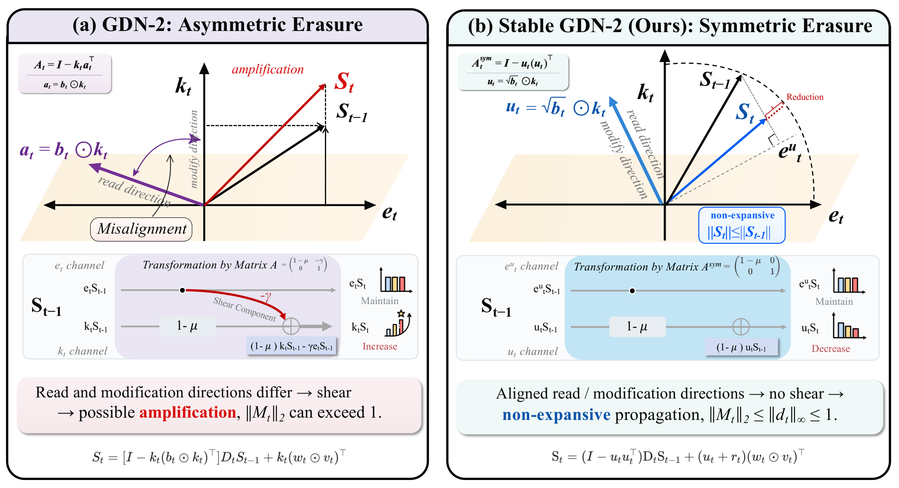
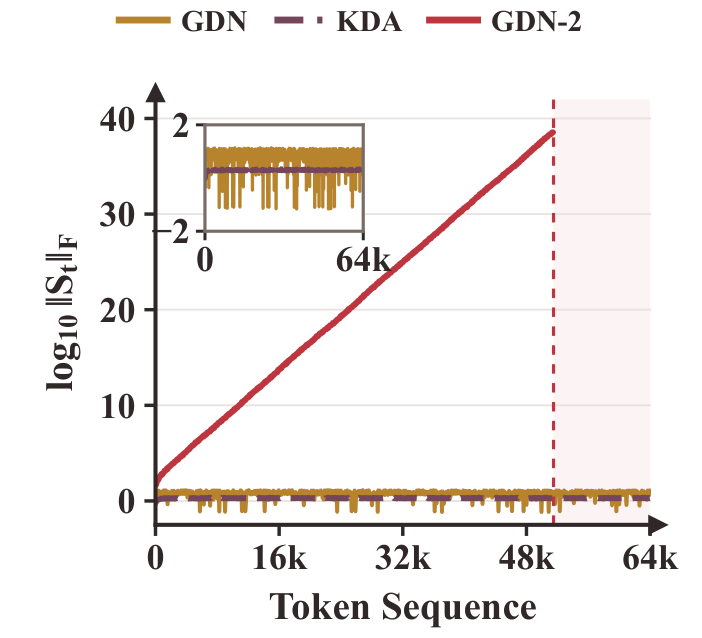
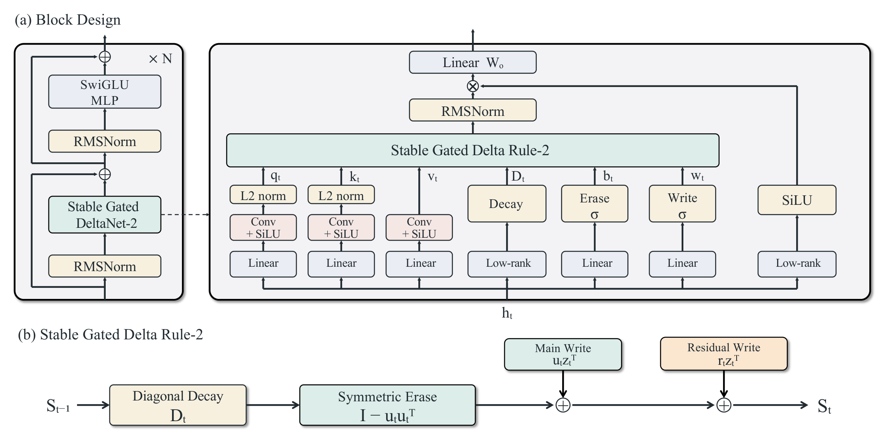
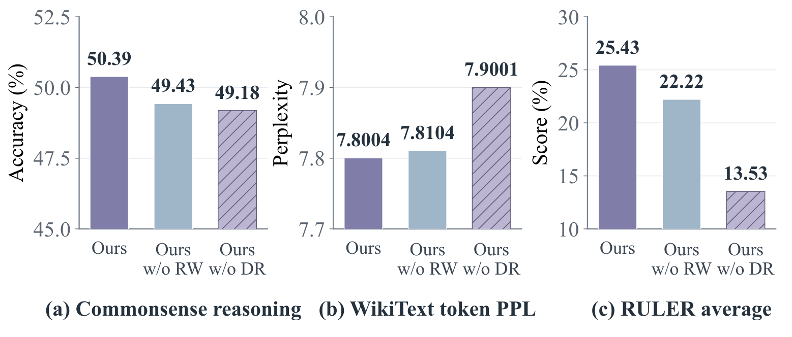
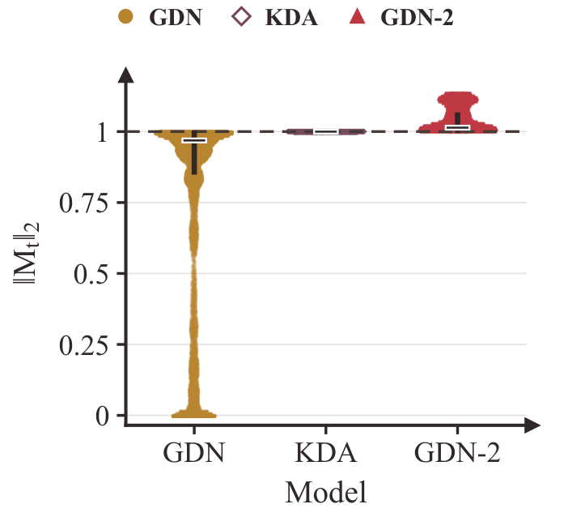

> **원문**: [arXiv](https://arxiv.org/abs/2611.34051) · [HuggingFace](https://huggingface.co/papers/2611.34051) (👍 128)
{: .prompt-info }

## 들어가며

오늘 고른 논문은 HuggingFace Daily Papers에서 128 upvote를 받은, linear attention 계열의 안정성 문제를 다룬 논문입니다. 최근 긴 컨텍스트를 효율적으로 처리하려는 시도들 — Gated DeltaNet, Kimi Delta Attention(KDA), 그리고 이 논문이 다루는 Gated DeltaNet-2(GDN-2) — 이 계속 쏟아지고 있는데, 다들 "더 표현력 있는 recurrent state 업데이트"를 내세우면서 동시에 "그런데 가끔 학습이 깨진다"는 얘기도 함께 따라옵니다.

이 논문이 흥미로웠던 지점은, GDN-2가 최근 공개된 비교적 따끈한 아키텍처인데 벌써 이 논문이 그 안정성 결함을 지적하고 고쳤다는 점입니다. 본문 서두에 벤자민 프랭클린의 "작은 누수가 큰 배를 가라앉힌다"는 문구를 인용해두었는데, 읽어보니 정말 딱 맞는 비유였습니다. 게이트 값이 전부 0과 1 사이에 멀쩡히 있는데도 recurrent state가 $10^{36}$까지 폭주할 수 있다는 걸 수학적으로 증명하고, 실제 학습 로그에서 그 증거를 잡아낸 과정이 꽤 설득력 있었습니다.

## 한눈에 보기

- **핵심 기여**: GDN-2의 channel-wise erase 게이트가 "읽는 방향"과 "지우는 방향"을 다르게 만들어서(비대칭) recurrent state를 증폭시킬 수 있음을 이론적으로 증명하고, symmetric erasure + decay-regulated residual writing으로 이를 고친 Stable GDN-2를 제안
- **성능**: 64K 컨텍스트로 사전학습한 1.6B 모델 기준, GDN-2 대비 128K RULER 평균 점수를 recurrent 설정에서 6.80점, hybrid 설정에서 9개 다운스트림 태스크 평균 정확도를 0.62점 개선. 언어모델링 성능은 기존 방법들과 비슷한 수준을 유지
- **한 줄 요약**: erase 게이트와 key를 비대칭으로 묶어서 생기던 GDN-2의 recurrent state 폭주를, 두 방향을 대칭으로 맞춰 원천 차단한 안정화 기법

## 어떤 문제를 풀려고 했나

Linear attention은 과거 토큰들의 정보를 고정 크기 행렬(recurrent state) $\mathbf{S}_t$에 압축해 저장하는 방식으로, 시퀀스 길이에 비례하지 않는 연산량·메모리로 추론할 수 있게 해줍니다. DeltaNet 계열은 여기에 "delta rule"을 더해서, 그냥 새 정보를 더하기만 하는 게 아니라 기존 저장된 내용 중 틀린 부분을 지우고(erase) 다시 쓰는(write) 방식을 씁니다.

이 erase-write 메커니즘을 얼마나 정교하게 제어하느냐를 두고 계보가 이어져 왔습니다. Gated DeltaNet은 하나의 스칼라 게이트로 전체 상태를 깎았고, KDA는 채널마다 다른 decay를 줬습니다. 그리고 GDN-2는 한 걸음 더 나아가 erase와 write를 아예 독립된 채널별 게이트로 분리했습니다. 문제는 바로 이 분리 과정에서 생깁니다 — erase 게이트가 "어떤 내용을 지울지 읽어오는" 방향과 "실제로 지우는" 방향이 서로 달라지게 됩니다. 저자들은 이 비대칭이 겉보기엔 멀쩡해 보이는 게이트 값들 속에서 recurrent state를 조용히 폭주시킬 수 있다는 걸 발견하고, 그 메커니즘을 규명한 뒤 고치는 것을 목표로 삼았습니다.

## 핵심 아이디어

### GDN-2는 왜 불안정한가 — 읽는 방향과 지우는 방향의 어긋남

먼저 GDN-2의 업데이트 식을 봐야 합니다. 채널별 erase 게이트 $\boldsymbol{b}_t\in(0,1)^{d_k}$와 write 게이트 $\boldsymbol{w}_t\in(0,1)^{d_v}$를 쓰면, 상태는 이렇게 갱신됩니다.

$$\mathbf{S}_t = \bigl[\mathbf{I} - \boldsymbol{k}_t(\boldsymbol{b}_t\odot\boldsymbol{k}_t)^\top\bigr]\mathbf{D}_t\mathbf{S}_{t-1} + \boldsymbol{k}_t(\boldsymbol{w}_t\odot\boldsymbol{v}_t)^\top$$

$\boldsymbol{k}_t$는 ($\ell_2$ 정규화된) key, $\boldsymbol{v}_t$는 value, $\mathbf{D}_t$는 채널별 decay 행렬입니다. 여기서 눈여겨봐야 할 부분은 첫 항의 $\boldsymbol{k}_t(\boldsymbol{b}_t\odot\boldsymbol{k}_t)^\top$입니다 — 지우려는 내용을 "읽어올 때"는 $\boldsymbol{b}_t\odot\boldsymbol{k}_t$ 방향을 쓰고, 실제로 상태에 "적용할 때"는 $\boldsymbol{k}_t$ 방향을 씁니다. 이 두 벡터가 같은 방향이 아니면, 이 erase 연산은 수학적으로 symmetric하지 않은 행렬이 됩니다.

저자들은 이 비대칭이 만드는 shear(전단) 효과를 2차원으로 분해해서 정확한 증폭률을 구했습니다. $\mu, \gamma$를 각각 key 방향 성분과 그에 수직인 성분의 크기라고 하면, 이 erase 연산자의 스펙트럴 노름(최대 증폭률)은 다음과 같습니다.

$$\|\mathbf{A}\|_2 = \frac{\sqrt{\mu^2+\gamma^2} + \sqrt{(2-\mu)^2+\gamma^2}}{2}$$

$\mu\in[0,1]$은 key 방향으로 상태가 얼마나 감쇠되는지를, $\gamma$는 읽는 방향과 지우는 방향이 어긋난 정도(shear)를 나타냅니다. 이 식이 말하는 바는 명확합니다 — $\gamma=0$(즉 두 방향이 일치)일 때만 $\|\mathbf{A}\|_2=1$이고, $\gamma>0$이면 항상 $\|\mathbf{A}\|_2>1$이라는 겁니다. 다시 말해 게이트 값이 전부 0과 1 사이에 있어도, 읽는 방향과 지우는 방향만 어긋나 있으면 erase 연산 그 자체가 상태를 키울 수 있다는 뜻입니다. GDN이나 KDA는 애초에 두 방향이 항상 같은 key라서 이 문제가 생기지 않는다고 합니다.

더 무서운 건 이게 한 토큰에서 끝나지 않는다는 점입니다. 논문은 이 증폭 방향이 다음 토큰의 확장 방향과 계속 정렬되는 상황을 구체적으로 구성해서, 단 한 번의 write 이후 추가 write가 전혀 없어도 상태가 무한히 커지는 예시를 증명으로 보여줍니다($\lim_{t\to\infty}\|\mathbf{S}_t\|_F=\infty$). 즉 "이미 다 써버린 정보"가 아무 새 입력 없이도 매 스텝 조금씩 증폭되어 쌓이는, 복리처럼 작동하는 폭주입니다.

다음은 이 비대칭 구조를 가장 직관적으로 보여주는 그림입니다.

_Figure 1. (a) GDN-2: 읽는 방향($\boldsymbol{a}_t$)과 지우는 방향($\boldsymbol{k}_t$)이 어긋나 shear가 생기고 상태가 증폭됨. (b) Stable GDN-2: 두 방향을 $\boldsymbol{u}_t$ 하나로 맞춰 shear를 없애고 비확장(non-expansive) 전파를 보장함_

왼쪽 (a)를 보면 검은 화살표 $\boldsymbol{S}_{t-1}$이 erase 연산을 거쳐 빨간 화살표 $\boldsymbol{S}_t$로 바뀌는데, 길이가 오히려 늘어나 있습니다. 보라색 $\boldsymbol{a}_t$(읽는 방향)와 $\boldsymbol{k}_t$(지우는 방향)가 서로 다른 방향을 가리키고 있다는 게 핵심이고, 아래쪽 막대그래프에서도 $k_t$ 채널 값이 "Increase"로 표시되어 있습니다. 오른쪽 (b)는 같은 상황에서 두 방향을 $\boldsymbol{u}_t=\sqrt{\boldsymbol{b}_t}\odot\boldsymbol{k}_t$ 하나로 일치시키니, $\boldsymbol{S}_t$의 길이가 $\boldsymbol{S}_{t-1}$보다 작거나 같게(non-expansive) 유지되는 걸 보여줍니다. 그림만 봐서는 "그냥 벡터 하나를 공유하게 만든 것뿐"처럼 단순해 보이지만, 그 단순함이 바로 저자들이 의도한 해법입니다.

### 실제 학습에서는 어떻게 터지는가

이론만으로 끝내지 않고, 저자들은 실제로 실패한 사전학습 run 하나를 재생(replay)해서 이 메커니즘이 현실에서도 똑같이 나타나는지 확인했습니다.

_Figure 2(b). 같은 토큰 시퀀스를 재생했을 때 GDN(주황)과 KDA(보라)의 state 노름은 거의 일정한데, GDN-2(빨강)만 로그 스케일로 선형 증가하다가 64K 근처에서 수치 오버플로를 일으킴_

세로축이 $\log_{10}\|\mathbf{S}_t\|_F$인데, GDN과 KDA는 0 근처에서 거의 평평한 반면 GDN-2는 토큰이 진행될수록 직선으로 계속 올라갑니다. 실제로 이 run은 학습 스텝 2,058에서 loss NaN으로 죽었는데, 그 직전까지는 loss 자체가 멀쩡하게 떨어지고 있었다고 합니다(Figure 2a). 즉 loss만 보고 있으면 전혀 눈치채지 못하다가 갑자기 터지는 식입니다. 더 인상적인 건, 저자들이 64번째 토큰 이후로 write를 인위적으로 전부 꺼버린 "write-stop" 실험(Figure 2c)에서도 GDN-2의 상태는 계속 자라났다는 점입니다 — 새로 쓰는 정보가 하나도 없는데 과거에 이미 쓴 정보가 erase 과정에서 저절로 증폭되는, 바로 앞서 증명한 "write 없이도 발산" 현상이 실제 데이터에서 그대로 재현된 겁니다.

표로도 이 불안정성이 얼마나 흔한지 확인할 수 있습니다.

| Architecture | | Pretraining | Post-training | Pretraining → Post-training |
|---|---|---|---|---|
| **GDN-2** | Recurrent Model | 1/4 | 1/4 | 0/3 |
| | Hybrid Model | 2/4 | 3/4 | 0/2 |

Recurrent와 Hybrid를 합쳐 8번의 사전학습 중 3번, 8번의 후속학습 중 4번이 NaN으로 실패했습니다. 거의 절반에 가까운 실패율인데, 논문 부록 표(여기엔 싣지 않았지만)를 보면 더 섬뜩한 사실이 하나 더 있습니다 — 끝까지 "성공"한 run 중에도 recurrent state의 최대 절댓값이 $3.157\times10^{36}$까지 치솟은 경우가 있었다는 겁니다. FP32 표현 범위 안에 아슬아슬하게 들어가서 NaN으로 터지지는 않았을 뿐, 사실상 거의 망가진 상태로 학습이 "성공"했다고 기록된 셈입니다. 개인적으로 이 대목이 가장 섬뜩했는데, loss 곡선만 보고 "이 run은 정상"이라고 판단하는 관행 자체가 얼마나 위험할 수 있는지를 보여주는 사례라고 생각합니다.

### 고치는 법 — symmetric erasure와 decay로 조절되는 residual write

진단이 명확한 만큼 처방도 명확합니다. erase 게이트를 key에 비대칭으로 곱하는 대신, 게이트의 제곱근을 key에 대칭으로 분배합니다.

$$\mathbf{A}_t^{\mathrm{sym}} = \mathbf{I} - \boldsymbol{u}_t\boldsymbol{u}_t^\top, \qquad \boldsymbol{u}_t=\sqrt{\boldsymbol{b}_t}\odot\boldsymbol{k}_t$$

$\boldsymbol{u}_t$는 읽기·수정·쓰기에 공통으로 쓰이는 단일 벡터입니다. $\boldsymbol{u}_t\boldsymbol{u}_t^\top$ 형태는 수학적으로 대칭 행렬이고, 항상 고유값이 0과 1 사이에 있다는 게 보장되기 때문에 — 즉 $\mathbf{A}_t^{\mathrm{sym}}$이 상태를 절대 늘리지 않는다는 게 수식으로 보장됩니다(논문의 Proposition 1). 앞서 본 $\gamma$(shear)가 정의상 0이 되는 구조라서, 증폭의 원인 자체가 사라지는 셈입니다.

그런데 이렇게 대칭으로 묶어버리면 부작용이 하나 생깁니다. erase 게이트 $b_{t,i}$가 0에 가까워지면 $u_{t,i}$도 0이 되어버리는데, 원래 쓰기(write)는 이 $u_t$를 타고 들어가므로 "erase를 약하게 하고 싶다"는 선택이 "write도 거의 못 한다"는 제약으로 같이 묶여버립니다. 이걸 풀어주려고 저자들은 residual write라는 보조 경로를 추가합니다.

$$\boldsymbol{r}_t = \sqrt{1-\boldsymbol{d}_t^2}\odot(\boldsymbol{k}_t-\boldsymbol{u}_t)$$

$\boldsymbol{d}_t$는 채널별 decay 비율이고, $\boldsymbol{k}_t-\boldsymbol{u}_t$는 원래 key에서 symmetric erase가 못 쓴 "나머지" 방향입니다. 여기에 곱해지는 $\sqrt{1-\boldsymbol{d}_t^2}$가 핵심 트릭인데, decay가 강한(즉 $d_{t,i}$가 작아서 상태를 많이 깎아내는) 채널일수록 이 보조 경로로 더 많이 써도 안전하다는 뜻입니다 — 어차피 금방 decay로 줄어들 거니까요. 반대로 decay가 거의 없는($d_{t,i}\approx1$) 채널은 residual write도 거의 0으로 억제됩니다. 전체 업데이트는 이렇게 완성됩니다.

$$\mathbf{S}_t = \mathbf{A}_t^{\mathrm{sym}}\mathbf{D}_t\mathbf{S}_{t-1} + (\boldsymbol{u}_t+\boldsymbol{r}_t)\boldsymbol{z}_t^\top$$

여기서 $\boldsymbol{z}_t=\boldsymbol{w}_t\odot\boldsymbol{v}_t$는 write 게이트가 적용된 값입니다. 이 설계로 저자들은 상태 증가율을 기존의 $O(T)$(누적 write 항이 선형으로 쌓이는 일반적인 bound)에서 $O(\sqrt{T})$로 더 조이는 증명까지 보였습니다 — decay가 write를 "보험 들어주는" 역할을 해서 누적 에너지가 선형보다 느리게 쌓인다는 의미로 읽힙니다.

다음은 이 전체 구조를 모델 블록 단위로 보여주는 그림입니다.

_Figure 3. (a) 표준 RMSNorm + SwiGLU 블록 안에 Stable Gated Delta Rule-2가 들어가는 구조. (b) 상태가 Diagonal Decay → Symmetric Erase → Main Write($u_t z_t^\top$) → Residual Write($r_t z_t^\top$) 순서로 갱신됨_

(a)를 보면 기존 Transformer 블록과 거의 똑같이 생겼습니다 — RMSNorm, convolution+SiLU로 전처리된 query/key/value, 그리고 erase·write·decay 게이트들이 전부 들어가서 Stable Gated Delta Rule-2 모듈 하나로 들어갑니다. 흥미로운 건 (b)인데, 상태 갱신이 네 단계 파이프라인으로 명시적으로 그려져 있습니다. decay로 먼저 깎고, symmetric erase로 지우고, 그 다음 main write($u_t z_t^\top$, 대칭 경로를 타는 주 쓰기)와 residual write($r_t z_t^\top$, decay가 허락하는 만큼의 보조 쓰기)가 순서대로 더해집니다. 기존 GDN-2와 비교하면 구조적으로 추가된 건 사실상 이 residual write 한 항뿐이라, 계산량 증가는 크지 않으면서도 chunkwise parallel 학습 구조(각 청크를 삼각행렬 연립방정식으로 풀어 병렬 처리하는 방식)를 그대로 유지할 수 있다는 게 논문의 주장입니다.

### 다른 해법들과는 뭐가 다른가

이 논문이 비교 대상으로 삼은 D-Clip과 $\beta$-Guard도 같은 문제(GDN-2 불안정성)를 겨냥한 기존 안정화 기법들입니다. D-Clip은 decay 자체를 erase 연산자의 스펙트럴 노름 역수로 깎아서 전체 전이를 non-expansive하게 만들고, $\beta$-Guard는 erase 게이트가 key 가중 평균에서 벗어나는 정도를 필요할 때만 줄입니다. 둘 다 "원래 erase 게이트는 그대로 두고 다른 걸 조여서" 안정성을 확보하는 전략인 반면, Stable GDN-2는 erase 연산 자체의 구조(비대칭 → 대칭)를 바꾼다는 점에서 접근이 다릅니다. 논문은 이 차이가 뒤에서 볼 실험 결과, 특히 RULER 성능 차이로 이어진다고 주장합니다.

## 실험 결과

64K 토큰 시퀀스로 사전학습한 약 1.6B(recurrent) / 1.55B(hybrid) 파라미터 모델로 GDN-2, KDA, D-Clip, $\beta$-Guard와 비교했습니다.

**RULER 128K 성능**이 가장 눈에 띄는 결과입니다. Recurrent 설정에서 GDN-2는 128K에서 평균 4.82점까지 떨어지는데(바로 이 불안정성 때문으로 보입니다), Stable GDN-2는 11.62점으로 6.80점 개선되며 모든 baseline 중 최고를 기록합니다. 32K와 64K에서도 각각 17.35점, 16.34점으로 1위입니다.

다만 Hybrid 설정에서는 이야기가 조금 복잡해집니다. 32K에서는 31.72점으로 1위지만, 64K(18.69점)와 128K(8.78점)에서는 $\beta$-Guard(각각 19.13점, 10.52점)에 근소하게 밀립니다. 저자들도 이 부분은 솔직하게 숫자 그대로 보고하고 있습니다.

다운스트림 태스크·언어모델링 결과는 이렇습니다.

| Method | Average Acc.(%) | WikiText PPL (8K/64K) | LAMBADA PPL |
|---|---|---|---|
| **Recurrent — GDN-2** | **50.39** | 7.849 / 7.804 | **7.856** |
| Recurrent — D-Clip | _49.10_ | 7.889 / 7.871 | _8.691_ |
| Recurrent — $\beta$-Guard | 48.89 | 7.858 / 7.806 | 9.543 |
| Recurrent — KDA | 49.02 | **7.697** / **7.677** | 9.250 |
| Recurrent — **Ours** | **50.39** | _7.801_ / _7.759_ | 9.333 |
| Hybrid — GDN-2 | 49.91 | 7.546 / **7.493** | 9.001 |
| Hybrid — D-Clip | 50.29 | **7.542** / 7.519 | _8.277_ |
| Hybrid — $\beta$-Guard | 49.68 | 7.601 / 7.561 | **8.153** |
| Hybrid — KDA | _50.36_ | _7.544_ / _7.504_ | 8.399 |
| Hybrid — **Ours** | **50.53** | 7.594 / 7.558 | 8.586 |

(굵게: 최고, 기울임: 2위. 지면상 PPL은 8K/64K만 표시했습니다.)

패턴을 짚어보면, Stable GDN-2는 다운스트림 정확도에서는 꾸준히 상위권(recurrent에서 GDN-2와 공동 1위, hybrid에서 단독 1위)이지만 언어모델링 perplexity에서는 1위를 거의 내주고 있습니다. 특히 LAMBADA PPL은 두 설정 모두에서 가장 나쁜 축에 속합니다. 안정성을 사러 성능을 약간 내준 것인지, 아니면 애초에 이 지표들이 서로 트레이드오프 관계인지는 논문이 명시적으로 분석하지는 않습니다. 개인적으로는 "불안정한 모델이 운 좋게 안 터진 seed에서 더 낮은 PPL을 낼 수도 있다"는 가능성도 염두에 둬야 한다고 생각합니다 — GDN-2 자체가 재현성이 불안정한 모델이기 때문에, 단일 seed 비교가 얼마나 믿을 만한지도 의문입니다.

**Ablation**은 두 구성 요소(residual write: RW, decay regulation: DR)가 각각 왜 필요한지 보여줍니다.

_Figure 4. RW와 DR을 각각 제거했을 때 commonsense 정확도, WikiText PPL, RULER 평균의 변화_

RW를 빼면(symmetric erase만 남기고 보조 쓰기 경로 제거) 정확도가 50.39%→49.43%, RULER가 25.43→22.22로 소폭 떨어집니다. 그런데 DR까지 같이 빼면(보조 쓰기를 decay로 조절하지 않고 그냥 $\boldsymbol{k}_t-\boldsymbol{u}_t$ 전체를 씀) RULER가 13.53으로 거의 반토막 납니다. 이 차이가 말해주는 건, "symmetric erasure로 안정성만 확보하는 것"과 "안정성을 유지하면서 쓰기 유연성도 같이 회복하는 것" 사이에 꽤 큰 간극이 있다는 점입니다. decay 조절 없이 보조 경로를 그냥 열어두면 장기 기억 능력이 오히려 더 망가진다는 건, residual write를 무작정 늘리는 게 능사가 아니라 "얼마나 열어줄지"를 잘 조절하는 게 핵심이라는 뜻으로 읽힙니다.

마지막으로, 안정성 주장을 수치로 직접 뒷받침하는 그림도 있습니다.

_Figure 5(우). 같은 입력 시퀀스에 대해 GDN, KDA, GDN-2의 전이 행렬 $\|\mathbf{M}_t\|_2$를 65,536개 토큰에서 측정한 분포. 점선은 $\|\mathbf{M}_t\|_2=1$ 기준선_

가로축이 모델, 세로축이 각 토큰에서의 전이 행렬 노름입니다. GDN(주황)은 분포가 넓게 퍼져 1 아래로도 많이 내려가 있고, KDA(보라)는 1 바로 아래에 거의 달라붙어 있습니다. 반면 GDN-2(빨강)는 분포 전체가 1선을 넘어서 있습니다 — 즉 "가끔 터지는" 게 아니라 거의 모든 토큰에서 조금씩 상태를 키우는 쪽으로 편향되어 있다는 뜻입니다. 이 그림이 논문의 핵심 주장을 가장 압축적으로 보여준다고 생각합니다. 매 순간의 증폭은 아주 작아 보이지만(노름이 1.0x~1.1x 수준), 그게 수만 토큰에 걸쳐 곱해지면 지수적으로 커진다는 게 바로 이 논문이 다루는 문제의 본질이기 때문입니다.

## 아쉬운 점 / 의문점

- **Hybrid 128K에서는 경쟁 기법에 밀립니다.** 특히 $\beta$-Guard가 64K·128K hybrid RULER에서 더 높은 점수를 냅니다. 논문이 "Recurrent 설정에서 특히 경쟁력 있다"고 스스로 조건을 달아 표현하는 걸 보면, 저자들도 이 한계를 인지하고 있는 것 같습니다.
- **언어모델링 PPL에서는 거의 매번 KDA나 GDN-2에 뒤집니다.** 안정성이라는 축과 perplexity라는 축이 트레이드오프 관계인지, 아니면 다른 이유(예: 불안정한 모델이 터지기 직전까지 우연히 더 날카로운 분포를 학습했을 가능성) 때문인지는 논문에 분석이 없습니다.
- **단일 seed 비교입니다.** "Main performance comparisons use initialization seed 42 and data-order seed 2026"이라고 명시되어 있는데, 부록 표를 보면 GDN-2 자체가 seed에 따라 터지거나 안 터지는 모델이라는 걸 저자들이 이미 보여준 바 있습니다. 그렇다면 비교 대상인 안정화 기법들(D-Clip, $\beta$-Guard, Stable GDN-2)도 seed를 여러 개 돌려서 분산을 같이 보고했어야 더 설득력이 있었을 텐데, 메인 비교 표에는 단일 seed 결과만 나옵니다.
- **코드가 공개되어 있지 않습니다.** HuggingFace Daily Papers 페이지에도, 논문 본문에도 GitHub 저장소 링크가 보이지 않습니다. 이론과 실험 설계는 꼼꼼하지만, 재현하려면 처음부터 다시 구현해야 하는 상황입니다.
- 여담으로, 저자 중 한 명(Jianlin Su, 필명 bojone)은 RoPE를 제안한 것으로 잘 알려진 연구자인데, 이런 세밀한 수학적 안정성 분석에 이 분이 참여했다는 게 논문의 이론 파트가 꽤 꼼꼼하게 다져져 있다는 인상과 맞아떨어졌습니다.

## 마치며

이 논문을 읽으면서 가장 인상적이었던 건 "loss가 멀쩡해 보여도 믿지 말라"는 메시지였습니다. Figure 2에서 본 것처럼, NaN으로 터지기 직전까지도 training loss 곡선 자체는 GDN·KDA와 거의 구분이 안 될 정도로 평범했습니다. recurrent state의 effective rank가 1로 수렴하고, 노름이 로그 스케일로 선형 증가하는 걸 직접 들여다보지 않았다면 이 문제를 알아채기 어려웠을 것 같습니다. 개인적으로 긴 컨텍스트 모델을 다룰 일이 있다면, loss 외에도 상태의 노름이나 effective rank 같은 걸 같이 모니터링해야겠다는 교훈을 얻었습니다.

방법론 자체도 "erase 게이트를 제곱근으로 쪼개 대칭으로 나눠준다"는 아이디어가 수식으로는 몇 줄 안 되는데, 그 몇 줄이 이론적 보장(non-expansive propagation)과 실질적 성능 개선을 동시에 가져온다는 점이 깔끔했습니다. 다음에 비슷한 채널별 게이팅 구조를 설계할 일이 있다면, "읽는 방향과 쓰는 방향이 같은가"를 체크리스트에 넣어볼 만하다고 생각합니다.
